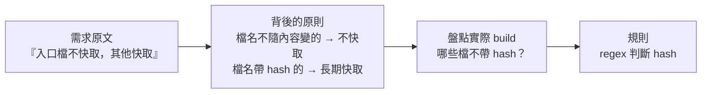
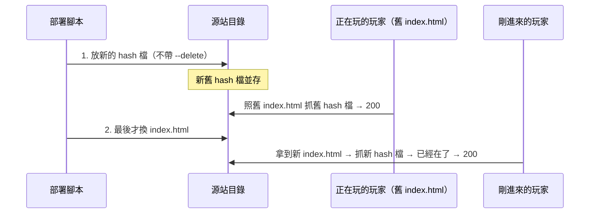

# [E-11-9] 幫一個已上線的前端打開快取：規則用原則定、不用清單，換版要照順序

> **目標**：接手一個「每個檔都 `no-store`、CDN 形同虛設」的前端時，知道怎麼一步步把快取打開而不讓玩家拿到舊版或 404：先讓檔名帶 hash、再盤點、用 regex 寫規則、照「先放檔、最後換 index.html、不刪舊檔」的順序部署，並用陽性對照證明規則真的生效。

## 先說這篇不重講什麼

- `Cache-Control` 各個值的意思 → [cache-3-2 Cache-Control 完全詳解](../../lessons/cache/part-3/cache-3-2-cache-control.md)
- 為什麼檔名要帶 hash、`index.html` 為什麼要特別處理 → [cache-3-5 前端更新後使用者還拿到舊版](../../lessons/cache/part-3/cache-3-5-frontend-deploy-pitfall.md)
- 瀏覽器＋CDN 兩層、部署時為什麼不能刪舊 hash 檔 → [cache-4-4 雙層快取下的前端部署](../../lessons/cache/part-4/cache-4-4-dual-layer-deploy.md)

這篇是那幾課的「實際動手版」：理論都對，真正做的時候卡在哪幾步。

## 一個情境：前面明明有 CDN，卻每一個檔都回源

你接手一個網頁遊戲：前端約 50 MB、九百多個檔，前面掛著 CDN。查標頭發現：

```
GET https://game.example.com/app/index.html          Cache-Control: no-store
GET https://game.example.com/app/src/settings.json   Cache-Control: no-store
GET https://game.example.com/app/assets/hero.png     Cache-Control: no-store
cf-cache-status: DYNAMIC   ← CDN 沒有存，每次都回源站
```

每個玩家每次進遊戲，九百多個檔全部從源站送出去。直覺的修法是「把 nginx 改成全部快取一年」——**不要這樣做**。先問兩個問題：

1. **為什麼當初會設 `no-store`？** 常見答案是「那是開發用的設定，上線時沿用下來」。開發時要改了就看得到，`no-store` 很合理。
2. **檔名有沒有帶 hash？** 如果 `settings.json` 換版後還叫 `settings.json`，把它快取一年，玩家就會卡在舊版。這時 `no-store` 反而是唯一安全的選擇。

所以順序是：**先讓檔名帶 hash，才有資格談長期快取。**

## 第一步：讓 build 產出帶 hash 的檔名

多數打包工具（webpack、Vite、遊戲引擎的 web 匯出）都有「檔名加內容 hash」的選項，常見叫法是 `contenthash`、`md5Cache`。打開之後：

```
src/settings.json        →  src/settings.f28af.json
index.js                 →  index.f40f1.js
assets/hero.png          →  assets/hero.ec230.png
```

如果你發現**別的團隊的 build 有 hash、你的沒有**，先查設定是不是放在一個沒進版控的檔案裡 → [E-8-12 被 .gitignore 藏起來的設定](../E-8-git/E-8-12-hidden-config-in-gitignore.md)。

## 第二步：盤點，再決定規則

需求常常是這樣下的：「入口檔（`index.html`、`settings.json`、`import-map.json`）不要快取，其他都快取。」

這句話背後真正的意思是：**會變、但檔名不會跟著變的檔，不能快取。** 在沒有 hash 的時代，這三個檔剛好就是這一類。開了 hash 之後要重新盤點：

```
// pseudo code
對 build 目錄的每一個檔：
    如果 檔名符合「帶 hash」的樣式：歸到「可以長期快取」
    否則：歸到「不能快取」
印出「不能快取」那一組
```

很常見的結果是：**只剩 `index.html` 不帶 hash**。`settings` 和 `import-map` 開了 hash 之後也帶 hash 了（`settings.f28af.json`），而且是由已經帶 hash 的檔引用，內容一變檔名就跟著變，可以放心長期快取。

如果照字面執行需求，`settings.f28af.json` 會被當成入口檔設成 `no-store`。不會出錯，只是白白每次回源。**規則要照原則定（帶不帶 hash），不要照當初列的檔名定。**



這張圖在說：需求、原則、實際檔名是三件事，要從原則推到實際檔名，不要從需求原文直接跳到設定。

## 第三步：用 regex 判斷 hash，不要列白名單

hash 的格式可能不只一種。例如同一個 build 裡：

| 格式 | 例 | 誰產生 |
|---|---|---|
| `.<5 碼 hex>.<副檔名>` | `settings.f28af.json` | 打包工具的 hash 選項 |
| `-<8 碼 base64url>.<副檔名>` | `engine-DuiyhP-C.js` | 底層 bundler（rollup 之類）的分塊 |

regex 兩種都收：

```nginx
# 帶 hash 的：內容一變檔名就變，所以可以一年、immutable
location ~ "^/app/.*(\.[0-9a-f]{5}\.[A-Za-z0-9]+|-[A-Za-z0-9_-]{8}\.(js|wasm|bin))$" {
    add_header Cache-Control "public, max-age=31536000, immutable";
}
# 其他（實際上只剩 index.html）：每次回源，換版才會生效
location /app/ {
    add_header Cache-Control "no-store";
}
```

**為什麼不列白名單**：白名單漏一個檔，那個檔就永遠 `no-store`——不會報錯、不會有人發現，只是靜靜地慢。regex 的好處是新增素材不用改設定。
**寫完要驗**：拿整個 build 目錄的檔名套一次 regex，沒命中的應該只有 `index.html`。多出來任何一個，都要查清楚是 regex 漏了，還是那個檔真的沒帶 hash。

> **常見錯誤** — 把 hash 的位數寫寬，例如 `\.[0-9a-f]+\.`：
> `jquery.3.js` 這種「版本號剛好是數字」的檔名也會被當成帶 hash、快取一年。
> 正確做法：位數寫死成 build 實際產生的長度，再用盤點驗證。

## 第四步：部署照順序——先放檔、最後換 index.html、不刪舊檔

cache-4-4 講了「不能刪舊 hash 檔」。實際寫部署腳本時，還有一個**順序**問題：



這張圖在說：只要「新檔先到、`index.html` 最後換、舊檔不刪」，任何時刻進來的人都拿得到自己需要的檔。

兩種錯法：
- **先換 `index.html`、再放檔**：中間那幾秒進來的人，拿到新的 `index.html`，它引用的新檔還沒上傳完 → 404。
- **`rsync --delete` 整個目錄換掉**：正在玩的人手上是舊的 `index.html`。很多應用（尤其遊戲）的資源是**用到才載**，他下一個場景載入就 404。

```bash
# 1. 先放新檔，排除 index.html；不帶 --delete（舊 hash 檔留著）
rsync -a --exclude 'index.html' build/ server:/srv/app/
# 2. 最後才換 index.html
rsync -a build/index.html server:/srv/app/index.html
```

舊檔會越積越多，所以要有**另外的、手動的清理步驟**：先用 `rsync -n --delete` 列出會刪掉的檔（`-n` 只演練不動手），看過清單、先備份，再真的刪。清理不要跟部署綁在一起。

## 第五步：用陽性對照證明規則真的生效

「我改了 nginx、標頭看起來對」不夠。驗證腳本要做三件事：

1. **從線上的 `index.html` 一路追**，抽幾個它真正引用的檔（兩種 hash 格式都要有），驗它們是 `immutable`；不要寫死檔名，下次換版檔名就變了。
2. 驗目錄與 `index.html` 是 `no-store`。
3. **陽性對照**：
   - 拿舊的（全部 `no-store`）設定跑同一支腳本，應該紅。不會紅，表示腳本根本沒在檢查。
   - 請求一個不存在的 hash 檔，應該是 404，而且**不帶 `immutable`**。如果 404 被快取一年，就算之後把檔補上去，已經快取到 404 的瀏覽器和 CDN 也拿不到。

開發環境建議**維持全部 `no-store`**：開發時常常重 build 同一版、或掛沒開 hash 的產物，長期快取會讓人看到舊檔、以為改了沒生效；開發環境通常也沒有頻寬問題。正式環境才換成分快取的設定。

最後在瀏覽器親眼看一次：開發者工具的 Network，重新整理，除了 `index.html` 都應該是 `(disk cache)`／`(memory cache)`。

## 小結

- 「全部 `no-store`」在沒有 hash 的 build 下是對的；**要快取，先讓檔名帶 hash**。
- 需求列的檔名是當時的例子，規則照**原則**定：檔名帶 hash → 長期快取；不帶 → 不快取。開了 hash 後重新盤點，常常只剩 `index.html`。
- 判斷 hash 用 **regex** 不用白名單，位數寫死，用整個 build 目錄驗。
- 部署順序：**先放新檔 → 最後換 `index.html` → 舊檔不刪**；清舊檔另外手動做。
- 驗證要有陽性對照：舊設定要紅、404 不能帶 `immutable`。

> 打包設定藏在沒進版控的地方 → [E-8-12 被 .gitignore 藏起來的設定](../E-8-git/E-8-12-hidden-config-in-gitignore.md)
> 「驗證腳本自己會不會紅」的通用方法 → [E-9-10 陽性對照](../E-9-testing/E-9-10-positive-control.md)
> CDN 的快取規則與回源 → [E-11-5 CDN](./E-11-5-cdn.md)
