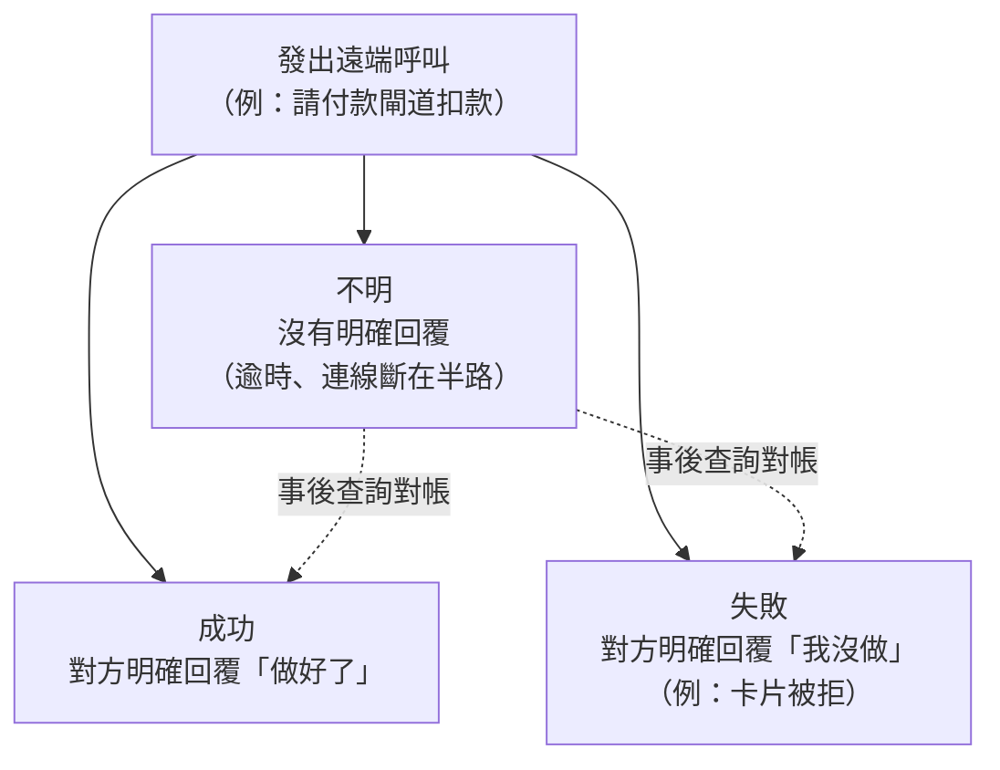
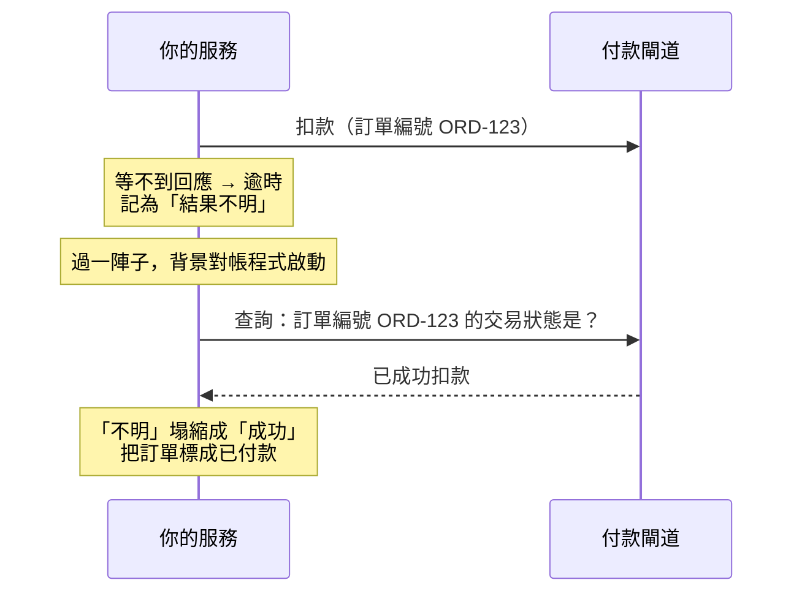

# [E-13-17] 結果三分法：遠端呼叫的答案有三種，不是兩種

> **目標**：理解遠端呼叫的結果不是「成功／失敗」兩種，而是「成功／失敗／**不明**」三種；明白為什麼「不明」必須當成一等公民處理，而不是當成失敗；以及「不明」要怎麼靠事後對帳與冪等重送收斂掉。

## 一個問題：按下「付款」之後，轉圈圈卡住了

想像你在做一個網路商店的結帳流程。使用者按下「付款」，你的後端服務去呼叫**外部的付款閘道**（payment gateway，幫你跟銀行收錢的第三方服務），請它從使用者的卡扣一筆錢。

正常情況有兩種結果，很直覺：

- 閘道回「扣款成功」→ 你把訂單標成已付款，出貨。
- 閘道回「卡片被拒絕」→ 你告訴使用者付款失敗，請換張卡。

但某次呼叫，閘道**等了 30 秒都沒回應**。可能是它的機器忙、可能是網路斷在半路、可能是它其實扣好了、只是那封「成功」的回應在回來的路上丟了。

你現在面對的是第三種結果：**你不知道對方到底做了沒。**

這就是本篇的主角——很多人直覺只認得「成功」和「失敗」，於是把這第三種硬塞進「失敗」裡處理。而這個塞法，正是重複扣款、帳對不上的根源。

> 「收不到回應時，無法分辨對方做了沒」是分散式系統的根源難題，在冪等性那篇已經鋪過 → [E-13-15：冪等性、重試與訊息傳遞保證](./E-13-15-idempotency.md)。這篇不重講冪等鍵怎麼做，而是換一個視角：**把「結果」這件事本身拆成三種**，看清楚「不明」為什麼得獨立出來。

## 生活類比：寄掛號信，回執還沒回來

你寄了一封重要的掛號信（裡面是一張支票）。對「對方到底收到了沒」，你手上會有三種狀態：

1. **回執單回來了，有人簽收** → 確定送達（成功）。
2. **信被退回來了，查無此人** → 確定沒送達（失敗）。
3. **寄出去三天了，回執單還沒回來** → **不知道**。可能對方收了、簽了，只是回執還在路上；也可能信根本卡在某個轉運站。

第三種狀態下，最糟的決定是「當成沒送到，再寄一張支票過去」——萬一對方其實早就收到第一張了，你就**付了兩次**。

正確的做法是：**先別急著重寄，去查。** 打電話問對方收到沒、或是查郵局的追蹤號碼。查清楚了，第三種狀態才會塌縮成「其實是成功」或「其實是失敗」。

遠端呼叫的「不明」，就是這封還沒回執的掛號信。

## 核心：結果是三態，不是兩態

把它畫出來。一次遠端呼叫發出去之後，可能落到三個格子裡：



這張圖表達：成功與失敗都是**對方給了明確答覆**的終局；而「不明」是個**暫時狀態**，它遲早要靠事後查詢，塌縮成真正的成功或失敗。

兩種終局和「不明」的本質差別，是誰說了算：

| 結果 | 是什麼 | 誰下的結論 | 要不要重送 |
|---|---|---|---|
| 成功 | 對方明確回「做好了」 | 對方 | 不用 |
| 失敗 | 對方明確回「我沒做」（卡被拒、金額不足、參數錯） | 對方 | 可以安全重送／換方式 |
| **不明** | 根本沒拿到對方的結論（逾時、連線中斷、對方掛了） | **沒有人** | **不能當失敗重送，要先查** |

關鍵在最後一欄。**「失敗」是安全的**——對方親口說了「我沒做」，你重送一次頂多就是再被拒絕一次，不會造成重複。**「不明」是危險的**——對方可能已經做了，你若當失敗重送，就是第二次扣款。

所以這篇的那句硬話是：

> **「不明」不是「失敗」的一種。把「不明」當「失敗」處理，等於假設「對方沒做」，而這個假設有一半機率是錯的。**

## 為什麼最容易錯：因為程式碼天生只有兩條路

問題出在：幾乎所有語言的錯誤處理語法，天生就把世界分成兩半——`try` 成功、`catch` 失敗。逾時會拋例外，於是它很自然地掉進 `catch`，跟「卡片被拒」擠在同一個區塊裡。

先用 pseudo code 看這個「兩態思維」長什麼樣：

```
嘗試：
    付款閘道.扣款(訂單)
    把訂單標成「已付款」
捕捉到任何錯誤：
    把訂單標成「付款失敗」   ← 問題在這：逾時也會進到這裡
    （或：直接重送一次）      ← 更糟：對方可能已經扣過了
```

逾時和「卡片被拒」都會觸發 `catch`，但它們的真相天差地遠：卡片被拒是「確定沒扣」，逾時是「不知道有沒有扣」。把它們混在一起，你就是拿「確定沒扣」的處置去對付「不知道」的狀況。

正確的心智模型是三條路，不是兩條：

```
嘗試：
    回應 = 付款閘道.扣款(訂單)
    如果 回應 是「明確成功」：
        標成「已付款」
    如果 回應 是「明確拒絕」：
        標成「付款失敗」，可以請使用者換卡重試
捕捉到「逾時 / 連線中斷 / 對方無回應」：
    標成「付款結果不明」      ← 第三種狀態，獨立出來
    排進「待查詢對帳」佇列，不要在這裡亂下結論
```

注意第三條路**沒有**做出「成功」或「失敗」的判斷，它只做一件事：誠實地記下「這筆結果不明」，然後把收斂的工作交給下一節的機制。

## 「不明」怎麼收斂：查詢對帳 ＋ 冪等重送

「不明」不能永遠懸著——錢的世界裡，每一筆都必須有個確定的歸宿。讓它塌縮成確定結果，有兩條互補的路。

### 路一：事後查詢對帳（reconciliation）

對帳（reconciliation）是指**事後去問權威方「這筆到底怎樣了」，讓自己的帳跟對方的帳對上**。付款閘道幾乎都會提供「用我方的訂單編號查詢一筆交易狀態」的 API，就是給這個用的。

它跟「扣款」有一個關鍵差別：**查詢是唯讀的，查幾次都不會改變任何東西**，所以天生安全，想查幾次就查幾次。



這張圖表達：逾時當下不下結論，先掛成「不明」；之後用**同一個訂單編號**去查詢閘道的真實狀態，查到了才把狀態確定下來。這裡能查得到的大前提是——你送扣款時就帶了一個**自己產生的、唯一的訂單編號**，而不是等閘道回傳它的流水號（逾時根本拿不到那個流水號）。

### 路二：冪等重送（idempotent retry）

查詢對帳有時候也查不到（例如閘道回「查無此筆」，但你不確定是真的沒收到、還是它那邊還沒入帳）。這時另一條路是**帶著同一把冪等鍵，把原本那個扣款請求重送一次**。

冪等鍵（idempotency key）的效果是：對方若已經做過這筆，看到同一把鍵，會**回上次的結果而不重做**；若真的沒做過，才會執行。這樣「不明 → 重送」就不會變成重複扣款。

```
不明的收斂策略（擇一或併用）：
    先查詢：帶訂單編號問閘道「這筆成了沒」
        查到成功 → 標成已付款，結束
        查到失敗／查無此筆 → 看情況重送或標失敗
    或重送：帶「同一把冪等鍵」重發原扣款
        對方已做過 → 回上次結果（不會重扣）
        對方沒做過 → 這次才真的執行
```

兩者的分工：**查詢**適合「只想知道真相、先不想改變現狀」；**冪等重送**適合「不管成沒成，我就是要把這筆推到成功」。錢的流程裡，通常是先查、查不明朗再靠冪等重送補上。冪等鍵怎麼設計（為什麼要用「業務編號＋步驟」而不是每次隨機產生），前一篇講得很細：

> 冪等鍵的做法與陷阱 → [E-13-15：冪等性、重試與訊息傳遞保證](./E-13-15-idempotency.md)

## 這跟「錢的狀態機」是同一件事的兩面

你可能發現了：把「不明」獨立成一個狀態、交給背景程式去收斂——這正是「錢的狀態機」那篇的骨架。那篇用一個 `debit_pending`（扣款待確認）狀態來裝「不明」，用背景的收尾程式（reaper）去把卡住的單推到終局。

兩篇的分工是：

- **這篇（E-13-17）**講的是**視角**——先讓你承認「結果有三種」，否則你連那個 `pending` 狀態都不會想到要設。
- **E-15-2** 講的是**實作**——有了三態的認知之後，怎麼把它落成資料庫裡的狀態機、鎖、約束，怎麼真的測出來。

> 把三態落成資料庫狀態機、逾時重送、背景收尾怎麼做 → [E-15-2：錢的狀態機](../E-15-resilience/E-15-2-money-state-machine.md)

## 常見錯誤（反模式）

> **常見錯誤一：把逾時當成失敗，直接重送**
>
> ```typescript
> // 危險！逾時被 catch 接住，當成「沒扣到」，於是重送
> try {
>   return await paymentGateway.charge(order);
> } catch {
>   return await paymentGateway.charge(order); // 😱 對方可能已經扣過了
> }
> ```
>
> 問題是：`catch` 區塊無法分辨這次是「卡片被拒（確定沒扣）」還是「逾時（不知道有沒有扣）」。對逾時直接重送，等於賭「對方一定沒做」——賭輸了就是**重複扣款**。
>
> **正確做法**：重送之前必須有「安全重送」的保證。要嘛帶**同一把冪等鍵**讓對方能辨識出重複、不重扣；要嘛**先查詢對帳**確認真實狀態再決定。沒有這兩者之一，就不要在逾時後重送。

> **常見錯誤二：把逾時當成失敗，直接標「付款失敗」就結案**
>
> 這是上一個錯誤的反向版本——為了不重複扣款，乾脆把逾時一律當失敗，告訴使用者「付款失敗，請重試」，然後把這筆丟掉不管了。
>
> 問題是：對方可能**其實扣成功了**。於是使用者的卡被扣了錢，你的系統卻顯示「未付款、沒出貨」。錢收了、東西沒給——這種「對方做了、我方以為沒做」的落差，是最難查、客訴最兇的一種，因為雙方的帳各自看起來都正常。
>
> **正確做法**：逾時標成「不明 / 待對帳」，**不要結案**。交給背景對帳程式去查閘道的真實狀態，查到成功就補出貨，查到確定沒扣才告訴使用者失敗。「不明」必須被收斂，不能被丟棄。

> **常見錯誤三：以為「不明」很罕見，不值得特別設計**
>
> 有人覺得逾時是極少數狀況，為它多設一個狀態、多寫一支對帳程式太麻煩，先上線再說。
>
> 問題是：**量一大，「不明」就一定會發生**，而且往往集中在對方最忙、最容易出錯的時候（大促、尖峰）。等到那時才發現沒有對帳機制，你只能人工一筆一筆去跟閘道後台核對，規模一大根本核不完。
>
> **正確做法**：從一開始就把「不明」當一等公民。送請求前先產生自己的唯一業務編號（才查得到、才能冪等重送），把「待對帳」狀態與背景收尾程式一起設計進去。這不是為罕見狀況過度設計——在分散式與金流裡，「不明」是**必然**，不是意外。

## 小結

- 遠端呼叫的結果有**三種**：成功（對方說做好了）、失敗（對方說沒做）、**不明**（沒拿到對方的結論——逾時、連線斷在半路）。
- **「失敗」安全，「不明」危險**：失敗是對方確認沒做，重送無害；不明時對方可能已經做了，當失敗重送就會**重複扣款**，當失敗結案則會**漏帳、收了錢沒給貨**。
- 「不明」是暫時狀態，必須收斂成確定結果，靠兩條路：**事後查詢對帳**（唯讀、安全，用自己的業務編號去問真實狀態）與**冪等重送**（帶同一把鍵，對方已做過就不重做）。
- 能查、能冪等重送的前提：**送請求前就產生自己的唯一業務編號**，不要依賴逾時時根本拿不到的對方流水號。
- 這個「三態視角」是「錢的狀態機」的思想起點——先承認有第三種結果，才會替它設一個 `pending` 狀態和背景收尾程式。

> 把三態落成資料庫狀態機、逾時重送、背景收尾、怎麼真的測出來 → [E-15-2：錢的狀態機](../E-15-resilience/E-15-2-money-state-machine.md)
> 冪等鍵的設計與訊息傳遞保證（at-least-once / exactly-once） → [E-13-15：冪等性、重試與訊息傳遞保證](./E-13-15-idempotency.md)
> 跨服務一致性的補償式做法（Saga） → [E-13-14：分散式交易](./E-13-14-distributed-transactions.md)
