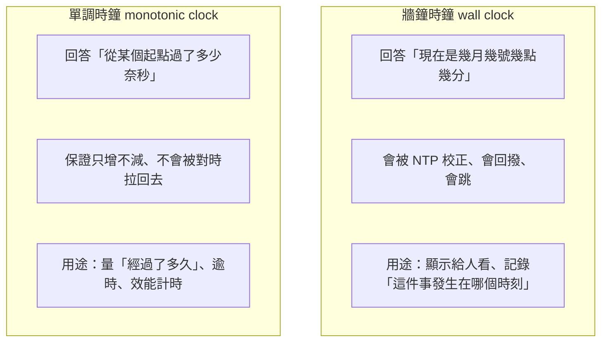

# [E-13-18] 時鐘不可信：為什麼別拿牆上的時間當排序鍵

> **目標**：搞懂分散式與資料庫裡「時間」為什麼難用；分清楚 PostgreSQL 的 `now()`／`transaction_timestamp()`／`statement_timestamp()`／`clock_timestamp()` 各是什麼時間；理解牆鐘時鐘（wall clock）會回撥、會跳、多機會偏差，所以不能當排序或唯一性的依據；以及單調時鐘（monotonic clock）能補上哪一塊。

## 一個問題：兩筆事件，誰先誰後？

想像你在做一個票務系統。開賣瞬間，兩位使用者幾乎同時搶同一個座位。你的兩台伺服器各自收到一筆請求，各自記下「成交時間」，然後你規定：**時間比較早的那筆贏**。

聽起來很公平。但你用的「時間」是每台機器自己問作業系統「現在幾點」拿到的。於是可能發生：

- A 機器的時鐘比標準時間快了 40 毫秒，B 機器慢了 30 毫秒。
- 實際上 B 的請求先到，但因為 B 的時鐘慢，記下來的時間戳反而比 A 大。
- 結果你判給了**其實比較晚**的 A。

更糟的情況：某台機器正好在這一刻被 NTP（Network Time Protocol，自動對時協定）校正，時間**往回跳**了 50 毫秒。於是一筆「比較晚發生」的事件，拿到了一個「比較早」的時間戳，甚至跟前一筆**撞成同一個時間**。

這就是本篇要打破的直覺：**電腦上那個「現在幾點」的時鐘，不是一條穩穩往前走的線。它會快、會慢、會突然往回跳，而且每台機器都不一樣。** 拿它當排序鍵或唯一性依據，遲早出錯。

## 生活類比：用每個人的手錶湊時間軸

想像一群人各自戴著手錶，事後要靠「各自看自己手錶記下的時間」拼出「事情發生的先後順序」。

問題一大堆：

- 有人的錶**快了兩分鐘**，有人**慢了一分鐘**（這就是多機之間的 **clock skew，時鐘偏差**）。
- 有人中途**對了一次錶**，把指針往回撥（這就是 **NTP 校正跳動 / 時鐘回撥**）——於是他記的下一件事，時間反而比上一件還早。
- 兩個人剛好記下**一模一樣的時間**，你分不出誰先（時間戳**撞號**）。

靠這堆各走各的手錶去排先後，一定會排錯。但如果你問的是另一個問題——「從我按下碼錶開始，過了多久？」——那隻**碼錶**就可靠得多：它只會往前走、不會被拿去對時、不會往回跳。這隻只量「過了多久」的碼錶，就是待會要講的**單調時鐘**。

## 兩種時鐘：牆鐘 vs 單調

電腦裡其實有兩種「時鐘」，用途完全不同。這是本篇最重要的分辨。



這張圖表達：牆鐘回答「現在幾點」、適合給人看與標記時刻，但它會被校正而跳動；單調時鐘回答「過了多久」、保證只往前走，適合量時間差。

用一句話記住它們的分工：

> **牆鐘時鐘（wall clock）回答「幾點」，單調時鐘（monotonic clock）回答「過了多久」。問錯問題就用錯時鐘。**

最典型的用錯：拿牆鐘來量「經過多久」。看這段 pseudo code：

```
開始 = 牆鐘現在時間()
    執行一段工作……
    （就在這一瞬間，NTP 把系統時間往回校正了 100 毫秒）
結束 = 牆鐘現在時間()
耗時 = 結束 - 開始    // 可能算出「負的耗時」！
```

因為牆鐘中途被往回撥，`結束 - 開始` 可能是負數。量「過了多久」必須用單調時鐘——它不受對時影響，`結束 - 開始` 永遠是真實流逝的時間。各語言測效能、設逾時的 API（例如量一段程式跑多久）底層用的都是單調時鐘，就是這個原因。

## 牆鐘不能當排序鍵或唯一性依據的三個理由

回到票務那個問題。把「為什麼牆鐘時間戳不能當排序鍵、更不能當唯一鍵」拆成三條：

| 問題 | 是什麼 | 後果 |
|---|---|---|
| **時鐘回撥** | NTP 校正或人工改時間，讓牆鐘往回跳 | 晚發生的事件拿到較早的時間戳，先後順序顛倒 |
| **校正跳動** | NTP 不只往回，也會往前跳一段來追上標準時間 | 時間軸出現「空洞」或「重疊」，相鄰事件時間戳不連續 |
| **多機偏差 clock skew** | 每台機器的時鐘快慢不一，彼此差幾十毫秒到幾秒 | 跨機器比時間戳大小，等於拿兩把不準的尺互量 |

這三條合起來，導致兩個你最不想要的結果：

1. **排序錯**：時間戳大小 ≠ 真實先後順序。
2. **撞號**：兩筆事件可能拿到**完全相同**的時間戳（同一毫秒內多筆、或回撥造成重疊），於是「用時間戳當唯一鍵」會撞鍵。

所以牆鐘時間戳適合的角色是**「這件事大概發生在哪個時刻」這種給人看、做統計的資訊**，不適合當「決定誰先誰後」或「保證不重複」的依據。那兩件事該用：

- **要唯一** → 用資料庫自己發的序號（如 `BIGSERIAL`、序列）或 UUID，它們天生保證不撞，不依賴時鐘。
- **要跨機器排因果先後** → 用**邏輯時鐘**（logical clock），下面會點到。

## PostgreSQL 的四種「現在時間」

資料庫這一層，同樣的陷阱換個樣子出現：**PostgreSQL 給你四個拿「現在時間」的函式，它們回傳的時間不一樣**。不知道差別，就會在「同一筆交易裡時間到底變不變」上踩坑。

先用一句話對照：

```
一筆交易 = 從 BEGIN 到 COMMIT 之間的一連串 SQL。
交易裡可能有很多句 SQL，每句執行可能花掉一點時間。
問題：在交易進行中問「現在幾點」，要回「交易開始的時刻」還是「此刻的真實時刻」？
```

PostgreSQL 的四個函式，差別就在這個「回哪個時刻」：

| 函式 | 回傳哪個時刻 | 在同一筆交易內 |
|---|---|---|
| `transaction_timestamp()` | **交易開始**的時刻 | **不變**（整筆交易都回同一值） |
| `now()` | 同上，`transaction_timestamp()` 的別名 | **不變** |
| `statement_timestamp()` | 當前這**句 SQL 開始**的時刻 | 每句可能不同 |
| `clock_timestamp()` | **此刻的真實牆鐘時間** | **每次呼叫都可能不同** |

最常被混淆的是 `now()` 和 `clock_timestamp()`。用一段 SQL 把差別逼出來——下面這句在同一筆交易裡呼叫 `now()` 兩次、`clock_timestamp()` 兩次，中間睡一秒：

```sql
-- pg_sleep(1) 讓這句 SQL 停一秒，好看出哪個時間會跟著走
BEGIN;
SELECT now() AS n1, clock_timestamp() AS c1;
SELECT pg_sleep(1);
SELECT now() AS n2, clock_timestamp() AS c2;
COMMIT;
-- 結果：n1 == n2（交易開始時刻，整筆不動）
--       c2 比 c1 晚了大約一秒（真實牆鐘，一直在走）
```

為什麼要有這個區分？因為大多數時候你**想要**同一筆交易裡時間一致——一筆交易代表「一件事」，這件事裡所有紀錄標同一個時刻（交易開始時刻）最直覺、也最好對帳。這正是 `now()` 的預設行為，也是你平常 `created_at DEFAULT now()` 想要的語意。

什麼時候才需要 `clock_timestamp()`？當你真的要量「交易**內部**」某段處理花了多久，或要記「這一句具體在哪個瞬間跑的」——例如在一個長交易裡逐筆記錄每筆處理的真實時刻。但注意：**即使是 `clock_timestamp()`，它拿的還是「牆鐘」**，一樣會回撥、會跳。它只是「不被交易凍住」，不代表它「準」或「單調」。

> 一筆交易為什麼要「同生共死」、`BEGIN`/`COMMIT` 的意義 → [E-13-14：分散式交易](./E-13-14-distributed-transactions.md)（跨服務版本的交易）；資料庫層的鎖與並發 → [E-4-5：資料庫鎖與並發控制](../E-4-database/E-4-5-database-lock.md)

## 那跨機器要排先後，到底該用什麼？

如果牆鐘不能當排序鍵，分散式裡要怎麼表達「A 事件在 B 事件之前」？答案是**邏輯時鐘（logical clock）**——不看牆上幾點，只數「因果順序」。

這裡點到為止，講最經典的一種：**Lamport clock（蘭波特時鐘）**。它的規則簡單到可以一句話說完：

```
每個節點維護一個計數器（一個整數，從 0 開始）：
    每做一件事              → 計數器 +1
    送訊息給別人            → 把自己當前的計數器一起帶過去
    收到別人的訊息          → 計數器 = max(自己的, 訊息帶來的) + 1
```

它放棄了「幾點幾分」這種真實時刻，換來一個保證：**如果 A 事件「導致」了 B 事件（有因果關係），那 A 的計數器一定小於 B 的計數器。** 於是你能靠這個計數器排出「合理的因果先後」，完全不碰會回撥、會偏差的牆鐘。

代價是它**不告訴你真實時刻**（你無法從計數器 42 反推那是幾點），而且兩個「互不相干、沒有因果關係」的事件之間，它也排不出先後——但那種事件本來就無所謂誰先誰後。邏輯時鐘的完整家族（Lamport clock、vector clock 向量時鐘）牽涉到一致性模型，屬於更進階的主題，想深入可往一致性那條線走：

> 分散式一致性模型（因果一致、最終一致等） → [E-13-11：一致性模型](./E-13-11-consistency-models.md)

## 常見錯誤（反模式）

> **常見錯誤一：拿牆鐘時間戳當唯一鍵或排序鍵**
>
> ```typescript
> // 危險！用「毫秒時間戳」當事件的唯一 ID 兼排序依據
> const eventId = Date.now();        // 😱 同一毫秒內兩筆就撞號
> await db.insert({ id: eventId, payload });
> // 之後靠 ORDER BY id 當「發生先後」——時鐘回撥時順序會錯
> ```
>
> 問題是：同一毫秒內來兩筆就**撞鍵**；跨機器時鐘偏差讓「id 大小」對不上「真實先後」；NTP 回撥甚至讓後發生的事件 id 更小。
>
> **正確做法**：要唯一就用資料庫序列（`BIGSERIAL`）或 UUID，它們不依賴時鐘、保證不撞。要排因果先後就用邏輯時鐘。牆鐘時間戳可以**同時存一欄**當「大約發生在幾點」給人看與做統計，但**不要**拿它當唯一性或排序的依據。

> **常見錯誤二：拿牆鐘量「經過多久」**
>
> ```typescript
> // 危險！用牆鐘算耗時，NTP 一校正就可能算出負數或暴衝
> const start = Date.now();
> await doWork();
> const elapsedMs = Date.now() - start;  // 😱 中途被對時就不準
> ```
>
> 問題是：`Date.now()` 是牆鐘，中途被 NTP 往回校正，`elapsedMs` 可能變負數；往前跳則會莫名暴增。拿這個去判斷「有沒有逾時」會誤判。
>
> **正確做法**：量時間差、設逾時，用**單調時鐘**。各語言都有對應 API（例如量經過時間的高解析度計時器），底層走單調時鐘，保證只增不減，不受對時影響。記住那句分工：**「過了多久」用單調時鐘，「現在幾點」才用牆鐘。**

> **常見錯誤三：以為同一筆交易裡 `now()` 會跟著時間走**
>
> ```sql
> -- 誤會：以為這筆長交易裡，後面的 now() 會比前面晚
> BEGIN;
> INSERT INTO log(at) VALUES (now());   -- 標的是「交易開始」時刻
> -- ……中間跑了很久的處理……
> INSERT INTO log(at) VALUES (now());   -- 還是「交易開始」時刻，和上面一模一樣
> COMMIT;
> ```
>
> 問題是：`now()` 回的是**交易開始**的時刻，整筆交易不變。以為它會隨時間走，就會納悶「為什麼兩筆 log 時間完全一樣」，甚至誤判處理沒花時間。
>
> **正確做法**：要「同一筆交易用同一個時刻」（最常見的需求）就用 `now()`，它的凍結正是你要的。真的要記交易內部某句的**真實當下**時刻，才改用 `clock_timestamp()`——但別忘了它拿的仍是牆鐘，一樣會跳。

## 小結

- 電腦有兩種時鐘：**牆鐘時鐘**回答「現在幾點」（會被 NTP 校正、會回撥、會跳、多機有偏差），**單調時鐘**回答「過了多久」（只增不減，不受對時影響）。問錯問題就用錯時鐘。
- 牆鐘時間戳**不能當排序鍵或唯一鍵**：回撥讓先後顛倒、校正跳動讓時間軸不連續、多機 clock skew 讓跨機比較失真，還可能撞號。
- 要**唯一**用資料庫序列或 UUID；要量**經過多久**用單調時鐘；要排**跨機因果先後**用邏輯時鐘（Lamport clock 點到為止）。牆鐘時間戳只適合當「大約幾點」給人看與統計。
- PostgreSQL 四個時間函式：`now()` ＝ `transaction_timestamp()` 回**交易開始**時刻（同交易內不變）、`statement_timestamp()` 回**本句**開始時刻、`clock_timestamp()` 回**此刻真實牆鐘**（每次呼叫都變，但仍是會跳的牆鐘）。平常 `created_at` 用 `now()` 就對。

> 分散式一致性模型與因果順序 → [E-13-11：一致性模型](./E-13-11-consistency-models.md)
> 逾時造成的「結果不明」怎麼處理 → [E-13-17：結果三分法](./E-13-17-tri-state-outcome.md)
> 資料庫交易與並發控制 → [E-4-5：資料庫鎖與並發控制](../E-4-database/E-4-5-database-lock.md)
