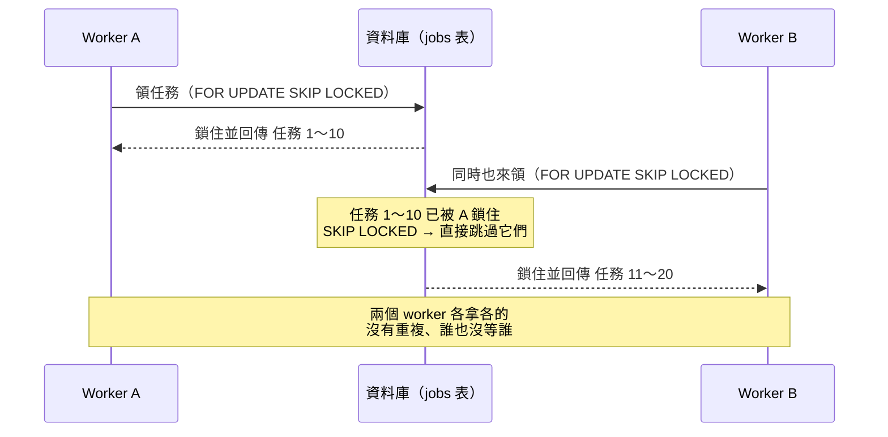
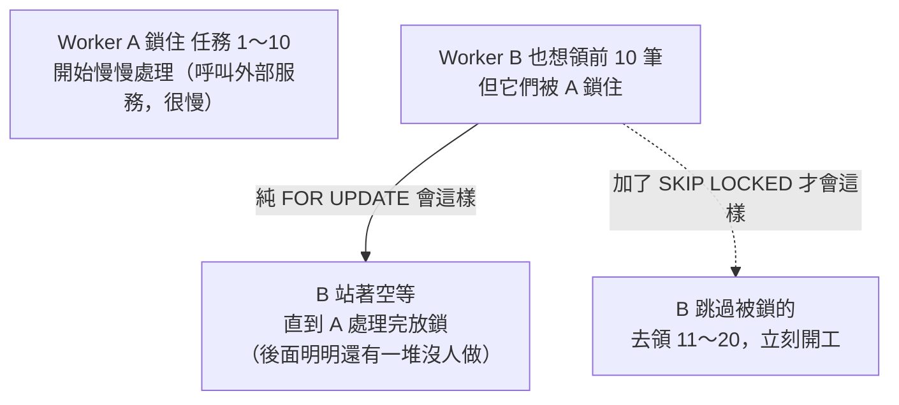

# [E-13-19] 用資料庫當工作佇列：一張表 ＋ SKIP LOCKED 就夠了

> **目標**：理解很多情況不必引入 Kafka／RabbitMQ，一張表加上 `SELECT ... FOR UPDATE SKIP LOCKED` 就是一個夠好的工作佇列；看懂 `SKIP LOCKED` 怎麼讓多個 worker 各領各的、不互搶也不互卡；跟純 `FOR UPDATE` 對比差在哪；領取→處理→標記完成的完整 SQL 流程；以及什麼時候才該升級到真正的訊息佇列。

## 一個問題：寄通知這件小事，需要搬出 Kafka 嗎？

想像你在做一個後端服務。使用者下單後，你要**寄一封確認通知**（email 或簡訊）。寄信要呼叫外部服務、可能很慢、可能失敗要重試——顯然不該卡在下單的請求裡同步做完。你想把它變成一個**背景任務**：下單時先「記一筆待辦」，之後由背景的工人（worker）慢慢處理。

這就是一個典型的「工作佇列（work queue）」需求：**有人往裡面放任務，有一群 worker 從裡面拿任務來做。**

很多人一聽到「佇列」反射性就想架 Kafka 或 RabbitMQ。但你其實已經有一個現成、可靠、你早就很熟的東西——**你的關聯式資料庫**。而你多半已經在用它了（訂單就存在裡面）。

本篇要說的是：**在中小量、且你已經有一個資料庫的情況下，一張表加上 `SKIP LOCKED`，就是一個夠好的工作佇列**，不必多養一套訊息中介軟體（message broker，專門負責收發訊息的系統，如 Kafka、RabbitMQ）。

## 生活類比：候位夾 vs 大家搶同一本

想像一間餐廳後場，牆上掛著一疊「待出餐的點單」。有好幾個廚師（worker）要從這疊單子裡拿來做。你希望：

- 每張單**只被一個廚師拿走**，不會兩個人同時做同一張（重複出餐）。
- 一個廚師伸手拿單時，**不必等別人**——看到最上面那張有人正在拿，就直接拿下一張，而不是站在旁邊乾等。

`SKIP LOCKED` 做的就是第二件事：**「這張有人正在處理？跳過，去拿下一張沒人碰的。」** 多個廚師同時來拿，各拿各的、互不干擾，也沒人被卡住。

對照之下，純 `FOR UPDATE`（不加 `SKIP LOCKED`）的行為是：廚師看到最上面那張有人在拿，就**站著排隊等那張被放回來**——明明旁邊還有一堆沒人碰的單子，他卻在空等。這在「搶同一筆」時是對的（避免兩人改同一列），但拿來當佇列領任務就錯了。

## 先看任務表長什麼樣

工作佇列的核心就是一張表。每一列是一個任務，重點在那個 `status` 欄位——它記錄任務走到哪一步：

```sql
-- 一張最小可用的任務表。重點是 status 與 run_after 兩欄
CREATE TABLE jobs (
    id          BIGSERIAL PRIMARY KEY,
    kind        TEXT        NOT NULL,            -- 任務類型，如 'send_email'
    payload     JSONB       NOT NULL,            -- 任務要用的資料（寄給誰、內容）
    status      TEXT        NOT NULL DEFAULT 'pending',  -- pending / done / failed
    attempts    INT         NOT NULL DEFAULT 0,  -- 已嘗試幾次，給重試用
    run_after   TIMESTAMPTZ NOT NULL DEFAULT now(), -- 這個時刻之後才可以領（延遲／重試退避用）
    created_at  TIMESTAMPTZ NOT NULL DEFAULT now()
);

-- 讓「找出可領的任務」這個查詢走索引，而不是每次全表掃描
CREATE INDEX jobs_pending_idx ON jobs (run_after) WHERE status = 'pending';
```

放一個任務進去，就是一句 `INSERT`——下單的那筆交易裡順手寫一行「待寄信」即可：

```sql
INSERT INTO jobs (kind, payload)
VALUES ('send_email', '{"to": "someone@example.com", "template": "order_confirm"}');
```

難的從來不是放進去，而是**多個 worker 怎麼安全地把任務拿出來**。這就是 `SKIP LOCKED` 登場的地方。

## 核心：SKIP LOCKED 怎麼讓多個 worker 不互搶

每個 worker 都跑同一個迴圈：**領一批任務 → 做 → 標記完成**。關鍵在「領」這一步的 SQL。

先用 pseudo code 說它想達成什麼：

```
worker 不斷重複：
    在一筆交易裡：
        找出「狀態是 pending、現在可以跑、而且沒有別的 worker 正在領」的任務
        把它們標記成「我拿走了」
    離開交易（鎖放掉）
    慢慢處理這些任務（可能呼叫外部服務、可能很慢）
    處理完 → 把狀態標成 done
```

把「找出且別人沒在領」這句話翻成 SQL，就是 `FOR UPDATE SKIP LOCKED`：

```sql
-- worker 領任務：鎖住選中的列，但「已被別的 worker 鎖住的」直接跳過
SELECT id, kind, payload
FROM jobs
WHERE status = 'pending'
  AND run_after <= now()
ORDER BY id          -- 先進先出（大致），老任務先做
FOR UPDATE SKIP LOCKED
LIMIT 10;            -- 一次領一小批，不要一口氣把整張表鎖光
```

這句 SQL 的每一塊都在解一個具體問題：

- `FOR UPDATE`：鎖住選中的這幾列，宣告「這幾筆我要處理，別人別碰」。
- `SKIP LOCKED`：**遇到已經被別的 worker 鎖住的列，不要等，直接跳過。** 這是讓多 worker 不互卡的關鍵。
- `LIMIT 10`：一次只領一小批。一方面降低單筆交易握鎖的範圍，一方面讓任務平均分散到多個 worker。
- `ORDER BY id`：大致照放入順序處理（先進先出）。

畫成流程看兩個 worker 同時來領會發生什麼：



這張圖表達：A 和 B 幾乎同時來領，`SKIP LOCKED` 讓 B 自動跳過 A 已經鎖住的那批，去領下一批沒人碰的。兩個 worker 各領各的，沒有重複處理，也沒有人空等。

## 對比：如果用純 FOR UPDATE（不加 SKIP LOCKED）

同樣兩個 worker，把 `SKIP LOCKED` 拿掉會怎樣？

```sql
-- 不要這樣當佇列領任務：少了 SKIP LOCKED
SELECT id FROM jobs
WHERE status = 'pending'
ORDER BY id
FOR UPDATE            -- ← 沒有 SKIP LOCKED
LIMIT 10;
```

B 來領時，`ORDER BY id` 讓它也想要「最前面那批」，但那批已被 A 鎖住。純 `FOR UPDATE` 的行為是——**B 站在那裡排隊，等 A 的交易結束、鎖放掉**。於是：



這張圖表達：純 `FOR UPDATE` 下，第二個 worker 會卡在「等前一批放鎖」，完全沒發揮多 worker 的意義；加上 `SKIP LOCKED` 才會跳過去領別的、真正平行起來。

一句話總結兩者的分工：

> **`FOR UPDATE` 是「這筆我要改，別人排隊等」——適合「大家搶同一筆、不能漏掉」的場景（如前一篇那種鎖住一列推進狀態機）。`FOR UPDATE SKIP LOCKED` 是「有人在弄的我就跳過」——適合「一堆任務分給一群 worker、各做各的」的佇列場景。**

> 鎖的基本概念、`FOR UPDATE` 怎麼運作 → [E-4-5：資料庫鎖與並發控制](../E-4-database/E-4-5-database-lock.md)；用 `FOR UPDATE`／`SKIP LOCKED` 推進「錢的狀態機」與背景收尾程式 → [E-15-2：錢的狀態機](../E-15-resilience/E-15-2-money-state-machine.md)

## 完整流程：領 → 處理 → 標記完成

把一輪完整寫出來。重點是**「領」和「標記完成」要分成兩段**，中間放掉鎖去做那件慢事（寄信）。

**第一段：在一筆短交易裡領任務，並立刻標記「處理中」。** 為什麼領了要馬上改狀態？因為交易一結束、鎖一放掉，別的 worker 就看得到這列了；如果還停在 `pending`，會被重複領。所以領的同時就把它移出「可領」的範圍：

```sql
-- 在一筆交易裡：領一批、同時把它們標成 processing，然後 COMMIT 放鎖
BEGIN;

-- 用 CTE 先選出要領的 id（帶 SKIP LOCKED），再一次 UPDATE 改狀態並回傳內容
WITH picked AS (
    SELECT id
    FROM jobs
    WHERE status = 'pending' AND run_after <= now()
    ORDER BY id
    FOR UPDATE SKIP LOCKED
    LIMIT 10
)
UPDATE jobs
SET status = 'processing', attempts = attempts + 1
FROM picked
WHERE jobs.id = picked.id
RETURNING jobs.id, jobs.kind, jobs.payload;

COMMIT;  -- 交易結束，鎖放掉。這批已是 processing，不會被別人再領
```

這裡用了 CTE（Common Table Expression，`WITH ... AS` 寫出的具名子查詢）先把要領的 `id` 挑出來鎖住，再據此 `UPDATE`。一句 SQL 同時完成「領取」和「標記處理中」，乾淨且不留空窗。

**第二段：交易已結束、鎖已放掉，現在才慢慢做那件慢事，做完再標 `done`。** 這一步不握任何鎖——寄信可能花好幾秒，絕不能把資料庫的鎖握著等它：

```sql
-- 處理成功後（例如信寄出去了），把這筆標成完成
UPDATE jobs SET status = 'done' WHERE id = $1;

-- 處理失敗，想稍後重試：改回 pending，並延後 run_after（指數退避）
UPDATE jobs
SET status = 'pending',
    run_after = now() + (interval '1 minute' * attempts)  -- 試越多次、等越久
WHERE id = $1;
```

為什麼第二段要在交易外、不握鎖做？這跟 `FOR UPDATE` 握鎖打外部服務會吃光連線池是同一個道理——鎖握越久、佔用的資源越久，整體吞吐越低。前一篇對這個取捨有更完整的討論：

> 握鎖打外部服務為什麼危險、連線池大小如何變成處理量上限 → [E-15-2：錢的狀態機](../E-15-resilience/E-15-2-money-state-machine.md)

還有一個必須面對的狀況：worker 在「標成 processing 之後、標成 done 之前」**當機**了，這筆就會永遠卡在 `processing`。解法跟狀態機那篇的「收尾程式」一樣——另有一支背景程式定期把「`processing` 超過 N 分鐘沒動」的任務撿回來（改回 `pending` 重領）。這也是為什麼要有 `attempts` 欄位：撿回來重試不能無限循環，次數到了就標 `failed` 並告警。

## 什麼時候該升級到真正的訊息佇列

資料庫當佇列很好用，但它有天花板。該認得出「什麼時候這招不夠了」，而不是無腦套用或無腦排斥。

| 情況 | 用資料庫佇列 | 該升級到專門的訊息佇列（Kafka／RabbitMQ 等） |
|---|---|---|
| 任務量 | 中小量（每秒數十～數百筆） | 極高吞吐（每秒上萬、持續灌入） |
| 消費者模式 | 一個任務做一次就好 | 需要「一則訊息廣播給很多訂閱者」（發布／訂閱） |
| 你的架構 | 已經有一個資料庫，不想多養系統 | 本來就有訊息中介軟體，或跨多個團隊／服務串流事件 |
| 保留與重放 | 做完就算了 | 需要保留事件歷史、可回放重算 |
| 輪詢成本 | worker 定期 poll 可接受 | 需要即時推送、大量 consumer 長連線 |

判斷心法：**先問「我是不是已經有資料庫、量也不大？」是的話，用 `SKIP LOCKED` 這招就好，別為了「看起來專業」搬出 Kafka。** 多養一套訊息中介軟體＝多一個要部署、監控、備份、學習、會半夜壞掉叫你起床的系統。等到真的撞上「吞吐不夠」「要發布／訂閱廣播」「要事件重放」這些資料庫佇列給不了的需求，再升級也不遲。

訊息佇列與訊息中介軟體本身的完整介紹（投遞保證、分區、消費群組等）在這兩篇：

> 訊息佇列是什麼、解決什麼問題 → [E-13-5：訊息佇列](./E-13-5-message-queue.md)
> 訊息中介軟體（Broker）的角色與機制 → [E-13-16：訊息中介軟體](./E-13-16-broker.md)

## 常見錯誤（反模式）

> **常見錯誤一：領任務用純 FOR UPDATE，沒加 SKIP LOCKED**
>
> ```sql
> -- 壞：多個 worker 會互相卡住排隊
> SELECT id FROM jobs WHERE status = 'pending'
> ORDER BY id FOR UPDATE LIMIT 10;   -- 😱 少了 SKIP LOCKED
> ```
>
> 問題是：所有 worker 都想要「最前面那批」，第一個 worker 鎖住後，其他 worker 全部**排隊空等**那批放鎖——你開了十個 worker，實際上同時只有一個在做事，後面明明還有一堆任務沒人碰。
>
> **正確做法**：當佇列領任務一定加 `SKIP LOCKED`，讓後來的 worker 跳過被鎖的、去領別的。`FOR UPDATE` 不加 `SKIP LOCKED` 是給「大家搶同一筆、不能漏」的場景用的，不是給佇列用的。

> **常見錯誤二：領了任務不立刻改狀態，等處理完才一起改**
>
> ```
> 壞的順序：
>     領出 pending 任務（FOR UPDATE SKIP LOCKED），放鎖
>     開始寄信……（這段期間任務還是 pending）
>     寄完才把狀態改成 done
> ```
>
> 問題是：交易一 `COMMIT`、鎖一放掉，那筆還停在 `pending`，**別的 worker 立刻又把它領走**——同一封信寄兩次。鎖只在交易存續期間有效，一旦放掉就保護不到還是 `pending` 的列。
>
> **正確做法**：領取的那筆交易裡就把狀態改成 `processing`（像前面的 CTE 寫法），讓它馬上移出「可領」範圍。慢事（寄信）在放鎖之後、狀態是 `processing` 時做，做完才改 `done`。

> **常見錯誤三：沒有收尾機制，當機的任務永遠卡在 processing**
>
> 問題是：worker 在「標 processing」之後、「標 done」之前當機（部署、OOM、機器重開），這筆就永遠停在 `processing`——不再被領、也不會完成。信沒寄出去，卻也沒人知道。量一大，這種「殭屍任務」會慢慢累積。
>
> **正確做法**：補一支背景收尾程式，定期把「`processing` 且超過合理時限沒更新」的任務撿回 `pending` 重領；並用 `attempts` 欄位限制重試次數，超過上限標 `failed` 並告警。這跟狀態機那篇的「收尾程式（reaper）」是同一個設計。

## 小結

- 中小量、而且你已經有一個關聯式資料庫時，**一張任務表 ＋ `SELECT ... FOR UPDATE SKIP LOCKED`** 就是夠好的工作佇列，不必額外搬出 Kafka／RabbitMQ。
- `SKIP LOCKED` 是關鍵：讓 worker **跳過別人正在處理的列、去領沒人碰的**，多個 worker 各領各的、不重複也不互卡。純 `FOR UPDATE`（不加 `SKIP LOCKED`）會讓後來的 worker 排隊空等，那是給「搶同一筆」用的，不是給佇列用的。
- 流程分兩段：**第一段**在短交易裡領取並立刻標 `processing`（放掉鎖前就移出可領範圍，避免重複領）；**第二段**在交易外、不握鎖做那件慢事，做完標 `done`，失敗則退避重試。
- 一定要有**收尾機制**：背景程式把卡在 `processing` 的殭屍任務撿回重領，用 `attempts` 限制重試次數、超限告警。
- 該升級到真正的訊息佇列的訊號：**極高吞吐、需要發布／訂閱廣播、需要事件保留與重放**。沒撞上這些，就別為了「看起來專業」多養一套系統。

> 握鎖打外部服務的取捨、背景收尾程式 → [E-15-2：錢的狀態機](../E-15-resilience/E-15-2-money-state-machine.md)
> 資料庫鎖與並發控制的基礎 → [E-4-5：資料庫鎖與並發控制](../E-4-database/E-4-5-database-lock.md)
> 什麼時候真的需要訊息佇列 → [E-13-5：訊息佇列](./E-13-5-message-queue.md)、[E-13-16：訊息中介軟體](./E-13-16-broker.md)
