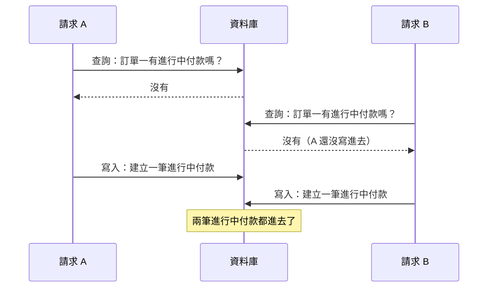
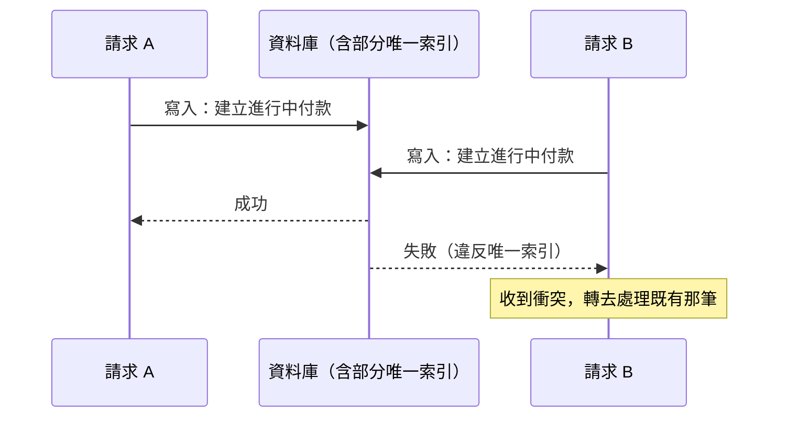

# [E-13-20] 部分唯一索引：讓資料庫幫你擋重複，別用「先查再寫」

> **目標**：理解「先查再寫」（check-then-act）在並發下為什麼一定會爆（TOCTOU race），以及怎麼用 PostgreSQL 的部分唯一索引（partial unique index）把「同一筆最多只能有一個進行中」這種規則交給資料庫強制。

## 一個問題：同一張訂單，怎麼被建了兩筆付款？

你在做一個付款服務。規則很單純：**同一張訂單，同一時間只能有一筆「進行中（pending）」的付款**。但付款可以失敗很多次——使用者這次卡被拒、下次換張卡再試，所以「失敗（failed）」的紀錄可以有好幾筆。

你很自然地寫出這段邏輯：

```
收到「幫訂單 A 建立付款」的請求：
    先查：訂單 A 有沒有「進行中」的付款？
    如果有 → 拒絕（不能重複付）
    如果沒有 → 建立一筆新的「進行中」付款
```

單人測試一切正常。上線後某天你發現：**同一張訂單 A，資料庫裡躺著兩筆 pending 付款**，使用者被扣了兩次款。

明明有「先查有沒有」的檢查，怎麼還會重複？問題就出在這個「先查再寫」的寫法本身——它在並發（concurrency，多個請求同時發生）下有一個經典漏洞。

## 生活類比：兩個人同時看到「最後一個停車位」

想像一個停車場，規則是「一個車位只能停一台車」。管理員的做法是：

1. 有車要進來，先**看一眼**某個車位空不空
2. 空的話，**揮手讓它停進去**

平常沒問題。但某個瞬間，兩台車同時到，管理員**同時**看了同一個空位——對兩台車都說「空的，停吧」。兩台車一起開進去，撞在一起。

問題不在「有沒有檢查」，而在：**「看一眼」和「讓它停」之間有空檔，另一台車趁這個空檔也通過了同一個檢查。**

正確的做法不是叫管理員看快一點，而是**在車位上裝一支地鎖**：一台車停進去，地鎖就升起來，第二台車**物理上就是進不來**。檢查與占用變成同一個不可分割的動作。

資料庫的部分唯一索引，就是那支地鎖。

## 「先查再寫」為什麼在並發下必爆：TOCTOU

「先查再寫」有個正式名字叫 **check-then-act**（先檢查、再動作）。它的漏洞叫 **TOCTOU**（Time-Of-Check to Time-Of-Use，從「檢查的時刻」到「使用的時刻」之間）——檢查完到真正動作之間有一段時間差，狀態可能已經變了。

把兩個請求交錯的時序畫出來，一眼就懂：



這張圖在表達：A 查完「沒有」之後、還來不及寫入之前，B 也查了一次，也看到「沒有」——於是兩個請求都認為自己可以建，最後各建一筆。

重點：**兩個請求各自都沒錯**，它們都老實地「先查再寫」了。錯的是這個模式本身——檢查和寫入是**兩個分開的步驟**，中間的空檔擋不住別人。你把檢查寫得再嚴謹，只要它和寫入是分開的兩步，這個空檔就在。

你可能會想「那我加一個應用層的鎖（例如用一個記憶體變數鎖住）」。這在單一程序也許擋得住，但付款服務通常**跑很多台**；記憶體裡的鎖只管得到自己這台，另一台照樣闖進來。要擋住所有人，鎖必須放在大家共用的那個點上——**資料庫**。

## 解法：把規則變成資料庫約束

與其讓每個請求「自己檢查」，不如讓資料庫定一條所有人都繞不過的規則：**「同一個 order_id，status 是 pending 的列，最多只能有一筆」**。

但這裡有個關鍵限制：普通的唯一索引（unique index）會對**整欄**生效。如果直接在 `order_id` 上建唯一索引，那同一張訂單連「失敗」的紀錄都只能有一筆了——這不是我們要的，失敗紀錄要能有很多筆。

PostgreSQL 的 **部分唯一索引（partial unique index）** 正好解決這點：它只對**符合某個條件的列**強制唯一。語法是在普通唯一索引後面加一個 `WHERE 條件`：

```sql
-- 只對「status 等於 pending」的列，強制 order_id 不可重複。
-- WHERE 後面的條件就是「這條唯一規則只管哪些列」。
CREATE UNIQUE INDEX one_pending_payment_per_order
    ON payments (order_id)
    WHERE status = 'pending';
```

這條索引的意思是：**在「status = 'pending' 的那些列」這個子集合裡，order_id 必須唯一。** 至於 `status = 'failed'` 的列，完全不在這條規則的管轄範圍內，所以同一張訂單想失敗幾次都行。

它怎麼擋住前面那個 race？因為「檢查 order_id 在 pending 子集合裡唯不唯一」這件事，是在**寫入的那一刻由資料庫原子地（atomic，不可分割）完成**的——沒有「查完到寫入之間」的空檔。兩個請求同時寫，資料庫只會讓第一筆成功，第二筆直接被索引擋下、丟出錯誤。



這張圖在表達：不再有「先查」這一步，兩個請求直接搶寫，資料庫保證只有一筆成功，另一筆得到明確的衝突錯誤。

## 正式程式碼：建索引，並優雅地接住衝突

先看資料表與索引。付款表除了主鍵，再加上那條部分唯一索引：

```sql
CREATE TABLE payments (
    id          bigserial PRIMARY KEY,
    order_id    bigint      NOT NULL,
    status      text        NOT NULL,  -- pending／succeeded／failed
    amount      numeric     NOT NULL,
    created_at  timestamptz NOT NULL DEFAULT now()
);

-- 同一張訂單，最多一筆進行中付款；失敗紀錄不受限。
CREATE UNIQUE INDEX one_pending_payment_per_order
    ON payments (order_id)
    WHERE status = 'pending';
```

接著是應用層。注意這裡的心法整個反過來：**不先查，直接寫；把「重複」交給資料庫判斷，再接住它丟回來的衝突。** 這叫「寧可請求原諒，不要事先請示」（try-first，而非 check-first）。

PostgreSQL 違反唯一約束時會丟出 SQL 狀態碼 `23505`（unique_violation）。我們用它來分辨「這是重複，不是別的錯」：

```typescript
// PostgreSQL 違反唯一約束的錯誤碼，是一個穩定的常數，取個名字免得日後看不懂。
const PG_UNIQUE_VIOLATION = "23505";

interface CreatePaymentResult {
  outcome: "created" | "already_pending"; // 剛建立的／早就有一筆進行中
  payment: Payment;
}

async function createPendingPayment(
  orderId: number,
  amount: number,
): Promise<CreatePaymentResult> {
  try {
    // 直接寫，不先查。要擋重複的規則已經在資料庫索引裡了。
    const payment = await db.one<Payment>(
      `INSERT INTO payments (order_id, status, amount)
       VALUES ($1, 'pending', $2)
       RETURNING *`,
      [orderId, amount],
    );
    return { outcome: "created", payment };
  } catch (error) {
    // 只「吞」真正代表重複的那種錯誤；其他錯誤要原樣往上丟，不能被當成重複吃掉。
    if (isUniqueViolation(error, "one_pending_payment_per_order")) {
      // 衝突代表「已經有一筆進行中」——這通常是使用者重複送出，屬正常情況，
      // 回傳既有那筆即可，不必當成錯誤。
      const existing = await db.one<Payment>(
        `SELECT * FROM payments
         WHERE order_id = $1 AND status = 'pending'`,
        [orderId],
      );
      return { outcome: "already_pending", payment: existing };
    }
    throw error;
  }
}

// 判斷這個錯誤是不是「違反指定那條唯一索引」。
// 帶上索引名稱，才不會把別的唯一約束衝突也誤判成「已有進行中付款」。
function isUniqueViolation(error: unknown, constraintName: string): boolean {
  return (
    typeof error === "object" &&
    error !== null &&
    "code" in error &&
    (error as { code: unknown }).code === PG_UNIQUE_VIOLATION &&
    "constraint" in error &&
    (error as { constraint: unknown }).constraint === constraintName
  );
}
```

幾個對應到規範的重點：

- **不先查、直接寫**：把「唯一」的判斷放在資料庫原子地做，根本不給 TOCTOU 空檔。
- **只吞「對的那種錯」**：`isUniqueViolation` 連**索引名稱**都比對，確保只有「違反這條 pending 規則」才當成重複處理；別的錯誤（例如欄位型別錯、別條約束）照樣往上拋，不會被 `catch` 悄悄吃掉。
- **衝突是正常情況，不是例外災難**：使用者連點兩下送出是家常便飯，收到衝突就回傳既有那筆，體驗上跟成功沒兩樣。

你可能聽過 `INSERT ... ON CONFLICT`（PostgreSQL 的 upsert 語法）可以更省事地處理衝突。它確實好用，但 `ON CONFLICT` 需要指定一個「衝突目標」，而**部分索引**當衝突目標時語法較綁手（要連 `WHERE` 條件一起寫對），所以這裡用「接住 23505」的寫法，概念上更直白、也更容易看懂發生了什麼。

## 常見錯誤（反模式）

> **常見錯誤一：以為「先查再寫」加了交易（transaction）就安全了**
>
> 很多人以為把「查」和「寫」包進同一個資料庫交易就沒事了：
>
> ```typescript
> // 危險！交易的預設隔離等級（read committed）擋不住這個 race
> await db.tx(async (t) => {
>   const existing = await t.oneOrNone(
>     `SELECT 1 FROM payments WHERE order_id = $1 AND status = 'pending'`,
>     [orderId],
>   );
>   if (existing) throw new Error("已有進行中付款");
>   await t.none(
>     `INSERT INTO payments (order_id, status, amount) VALUES ($1, 'pending', $2)`,
>     [orderId, amount],
>   );
> });
> ```
>
> 問題是：在 PostgreSQL 預設的 read committed 隔離等級下，**兩個交易各自的 `SELECT` 都看不到對方「還沒提交」的那筆 INSERT**——於是兩邊都查到「沒有」，兩邊都 INSERT。交易保證的是「全成或全敗」，**不保證**「別人同時在做的事你看得到」。
>
> **正確做法**：要嘛用部分唯一索引讓資料庫在寫入時擋（本篇主角），要嘛把隔離等級拉到 `SERIALIZABLE`（代價是衝突時要重試、效能較差）。多數情況下，一條部分唯一索引又簡單又快。

> **常見錯誤二：用普通唯一索引，結果連失敗紀錄都卡住**
>
> ```sql
> -- 壞：對整欄 order_id 唯一，同一張訂單連「失敗」都只能有一筆
> CREATE UNIQUE INDEX ON payments (order_id);
> ```
>
> 問題是：使用者第一次付款失敗後想換張卡再試，第二筆 INSERT 會因為「order_id 已存在」被擋下——明明失敗的紀錄本來就該能有很多筆。你把「進行中最多一筆」的規則，錯誤地擴大成了「這張訂單一輩子只能有一筆付款」。
>
> **正確做法**：用 `WHERE status = 'pending'` 的部分唯一索引，讓規則**只管進行中的那些列**，失敗紀錄不受限。「只對一部分列生效」正是 partial 這個字的意義所在。

> **常見錯誤三：`catch` 把所有錯誤都當成「重複」吞掉**
>
> ```typescript
> // 壞：不管什麼錯都當成「已有進行中」，真正的 bug 被藏起來
> try {
>   await insertPendingPayment(orderId, amount);
> } catch {
>   return existingPayment; // 連「金額欄位傳了 null」這種 bug 都被吞成「重複」
> }
> ```
>
> 問題是：`catch` 不分青紅皂白，資料庫連線斷了、欄位違反 NOT NULL、另一條約束被違反……全都被當成「喔，重複而已」。真正的 bug 被靜默吃掉，你會以為一切正常，其實付款根本沒建成。
>
> **正確做法**：只對「錯誤碼是 23505 **且** 違反的是指定那條索引」才當成重複（前面範例的 `isUniqueViolation`），其餘一律 `throw` 往上拋。**該炸的要讓它炸**，不要用寬鬆的 `catch` 把 bug 藏起來。

## 小結

- **「先查再寫」（check-then-act）在並發下一定會爆**：檢查和寫入是分開的兩步，中間的空檔（TOCTOU）讓兩個請求都通過檢查、各寫一筆。檢查寫得再嚴謹也擋不住，因為問題在模式本身。
- **應用層的鎖救不了**：付款服務跑很多台，記憶體鎖只管得到自己這台。要擋住所有人，規則得放在大家共用的資料庫上。
- **部分唯一索引（partial unique index）= `CREATE UNIQUE INDEX ... WHERE 條件`**：只對符合條件的列強制唯一。經典用法——`(order_id) WHERE status = 'pending'` 讓同一訂單最多一筆進行中，但失敗紀錄不受限。
- 心法從「先查再寫」反過來變成「**直接寫、接住衝突**」：把唯一判斷交給資料庫原子地做，再優雅地處理它丟回的 `23505`。
- 接衝突時只吞「對的那種錯」（比對錯誤碼與索引名稱），其餘往上拋，別讓寬鬆的 `catch` 藏住真正的 bug。

> 這條規則也是「錢的狀態機」用來擋重複的三道防線之一 → [E-15-2：錢的狀態機](../E-15-resilience/E-15-2-money-state-machine.md)
> 為什麼分散式系統天生會有「重複」、冪等性是什麼 → [E-13-15：冪等性、重試與訊息傳遞保證](./E-13-15-idempotency.md)
> 把「請求層／業務層／資料層」三層冪等鍵分層擺好（本篇的資料庫約束是最後一層） → [E-13-21：多層冪等鍵](./E-13-21-layered-idempotency-keys.md)
