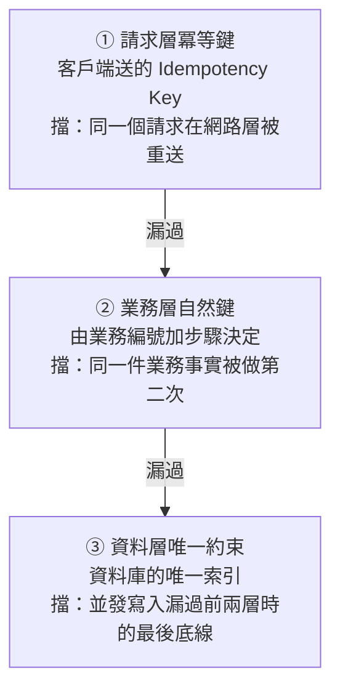
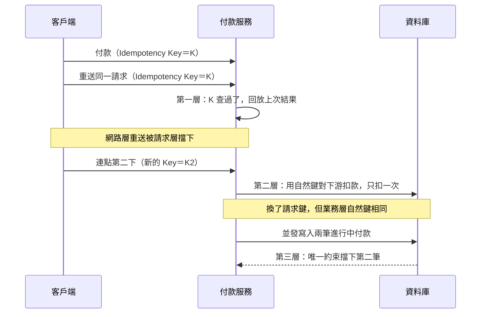

# [E-13-21] 多層冪等鍵：一把鍵不夠，分三層各擋一種重複

> **目標**：理解「冪等」不是只靠一把鍵就夠，而是請求層、業務層、資料層三道防線各擋一種重複；知道每一層各擋什麼、為什麼一把鍵補不了另一把的洞、以及三層怎麼分層擺。

> 前置：先看懂「為什麼會重複、冪等是什麼、冪等鍵怎麼定」→ [E-13-15：冪等性、重試與訊息傳遞保證](./E-13-15-idempotency.md)。本篇不重複那些定義，**只聚焦「有了冪等鍵之後，該分幾層、怎麼擺」**。

## 一個問題：我明明帶了冪等鍵，為什麼還是扣了兩次？

你在做付款 API。你讀過冪等的觀念，照做了：讓客戶端每次送付款請求時，帶一個 **Idempotency-Key**（冪等鍵）在 HTTP header 上，伺服器看到同一把鍵就回「上次的結果」，不重複扣款。

```
POST /payments
Idempotency-Key: 9f2c-a1b4-...   ← 客戶端這次請求的唯一識別
{ "orderId": 123, "amount": 500 }
```

上線後你還是遇到重複扣款。你一查，發現這幾種情況冪等鍵都沒擋住：

- **使用者在手機上連點兩下「付款」**：兩次點擊是兩個**不同的 Idempotency-Key**（各自新產生），伺服器當成兩筆不同請求。
- **使用者這次失敗，過五分鐘換張卡重試**：又是一把新鍵，又是一筆。
- **你的服務重啟後，背景工作重新發起同一筆付款**：程式重新產生了鍵，對下游又是全新的一筆。

問題出在：**Idempotency-Key 只擋得住「同一個請求在網路層被重送」這一種重複**。使用者的重複意圖、程式重啟後的重新發起、資料落地時的並發——這些它管不到。一把鍵擋一種洞，你需要的是**好幾把鍵、擺在不同層**。

## 生活類比：進一場演唱會要過三道關卡

想像你要進一場大型演唱會，入口有三道關卡，各防一種不同的混入：

1. **門口驗票閘門**：看你手上的票根（entry ticket）有沒有被掃過。同一張票根掃第二次，閘門「嗶」一聲擋下——這擋的是**「同一張票被重複刷」**。
2. **座位表**：就算你換了張看起來不一樣的票，工作人員對照座位表，發現「A 區 12 排 5 號」已經有人坐了，也不讓你再坐——這擋的是**「不同的票、但指向同一個座位」**。
3. **座椅本身**：真有兩個人擠到同一個座位前，椅子只有一張，物理上就是只能坐一個——這是**最後的物理底線**。

三道關卡防的是**不同的東西**：票根防重複刷票、座位表防「換票但同座位」、椅子防物理超賣。少任何一道都有漏洞——只驗票根，換張票就混進來了；只看座位表，沒有物理底線的話兩人同時衝到位子前還是會撞。

多層冪等鍵就是這三道關卡：**請求層的冪等鍵（票根）→ 業務層的自然鍵（座位表）→ 資料層的唯一約束（椅子）。**

## 三層分別擋什麼

把三層的分工畫成一條由外而內的防線：



這張圖在表達：重複會由外往內一層層嘗試穿過，每一層擋掉它能擋的那種，前面漏掉的交給後面兜底。

逐層講清楚各自擋什麼、為什麼別層補不了它：

| 層 | 鍵是什麼 | 擋哪一種重複 | 為什麼別層補不了 |
|---|---|---|---|
| **① 請求層** | 客戶端產生的 Idempotency-Key（放 HTTP header） | **網路層重送**：客戶端沒收到回應而自動重試同一個請求 | 這把鍵「同一次請求行為」才一樣；它無法知道「兩次不同請求其實是同一件業務事實」 |
| **② 業務層** | 業務自然鍵，由**業務編號＋步驟**決定（例如 `訂單123:debit`） | **同一件業務事實被做第二次**：使用者重試、程式重啟後重新發起、不同請求指向同一步驟 | 它認的是「業務上這一步」，不認「請求長得一不一樣」；但它是應用層邏輯，擋不住兩個請求**同時**寫入的瞬間 |
| **③ 資料層** | 資料庫唯一約束（唯一索引／部分唯一索引） | **並發寫入**：前兩層判斷之間的空檔，兩個請求同時落地 | 它是最後的物理底線，但它只認「資料重不重複」，給不出「這是重試、回上次結果」這種友善行為 |

一句話串起來：**請求層認「同一次請求」、業務層認「同一件事」、資料層認「同一列資料」。** 三者認的東西不同，所以誰也取代不了誰。

為什麼不能只靠最裡面那層（反正資料庫會擋）？因為資料層只會「擋下來報錯」，它不知道該怎麼溫柔收場。使用者連點兩下，你希望第二下**安靜地回傳第一下的結果**（而不是跳一個「重複付款」的錯誤嚇他）——這種「回上次結果」的友善行為，得靠前面兩層在報錯之前就處理掉。資料層是安全網，不是第一線。

## 三層怎麼擺：一筆付款走過三道關卡

用付款 API 把三層實際串起來看。情境：客戶端送一筆付款，帶著 Idempotency-Key。

**第一層——請求層：** 伺服器拿 Idempotency-Key 查一張「請求紀錄表」，看這個請求有沒有處理過。

```typescript
interface PaymentRequest {
  idempotencyKey: string; // 客戶端產生，放在 HTTP header
  orderId: number;
  amount: number;
}

// 第一層：請求層。同一把 Idempotency-Key 再來，直接回上次存好的結果，根本不往下走。
async function handlePaymentRequest(req: PaymentRequest): Promise<PaymentResult> {
  const seen = await requestLog.find(req.idempotencyKey);
  if (seen) {
    // 這是網路層重送：回放上次的結果，下游一步都不用再做。
    return seen.result;
  }
  const result = await processPayment(req);
  await requestLog.save(req.idempotencyKey, result);
  return result;
}
```

**第二層——業務層：** 進到業務邏輯後，**不信任**客戶端的 Idempotency-Key 來判斷業務重複（它每次點擊都不一樣）。改用「業務編號＋步驟」算出的自然鍵，當作對下游（例如外部錢包）的冪等鍵。

```typescript
// 第二層：業務層。自然鍵由「業務事實」決定，和請求長怎樣無關。
// 同一張訂單的扣款步驟，不管被發起幾次、哪台機器發起，這把鍵永遠一樣。
function debitKey(orderId: number): string {
  return `order:${orderId}:debit`;
}

async function processPayment(req: PaymentRequest): Promise<PaymentResult> {
  // 把自然鍵當冪等鍵傳給下游錢包：下游看到同一把鍵，只會扣一次。
  const debit = await wallet.debit({
    amount: req.amount,
    idempotencyKey: debitKey(req.orderId), // ← 業務層的鍵，不是請求層那把
  });
  return { status: "charged", walletTxId: debit.id };
}
```

**第三層——資料層：** 就算前兩層都被並發鑽過（兩個請求幾乎同時、都查到「沒處理過」），落地時資料庫用唯一約束擋下第二筆。

```sql
-- 第三層：資料層。最後的物理底線，前兩層漏掉的並發在這裡被擋。
-- 同一張訂單最多一筆進行中付款（部分唯一索引，見 E-13-20）。
CREATE UNIQUE INDEX one_pending_payment_per_order
    ON payments (order_id)
    WHERE status = 'pending';
```

三層擺好之後，各種重複都有對應的關卡接住：



這張圖在表達：網路重送被請求層回放擋下、換了請求鍵的連點被業務層自然鍵擋下、漏到資料庫的並發被唯一約束擋下——三種重複各有歸屬。

## 跟 E-13-15、E-15-2 的分工（別搞混）

這三篇很接近，各管一塊，別混在一起記：

| 篇 | 回答的問題 |
|---|---|
| **E-13-15**（冪等性概念版） | 分散式**為什麼**會重複？**什麼是**冪等？冪等鍵的基本觀念 |
| **E-15-2**（錢的狀態機） | 冪等鍵**怎麼定**（業務編號＋步驟）？整個「扣錢→算→發錢」流程怎麼不出事 |
| **本篇 E-13-21** | 有了鍵之後，**該分幾層、每層擺哪種鍵**——分層的擺法 |

一句話：E-13-15 講「是什麼」、E-15-2 講「鍵怎麼定、流程怎麼跑」、**本篇講「怎麼分層擺」**。

## 常見錯誤（反模式）

> **常見錯誤一：拿客戶端的 Idempotency-Key 當業務去重鍵**
>
> ```typescript
> // 壞：用請求層的鍵當下游冪等鍵。使用者連點兩下是兩把不同的鍵 → 扣兩次
> await wallet.debit({
>   amount: req.amount,
>   idempotencyKey: req.idempotencyKey, // 😱 每次點擊都不一樣
> });
> ```
>
> 問題是：Idempotency-Key 認的是「同一次請求」，使用者連點兩下 / 換張卡重試，都是**全新的鍵**。拿它當業務去重鍵，等於沒有業務層防線——兩次不同點擊就變成兩筆扣款。
>
> **正確做法**：業務層要用**業務自然鍵**（`order:123:debit`，由業務事實決定）。請求層的鍵只負責擋「同一次請求的網路重送」，兩者是不同的鍵、擋不同的東西，不能混用。

> **常見錯誤二：只做請求層，以為帶了 Idempotency-Key 就萬事大吉**
>
> 很多人做完請求層那張「請求紀錄表」就收工，覺得冪等做完了。但請求層只擋網路重送——程式重啟後背景工作重新發起（新鍵）、兩台機器同時處理，它都擋不住。
>
> **正確做法**：請求層是**最外面、最友善**的一層，不是唯一一層。後面一定要有業務層（認業務事實）和資料層（物理底線）兜底。三層都在，防線才完整。

> **常見錯誤三：只靠資料庫唯一約束，沒有前面兩層**
>
> ```typescript
> // 壞：沒有請求層/業務層，重複請求一律撞到資料庫才報錯
> await db.insert(payment); // 第二筆直接丟 23505 給使用者看
> ```
>
> 問題是：資料層只會「擋下來報錯」。使用者連點兩下，第二下收到一個冷冰冰的「重複」錯誤——但他的本意只是「我要付這筆款」，理應安靜地看到成功。把安全網當第一線，體驗很差，而且每次重複都白白打到資料庫。
>
> **正確做法**：資料層是**最後一道**，負責兜住並發漏網之魚。能在請求層 / 業務層就「回放上次結果」的友善處理，要在打到資料庫**之前**做掉。安全網該在最底層，不該是第一線。

## 小結

- **一把冪等鍵不夠**：Idempotency-Key 只擋「同一次請求的網路重送」，擋不了使用者重試、程式重啟重新發起、並發寫入。
- **分三層，各擋一種**：
  - **① 請求層**（客戶端的 Idempotency-Key）：擋網路層重送，最友善，直接回放上次結果。
  - **② 業務層**（業務編號＋步驟的自然鍵）：擋「同一件業務事實被做第二次」，不管請求長怎樣。
  - **③ 資料層**（資料庫唯一約束 / 部分唯一索引）：最後物理底線，兜住並發漏網。
- **三者認的東西不同**：請求層認「同一次請求」、業務層認「同一件事」、資料層認「同一列資料」，誰也取代不了誰。
- **擺放順序由外而內**：友善處理（回放）放最外層，物理底線放最裡層，別把安全網當第一線。
- 與鄰篇分工：E-13-15 講「是什麼」、E-15-2 講「鍵怎麼定、流程怎麼跑」、本篇講「怎麼分層擺」。

> 第三層（資料層唯一約束）怎麼用部分唯一索引實作 → [E-13-20：部分唯一索引](./E-13-20-partial-unique-index.md)
> 冪等的基本觀念、訊息傳遞保證（at-least-once / exactly-once） → [E-13-15：冪等性、重試與訊息傳遞保證](./E-13-15-idempotency.md)
> 業務層自然鍵怎麼定、整條金流怎麼設計才不出事 → [E-15-2：錢的狀態機](../E-15-resilience/E-15-2-money-state-machine.md)
