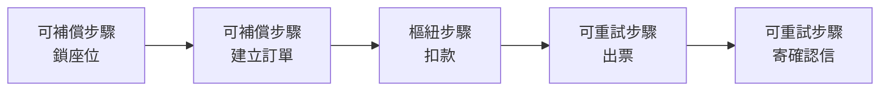
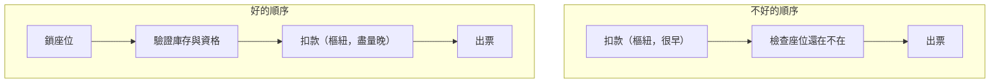

# [E-13-22] Saga 的樞紐步驟：過了這一步，就不能回頭

> **目標**：在一串 Saga 步驟裡辨認出「樞紐（pivot step）」——過了它就不能回頭的那一步；理解樞紐之前（可補償）和之後（可重試）的失敗處理策略為什麼完全相反，以及怎麼設計讓樞紐盡量晚發生。

> 前置：先看懂 Saga 和 2PC 的基本定義、補償交易是什麼 → [E-13-14：分散式交易（2PC 與 Saga）](./E-13-14-distributed-transactions.md)。本篇不重複那些，**只聚焦 Saga 裡「樞紐」這一個概念**。

## 一個問題：訂票到一半失敗了，錢到底該退還是該硬做下去？

你在做一個訂票流程，它跨好幾個服務、一步一步做：

```
1. 鎖住座位（庫存服務）
2. 建立訂單（訂單服務）
3. 扣款（支付服務）
4. 出票（票務服務）
5. 寄確認信（通知服務）
```

E-13-14 教過：跨服務沒辦法用單一資料庫交易，於是用 **Saga**——把流程拆成一串步驟，**哪一步失敗了，就把前面做過的步驟一步步「補償」回去**（補償＝做一個相反的動作，例如「鎖座位」的補償是「放開座位」）。

聽起來很乾淨：失敗就全部回滾。但真的做下去你會卡住：

- 如果**第 4 步「出票」**失敗了，難道要把第 3 步「扣款」退掉、第 1 步「座位」放掉，整筆取消？可是錢都收了、使用者也確實要這張票，**退掉反而是幫倒忙**——這種情況應該是「想辦法把票出出來」，而不是回滾。
- 但如果**第 2 步「建立訂單」**失敗了，那把第 1 步「座位」放掉、整筆取消，就很合理。

同樣是「某一步失敗」，一個該回滾、一個該硬做下去——**為什麼？** 因為這條 Saga 裡有一個分界點：**扣款**。過了扣款這一步，整件事的性質就變了，不能再當作「沒發生過」回滾掉。這個分界點，就是這篇的主角——**樞紐步驟（pivot step）**。

## 生活類比：婚禮上的「我願意」

想像一場婚禮的流程：發喜帖、布置會場、賓客入座、**證婚人問「你願意嗎」而你說「我願意」**、宴客、送客。

「我願意」之前的每一步都還能**取消**：喜帖可以說聲抱歉、會場可以撤、賓客可以請回。雖然麻煩，但都還「退得回去」。

可是一旦你說出「我願意」、完成登記——這件事就**成立了**，不能再當作沒發生。從這一刻起，後面的宴客、送客就算出了狀況（菜上慢了、音響壞了），你也不會因此「取消婚姻」，而是**想辦法把它辦完**。

「我願意」就是這場流程的**樞紐**：

- **它之前**的步驟，萬一要喊停，都還能一步步**撤銷（補償）**。
- **它之後**的步驟，就算卡住，也只能**想辦法完成**，不能回頭。

Saga 的樞紐步驟，就是這個「我願意」。

## 三種步驟：可補償、樞紐、可重試

有了這個分界點，一條 Saga 的步驟其實分成三類：



這張圖在表達：樞紐（扣款）像一道閘門，把流程切成「它之前都能撤銷」和「它之後只能完成」兩半。

三類步驟的定義與處理策略：

| 類別 | 英文 | 是什麼 | 失敗了怎麼辦 |
|---|---|---|---|
| **可補償步驟** | compensatable | 樞紐**之前**的步驟，每一步都有對應的「相反動作」 | **往回補償**：把這步和它之前所有步驟一步步撤銷，整筆取消 |
| **樞紐步驟** | pivot | 那一步「過了就不能回頭」的分界點（通常是不可補償 non-compensatable 的動作） | 它本身成功 → 從此只進不退；它本身失敗 → 當作「還沒過樞紐」，往回補償 |
| **可重試步驟** | retriable | 樞紐**之後**的步驟，保證「只要一直試，終究會成功」 | **一直重試**（配退避、必要時告警找人），**永遠不回滾** |

關鍵在於**樞紐前後的策略完全相反**：

- **樞紐之前失敗 → 往回補償（回滾）**：整件事還沒「成立」，乾淨地取消掉，大家當無事發生。
- **樞紐之後失敗 → 不斷重試到成功（絕不回滾）**：整件事已經「成立」了，退不回去，只能咬著牙把它推完。

這也解釋了開頭的問題：出票（第 4 步）在樞紐之後，所以它失敗時不是退款，而是**重試出票**；建立訂單（第 2 步）在樞紐之前，所以它失敗時**可以**整筆回滾、放開座位。

## 怎麼辨認樞紐，又怎麼讓它盡量晚

**辨認樞紐的準則：找出那個「做了就無法乾淨地收回」的動作。** 問自己一句：「這一步做完之後，我還能不能**不留痕跡地**把它當作沒發生？」

- 能 → 它是可補償步驟（鎖座位可以放開、建訂單可以取消）。
- 不能，或收回的代價 / 副作用大到不該收回 → 它就是樞紐（對外收了真金白銀、對外部系統送出了不可撤回的指令、寄出了實體物品）。

在訂票流程裡，**扣款**就是樞紐：錢一旦真的從使用者帳戶扣走、進了金流，就不該再「假裝沒收過」——退款是另一筆交易、有手續費與對帳成本，而且使用者明明是想買票。

**設計心法：讓樞紐盡量晚發生。** 因為樞紐之前的失敗可以乾淨回滾，樞紐之後只能硬著頭皮重試——所以**把「還可能失敗、還需要驗證」的事情，盡量排在樞紐之前做掉**。樞紐越晚，能乾淨回滾的範圍就越大，卡在「進退兩難」的機會越小。



這張圖在表達：把所有「可能失敗、要驗證」的事（鎖座位、驗證資格）排在樞紐**之前**；等這些都穩了才扣款，扣款之後就只剩「保證做得成」的步驟。

對照「不好的順序」：如果你一開始就扣款，然後才發現座位沒了——此時已過樞紐，你不能乾淨回滾，只能退款（一筆額外交易）＋跟使用者道歉。把扣款往後挪到「座位確定鎖好」之後，就完全避開這個窘境。

## 正式程式碼：把步驟分類寫進流程

把這個概念落成程式。先把每個步驟標上它的類別，流程引擎看類別決定失敗時的策略——這比把「該補償還是該重試」的判斷散落在各處清楚得多。

先定義型別。一個 Saga 由一串步驟組成，每步標明自己是哪一類：

```typescript
// 三種步驟類別。流程引擎靠這個標籤決定「失敗了往回補償，還是往前重試」。
type StepKind = "compensatable" | "pivot" | "retriable";

interface SagaStep {
  name: string;
  kind: StepKind;
  run: () => Promise<void>;        // 執行這一步
  compensate?: () => Promise<void>; // 補償動作（只有可補償步驟與樞紐需要）
}
```

接著是流程引擎。它的核心邏輯就是「**還沒過樞紐 → 失敗就補償；已過樞紐 → 失敗就重試**」：

```typescript
async function runSaga(steps: SagaStep[]): Promise<void> {
  const done: SagaStep[] = []; // 已成功、將來要補償時倒著撤銷的步驟
  let passedPivot = false;     // 是否已經越過樞紐

  for (const step of steps) {
    try {
      if (step.kind === "retriable") {
        // 樞紐之後：保證做得成，一直重試，永遠不回滾。
        await runWithRetry(step.run, step.name);
      } else {
        await step.run();
      }
    } catch (error) {
      if (passedPivot) {
        // 已過樞紐卻失敗，而且不是可重試步驟——這是設計錯誤：
        // 樞紐之後的每一步都「必須」是可重試的，否則會卡在無法前進也無法回頭。
        throw new Error(
          `步驟「${step.name}」在樞紐之後失敗，但它不可重試——這一步的設計有問題`,
        );
      }
      // 還沒過樞紐：乾淨回滾，把已完成的步驟倒著補償回去。
      await compensateAll(done);
      throw new Error(`訂票在「${step.name}」失敗，已整筆取消`, { cause: error });
    }

    done.push(step);
    if (step.kind === "pivot") {
      // 樞紐成功的這一刻，整件事「成立」了，之後只進不退。
      passedPivot = true;
    }
  }
}

// 補償：倒著把做過的步驟撤銷（後做的先撤，順序不能反）。
async function compensateAll(done: SagaStep[]): Promise<void> {
  for (const step of [...done].reverse()) {
    if (step.compensate) {
      // 補償本身也可能失敗，但不能因此停手——記下來、繼續補下一個，別讓一個卡住全部。
      await runWithRetry(step.compensate, `補償 ${step.name}`);
    }
  }
}
```

最後是訂票流程的組裝——哪一步是樞紐，在這裡一目了然：

```typescript
const bookingSaga: SagaStep[] = [
  { name: "鎖座位", kind: "compensatable", run: lockSeat, compensate: releaseSeat },
  { name: "建立訂單", kind: "compensatable", run: createOrder, compensate: cancelOrder },
  { name: "扣款", kind: "pivot", run: charge, compensate: refund }, // ← 樞紐，盡量晚
  { name: "出票", kind: "retriable", run: issueTicket },
  { name: "寄確認信", kind: "retriable", run: sendConfirmation },
];
```

重點：

- **扣款標成 `pivot` 且排在最後面能排的位置**——所有需要驗證、可能失敗的事（鎖座位、建訂單）都在它之前做完。
- **樞紐之後的步驟標 `retriable`**，引擎用重試處理，不做補償。
- **樞紐之後若出現非可重試的失敗，引擎直接拋設計錯誤**——這是在提醒你：樞紐之後的每一步都必須保證「重試終會成功」，否則整個流程會卡死在進退兩難。

## 常見錯誤（反模式）

> **常見錯誤一：對樞紐之後的步驟做補償（回滾）**
>
> ```typescript
> // 壞：出票失敗，就把扣款退掉、座位放掉，整筆取消
> try {
>   await issueTicket();
> } catch {
>   await refund();      // 😱 錢退了
>   await releaseSeat(); // 😱 座位也放了
> }
> ```
>
> 問題是：出票在樞紐（扣款）**之後**。使用者的錢已經收了、他也真的要這張票——出票只是「我方系統暫時出不了」，正確的回應是**重試把票出出來**，不是把整筆取消。退款＋放座位反而製造了「使用者付了錢卻什麼都沒拿到」的更糟局面，還多出對帳與客訴成本。
>
> **正確做法**：樞紐之後的步驟失敗，**一律重試到成功**（配指數退避，重試很久仍不行就告警找人工介入），**永遠不回滾**。要做到這點，樞紐之後的步驟在設計上就必須是「只要一直試終究會成」的（例如出票是對內部系統的操作，不依賴任何還可能拒絕你的外部方）。

> **常見錯誤二：把樞紐排太早**
>
> ```typescript
> // 壞：一開始就扣款，之後才發現座位沒了
> const badSaga = [
>   { name: "扣款", kind: "pivot", run: charge },
>   { name: "鎖座位", run: lockSeat }, // 這步失敗時，已過樞紐，只能退款
> ];
> ```
>
> 問題是：扣款（樞紐）排在「鎖座位」前面。萬一座位剛好被別人訂走、鎖座位失敗——此時已過樞紐，你沒辦法乾淨回滾，只能退款（一筆額外交易）＋道歉。本來可以避免的「進退兩難」被你自己製造出來了。
>
> **正確做法**：**讓樞紐盡量晚**。把所有「可能失敗、需要驗證」的步驟（鎖座位、驗證資格、檢查庫存）都排在樞紐**之前**，全部確定沒問題了才扣款。樞紐越晚，能乾淨回滾的範圍越大。

> **常見錯誤三：樞紐之後擺了一個「可能永遠失敗」的步驟**
>
> 有人在樞紐之後放了一步「呼叫某個外部合作方的 API」，而這個外部方**可能一直拒絕**你。這下你卡死了：往前推不動（對方一直拒絕）、往後退不了（已過樞紐不能回滾）。
>
> **正確做法**：樞紐之後的每一步都必須是**真正可重試**的——它的成功只取決於「你夠不夠有耐心重試」，不取決於任何還可能拒絕你的外部方。如果某個動作「可能被永久拒絕」，它要嘛移到樞紐**之前**（這樣失敗還能回滾），要嘛它自己該被設計成樞紐。別把「結果不確定」的步驟放在「只能往前」的區段。

## 小結

- **Saga 裡有一個樞紐步驟（pivot step）**：過了它就不能回頭。辨認準則——「這步做完後，還能不能不留痕跡地當作沒發生？」不能，它就是樞紐（例如對外扣款）。
- 一條 Saga 的步驟分三類：**可補償（樞紐之前，失敗就往回補償回滾）、樞紐（分界點）、可重試（樞紐之後，失敗就一直重試、絕不回滾）**。
- **樞紐前後策略完全相反**：之前失敗→乾淨回滾整筆取消；之後失敗→咬著牙重試到成功。因為整件事在樞紐那一刻「成立」了，退不回去。
- **設計心法：讓樞紐盡量晚**。把所有可能失敗、需要驗證的步驟排在樞紐之前，避免「已收錢卻發現前提不成立」的進退兩難。
- 樞紐之後的每一步都必須**真正可重試**（成功只取決於你夠不夠有耐心，不取決於任何還可能拒絕你的外部方），否則流程會卡死。

> Saga、2PC 的基本定義與補償交易是什麼 → [E-13-14：分散式交易](./E-13-14-distributed-transactions.md)
> 「結果落地後只能發、不能退」正是金流版的樞紐規則，還有狀態機與收尾程式的完整做法 → [E-15-2：錢的狀態機](../E-15-resilience/E-15-2-money-state-machine.md)
> 重試、冪等為什麼是分散式的基本功 → [E-13-15：冪等性、重試與訊息傳遞保證](./E-13-15-idempotency.md)
