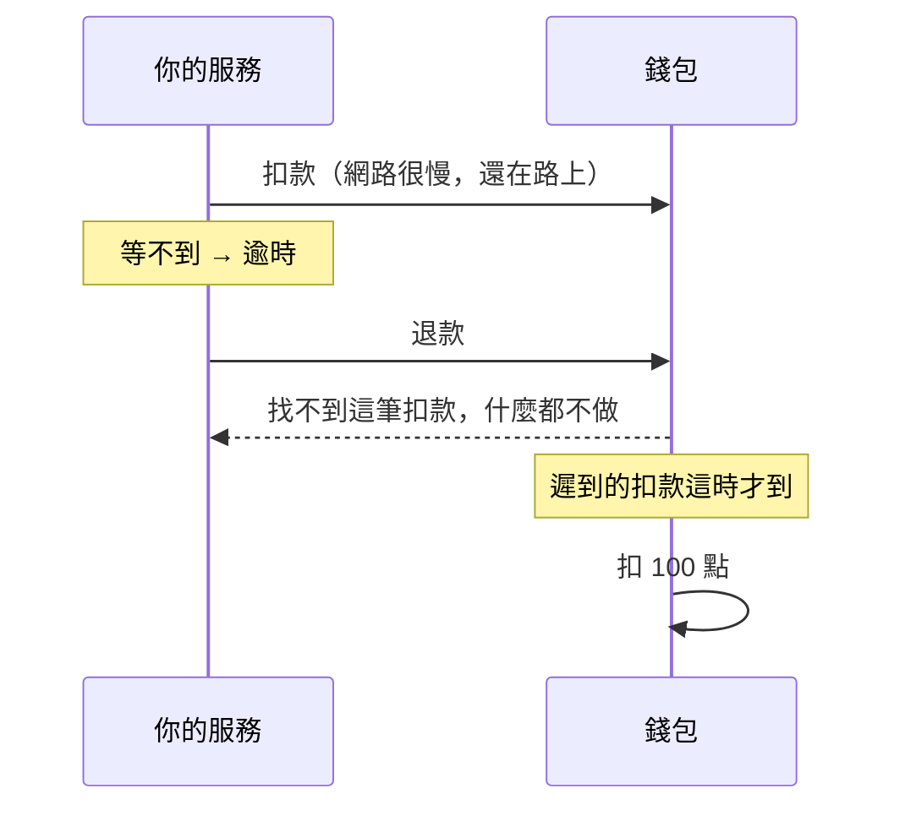
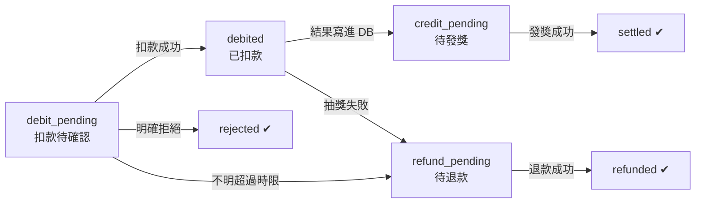

# [E-15-2] 錢的狀態機：逾時、當機、重送都不會扣兩次

> **目標**：知道怎麼設計「扣錢 → 算結果 → 發錢」這種跨系統流程，讓它在逾時、程序被砍、請求重送時都不會扣兩次、不會漏退款；並知道怎麼**真的**測出來。

> 前置：先看懂冪等鍵的基本觀念 → [E-13-15：冪等性、重試與訊息傳遞保證](../E-13-scaling/E-13-15-idempotency.md)。那篇講「為什麼要冪等」，這篇講「錢的流程實際上怎麼做才不出事」。

## 一個場景：點數抽獎

玩家花 100 點抽一次獎。你的服務要做三件事，點數存在**外部的錢包服務**：

```
1. 跟錢包說：扣 100 點
2. 抽獎，算出玩家贏了多少
3. 跟錢包說：發 X 點
```

聽起來很簡單。但每一步都可能出這些事：

- 錢包**沒回應**（逾時）——你不知道錢到底扣了沒
- 你的程序在兩步之間**被砍掉**（部署、當機、OOM）
- 玩家網路不好，**同一個抽獎請求送了兩次**
- 兩台伺服器**同時**處理同一筆

一個很常見的寫法是把錯誤處理寫在當下的 `try/catch`：

```
try:
    錢包.扣款(100)
    結果 = 抽獎()
    回給玩家(結果)
    錢包.發獎(結果.贏分)
catch:
    錢包.退款(100)
```

這段有四個洞，下面一個一個看。

## 洞 1：每次呼叫產生新的冪等鍵

很多人知道要帶冪等鍵，但寫成**每次呼叫時才產生**（例如 `uuid()`）。HTTP 客戶端自己重試時會沿用同一個請求，所以沒事；可是一旦**程序重啟後重新呼叫**，就是一個全新的鍵——錢包當成新交易，再扣一次。

**解法：冪等鍵由「業務編號＋步驟」決定。**

```
抽獎編號 = 在扣款前就產生，寫進資料庫
扣款的鍵 = 抽獎編號 + ":debit"
發獎的鍵 = 抽獎編號 + ":credit"
退款的鍵 = 抽獎編號 + ":refund"
```

這樣不管是第幾次送、哪台機器送、重啟後誰接手，同一步的鍵**永遠一樣**。

## 洞 2：逾時就退款

逾時的真正意思是「**我不知道**」——錢包可能根本沒收到，也可能已經扣好了、只是回應在路上丟了。

`catch` 裡直接送退款，看起來很安全，其實有個時序陷阱：



這張圖在表達：退款比扣款先到，錢包「找不到原交易」就忽略退款；扣款晚到照扣。玩家白白少 100 點，**而且雙方的帳看起來都正常**——你的服務記得「退款成功」，錢包記得「扣款成功」。

**解法分兩半：**

1. **結果不明 → 用同一把鍵重送**，直到拿到明確答案（成功或明確拒絕）。錢包看到同一個鍵就回「第一次的結果」，不會重扣
2. **真的等太久要放棄時才送退款**，而且錢包必須遵守：**退款先到，也要留一筆紀錄**（俗稱墓碑 tombstone）。之後同一筆扣款再到，一律拒絕

第 2 點是錢包那邊的責任。你串接別人的錢包時，要拿這個情境去測他們的沙盒，不要假設他們做到了。

## 洞 3：先讓玩家看到結果，發獎失敗就退款

上面的寫法是「回給玩家」之後才「發獎」。發獎失敗走 `catch` 退款 → 玩家剛看到的贏分**作廢**，只拿回押注。

**解法：一條硬規則——結果寫進資料庫之後，這筆就只能發，不能退。** 發獎失敗就一直重試（必要時告警找人），永遠不改成退款。反過來，結果在寫進資料庫之前，也不能給玩家看。

## 洞 4：狀態只在 try/catch 的執行流程裡

程序在第 1 步和第 2 步之間被砍掉，`catch` 根本不會執行。重啟之後，**沒有任何地方知道這筆做到哪了**。

**解法：把流程寫成狀態機，狀態存在資料庫。**



這張圖在表達：每筆抽獎永遠處在某個狀態，✔ 是終點。注意 `credit_pending` 只有一條出路——這就是洞 3 的硬規則。

每一次轉換是**一筆資料庫交易**：改狀態、寫轉換紀錄、寫帳本，要嘛全部成功、要嘛全部沒發生。

## 只有一個「推進一步」的函式

```
函式 推進一步(抽獎):
    依照 抽獎.狀態：
        debit_pending   → 送扣款（鍵 = 編號:debit）
        debited         → 抽獎，把結果寫進 DB
        credit_pending  → 送發獎（鍵 = 編號:credit）
        refund_pending  → 送退款（鍵 = 編號:refund）
    成功 → 轉到下一個狀態
    結果不明 → 記下「失敗一次」，停在原狀態，晚點再推
```

線上請求、重送的請求、背景收尾程式，**全部呼叫同一個函式**。出錯時不當場決定怎麼辦，只記下來，等下次推。這樣「正常流程」和「出事後的收尾」不可能寫成兩套不一致的邏輯。

**收尾程式**（reaper）：背景定期掃描「沒到終點、超過 N 秒沒動」的抽獎，一筆一筆呼叫「推進一步」。它就是那個「把卡住的單收完的人」——沒有它，當機留下的半成品只能靠人工對帳。

## 併發：用資料庫的鎖，不用記憶體的鎖

推一筆之前，先鎖住資料庫裡那一列：

```sql
SELECT * FROM draws WHERE draw_id = $1 FOR UPDATE;
```

別人要推同一筆就得排隊，排到時看到的是最新狀態。收尾程式用：

```sql
SELECT * FROM draws WHERE state NOT IN (...) AND updated_at < now() - interval '30 seconds'
FOR UPDATE SKIP LOCKED LIMIT 100;
```

`SKIP LOCKED` 的意思是「有人在處理的就跳過」，多台機器同時掃也不會互相等。記憶體裡的鎖（mutex）只管得到同一個程序，多台機器、程序重啟就失效。

> 鎖的基本概念 → [E-4-5：資料庫鎖與並發控制](../E-4-database/E-4-5-database-lock.md)

**代價**：如果鎖一直握到錢包回應，每個進行中的錢包呼叫都佔一條資料庫連線，**連線池大小就是同時處理量的上限**。錢包變慢時會先塞在這裡。量大時的改法是「先寫下要做什麼、放鎖、再打錢包」，但狀態機會多幾個狀態。先選簡單的、壓測後再改，是合理的順序。

## 把規則寫進資料庫，不靠人記得

程式碼會被改，資料庫約束會一直在。這幾條規則可以直接讓資料庫擋：

**同一位玩家同時最多一筆進行中**——用 partial unique index（只對符合條件的列建唯一索引）：

```sql
CREATE UNIQUE INDEX one_open_draw_per_player
    ON draws (player_id)
    WHERE state NOT IN ('settled', 'rejected', 'refunded');
```

為什麼不用程式「先查有沒有、沒有再寫」？兩個請求同時進來，兩邊都會查到「沒有」，然後都寫進去。只有唯一索引能讓第二個寫入失敗。

**有結果 ⇔ 處於只能發獎的階段**——用 CHECK 約束：

```sql
CHECK ((win_amount IS NOT NULL) = (state IN ('credit_pending', 'settled')))
```

以後有人加了一條「發獎失敗改退款」，這筆寫入會直接被資料庫拒絕。

**轉換紀錄、帳本只能新增**——用 trigger 擋 UPDATE／DELETE：

```sql
CREATE FUNCTION forbid_update_delete() RETURNS trigger LANGUAGE plpgsql AS $$
BEGIN
    RAISE EXCEPTION '% 只能新增，不能修改或刪除', TG_TABLE_NAME;
END $$;
CREATE TRIGGER ledger_append_only BEFORE UPDATE OR DELETE ON ledger
    FOR EACH ROW EXECUTE FUNCTION forbid_update_delete();
```

同一條重要規則，可以在「狀態機程式」「轉換白名單」「資料庫約束」三層各擋一次。

## 怎麼證明它真的不會出事

### 1. 檢查「結果」，不是檢查「過程」

每個測試情境結束後檢查的是不變量（invariant，任何時候都必須成立的條件）：

- 錢包餘額 = 初始值 + 你這邊帳本的加總（而且逐筆對得上）
- 沒有任何一筆卡在中間狀態超過時限
- 每一筆在錢包最多成功扣款一次
- 結果寫進 DB 的，一定照贏分發了獎

### 2. 真的把程序砍掉

用 `panic` 再 `recover` 模擬當機是假的——程序還活著，記憶體裡的東西都還在。要測就讓程序**真的結束**：

```go
// 測試時設環境變數 CRASH_AT=after_wallet_debit，程序就在那個點直接結束
func Hit(point string) {
    if os.Getenv("CRASH_AT") == point {
        os.Exit(70)
    }
}
```

測試流程：起一個真的服務執行檔 → 讓它死在某個點 → 確認資料庫停在預期狀態、錢包那邊確實已經扣了 → 起一個新的服務 → 等收尾程式收完 → 檢查不變量。

**最危險的點**是「錢包已經成功、你這邊還沒記下」的那一瞬間，每一種錢包操作都要測一次。

### 3. 製造「結果不明」

模擬錢包要能注入故障：延遲、處理前就回 500、**處理完（已寫入）卻不回應**、同一個回應送兩次。第三種最重要，它就是真實世界的逾時。

### 4. 陽性對照：故意弄壞，確認測試會紅

測試全綠不代表測得到問題。故意弄壞一條規則，確認測試會失敗、而且錯誤訊息指得出是哪條：

| 故意弄壞 | 應該看到 |
|---|---|
| 冪等鍵改成每次產生新的 | 「同一筆在錢包扣款 2 次」「餘額 ≠ 帳本」 |
| 模擬錢包改成「退款先到就忽略」 | 「餘額 ≠ 帳本」（玩家少錢） |
| 發獎失敗改成退款 | 被轉換白名單或 CHECK 約束擋下 |

做陽性對照常會有意外收穫：例如發現「發獎失敗改退款」時，**錢包餘額和帳本照樣對得上**——因為退款也是一筆正常記帳的交易。只檢查「餘額 = 帳本」抓不到它，要另外檢查「結果寫進 DB 的，一定照贏分發了獎」。不弄壞一次，你不會知道自己的檢查有盲點。

> 測試相關觀念 → [E-9 測試](../E-9-testing/)

## 小結

- 冪等鍵由**業務編號＋步驟**決定，不在呼叫時隨機產生
- 逾時 = 不知道。**用同一把鍵重送**到有明確答案；真要放棄才退款，而且錢包要記住先到的退款
- **結果落地後只能發、不能退**；落地前不能給人看
- 狀態存在資料庫、**只有一個推進函式**、背景收尾程式負責收完卡住的單
- 用資料庫的鎖（`FOR UPDATE`／`SKIP LOCKED`）和約束（partial unique index、CHECK、append-only trigger）把規則寫死
- 測試要**真的砍程序**、要製造「已寫入卻不回應」、要做**陽性對照**

> 跨服務一致性的另一種做法（Saga、補償） → [E-13-14：分散式交易](../E-13-scaling/E-13-14-distributed-transactions.md)；依賴壞掉時怎麼給備案 → [E-15-1：Fallback Pattern](./E-15-1-fallback.md)
