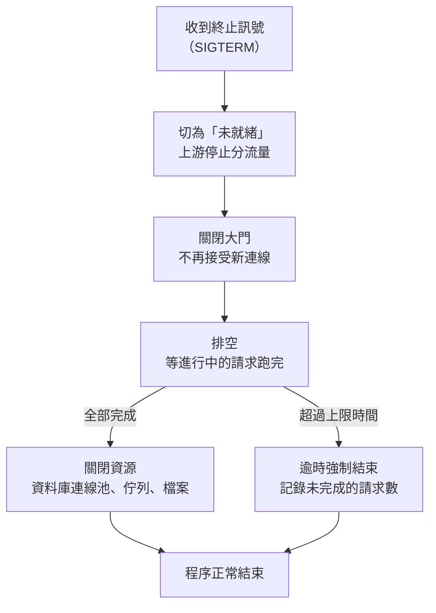

# [E-15-3] 優雅關機：收到關閉訊號後，做完手上的事再走

> **目標**：理解服務收到終止訊號（SIGTERM）後，為什麼不能立刻斷電，而要「停收新請求 → 排空進行中的請求 → 關閉資源 → 逾時才強制結束」；並知道硬關會造成哪些半完成交易與連線洩漏。

## 一個問題：部署更新時，正在結帳的那個人怎麼辦？

想像你維運一個 HTTP 後端服務。某天你要部署新版本，流程很單純：把舊的那台關掉、換上新的。

關掉的那一刻，這台服務身上可能正**同時**處理著好幾十個請求：有人在查詢訂單、有人剛按下「送出付款」、有一支背景工作正在寫資料庫。如果你直接「拔插頭」——程序被瞬間砍掉——這些進行中的工作會發生什麼事？

- 那個剛按下付款的人：請求處理到一半被切斷。錢**可能已經扣了**，但「寫入訂單」那一步還沒做完。他看到的是一個轉圈圈到最後變成的錯誤畫面。
- 那支正在寫資料庫的背景工作：寫了一半斷掉，留下一筆殘缺的資料。
- 那些開著的資料庫連線：來不及好好歸還，變成對端還以為你在線上的「幽靈連線」。

這就是**硬關（hard shutdown）**的代價。而「優雅關機（graceful shutdown）」要解決的，就是這件事：

> **收到關閉訊號不是立刻斷電，而是「先不要再接新客人，把手上的客人服務完，再鎖門下班」。**

## 生活類比：餐廳打烊

一家餐廳要打烊了，老闆不會在時間一到就把客人全部轟出去、燈一關走人。正常的打烊是這樣：

1. **先把「營業中」的牌子翻成「準備打烊」**——不再放新客人進來。
2. **已經在店裡的客人，讓他們把飯吃完。**
3. 客人都走了，才去**關瓦斯、鎖冰箱、關燈**（收拾資源）。
4. 但也不能無限等下去——如果有一桌客人聊到天亮都不走，到了某個**上限時間**，就得請他們結帳離開（強制結束）。

優雅關機就是這四步的翻版：停收新請求、排空進行中的請求、關閉資源、設上限逾時。我們一步一步看。

## 第一步：為什麼「停收新請求」要先做

收到關閉訊號後，第一件事是**讓負載平衡器（load balancer，把流量分到多台伺服器的那一層）不要再把新請求送過來**。

這件事有先後順序的學問。在容器調度（如 Kubernetes）環境下，「把這台從流量清單移除」和「送關閉訊號給這台」這兩件事是**非同步**發生的——你可能先收到關閉訊號，但流量還在進來好幾秒。所以實務上常見的做法是：**收到訊號後先把「就緒探針」切成失敗**，讓上游知道「別再分流量給我了」，等上游真的停止送新請求，再開始排空。

> 就緒探針（readiness probe）怎麼運作、為什麼和存活探針不能混用 → [E-15-4：readiness 與 liveness 探針](./E-15-4-readiness-liveness.md)

## 第二步：排空（drain）——把手上的請求做完

「排空」指的是：**停止接受新連線，但讓已經在處理中的請求跑完**。這是整個優雅關機的核心。

用 pseudo code 描述整段流程的骨架：

```
收到 關閉訊號（SIGTERM）：
    1. 把「就緒」狀態切成否      // 上游別再送新請求來
    2. 關閉「接收新請求」的大門    // 新連線一律拒絕
    3. 等待 進行中的請求 全部完成  // 這就是「排空」
    4. 關閉資料庫連線池、訊息佇列等資源
    5. 程序正常結束

但是（第 3 步）不能無限等：
    如果 排空超過 上限時間（例如 30 秒）：
        強制結束，記下「有 N 個請求沒跑完」
```

注意第 3 步和最後那段「但是」——**排空一定要配一個上限時間**，否則一個卡住的請求會讓你永遠關不掉。這點後面「常見錯誤」會再強調。

用一張流程圖把這段走一遍：



這張圖表達：從收到訊號到程序結束，中間一定經過「停收新請求、排空、關資源」三段，而排空這段設了一個逾時的岔路——跑得完就正常收尾，跑不完就強制結束。

## 第三步：成對地關閉資源

請求排空完，才輪到收拾資源：資料庫連線池、訊息佇列的連線、開著的檔案、背景計時器。這裡的原則是「**開了什麼，就要在這裡對應地關什麼**」——註冊和解除、開啟和關閉，要成對出現。

為什麼順序是「先排空請求、後關連線池」？因為反過來會自己打自己：如果你先關了資料庫連線池，那些還在排空中、需要寫資料庫的請求就會全部失敗。**資源要等到沒有人用它了，才能關。**

## 正式程式碼範例

把上面的概念寫成一段 TypeScript。情境：一個 HTTP 後端服務，監聽 `SIGTERM`（部署工具和容器調度器用來要求關閉的標準訊號）。

這段程式碼在做的事：收到訊號後，先停止接受新連線，等進行中的請求跑完，再關連線池；並且設一個上限時間，逾時就強制結束。

```typescript
// 排空的上限時間。設成具名常數，不要讓這個「30000」散落在程式各處。
// 這個值要比「容器調度器等你關閉的寬限時間」短一點，否則你還沒排空完就被直接砍了。
const SHUTDOWN_TIMEOUT_MS = 30_000;

interface Closeable {
  close(): Promise<void>;
}

// server：HTTP 伺服器；pool：資料庫連線池。兩者都要在關機時收尾。
async function gracefulShutdown(server: HttpServer, pool: Closeable): Promise<void> {
  // 第一步：切成未就緒，讓就緒探針失敗，上游停止分新流量過來。
  readinessState.markNotReady();

  // 第二步：關閉「接收新連線」的大門。注意 server.close() 的語意是
  // 「不再接受新連線，但讓已經在處理的請求跑完」——它本身就是排空。
  const drained = closeServer(server);

  // 排空和逾時賽跑：誰先到就用誰的結果。
  const timedOut = await Promise.race([
    drained.then(() => false),
    delay(SHUTDOWN_TIMEOUT_MS).then(() => true),
  ]);

  if (timedOut) {
    // 不要靜默吞掉——逾時代表「有請求沒跑完就被我們放生了」，一定要留下紀錄。
    logger.warn("排空逾時，仍有未完成的請求，即將強制關閉", {
      pendingRequests: server.getActiveRequestCount(),
    });
  }

  // 第三步：請求排空（或逾時放棄）之後，才關資源。順序不能顛倒：
  // 先關連線池會害還在排空的請求連不到資料庫。
  await pool.close();

  logger.info("優雅關機完成");
}

// 把 server.close() 的 callback 風格包成 Promise，方便上面用 await。
function closeServer(server: HttpServer): Promise<void> {
  return new Promise((resolve, reject) => {
    server.close((error) => (error ? reject(error) : resolve()));
  });
}

// 把關機掛到訊號上。SIGTERM 是正常關閉；SIGINT 是你在終端機按 Ctrl+C。
function registerShutdown(server: HttpServer, pool: Closeable): void {
  for (const signal of ["SIGTERM", "SIGINT"] as const) {
    process.once(signal, () => {
      logger.info(`收到 ${signal}，開始優雅關機`);
      gracefulShutdown(server, pool)
        .then(() => process.exit(0))
        .catch((error) => {
          logger.error("關機過程出錯", { reason: toMessage(error) });
          process.exit(1);
        });
    });
  }
}
```

幾個對應到規範的重點：

- **逾時是必須的**：`Promise.race` 讓「排空」和「上限時間」賽跑，排不完也不會卡死，到點就強制走。
- **資源關閉有順序**：先 `closeServer`（排空），後 `pool.close()`（關連線池），不能顛倒。
- **不吃掉錯誤**：逾時要 `logger.warn` 記下「有幾個請求沒跑完」；關機出錯要 `logger.error`。悄悄關掉會讓你事後完全查不到「那批失敗的請求是部署時被切斷的」。
- **用 `process.once` 不是 `process.on`**：關機只該觸發一次，第二次收到訊號不該又跑一遍（這就是「成對、只做一次」的體現）。

這段程式碼示範了關機時「開什麼就關什麼」的成對收尾——每一個在啟動時開啟的資源，都要在這裡找到對應的關閉。

> 這裡 Go 語言版本的完整實作（用 `context` 控制逾時、`SIGTERM` 怎麼接）→ [go-7-5：優雅關機與 context](../../lessons/go/part-7/go-7-5-graceful-shutdown.md)

## 常見錯誤（反模式）

> **常見錯誤一：排空不設上限時間**
>
> 「既然要做完手上的事，那就等到全部做完為止吧」——聽起來很體貼，但只要有**一個**請求卡住（例如它在等一個已經掛掉的下游服務、或陷入無窮迴圈），你的服務就**永遠關不掉**。
>
> ```typescript
> // 危險：沒有上限，一個卡住的請求就讓整台永遠下不了班
> await closeServer(server); // 若有請求永遠不回來，這行永遠不 resolve
> await pool.close();
> ```
>
> 而容器調度器對「關不掉」的服務沒有耐心——它等不到你自己關閉，過了寬限時間就會直接送 `SIGKILL`（這個訊號**無法被攔截**，程序當場死亡）。於是你精心寫的排空邏輯一行都沒跑到，退化成最糟的硬關。
>
> **正確做法**：排空一定要和一個上限時間賽跑（前面範例的 `Promise.race`），而且這個上限要**比調度器的寬限時間短**，讓你有機會在被 `SIGKILL` 之前自己乾淨收尾。

> **常見錯誤二：先關資源、後排空請求**
>
> ```typescript
> // 壞：順序顛倒——連線池先關了，還在排空的請求全部連不到資料庫
> await pool.close();
> await closeServer(server); // 這些請求需要資料庫，但池子已經沒了
> ```
>
> 問題是：這些「手上的客人」本來可以好好服務完，卻因為你太早把廚房瓦斯關了，害他們的餐做到一半失敗。排空的意義整個落空。
>
> **正確做法**：資源永遠在「確定沒有人要用它」之後才關。順序是「停收新請求 → 排空 → 關資源」，一步都不能提前。

> **常見錯誤三：完全不處理訊號，把半完成交易留給下次收尾**
>
> 有人覺得「反正我有背景收尾程式會把卡住的單收完，關機硬關也沒差」。這在「錢的狀態機」那種有狀態機＋收尾程式的設計下，確實**不會算錯帳**——但它把本來可以當場跑完的交易，變成一筆需要事後補救的半成品，徒增對帳負擔與使用者看到的錯誤。
>
> **正確做法**：優雅關機和「狀態機＋收尾程式」是互補、不是二選一。優雅關機讓**絕大多數**請求在關機時正常跑完（減少殘骸），狀態機＋收尾程式則是最後一道保險，接住那些真的被逾時強制切斷的少數。兩者都要有。
>
> 關機時被切斷的那些「扣了錢還沒寫訂單」的半完成交易，為什麼不會變成扣兩次 → [E-15-2：錢的狀態機](./E-15-2-money-state-machine.md)

## 小結

- **優雅關機**＝收到關閉訊號後，依序做四件事：**停收新請求 → 排空進行中的請求 → 關閉資源 → 逾時才強制結束**。核心是「做完手上的事再走」。
- **順序不能亂**：先讓上游停止分流量（切未就緒）、再關接收新連線的門、排空完才關連線池等資源。太早關資源會害還在排空的請求失敗。
- **排空一定要配上限時間**：否則一個卡住的請求就讓你永遠關不掉，最後被 `SIGKILL` 硬砍，等於白做。上限要比調度器的寬限時間短。
- 硬關的代價是**半完成交易**（扣了錢沒寫訂單）和**連線洩漏**（來不及歸還的幽靈連線）。優雅關機減少殘骸，但它和「狀態機＋收尾程式」互補，不是替代。

> 關機時被切斷的交易為什麼不會扣兩次、怎麼靠狀態機接住 → [E-15-2：錢的狀態機](./E-15-2-money-state-machine.md)
> 「切未就緒」用的就緒探針是什麼、為什麼不能和存活探針混用 → [E-15-4：readiness 與 liveness 探針](./E-15-4-readiness-liveness.md)
> Go 語言版的優雅關機完整實作 → [go-7-5：優雅關機與 context](../../lessons/go/part-7/go-7-5-graceful-shutdown.md)
