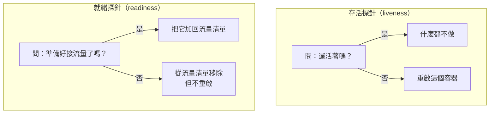

# [E-15-4] readiness 與 liveness 探針：「還活著」和「準備好了」是兩回事

> **目標**：分清楚兩種健康檢查——liveness（存活探針）問「還活著嗎？死了就重啟」、readiness（就緒探針）問「準備好接流量了嗎？沒好就先別分流量給它」；並知道把兩者混用會釀成什麼災難。

## 一個問題：需要暖身的服務，剛啟動就被判「死亡」

想像你維運一個 API 服務。它啟動時不是一瞬間就能服務——它得先**暖身（warm up）**：從資料庫把一大份設定載進記憶體快取、建立好連線池、把一些計算結果預先算好。這個暖身要花 20 秒。暖身完成前，它接到請求也答不出來。

現在，有人幫這個服務加了「健康檢查」：每隔幾秒戳它一下，**連不上或回答不了就把它重啟**。立意良善——服務掛了就自動救活，不用半夜爬起來。

結果呢？服務一啟動，健康檢查馬上戳它。但它還在暖身、答不出來，於是健康檢查判定「這台壞了」，把它**重啟**。重啟後又要重新暖身 20 秒，又答不出來，又被重啟……

你的服務陷入**永遠啟動不起來的無限重啟迴圈**——而它其實一點毛病都沒有，只是需要一點時間暖身而已。

問題出在哪？出在把「你準備好接客了嗎」和「你還活著嗎」這**兩個根本不同的問題，用同一支健康檢查問了**。這章就是要把它們拆開。

## 生活類比：餐廳的兩種問法

一家餐廳，門口站了兩種人，各問一個不同的問題：

- **衛生稽查員**問的是：「這家店**還能營業嗎**？」——如果廚房失火、老闆昏倒，答案是「不行」，那就得**關店整頓**（相當於重啟）。
- **帶位的服務生**問的是：「現在**可以放客人進去坐嗎**？」——如果廚師還在備料、桌子還沒擦，答案是「還不行，再等一下」，但這**不代表要關店**，只是「**暫時先別帶客人進來**」。

這兩個問題的「答案是否」導向**完全不同的處置**：

| 問的人 | 問題 | 答「否」時怎麼辦 |
|---|---|---|
| 衛生稽查員（liveness） | 還活著嗎？ | **重啟**——這台已經壞到救不回來 |
| 帶位服務生（readiness） | 準備好接客了嗎？ | **暫時別分流量**——這台沒壞，只是現在不方便 |

把這兩個混成同一個問題，就像叫衛生稽查員去帶位：廚師還在備料（還沒 ready），他卻判定「這家店不能營業」，把整家店關掉重來。這正是開頭那個無限重啟迴圈的本質。

## 兩種探針分別是什麼

在容器調度（如 Kubernetes）環境裡，這兩個問題各自對應一支**探針（probe）**——調度器定期去呼叫的一個健康檢查端點：

- **liveness probe（存活探針）**：問「這個程序還活著、沒卡死嗎？」。**失敗 → 重啟這個容器**。用來救「活著但卡死」的狀況（例如陷入死結、記憶體耗盡到動不了）。
- **readiness probe（就緒探針）**：問「這台現在可以接流量嗎？」。**失敗 → 把它從負載平衡的流量清單移除**（但不重啟），等它恢復就緒再把流量接回來。用來處理「暫時不方便」的狀況（暖身中、依賴暫時斷線、正在排空關機）。

> 「把流量分到哪幾台」是負載平衡器在做的事，就緒探針的結果直接影響它 → [E-13-7：Load Balancer](../E-13-scaling/E-13-7-load-balancer.md)

用一張圖看兩者的分工：



這張圖表達：兩支探針問的問題不同、失敗後的處置也不同——存活探針失敗會「重啟」，就緒探針失敗只會「暫時不分流量」。

## 關鍵差異：什麼該進哪一支探針

判斷準則就一句話：**「這個狀況重啟能不能救？」**

- **重啟能救** → 放進 liveness。例：程序陷入死結、內部狀態壞到無法恢復。重啟會給它一個乾淨的開始。
- **重啟救不了、甚至更糟** → 放進 readiness。例：
  - **暖身中**——重啟只會讓它重新暖身，更慢。
  - **依賴（資料庫、下游服務）暫時掛了**——重啟你自己這台，依賴還是掛的，問題沒解決，反而把本來只是「暫時 not ready」升級成「整批服務一起重啟」的雪崩。

第二點是整章最重要的雷。用 pseudo code 寫出兩支探針**正確**的判斷邏輯：

```
存活探針（liveness）回答「還活著嗎」：
    只檢查「我自己這個程序有沒有卡死」
    → 不要去戳資料庫、不要去戳下游服務！
    能跑到這行、能回應，就回「活著」

就緒探針（readiness）回答「能接流量嗎」：
    檢查「我現在接到請求，能不能真的服務」
    → 暖身完成了嗎？
    → 必要的依賴連得上嗎？
    任何一項否 → 回「還沒就緒」（但我沒壞，別重啟我）
```

注意最關鍵的那一行：**存活探針不該去檢查外部依賴**。這是下面「常見錯誤」的頭號災難。

## 正式程式碼範例

把上面的概念寫成兩個 HTTP 端點。情境：開頭那個需要暖身的 API 服務。

這段程式碼在做的事：定義一個「服務狀態」物件，`/livez`（存活）只回報程序本身還能回應，`/readyz`（就緒）額外檢查暖身是否完成、依賴是否可用。

```typescript
// 用一個狀態物件集中管理「我現在的狀況」，而不是在探針裡臨時判斷。
interface ServiceHealth {
  // 暖身是否完成。啟動時為 false，載完快取後才設 true。
  warmedUp: boolean;
  // 是否正在關機（優雅關機時切成 true，讓就緒探針失敗、上游停止分流量）。
  shuttingDown: boolean;
}

const health: ServiceHealth = { warmedUp: false, shuttingDown: false };

// 暖身：載入快取。完成後才宣告就緒。
async function warmUp(): Promise<void> {
  await cache.preloadConfig(); // 把設定從資料庫載進記憶體，約需數十秒
  health.warmedUp = true;
  logger.info("暖身完成，服務開始接受流量");
}

// 存活探針：只回答「我這個程序還能回應嗎」。
// 關鍵：這裡「不」檢查資料庫、不檢查下游——那些是 readiness 的事。
// 能執行到這行、能送出回應，就代表程序沒卡死。
function handleLiveness(): HealthResponse {
  return { status: 200, body: "alive" };
}

// 就緒探針：回答「我現在接到流量，能不能真的服務」。
async function handleReadiness(): Promise<HealthResponse> {
  // 正在關機 → 不就緒，讓上游把流量導去別台（這是優雅關機的第一步）。
  if (health.shuttingDown) {
    return { status: 503, body: "shutting down" };
  }
  // 還沒暖身完 → 不就緒，但我沒壞，別重啟我。
  if (!health.warmedUp) {
    return { status: 503, body: "warming up" };
  }
  // 檢查必要依賴。注意：這個「不就緒」只會讓這台暫時不分流量，
  // 不會觸發重啟——所以依賴暫時抖動，不會害我們被整批重啟。
  const dbReachable = await database.ping().catch(() => false);
  if (!dbReachable) {
    return { status: 503, body: "database unreachable" };
  }
  return { status: 200, body: "ready" };
}
```

幾個重點：

- **存活探針極度單純**：不碰任何外部依賴，只證明「程序還能回應」。越簡單越好，因為它一失敗就會重啟。
- **就緒探針才檢查依賴和暖身**：這些狀況的正確處置是「暫時不分流量」，不是重啟。
- **關機也走就緒探針**：`shuttingDown` 一設 true，就緒探針就失敗，上游停止送新請求——這正是上一章優雅關機的第一步。
- **回 503 不吃錯誤**：`database.ping()` 失敗用 `.catch(() => false)` 轉成「不就緒」，而不是讓探針端點自己爆掉。

> 探針端點本身也常是部署在容器調度器上才有的概念 → [E-13-3：Kubernetes 概念入門](../E-13-scaling/E-13-3-kubernetes-intro.md)

## 常見錯誤（反模式）

> **常見錯誤一：存活探針去檢查外部依賴（最危險）**
>
> 這是會釀成大災難的經典錯誤。有人覺得「健康檢查嘛，當然要連資料庫試試看才算健康」，於是把資料庫檢查寫進了**存活**探針：
>
> ```typescript
> // 災難：存活探針檢查資料庫。資料庫一抖，全部服務一起被重啟
> async function handleLiveness(): Promise<HealthResponse> {
>   const dbOk = await database.ping(); // ← 不該出現在 liveness
>   return dbOk ? { status: 200, body: "alive" } : { status: 503, body: "db down" };
> }
> ```
>
> 問題是：假設資料庫暫時抖動了 30 秒。這時**每一台**服務的存活探針都會失敗，調度器把它們**全部重啟**。但重啟救不了資料庫——它們重啟完，資料庫可能還在抖，於是又全部被重啟。本來只是「資料庫短暫不可用、各台應該回報 not ready 稍等一下」的小問題，被升級成「**整個服務叢集集體重啟的雪崩**」，連本來可以服務快取命中請求的機會都沒了。
>
> **正確做法**：外部依賴的檢查**只放 readiness**。依賴掛了，各台回報「暫時不就緒」、從流量清單移除即可，等依賴恢復就自動接回來——全程**沒有任何一台被重啟**。存活探針永遠只檢查「我自己這個程序卡死了沒」。

> **常見錯誤二：啟動慢的服務被存活探針誤殺**
>
> 這就是開頭那個無限重啟迴圈。服務需要暖身 20 秒，但存活探針在啟動後幾秒就開始戳，暖身還沒完就判定「死亡」並重啟。
>
> **正確做法**：兩個手段並用。
> 1. 「還在暖身」是 readiness 的事，不是 liveness 的事——暖身未完就回報 not ready（不分流量），但存活探針要回報 alive（別重啟）。
> 2. 給存活探針設一段**啟動寬限期**（容器調度器通常提供「啟動探針 startup probe」或初始延遲設定）：在這段時間內不要讓存活探針的失敗觸發重啟，留足暖身時間。

> **常見錯誤三：兩支探針指向同一個端點**
>
> 偷懶把 `/health` 一個端點同時當 liveness 和 readiness 用。只要這個端點裡摻了依賴檢查，就同時染上前兩個錯誤——依賴一掛，「不就緒」和「該重啟」被混為一談。
>
> **正確做法**：兩個端點分開（如 `/livez` 和 `/readyz`），各自只回答自己該回答的問題。即使現在看起來邏輯一樣，分開它們才能在未來各自演進而不互相拖累。

## 小結

- **liveness（存活探針）**問「還活著嗎」，失敗就**重啟**；**readiness（就緒探針）**問「準備好接流量了嗎」，失敗只是**暫時不分流量、不重啟**。
- 判斷某個檢查該進哪支探針，就問一句：**「這個狀況重啟能不能救？」** 能救（程序卡死）→ liveness；救不了甚至更糟（暖身中、依賴暫掛）→ readiness。
- 最危險的錯誤是**存活探針去檢查外部依賴**：依賴一抖，整個叢集集體重啟雪崩。外部依賴只放 readiness。
- 啟動慢的服務要靠「readiness 回報暖身未完」＋「存活探針的啟動寬限期」雙管齊下，避免被誤殺進無限重啟。
- 優雅關機時「切未就緒讓上游停止分流量」，走的正是就緒探針。

> 關機時怎麼用「切未就緒」讓上游先停止分流量 → [E-15-3：優雅關機](./E-15-3-graceful-shutdown.md)
> 就緒狀態如何影響「流量分到哪幾台」 → [E-13-7：Load Balancer](../E-13-scaling/E-13-7-load-balancer.md)
> 探針是容器調度器上的機制，調度器在管什麼 → [E-13-3：Kubernetes 概念入門](../E-13-scaling/E-13-3-kubernetes-intro.md)
