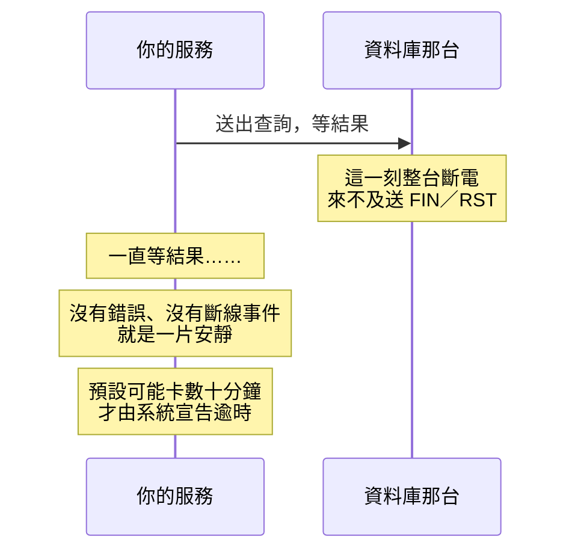
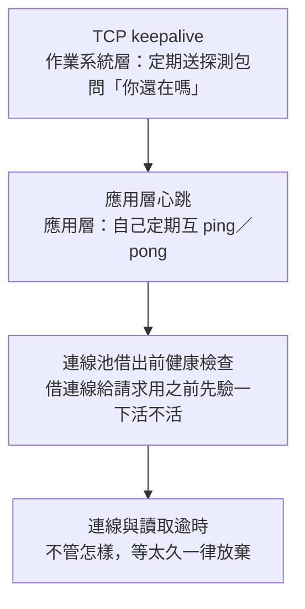

# [E-15-5] TCP keepalive 與整台當機：沒有錯誤，不代表連線還好

> **目標**：理解對端機器**整台當掉**時，為什麼你這端的 TCP 連線會「假性存活」卡住數十分鐘；以及怎麼及早發現——TCP keepalive、應用層心跳、連線池借出前健康檢查、連線與讀取逾時。

## 一個問題：連線池裡有一條連到「鬼」的連線

想像你的服務有一個**連線池（connection pool）**——預先建好一批連到資料庫（或下游服務）的 TCP 連線，重複使用，省去每次都重新握手的成本。

某天，資料庫那台機器**整台硬當**：電源跳掉、或虛擬機被瞬間抽掉、或網路線被拔。注意是「**整台沒了**」，不是「資料庫程式正常關閉」。

正常關閉和整台當掉，差別是天與地：

- **正常關閉**：資料庫程式會好好地送一個 TCP 的 **FIN**（「我要關連線了」）或 **RST**（「這連線沒了」）給你。你這端馬上知道連線斷了，把它丟掉。
- **整台當掉**：機器瞬間沒了，**它來不及送任何東西**。沒有 FIN、沒有 RST、沒有任何告別。

於是你這端的 TCP 連線陷入一種詭異的狀態：**它以為連線還好好的**。因為 TCP 本來就是「沒消息就是好消息」——沒收到關閉訊號，它就假設對方還在。這條連到「鬼」的連線會繼續躺在連線池裡，被當成健康的連線借出去，直到某個請求用它——然後那個請求就卡住，等很久很久。

這章要講的核心就一句話：

> **「沒有錯誤」不等於「連線還好」。對端整台消失時，TCP 不會主動告訴你——你得自己去探。**

## 生活類比：講電話講到一半，對方那棟樓停電了

你在講電話，講到一半你停下來聽對方說話。這時對方那棟樓**瞬間停電**，電話直接斷電——不是對方掛電話（掛電話你會聽到「嘟嘟」），而是整支話機沒電。

你這頭的聽筒會發生什麼事？**一片安靜。** 你不會聽到忙音、不會聽到任何提示音。你只會覺得「怎麼他突然不講話了」，然後你繼續「喂？喂？」地等——可能等上好幾分鐘，才終於意識到「這通電話其實早就斷了」。

這就是整台當機時的 TCP 連線：**沒有任何斷線提示音，只有無盡的安靜**。而你要及早發現「對方其實沒電了」，唯一的辦法是**主動出聲試探**：「喂，你還在嗎？」——對方沒回應，你才敢確定線斷了。TCP keepalive、應用層心跳，本質上都是這聲「你還在嗎」。

## 為什麼預設會卡「數十分鐘」

你可能會問：TCP 不是有重傳機制嗎？它發現對方不回，難道不會自己放棄？

會，但**非常慢**。當你這端送資料給一條連到死機的連線，TCP 收不到對方的確認（ACK），會啟動**重傳**——而重傳是**指數退避**的：等 1 秒重傳、等 2 秒、4 秒、8 秒……一路退到很長，重傳十幾次都沒回應，才終於宣告連線失敗。作業系統預設的這整套流程走完，**可能長達數十分鐘**。

更糟的是：如果你這端只是**在等對方送資料**（例如你送出了查詢，正在等結果），而你**沒有送任何東西**，那連重傳都不會觸發——因為你根本沒在發包，TCP 沒有「送了收不到 ACK」的依據，它會**安靜地等到天荒地老**。



這張圖表達：對端整台消失時不會送出任何關閉訊號，你這端在「等回應」的狀態下不會收到錯誤，只會無聲地卡住非常久。

## 四個手段：怎麼及早發現

既然 TCP 自己太慢、甚至不會發現，就得主動補上探測。由低層到高層，有四個互補的手段：



這張圖表達：四個手段分布在不同層次，由下到上一層補一層，最後用「逾時」兜底——任何一層沒抓到，逾時都會讓請求不至於無限卡住。

一個一個看：

**① TCP keepalive（作業系統層的保活）**
開啟後，一條連線閒置一段時間，作業系統會自動送一個小小的「keepalive 探測包」去問「你還在嗎」。對端活著就回 ACK；對端整台沒了，探測包連續幾次都沒回應，作業系統就判定連線死亡、回報錯誤給你。**但預設的 keepalive 間隔常常是 2 小時起跳**，等於沒用——要主動把它調短（例如閒置 30 秒就開始探、探幾次沒回就斷）。

**② 應用層心跳（application-level heartbeat）**
不依賴作業系統，由你的應用程式自己定期互送一個小訊息（常稱 ping / pong、heartbeat）。對方該回卻沒回，就當連線死了、主動關掉重連。它比 TCP keepalive 更可靠，因為它驗的是「**對方的應用程式真的還能回應**」，而不只是「作業系統的 TCP 堆疊還在」。長連線（WebSocket 等）幾乎都靠它。

> 應用層心跳在長連線上怎麼設計（ping/pong 間隔、斷線重連退避）→ [E-3-11：WebSocket 心跳與斷線重連](../E-3-network/E-3-11-websocket-heartbeat-reconnect.md)

**③ 連線池借出前健康檢查（validation on borrow）**
連線池把一條連線借給請求之前，先快速驗證它還活著（例如送一個極輕量的測試查詢）。壞的連線當場丟棄、換一條新的給請求。這能擋住「借到一條連到鬼的連線」——代價是每次借出多一點點開銷，通常值得。

**④ 連線與讀取逾時（connect timeout / read timeout）**
這是最後的兜底，也是最不該省的一個。不管前三個有沒有抓到，都給每個操作設上限：
- **連線逾時**：建立連線最多等幾秒。
- **讀取逾時**：送出請求後，等回應最多等幾秒。

有了讀取逾時，就算你借到一條連到死機的連線、前面三道都沒攔到，請求也只會卡「讀取逾時」那幾秒，而不是數十分鐘。

## 正式程式碼範例

把「連線池借出前健康檢查」＋「讀取逾時」兜底寫成 TypeScript。情境：從連線池借一條連線執行查詢。

這段程式碼在做的事：借連線時先驗活性，壞的丟掉換一條；執行查詢時套一個讀取逾時，確保永遠不會無限卡住。

```typescript
// 各種逾時設成具名常數，並說明為什麼是這個值。
const VALIDATION_TIMEOUT_MS = 2_000; // 借出前的活性檢查，要很快，不能自己卡住
const READ_TIMEOUT_MS = 5_000;       // 查詢讀取逾時：這是對抗「連到鬼」的最後一道兜底
const MAX_BORROW_ATTEMPTS = 3;       // 連續借到壞連線時，最多換幾次

interface PooledConnection {
  // 送一個極輕量的測試查詢驗活性，例如 SELECT 1。活著回 true。
  isAlive(timeoutMs: number): Promise<boolean>;
  query<T>(sql: string, timeoutMs: number): Promise<T>;
  discard(): Promise<void>; // 確認是壞連線，從池子移除
}

interface ConnectionPool {
  borrow(): Promise<PooledConnection>;
  release(conn: PooledConnection): Promise<void>;
}

// 借一條「確定活著」的連線：借出前先驗，壞的丟掉再換一條。
async function borrowHealthyConnection(pool: ConnectionPool): Promise<PooledConnection> {
  for (let attempt = 1; attempt <= MAX_BORROW_ATTEMPTS; attempt++) {
    const conn = await pool.borrow();

    // 關鍵：借出前先問「你還活著嗎」。連到死機的連線在這裡就被攔下，
    // 而不是等真正的查詢送出去後卡住數十分鐘。
    const alive = await conn.isAlive(VALIDATION_TIMEOUT_MS);
    if (alive) {
      return conn;
    }

    // 不吃掉這件事——連到死節點是重要訊號，要記下來，否則查不到節點是何時掛的。
    logger.warn("借到一條失效連線，丟棄後重借", { attempt });
    await conn.discard();
  }
  // 連換幾條都是壞的，代表對端可能整批出問題，誠實拋錯讓上層走備援。
  throw new Error(`連續 ${MAX_BORROW_ATTEMPTS} 次都借到失效連線，下游疑似整台故障`);
}

// 執行查詢：一定帶讀取逾時。就算前面漏掉一條壞連線，這裡也會在幾秒內放棄，
// 而不是讓請求無限卡住。
async function runQuery<T>(pool: ConnectionPool, sql: string): Promise<T> {
  const conn = await borrowHealthyConnection(pool);
  try {
    return await conn.query<T>(sql, READ_TIMEOUT_MS);
  } finally {
    // 借了就要還——成對收尾，不管成功失敗都把連線還回池子。
    await pool.release(conn);
  }
}
```

幾個重點：

- **借出前健康檢查擋在最前面**：`isAlive` 把連到死機的連線在「真正使用前」就攔下。
- **讀取逾時是兜底**：`conn.query(sql, READ_TIMEOUT_MS)` 保證最壞情況也只卡幾秒。這一道絕對不能省——它是對抗「數十分鐘假性存活」的最後防線。
- **借了一定還**：`finally` 裡 `release`，不管成功或拋錯都把連線歸還，避免連線洩漏（借出借出不還，池子很快被榨乾）。
- **壞連線要記 log、該炸就炸**：連換幾次都壞，就誠實拋錯讓上層決定（例如走備援），不要無限重借硬撐。

> 下游疑似整台故障時，上層怎麼給一個「堪用的備案」 → [E-15-1：Fallback Pattern](./E-15-1-fallback.md)

## 常見錯誤（反模式）

> **常見錯誤一：以為「沒拿到錯誤」就等於「連線健康」**
>
> 這是整章要破除的頭號迷思。很多人監控只看「有沒有噴錯」——沒噴錯就當一切正常。
>
> ```typescript
> // 危險的心智模型：沒 catch 到東西 = 沒事
> const result = await conn.query(sql); // 連到死機時，這行不是報錯，是「無聲地卡住」
> // ……然後請求池被卡住的查詢一條條佔滿，整個服務慢慢被拖垮
> ```
>
> 問題是：對端整台當掉時，你這端**不會收到任何錯誤**，只會卡住。監控面板上「錯誤率」是 0，看起來一片祥和，實際上請求正一條條堆積、連線池被卡死的查詢佔滿，最後整個服務雪崩——而你從「錯誤率」完全看不出來。
>
> **正確做法**：不要只監控錯誤率，要監控**延遲（latency）和逾時率**。連到死節點的症狀是「延遲暴衝、逾時變多」，不是「錯誤變多」。並且一定要設讀取逾時，把「無聲地卡住」轉成「明確的逾時錯誤」，這樣它才會現形在你的監控上。

> **常見錯誤二：完全不設讀取逾時**
>
> 「反正資料庫很快，不用設逾時吧」——直到某台整個當掉，所有打到它的請求全部無限卡住。
>
> ```typescript
> // 壞：沒有讀取逾時，連到死機就是數十分鐘起跳
> const result = await conn.query(sql); // 沒有上限
> ```
>
> **正確做法**：**每一個**跨網路的操作都要有逾時——連線逾時、讀取逾時缺一不可。沒有逾時的網路呼叫，本質上就是一個「可能永遠不回來」的黑洞。這是最便宜、效益最高的一道防線。

> **常見錯誤三：依賴預設的 TCP keepalive**
>
> 有人知道 TCP keepalive 這東西，就以為「作業系統會幫我處理」。但**預設的 keepalive 間隔常是 2 小時**——等它發現，你的服務早就雪崩完了。
>
> **正確做法**：TCP keepalive 要**主動調短**（閒置幾十秒就開始探測）才有意義，而且它只是輔助。真正可靠的是**應用層心跳**（驗的是對方應用程式還能回應）＋**讀取逾時**（兜底）。別把保命的責任全押在一個預設兩小時才動作的機制上。

## 小結

- 對端**整台當掉**（斷電、虛擬機被抽、拔線）時，來不及送 FIN／RST，你這端的 TCP 連線會**假性存活**；若你正在「等回應」，可能無聲卡住**數十分鐘**。
- 核心心法：**「沒有錯誤」不等於「連線還好」。** 要主動探測，不能被動等 TCP 自己發現。
- 四個互補手段，由低到高層：**TCP keepalive（要調短）→ 應用層心跳（最可靠）→ 連線池借出前健康檢查 → 連線/讀取逾時（兜底）**。
- 監控別只看錯誤率——連到死節點的症狀是**延遲暴衝、逾時變多**，不是錯誤變多。設了讀取逾時，才能讓「無聲卡住」變成「明確逾時」現形出來。
- 每個跨網路操作都要有逾時，這是最便宜、效益最高的一道防線。

> 下游整台故障時怎麼給堪用的備案 → [E-15-1：Fallback Pattern](./E-15-1-fallback.md)
> 應用層心跳在長連線上的完整設計（ping/pong、斷線重連退避）→ [E-3-11：WebSocket 心跳與斷線重連](../E-3-network/E-3-11-websocket-heartbeat-reconnect.md)
