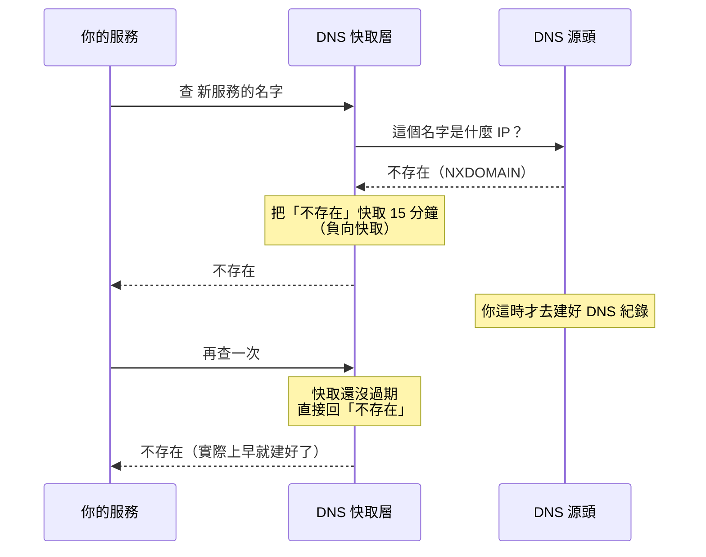
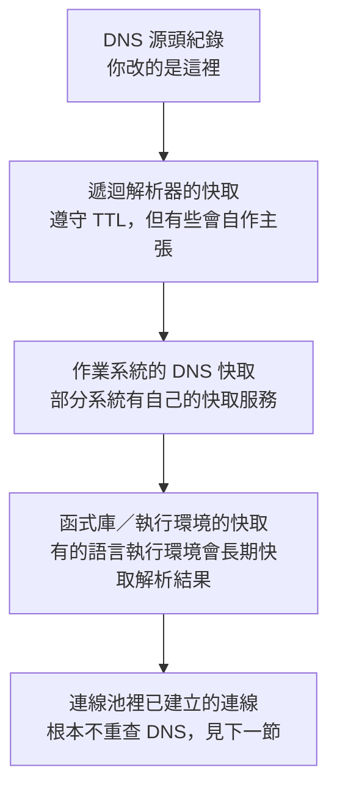

# [E-15-6] DNS 負向快取與故障切換：為什麼你還連著舊的 IP

> **目標**：理解服務換 IP 或做故障切換（failover）時，為什麼客戶端常常「還連著舊的」——TTL、負向快取、各層快取、以及長連線根本不跟著 DNS 變；並知道 DNS 不是一個即時的切換開關。

> 前置：先看懂 DNS 怎麼把網址翻成 IP → [E-3-5：DNS，網址背後的電話簿](../E-3-network/E-3-5-dns.md)。這篇講的是「DNS 改了，為什麼沒有馬上生效」。

## 一個問題：資料庫換了 IP，服務卻死活連不上

想像你的後端服務連著一台資料庫，連線用的是**網域名稱**（例如 `db.internal.example`）而不是寫死的 IP——這本來是好習慣，因為 IP 可能會變，用名稱才有彈性。

某天這台資料庫要搬家（換機器），新機器是一個**新的 IP**。你很負責地去 DNS 把 `db.internal.example` 指向新 IP，心想「改好了，服務應該會自動連到新機器」。

結果：服務**還在拼命連舊 IP**。舊機器已經關了，連線全部失敗。你明明改了 DNS，服務卻像沒看到一樣，繼續往那個已經沒人的舊地址撞牆——有時撞了好幾分鐘、甚至更久。

你開始懷疑人生：「我 DNS 明明改對了啊？」

問題在於一個很多人沒意識到的事實：

> **DNS 不是一個「撥下去立刻切換」的開關。它改的是「源頭的紀錄」，但這份紀錄在抵達你的服務之前，會被一層又一層地快取。你改了源頭，不代表沿路的快取馬上跟著變。**

## 生活類比：改了電話簿，但大家手機裡還存著舊號碼

把 DNS 想成一本**電話簿**（這正是 E-3-5 的比喻）。你的朋友搬家換了電話，你去把電話簿裡的號碼更新成新的——這相當於改 DNS 源頭紀錄。

但是：

- **你手機通訊錄裡還存著他的舊號碼。** 你打電話時直接翻通訊錄，根本沒去看電話簿——所以你還是撥舊號碼。（＝客戶端自己的快取）
- **你同事的手機裡也存著舊號碼。** 整棟辦公室的人,通訊錄都還是舊的。（＝各層各自的快取）
- 更麻煩的是，你們當初約好「這個號碼三天內有效」——**在這三天到期之前，大家都懶得重查電話簿**。（＝TTL）

所以就算你第一時間改好了電話簿，真正「大家都開始撥新號碼」，得等到各自通訊錄裡的舊號碼過期、重新去翻一次電話簿。**改源頭是瞬間的，但擴散到每個人是有延遲的。**

## 核心概念一：TTL——這筆紀錄「可以放心用多久」

DNS 的每一筆紀錄都帶一個 **TTL（Time To Live，存活時間）**，單位是秒。它的意思是：

> 「你查到這個答案後，可以**放心快取並重複使用 TTL 秒**，期間不用再問我。」

如果 TTL 設成 3600（一小時），那麼任何查過一次的地方，接下來一小時內都直接用快取的舊答案，不會重新查。**這就是你改了 DNS 卻不生效的頭號原因**：各處還在用上次查到、還沒過期的舊 IP。

所以**故障切換前的準備動作是「提前把 TTL 調短」**。如果你知道某台機器未來可能要切換，就先把它的 TTL 設成很短（例如 30 秒或 60 秒），這樣真的要切換時，舊答案最多 60 秒就過期，大家很快會重查到新 IP。等一切穩定後再把 TTL 調回長的（長 TTL 省查詢、減輕 DNS 負擔）。

## 核心概念二：負向快取——連「查不到」也會被記住

這是最反直覺、最容易害人的一點。

快取快取「成功的答案」很好理解。但 DNS 還會快取**失敗的答案**——這叫**負向快取（negative caching）**。意思是：如果某次查詢得到的回應是「**這個名字不存在**」（術語叫 NXDOMAIN，No such domain），那麼「不存在」這個結論也會被快取一段時間。

這會釀成一個經典慘案：

1. 你準備要上線一個新服務，但**先在程式裡填好了網域名稱、才去 DNS 建立紀錄**（順序錯了）。
2. 服務啟動，查詢這個名字——此時 DNS 還沒建好，回「不存在」。
3. 這個「不存在」被**負向快取**了（假設快取 15 分鐘）。
4. 你這才去 DNS 把紀錄建好。
5. 但服務在接下來 15 分鐘內**每次查都還是拿到快取的「不存在」**——明明紀錄已經建好了，它就是看不到，因為「查不到」這個答案還沒過期。



這張圖表達：「查不到」這個結論一旦被負向快取，即使你隨後補建了紀錄，服務在快取過期前仍會持續拿到「不存在」。

**教訓：先建好 DNS 紀錄、確認查得到，再讓服務去用那個名字。** 順序反了，負向快取會坑你一段時間。

## 核心概念三：快取不只一層

就算你把源頭的 TTL 調到很短，也可能不生效——因為 `name → IP` 的答案，從源頭到你的程式之間會被**好幾層各自快取**，每一層都有自己的脾氣：



這張圖表達：一個 DNS 答案要從源頭抵達你的程式，中間經過解析器、作業系統、函式庫執行環境等多層快取，任何一層沒更新都會讓你還連著舊 IP。

最常見的坑是**函式庫/執行環境層**：有些程式語言的執行環境會把「這個名字解析成這個 IP」的結果**快取很久甚至整個程序生命週期**，完全無視 DNS 的 TTL。這種情況下，就算源頭早就改了、TTL 也很短，你的程序還是認著啟動時解析到的那個舊 IP，直到它重啟。

## 核心概念四：長連線根本不跟著 DNS 變（最容易忽略）

這是整章最該記住的一點。前面講的所有快取，都是在**「下一次要新建連線、需要查 name → IP」**時才會發生作用。但有一種情況**連查都不會查**：

> **DNS 只在「建立連線的那一刻」用到。連線一旦建立好，之後的所有資料來回都是走那條既有連線的 IP——完全不會再回去查 DNS。**

所以一條**長連線（long-lived connection）**——例如連線池裡那條已經建好、重複使用的資料庫連線，或一條持續開著的 WebSocket——**你改 DNS，它一點感覺都沒有**。它認的是當初建立時那個 IP，會一直往那裡送，直到這條連線本身斷掉、需要重建時，才會重新查一次 DNS。

這就解釋了開頭的慘案：你的服務用連線池，裡面那些連線是**服務啟動時**連到舊 IP 建立的。你改了 DNS，但這些既有連線根本不重查，繼續往舊 IP（已關機）撞——你得等到這些連線因為對端關機而斷掉、連線池去**重建**連線時，新的查詢才會拿到新 IP。而「連線池多久會察覺對端沒了」又是另一個問題。

> 連線池裡連到死機的連線為什麼會假性存活、怎麼及早發現 → [E-15-5：TCP keepalive 與整台當機](./E-15-5-tcp-keepalive-node-failure.md)

## 怎麼做：故障切換前後該有的動作

把上面四點變成可操作的清單（pseudo code 風格）：

```
故障切換「之前」（預防）：
    1. 要走 DNS 切換的名字，平常就把 TTL 設短（例如 30～60 秒）
    2. 新服務上線：先建好 DNS 紀錄、確認查得到，「之後」才讓程式去用那個名字
       （避免負向快取記住「不存在」）

故障切換「當下」：
    3. 改源頭紀錄指向新 IP
    4. 心裡清楚：這不是即時生效——
       - 要等各層快取的舊答案過期（最長 = TTL）
       - 已建立的長連線不會自己切，要主動讓它們重建

故障切換「之後」確保真的切過去：
    5. 主動讓長連線重建：重啟服務 / 讓連線池淘汰舊連線 / 應用層健康檢查踢掉連到舊 IP 的連線
    6. 別只看「DNS 改了沒」，要看「實際流量有沒有打到新機器」
```

重點是第 4、5 步傳達的心態：**DNS 切換是「開始擴散」，不是「立刻完成」。** 真正要讓既有連線切過去，往往得主動介入（重啟、淘汰連線），不能只改 DNS 就等它自己好。

## 常見錯誤（反模式）

> **常見錯誤一：以為改了 DNS 就立刻全面生效**
>
> ```
> // 錯誤的心智模型：
> 改 DNS 指向新 IP → （以為）所有客戶端下一秒就連新 IP 了
> ```
>
> 問題是：各層快取還在用沒過期的舊答案，長連線更是完全不重查。改完 DNS 就宣告「切換完成、收工」，結果一堆流量還打在舊機器上，舊機器一關就全斷。
>
> **正確做法**：把 DNS 切換當成「開始擴散、需要時間」的過程。切換前把 TTL 調短、切換後主動讓長連線重建，並且**驗證實際流量真的落到新機器**，而不是只確認「DNS 紀錄改對了」。

> **常見錯誤二：先讓程式用名字、後建 DNS 紀錄（踩負向快取）**
>
> ```
> // 壞順序：
> 1. 程式先上線，開始查 新名字 → 拿到「不存在」並被負向快取
> 2. 才去建 DNS 紀錄
> 3. 程式在負向快取過期前，一直以為那個名字不存在
> ```
>
> **正確做法**：**先建好 DNS 紀錄、親自查一次確認查得到，再讓程式去用那個名字**。負向快取會把「不存在」記住一段時間，順序反了就得乾等它過期（或想辦法清快取）。

> **常見錯誤三：把 TTL 永遠設得很長，切換時才後悔**
>
> 有人為了「省 DNS 查詢」把 TTL 設成一天。平常沒事，但真的要緊急故障切換時，舊 IP 的答案要**一整天**才過期，等於切換半天切不乾淨。
>
> **正確做法**：對「可能需要切換」的名字，平常就維持**較短的 TTL**（幾十秒到幾分鐘）。TTL 是在「省查詢（長 TTL）」和「切換快（短 TTL）」之間的取捨——會做故障切換的名字，要的是後者。長 TTL 留給那些幾乎不會變的紀錄。

## 小結

- **DNS 不是即時的切換開關**：你改的是源頭紀錄，但它要擴散到每個客戶端需要時間。
- **TTL** 決定「舊答案可以被快取多久」——會做故障切換的名字，平常就把 TTL 設短。
- **負向快取**：連「查不到（NXDOMAIN）」也會被快取一段時間。所以要**先建好紀錄、確認查得到，再讓程式用那個名字**，否則會被「不存在」坑一段時間。
- **快取不只一層**：解析器、作業系統、函式庫執行環境各有各的快取，有些執行環境甚至快取整個程序生命週期，無視 TTL。
- **長連線根本不跟著 DNS 變**：DNS 只在建立連線那一刻用到，既有的連線池連線、WebSocket 會一直認舊 IP，直到斷線重建。要切換往往得**主動讓長連線重建**（重啟、淘汰連線）。

> 既有連線連到已關機的舊 IP 時，為什麼會假性存活、怎麼及早發現 → [E-15-5：TCP keepalive 與整台當機](./E-15-5-tcp-keepalive-node-failure.md)
> DNS 怎麼把網址翻成 IP 的基礎 → [E-3-5：DNS，網址背後的電話簿](../E-3-network/E-3-5-dns.md)
> 整條 DNS 委派鏈、網域搬家實際要改哪些紀錄 → [E-3-9：網域搬家](../E-3-network/E-3-9-dns-delegation-migration.md)
