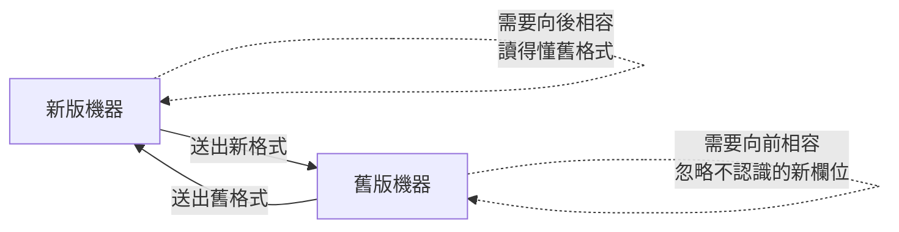
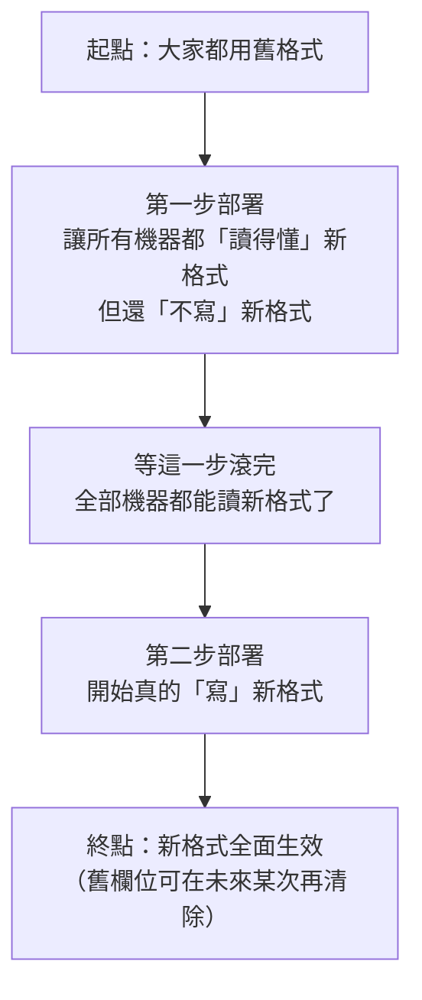

# [E-15-7] 滾動更新與版本相容：部署期間，新舊版本會同時在線上

> **目標**：理解滾動更新（rolling update）期間新舊版本會並存一段時間、互相收送請求與資料，所以 API 和資料格式的改動必須「新舊都能處理」——向後相容、向前相容、欄位只增不改不刪、分兩步驟部署。

## 一個問題：部署到一半，新版送了個舊版看不懂的東西

想像你有一個後端服務，跑在多台機器上。你要部署新版本，用的是**滾動更新（rolling update）**——不是把全部機器一次換掉（那樣會整個服務中斷），而是**一台一台慢慢換**：換好一台、確認健康、再換下一台。

這個做法很好，避免了停機。但它有一個常被忽略的後果：

> **在「換到一半」的那段時間裡，有些機器跑新版、有些機器還跑舊版——新舊版本同時在線上運作，而且會互相收送對方的請求與資料。**

這段時間可能是幾分鐘，也可能更久（如果你發現問題暫停了部署）。問題來了：假設你這次改動了請求的格式——新版送出的請求帶了一個新欄位，或改了某個欄位的名字。那麼：

- 新版機器送出一個「新格式」的請求，**負載平衡器可能把它分給一台還在跑舊版的機器**。舊版看到這個它不認識的格式，會發生什麼事？
- 反過來，舊版送出的「舊格式」請求，被分給新版機器處理——新版還讀得懂舊格式嗎？

如果任何一邊「看不懂對方」，部署期間就會冒出一堆詭異的錯誤——而且是**間歇性**的（取決於請求剛好被分到新版還是舊版），最難查。

這章的核心就是：**既然新舊會並存，你的每一次格式改動都必須讓「新舊雙方都能處理」。**

## 生活類比：公司換新版報帳單，但舊單還在流程裡跑

公司要把報帳單從舊格式換成新格式。如果老闆某天一聲令下「從今天起全部用新單」，會發生什麼混亂？

- 財務小美已經收到一疊**舊格式**的單子還沒處理完——她現在只會看新格式，這些舊單怎麼辦？（＝新版讀不懂舊資料）
- 隔壁部門還沒拿到新單的通知，今天交上來的還是**舊單**——財務退件嗎？
- 有人用了新單，上面多了一欄「專案代碼」，但還在用舊流程的審核員沒看過這欄，直接**當成錯誤把整張單打回**。（＝舊版遇到新欄位就炸）

聰明的公司會這樣換：**先讓所有人（新舊審核員）都「看得懂」新單、遇到不認識的欄位就忽略而不是報錯；等大家都更新完了，才開始真的「發」新單。** 這個「先讓大家能讀、再開始寫」的兩步驟，正是這章的關鍵做法。

## 兩個方向的相容：向後 與 向前

「新舊都能處理」要拆成兩個方向，名字容易搞混，先定義清楚：

- **向後相容（backward compatible）**：**新版讀得懂舊資料／舊請求**。（新的能往「後」回頭看懂舊的）
- **向前相容（forward compatible）**：**舊版遇到新資料／新欄位不會炸**（看不懂的部分忽略掉，而不是報錯）。（舊的能往「前」容忍未來的新東西）

用一張圖看這兩個方向在滾動更新期間各自防的是什麼：



這張圖表達：滾動更新期間新舊互相收送，新版要「向後相容」讀懂舊格式，舊版要「向前相容」容忍新欄位——兩個方向都顧到，並存才不會出事。

為什麼兩個都要？因為在滾動更新期間，資料流是**雙向**的：

| 情境 | 需要哪種相容 | 沒做到會怎樣 |
|---|---|---|
| 新版送出的資料被舊版讀到 | 舊版要**向前相容**（忽略新欄位） | 舊版看到新欄位就報錯／崩潰 |
| 舊版送出的資料被新版讀到 | 新版要**向後相容**（讀懂舊格式） | 新版找不到它預期的新欄位而出錯 |

## 黃金規則：欄位只增、不改、不刪

要同時滿足向後與向前相容，有一條好記又好用的規則：

> **欄位只能「新增」，不能「改名」也不能「刪除」（至少不能馬上刪）。**

為什麼？

- **改名** = 同時做了「刪掉舊名」和「新增新名」。舊版送的還是舊名、新版找的是新名，兩邊對不上。改名是最常見的部署事故來源。
- **刪除**正在用的欄位 = 還在送這個欄位的舊版，或還在讀這個欄位的下游，瞬間失去它。
- **新增**一個欄位則相對安全：只要讀取方「遇到不認識的欄位就忽略」（向前相容），新增欄位就不會弄壞任何人。

所以改動格式的正確姿勢是：

- 要「改名」→ 其實是**新增**一個新欄位，兩個欄位並存一段時間，等所有人都用新的了，**未來某一次**部署再刪掉舊的。
- 要「刪除」→ 先讓所有讀取方都不再依賴它（但還留著），確認沒人用了，**之後**才真的刪。

## 關鍵手法：分兩步驟部署（先讀後寫）

把「新增欄位」這件事拆成兩次部署，是最能避免事故的做法——先讓大家**都能讀**新格式，再開始**寫**新格式：



這張圖表達：格式升級分兩次部署——第一次只讓大家「能讀」、第二次才開始「寫」，中間等第一步完全滾完，確保「開始寫新格式時，所有機器都早已讀得懂它」。

為什麼一定要分兩步？因為如果你**一步到位**（同一次部署就又能讀又開始寫），在滾動更新到一半時，已經升級的新版機器開始寫新格式，但還沒升級的舊版機器**還讀不懂**——新格式資料就撞死在舊版上了。先讀後寫，就是為了保證「開始寫新格式的那一刻，全世界都早已準備好讀它」。

## 正式程式碼範例

把「向前相容：忽略不認識的欄位」和「向後相容：讀舊格式有預設」寫成 TypeScript。情境：這次部署想把請求裡的 `amount`（金額，單位元）改成更精確的表示，於是**新增**一個 `amountMinorUnits`（金額，單位為「分」，避免浮點誤差），而不是改掉舊欄位。

這段程式碼在做的事：定義一個同時容納新舊欄位的型別，解析時「新的有就用新的、沒有就從舊的推算」，並且遇到完全不認識的欄位一律忽略而不報錯。

```typescript
// 請求格式：新舊欄位並存。舊欄位 amount 保留（不刪），新欄位 amountMinorUnits 新增。
// 兩個都標成可選，因為在部署並存期間，任何一邊都可能只送其中一種。
interface PaymentRequest {
  orderId: string;
  amount?: number;           // 舊欄位：金額（單位：元）。暫時保留，確認沒人用了未來再刪
  amountMinorUnits?: number; // 新欄位：金額（單位：分），避免浮點誤差
}

// 向後相容：讀得懂舊請求。新欄位有就用新的，沒有就從舊欄位推算，
// 讓這版能同時服務「新版送來的」和「舊版送來的」請求。
function resolveAmountMinorUnits(request: PaymentRequest): number {
  if (request.amountMinorUnits !== undefined) {
    return request.amountMinorUnits;
  }
  if (request.amount !== undefined) {
    // 從舊欄位推算：元 → 分。四捨五入避免浮點數帶來的 0.999…
    return Math.round(request.amount * 100);
  }
  // 兩個欄位都沒有，才是真正的壞請求——這種該炸，不要默默給 0。
  throw new Error(`付款請求缺少金額欄位：orderId=${request.orderId}`);
}

// 向前相容：解析進來的資料時，只挑我認識的欄位，其餘一律忽略（不報錯）。
// 這樣就算「未來的新版」加了這版還不認識的欄位，這版也不會崩。
function parsePaymentRequest(raw: Record<string, unknown>): PaymentRequest {
  const orderId = raw.orderId;
  if (typeof orderId !== "string") {
    throw new Error("付款請求缺少 orderId");
  }
  return {
    orderId,
    amount: typeof raw.amount === "number" ? raw.amount : undefined,
    amountMinorUnits:
      typeof raw.amountMinorUnits === "number" ? raw.amountMinorUnits : undefined,
    // 注意：raw 裡任何其他欄位（包括未來版本新增的）都不去碰，自然被忽略
  };
}
```

幾個重點：

- **向前相容靠「只挑認識的欄位」**：`parsePaymentRequest` 不會因為 `raw` 裡有它沒聽過的欄位就報錯——這是「舊版遇到新欄位不炸」的具體寫法。
- **向後相容靠「新沒有就從舊推算」**：`resolveAmountMinorUnits` 讓這一版同時吃得下新舊兩種請求。
- **新增而非改名**：`amount` 留著沒刪，`amountMinorUnits` 是新增的。等確認全線都送新欄位了，**未來某一次**部署才清掉 `amount`。
- **該炸的還是要炸**：兩個金額欄位都沒有時，直接拋錯——金額是關鍵資料，缺了是真的壞請求，不能默默給預設值 `0` 把錯誤藏起來。

> 協定本身要怎麼設計才方便演進（版本欄位、未知欄位的處理）→ [E-3-10：自訂應用層協定設計](../E-3-network/E-3-10-protocol-design.md)

## 資料庫 migration 也是同一回事

上面講的是「服務之間的請求格式」，但**資料庫結構變更（migration）**面對的是一模一樣的問題：滾動更新期間，新舊版本的程式會同時讀寫同一個資料庫。

所以 migration 也遵守同樣的紀律：**加欄位安全（舊版不碰它、照常運作）、改名和刪欄位危險（要分多步，先讓程式不依賴，再動結構）**。例如要「改名一個欄位」，資料庫層的正確做法同樣是「加新欄位 → 兩邊都寫 → 程式改讀新欄位 → 確認舊欄位沒人用 → 才刪」。

> 資料庫 migration 怎麼做版本化、「加了新版本卻忘了寫轉換」的坑 → [E-4-6：存檔格式的版本化轉換](../E-4-database/E-4-6-versioned-migrations.md)

## 其他部署策略：藍綠與金絲雀（點到為止）

滾動更新不是唯一的部署方式，順帶認識兩個名字：

- **藍綠部署（blue-green deployment）**：準備兩套完整環境——「藍」（現役）和「綠」（新版）。新版在「綠」上全部備好、測好，再把流量**一次性**從藍切到綠。好處是切換瞬間完成、出事可秒切回藍；代價是要同時養兩套環境。注意：切換的那一刻之後，若還有長連線連在藍上，或資料庫是共用的，仍然要面對相容問題。
- **金絲雀部署（canary deployment）**：先把**一小部分**流量（例如 5%）導到新版，觀察有沒有異常，沒問題再逐步放大比例。好處是出問題時影響面小、能及早發現。

這兩種這裡只點到為止——但要注意：**只要新舊版本在任何一刻並存（金絲雀必然並存、藍綠在切換前後與共用資料庫時也並存），前面講的向後／向前相容就一樣要做。** 部署策略換了，相容性的功課跑不掉。

## 常見錯誤（反模式）

> **常見錯誤一：直接改欄位名稱**
>
> ```typescript
> // 危險：把 amount 直接改名成 amountMinorUnits，舊欄位沒了
> interface PaymentRequest {
>   orderId: string;
>   amountMinorUnits: number; // 原本叫 amount，直接改掉
> }
> ```
>
> 問題是：滾動更新期間，舊版還在送 `amount`，新版卻只找 `amountMinorUnits`——找不到，當場出錯。而且因為是間歇性的（看請求被分到新版還是舊版），超難查。
>
> **正確做法**：改名 = 新增新欄位 + 保留舊欄位並存，等全線都用新的了，**未來某次**部署再刪舊的。永遠不要在同一次部署裡「刪舊名又用新名」。

> **常見錯誤二：遇到不認識的欄位就報錯（嚴格解析）**
>
> ```typescript
> // 壞：嚴格模式，多一個沒見過的欄位就整個拒絕
> function parse(raw: Record<string, unknown>): PaymentRequest {
>   const known = new Set(["orderId", "amount"]);
>   for (const key of Object.keys(raw)) {
>     if (!known.has(key)) {
>       throw new Error(`未知欄位：${key}`); // 😱 未來新版加個欄位，這版全炸
>     }
>   }
>   // ...
> }
> ```
>
> 問題是：這等於宣告「我不向前相容」。未來任何一次新版新增欄位，只要資料流回這個舊版，它就全部報錯。這讓系統**完全無法平滑升級**。
>
> **正確做法**：解析時**只挑自己認識的欄位、忽略其餘**（前面範例的做法）。對「未知欄位」寬容，是向前相容的基礎。

> **常見錯誤三：一步到位——同一次部署就又能讀又開始寫新格式**
>
> 「分兩步太麻煩了，我一次把讀和寫都改好不就得了？」
>
> 問題是：滾動更新到一半，已升級的機器開始**寫**新格式，但還沒升級的機器**還讀不懂**——新格式資料撞死在舊版上。你省下的一次部署，換來一段部署事故。
>
> **正確做法**：**先讀後寫，分兩步**。第一步只部署「能讀新格式」的能力（還是寫舊格式），等它完全滾完、確認全線都讀得懂，第二步才開始寫新格式。這樣「開始寫新格式」時，所有機器早就準備好讀它了。

## 小結

- **滾動更新期間新舊版本並存**，且互相收送請求與資料——所以每次格式改動都要「新舊雙方都能處理」。
- 兩個方向：**向後相容**＝新版讀得懂舊資料；**向前相容**＝舊版遇到新欄位不炸（忽略而非報錯）。並存期間資料雙向流動，兩個都要做到。
- 黃金規則：**欄位只增、不改、不刪**。改名＝新增＋保留並存、未來再刪；刪除＝先確認沒人用、之後才刪。
- 關鍵手法：**分兩步驟部署（先讀後寫）**——先讓全線都「能讀」新格式，完全滾完後，才開始「寫」新格式。
- 資料庫 migration 是同一回事；藍綠、金絲雀部署換了策略，但只要有並存的一刻，相容性功課照樣要做。

> 協定要怎麼設計才方便演進、怎麼處理未知欄位 → [E-3-10：自訂應用層協定設計](../E-3-network/E-3-10-protocol-design.md)
> 資料庫 migration 的版本化與「標了新版本卻沒轉換」的坑 → [E-4-6：存檔格式的版本化轉換](../E-4-database/E-4-6-versioned-migrations.md)
> 部署時怎麼不中斷服務、關掉舊機器前先排空 → [E-15-3：優雅關機](./E-15-3-graceful-shutdown.md)
