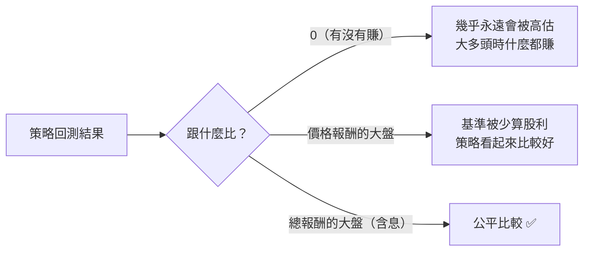

# [E-16-1] 成功標準先定好：策略要贏的是「含息買進持有」，不是「有賺錢」

> **目標**：理解為什麼評估一個交易策略時，「報酬是正的」幾乎不能說明任何事；學會挑對比較基準（benchmark）——含股利的買進持有——並用年化報酬與最大回撤兩個數字一起看。

> 本篇來自真實任務：自己寫的台股交易系統盤點（HQ 任務卡 `任務卡/20261102-trading-audit.md`，報告在 `trading/docs/reviews/2026-11-02-audit.md` §4、§7 決策 1）。

## 「賺 81%」聽起來很好，直到你看旁邊那一欄

盤點時用系統自己的回測引擎，把「Alpha Resonance」均線策略（均線＝過去 N 天收盤價的平均；短均線在長均線上方就當作漲勢成形而買進）套在 0050 上，跑 2019–2025：

| | 全期報酬 | 年化 | 最大回撤 |
|---|---|---|---|
| Alpha 策略（收盤成交） | **+81%** | 約 9% | 41% |
| 什麼都不做，直接買 0050 放著（含股利） | **+335%** | 約 24% | 34% |

單看第一列，策略「有賺錢」，而且一年 9% 不難看。但第二列告訴你：同樣這筆錢、同樣這段時間，**什麼都不做**會多賺四倍，而且中途最慘的那一跌還比較淺。

換句話說，這個策略「賺了 81%」，實際上是**輸了 254 個百分點**。

這就是基準（benchmark）的意義：報酬本身沒有好壞，**跟「本來可以怎樣」比**才有。

## 前端類比：A/B 測試沒有對照組

如果你上了一個新版結帳頁，轉換率 3.2%，這算成功嗎？不知道——要看舊版是多少。舊版 4% 的話，新版其實是退步。

```
評估一個策略
    實驗組 = 這個策略的回測結果
    對照組 = 同一段期間、同一筆錢，用最省事的替代方案
    結論   = 實驗組 − 對照組
如果 沒有對照組：
    「有賺錢」= 只是市場剛好在漲
```

交易策略的「最省事的替代方案」，對一個已經在做定期定額、手上就有 0050 的人來說，就是**直接買大盤 ETF 放著**。主動交易要花時間、要寫程式、要承擔 bug 風險；如果它連這個都贏不了，那些成本就全是白付的。

這個概念在金融裡叫**機會成本（opportunity cost）**：選了 A 就放棄了 B，B 本來能帶給你的就是 A 的成本。【共識】

## 為什麼一定要「含息」

股票會配股利。配息那天，股價會依照配掉的金額往下調（除息），但錢沒有消失，而是進了你的帳戶。

如果回測只看價格（不含股利），持有者在除息日看起來就像「虧了一筆」，實際上沒有。0050 這種年年配息的 ETF，累積起來很可觀：

| 0050 買進持有 2019–2025 | 報酬 |
|---|---|
| 只看價格（不含息） | +247% |
| 把股利算進去（含息） | +335% |
| **差距** | **88 個百分點** |

這兩種算法在金融上有名字：

- **價格報酬（price return）**：只算價差。
- **總報酬（total return）**：價差＋股利（通常假設股利再投入）。

和策略比的基準要用**總報酬**。用價格報酬當基準，等於把對手的成績扣掉一大塊，策略就會「看起來」接近或贏過大盤。【共識】



這張圖在表達：同一份回測，選錯比較對象就會得到相反的結論。

> 反過來也要公平：如果基準含息，策略持股期間領到的股利也要算進去，不然是在低估策略。這個系統兩邊都沒算，屬於回測引擎的問題，下一篇 [E-16-2](./E-16-2-backtest-biases.md) 會講。

## 只看報酬不夠：再加「最大回撤」

**最大回撤（MDD，Maximum Drawdown）**：從某個高點算起，資產最多跌掉幾成才回升。它回答的是「中途最痛的時候有多痛」。

很多主動策略賣的是「少賺一點，但比較不會跌」。這個主張要用 MDD 驗證，不能只聽說法：

- 單看 2020 年，Alpha 的 MDD 10%、0050 是 28%——看起來確實比較穩。
- 但看全期，Alpha 41%、0050 34%——**更深**。原因是它反覆停損、再進場，每次小賠累積起來變成大坑。

所以一份像樣的回測報告，至少要有這兩欄並排：

```
策略：年化報酬 ／ 最大回撤
基準（含息持有）：年化報酬 ／ 最大回撤
```

**年化報酬**是把多年的總報酬換算成「平均每年幾 %」，不同長度的期間才能比。例如 +335% 花了約 6.8 年：(1 + 3.35)^(1/6.8) − 1 ≈ 24%。

## 用 TypeScript 寫出這兩個數字

下面這段在做兩件事：給一串每日資產淨值，算出年化報酬與最大回撤。重點是 MDD 的算法——一路記住「到目前為止的最高點」，每天算離最高點跌了幾成，取最大值。

```typescript
const TRADING_DAYS_PER_YEAR = 245; // 台股一年約 245 個交易日

interface PerformanceSummary {
  annualizedReturn: number;
  maxDrawdown: number;
}

function summarizePerformance(dailyEquity: number[]): PerformanceSummary {
  const first = dailyEquity[0];
  const last = dailyEquity[dailyEquity.length - 1];
  const years = dailyEquity.length / TRADING_DAYS_PER_YEAR;
  const annualizedReturn = Math.pow(last / first, 1 / years) - 1;

  let peak = first;
  let maxDrawdown = 0;
  for (const equity of dailyEquity) {
    peak = Math.max(peak, equity);
    maxDrawdown = Math.max(maxDrawdown, (peak - equity) / peak);
  }
  return { annualizedReturn, maxDrawdown };
}
```

基準那一欄就是把「第一天全部買 0050、股利再投入」的每日淨值丟進同一個函式——**策略和基準用同一把尺量**，比較才有意義。

## 一個不舒服但必須接受的可能

2019–2025 是台股少見的大多頭（0050 含息年化約 24%）。在這種行情裡，任何「常常空手」的策略都很難贏買進持有。

這不代表未來也一樣，但它代表兩件事：

1. 這段回測**無法證明** Alpha 策略有用。【推估】
2. 如果連「0050 ＋ 一條簡單的跌破長期均線就空手」這種規則很少的做法都贏不了單純持有，最理性的結論可能就是「這 2 萬直接買 0050」。【推估】

把成功標準講清楚，本身就是在保護自己：不會把「有賺但輸大盤」當成功，然後放更多錢進去。

## 小結

- 策略報酬要跟**基準**比，不是跟 0 比。基準選「最省事的替代方案」：對台股小資族就是大盤 ETF 買進持有。
- 基準一定要用**總報酬（含息）**；只看價格會少算股利（0050 全期差 88 個百分點）。
- 至少並排兩個數字：**年化報酬**（賺多少）與**最大回撤**（中途多痛）。
- 決策 1 的驗法：之後每份回測都必須附「同期 0050 含息持有」的報酬與 MDD，沒有就退回。

## 自我檢查

1. 某策略 2024 年回測 +14.4%，你要再看哪兩個數字才能判斷它好不好？為什麼「+14.4%」本身不夠？
2. 為什麼基準用「不含息」的 0050 會讓策略看起來比較好？如果策略那邊也沒算股利，偏差會往哪個方向、能抵銷嗎？
3. 一個策略年化比大盤低 3%，但最大回撤只有大盤的一半——在什麼情況下你可能還是會選它？（提示：想想中途跌 35% 時你會不會砍掉）

> 回測引擎本身會怎麼讓數字失真 → [E-16-2：回測的四種偏差](./E-16-2-backtest-biases.md)；2 萬元下成本吃掉多少 → [E-16-3：小資金的交易成本與零股](./E-16-3-costs-and-odd-lots.md)
