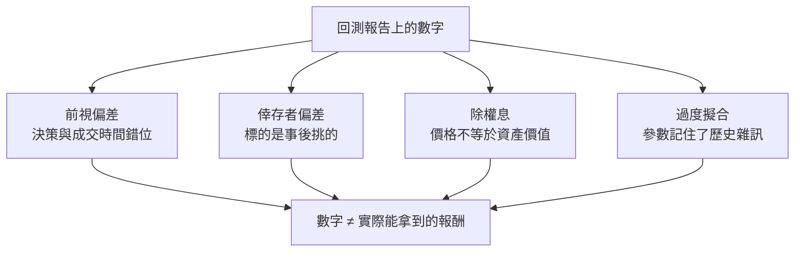
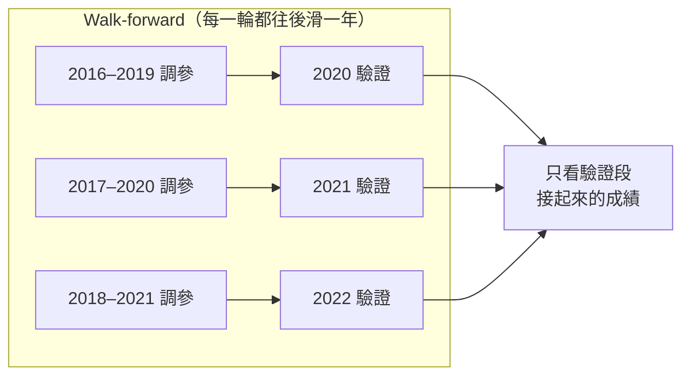

# [E-16-2] 回測的四種偏差：前視、倖存者、除權息、過度擬合

> **目標**：知道回測（backtest，拿歷史資料模擬「如果當時照這個策略做會怎樣」）最常在哪四個地方騙人；看到一份回測結果時，能逐項問出「這裡有沒有處理」。

> 本篇來自真實任務：自己寫的台股交易系統盤點（HQ 任務卡 `任務卡/20261102-trading-audit.md`，報告 §3）。文中的數字都是那次用系統自己的引擎跑出來的。

## 先說結論：回測是一場「考古題模擬考」

回測就像拿考古題來測自己的實力。它有用，但有四種作弊方式會讓分數虛高——而且多半不是故意的：

| 偏差 | 考試類比 | 一句話 |
|---|---|---|
| 前視偏差 | 考試時偷看了答案卷 | 用到「當時還不可能知道」的資訊 |
| 倖存者偏差 | 只挑自己會的考古題 | 測試標的只有「事後證明活下來」的 |
| 除權息沒還原 | 分數算錯 | 價格序列跟實際持有的資產價值對不上 |
| 過度擬合 | 背答案而不是學會 | 參數是對著同一份歷史調出來的 |

那次盤點，這套系統四項的結果是：**部分、有、沒處理、沒防護**。下面一項一項看。



這張圖在表達：四種偏差各自獨立，任何一個沒處理，最後那個數字都不能直接拿來決定要不要放錢。

---

## ① 前視偏差（Look-ahead Bias）

### 概念

**在時間點 T 做決定時，用到了 T 之後才會知道的資訊。**

最常見的版本長這樣：

```
每天：
    拿「今天的收盤價」算均線（過去 N 天的平均價）→ 決定要買
    用「今天的收盤價」成交
```

問題是：收盤價是 13:30 收盤那一刻才確定的。你看到它的時候，盤已經收了，**不可能再用那個價格買**。這就是「看到答案才作答」。

前端類比：在 React 裡用「下一次 render 才會算出來的 state」來決定這一次要畫什麼。邏輯上講得通，但現實中拿不到。

### 這套系統的狀況：部分

- 引擎在第 i 根 K 線（一根 K 線＝一天的開盤、最高、最低、收盤價）時，餵給策略的資料包含第 i 根的收盤價（`backtest.engine.ts:82-83` 的 `slice(0, i + 1)`），**預設**又用同一根的收盤價成交（`SAME_CLOSE`）。
- 有另一個模式 `NEXT_OPEN`：今天收盤算訊號、**明天開盤**成交。這是日線策略的標準做法【共識】，但不是預設。

下面這段把兩種模式的差別濃縮成一個函式：同樣是第 i 天收盤後出現的訊號，差別只在「成交價拿哪一個」。


```typescript
type ExecutionMode = "SAME_CLOSE" | "NEXT_OPEN";

// 第 i 天收盤後產生訊號，成交價取決於模式
function getFillPrice(bars: { open: number; close: number }[], signalIndex: number, mode: ExecutionMode): number {
  if (mode === "SAME_CLOSE") {
    return bars[signalIndex].close; // ⚠️ 決策用了這個價格，又假裝能用它成交
  }
  return bars[signalIndex + 1].open; // 收盤後才知道訊號，最早只能明天開盤成交
}
```

> 台股的細節：整股其實有「盤後定價交易」（14:00–14:30 以收盤價成交），所以「收盤價成交」對**整股**是做得到的。但 2 萬元多半只能買零股，零股的盤後是 14:30 一次撮合，價格不保證是收盤價——見 [E-16-3](./E-16-3-costs-and-odd-lots.md)。【事實】

### 有多嚴重？

換一個成交模式，結果差很多，而且**方向不固定**：

| | 收盤成交 | 次日開盤 |
|---|---|---|
| 0050 全期 | +81% | +57% |
| 2330 全期 | +253% | +298% |
| 2330 只看 2024 | +32% | +59% |

前視偏差不一定是「灌水」，但它證明了**數字對成交假設非常敏感**——同一個策略差到 27 個百分點。一個對假設這麼敏感的結果，不能拿來做決定。

---

## ② 倖存者偏差（Survivorship Bias）

### 概念

**只看「活下來的」，就會高估成功率。**

經典故事：二戰時統計飛回來的轟炸機哪裡彈孔多，打算在那裡加裝甲。統計學家指出應該補**沒有彈孔的地方**——那些地方中彈的飛機根本沒飛回來。

套到回測：你今天會想到拿來回測的股票，是 2330、0050 這種**現在還在、而且現在很紅**的。回頭看當然知道台積電會漲。2019 年那些後來下市、被打入全額交割的股票，不在你的清單裡。

```
有偏差的回測：
    股票池 = 今天上市中的熱門股
    → 結果 = 「這個策略在好股票上表現不錯」（廢話）

正確的回測：
    股票池 = 「當時」的名單（含後來下市的）
    → 結果 = 「如果當時用這個規則挑、這樣做，會怎樣」
```

### 這套系統的狀況：有（結構性）

系統沒有股票池，一次只回測一檔使用者手動輸入的股票——**選股這一步本身就是用今天的眼光做的**。那次盤點挑的 5 檔（0050、2330、2317、2603、2884）也一樣有這個問題。【事實】

要解決，得換有下市資料的資料源（台股常見的是 TEJ、FinMind），用「當時的成分股名單」回測。Yahoo Finance 沒有這種資料。【共識／推估】

---

## ③ 除權息與還原價

### 概念

配息、配股、分割、減資，都會讓股價「跳一下」，但你持有的資產價值並沒有跟著跳：

| 事件 | 股價 | 你的資產 |
|---|---|---|
| 配現金股利 5 元 | 隔天開盤少 5 元（除息） | 少 5 元股價，但帳戶多 5 元現金 → **不變** |
| 1 拆 4 | 變成原本 1/4 | 股數變 4 倍 → **不變** |

如果回測直接用「市場上看到的價格」（未還原價），除息那天策略會以為自己虧了，甚至**誤觸停損**賣掉。

**還原價（adjusted price）**就是把歷史價格往回調整，讓整條序列反映「一直持有的真實價值變化」。另一種做法是不調價格，但在除息日把現金股利記進帳戶。兩種都可以，重點是要處理。【共識】

這個坑跟前端很像：兩個時間點的數字單位不一樣（一個含息、一個不含），直接相減就是錯的。

### 這套系統的狀況：沒有處理

- 資料抓取只取 `close`，把 Yahoo 給的 `adjClose`（含息還原價）丟掉了（`yahoo-finance.provider.ts:33-40`）。
- 引擎沒有股利入帳邏輯。
- Yahoo 的 `close` 有處理**分割**（0050 在 2025-06 的 1 拆 4，資料是連續的），但**現金股利沒調整**。
- 長榮 2022 年減資退現金，Yahoo 當成「反分割」處理，退回的現金不在任何價格序列裡——資料源本身對特殊事件的處理也不一定對。

**影響**：0050 買進持有 2019–2025，不含息 +247%、含息 +335%，差 88 個百分點。對策略則是兩面的：持股時領的股利沒算（低估）；除息跳空可能誤觸停損（多出不必要的交易）。

---

## ④ 過度擬合（Overfitting）

### 概念

**參數是對著同一份歷史資料調出來的，所以它記住的是那段歷史的雜訊，而不是可重複的規律。**

前端工程師最熟的類比：**對著測試案例寫程式**。

```typescript
// 這個函式「通過所有測試」
function isPrime(n: number): boolean {
  return [2, 3, 5, 7, 11, 13].includes(n);
}
```

測試全綠，但遇到 17 就錯了。它不是學會了「質數」，而是背下了考題。

回測調參也是：「均線改成 13 日和 41 日、RSI 門檻改成 42，2019–2025 報酬從 +81% 變 +140%！」——你可能只是找到一組剛好躲過那幾次大跌的數字。可以調的參數越多、調的次數越多，越容易發生。

### 怎麼防：留一份「沒看過的考卷」

```
訓練期（2016–2020）：只在這段調參數
測試期（2021–2025）：參數凍結，跑一次看結果
如果 測試期表現 遠差於 訓練期：
    → 參數多半是背答案
```

這叫**樣本外驗證（out-of-sample test）**。進階版是 **walk-forward**：用前 N 年調參、驗證下 1 年，再整個往後滑一年重複，最後把每段「沒看過」的結果接起來看。【共識】



這張圖在表達：真正算數的只有「調參數時沒看過」的那幾段。

另一個簡單的檢查：同一組參數在**多檔、多種行情**（多頭、空頭、盤整）下都還行，才比較可能是真規律。

### 這套系統的狀況：沒有防護

- 沒有訓練期／測試期切分、沒有 walk-forward、沒有多標的交叉驗證。
- 前端可以調完參數馬上看回測——這正是最容易「調到漂亮」的流程。
- 目前的參數看起來是手選的，所以過度擬合暫時不嚴重；但一開始「找最好的參數」，沒有樣本外驗證就會出事。【推估】

---

## 小結：拿到任何一份回測，先問這四句

1. **決策跟成交的時間對得上嗎？**（收盤決策 → 次日開盤成交）
2. **標的是事後挑的嗎？**（有沒有包含後來下市的）
3. **股利、分割、減資處理了嗎？**（基準和策略兩邊都要）
4. **參數是在「沒看過的資料」上驗證過的嗎？**

四句有一句答不出來，那個數字就只能當「方向參考」。這也是那次盤點的決策 3：**先把回測修可信，再談新策略**——在歪掉的尺上比較策略，結論可能是反的。

## 自我檢查

1. 一個策略「今天收盤價跌破 20 日均線就用今天收盤價賣出」，這裡哪一步有前視偏差？要改成怎樣才正確？
2. 你拿「目前 0050 的 50 檔成分股」回測 2015–2025，發現策略很賺。這個結論為什麼可能被高估？要怎麼改資料才能修正？
3. 你調了 200 組參數，挑出全期報酬最高的那組。接下來最該做什麼，才能判斷它是不是背答案？

> 為什麼要跟「含息持有」比 → [E-16-1：成功標準先定好](./E-16-1-benchmark.md)；成本與零股 → [E-16-3：小資金的交易成本與零股](./E-16-3-costs-and-odd-lots.md)
> 「對著測試寫程式」的反面 → [課外讀物 E-9-1：為什麼要寫測試](../E-9-testing/E-9-1-why-test.md)
