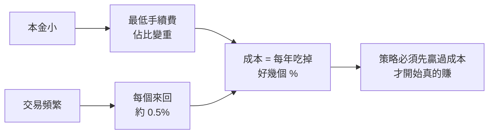

# [E-16-3] 小資金的交易成本與零股：2 萬元的帳怎麼算

> **目標**：會算台股一次買賣的真實成本（手續費、最低手續費、證交稅、滑價），理解為什麼「本金小」會讓成本的比例變重；知道 2 萬元幾乎只能買零股，以及零股的成交規則跟回測假設差在哪。

> 本篇來自真實任務：自己寫的台股交易系統盤點（HQ 任務卡 `任務卡/20261102-trading-audit.md`，報告 §3.4、§3.5）。

## 一個來回要付幾種錢

在台股買一次再賣掉（一個來回，round trip），會被收這些錢：

| 項目 | 什麼時候收 | 費率 | 備註 |
|---|---|---|---|
| **手續費** | 買、賣各一次 | 成交金額 × 0.1425% × 券商折扣 | 給券商的。折扣各家不同（例如 2.8 折） |
| **每筆最低手續費** | 算出來太少時 | 整股多數券商 20 元；零股各家不同 | ⚠️ 小資金的關鍵 |
| **證券交易稅** | **只有賣出**收 | 股票 0.3%；股票型 ETF 0.1%；當沖 0.15%（減半優惠，有期限） | 給政府的 |
| **滑價（slippage）** | 買、賣各一次 | 沒有固定費率 | 你想要的價格和實際成交價的差距 |

費率是法規與券商公告的事實；「零股最低手續費多少」各券商差很多，**一定要問自己用的那家**。【事實＋需確認】

**滑價**是新名詞，說明一下：你看到現在 100 元想買，但最便宜的賣單可能是 100.5 元，或者你的單一進去價格就被推高。這筆差距不會出現在帳單上，但真實存在。成交量越小、價差越大的標的，滑價越重。回測常用「買賣各吃 1 檔」來估——**檔**是股價的最小跳動單位（例如 100～500 元的股票一檔是 0.5 元）。

## 為什麼 2 萬元特別吃虧：最低手續費

用一個函式把上面那張表寫出來。這段在算「一次買進要付多少手續費」，重點是 `Math.max`——算出來的手續費如果比最低額度少，就收最低額度：

```typescript
const COMMISSION_RATE = 0.001425;
const BROKER_DISCOUNT = 0.28; // 2.8 折，依券商合約
const MINIMUM_COMMISSION = 20; // 整股常見下限；零股要問券商

function calculateCommission(tradeValue: number): number {
  return Math.max(tradeValue * COMMISSION_RATE * BROKER_DISCOUNT, MINIMUM_COMMISSION);
}
```

代進兩種本金看看：

| 一次買 | 算出來的手續費 | 實際收 | 實際費率 |
|---|---|---|---|
| 200 萬 | 798 元 | 798 元 | 0.04% |
| **2 萬** | **8 元** | **20 元** | **0.1%**（貴 2.5 倍） |

大戶的折扣是真的折扣；2 萬元的折扣**被最低手續費吃掉了**，實際費率是名目的 2.5 倍。

把一個來回算完（2 萬元、整股最低 20 元）：

```
買進手續費        20 元
賣出手續費        20 元
證交稅（股票 0.3%） 60 元   ← ETF 是 0.1% = 20 元
------------------------------
合計              100 元 ≈ 0.5%（ETF 約 0.3%）
再加上兩邊的滑價
```

**每個來回 0.5%** 聽起來很小，但乘上次數就不小了：

- Alpha 策略在 0050 上一年交易 5～12 筆 → **光成本每年 2～3%**。
- 2019–2025 全期 0050 上 49 筆，成本 2,895 元——本金的 14%。
- 套在長榮（2603）上全期 107 筆，成本 17,418 元——**幾乎等於本金**。



這張圖在表達：小資金＋高頻率是成本的雙重放大器——策略的優勢必須大於這個門檻，否則越勤勞越虧。

這也是為什麼「買進持有」在小資金上特別難打敗：它一共只付一個來回的成本。【共識】

### 那套系統算錯了什麼

| 項目 | 程式 | 實際 | 結果 |
|---|---|---|---|
| ETF 證交稅 | 一律 0.3%（`backtest.engine.ts:296` 沒把 `isEtf` 傳進去，雖然成本計算器支援） | 0.1% | 0050 每次賣出多算 0.2% |
| 零股最低手續費 | 一律 20 元 | 依券商，有些很低 | 可能高估成本【推估】 |
| 零股滑價 | 1 檔 | 零股價差通常更大 | 可能低估成本【推估】 |

> **常見錯誤** — 參數有了，但沒傳進去：
> ```typescript
> // 定義：static calculateSellCost(amount, feeDiscount = 1.0, isEtf = false)
> CostCalculator.calculateSellCost(amount, this.FEE_DISCOUNT); // 第三個參數沒傳，0050 也被當股票算
> ```
> 問題是：函式明明支援 ETF，但呼叫端沒傳，**型別檢查不會抓到**（因為那個參數有預設值）。這類「有預設值的可選參數」最容易靜默算錯。
> 正確做法：讓呼叫端一定要表態——把標的類型設成必填，或在資料層就帶著「這檔是不是 ETF」。
> ```typescript
> CostCalculator.calculateSellCost({ amount, feeDiscount: FEE_DISCOUNT, securityType: "ETF" });
> ```
> → 參數設計的原則 [課外讀物 E-6-3：函式設計](../E-6-best-practices/E-6-3-function-design.md)；更多反模式 → [E-6-6](../E-6-best-practices/E-6-6-anti-patterns.md)

## 2 萬元幾乎只能買零股

台股的交易單位：

- **整股**：1 張 = 1,000 股。
- **零股**：1～999 股。

2 萬元能買 1 張的，只有股價 20 元以下的標的。0050、台積電都只能買零股。所以**這個實驗實際上是一個零股實驗**，回測就得照零股的規則來。【推估，但用算術就能確認】

### 零股怎麼成交

零股不是像整股那樣隨時一對到就成交，而是**集合競價**：先收一段時間的單，再一次撮合，用同一個價格成交。

| 時段 | 時間 | 撮合方式 |
|---|---|---|
| 盤中零股 | 9:00–13:30 | 每 1 分鐘撮合一次（2022-12-19 起），**只能下限價單** |
| 盤後零股 | 13:40–14:30 收單 | 14:30 一次撮合 |

【事實，證交所規則】

**限價單**＝「最多出這個價」。好處是不會買貴；壞處是**可能不成交**。

```
回測目前的假設：
    訊號出現 → 一定成交 → 成交價 = 收盤價 ± 1 檔
零股的現實：
    訊號出現（收盤後才知道）
    → 隔天掛限價單
    → 價格沒到 → 不成交，訊號作廢或改價重掛
    → 有成交 → 價格是那一次撮合的價格，零股的價差通常比整股大
```

### 那套系統的狀況：沒有建模

引擎用 `Math.floor(可投資金額 / 每股成本)` 算股數（`backtest.engine.ts:250-251`），任何股數都能買、一定成交，沒有區分整股與零股。結果之一：台積電股價過了 1,000 元之後，定期定額每期 1,000 元連 1 股都買不起，2025 年整年只成交 3 次。【事實】

比較貼近真實的模擬方式【推估】：

1. 訊號在收盤後產生。
2. 隔天以「零股、限價」下單，限價設在某個合理範圍。
3. 依當天價格判斷有沒有成交；沒成交就要處理（放棄、隔天再試）。
4. 成本用自己券商的零股手續費與合理的滑價。

## 小結

- 一個來回要付：手續費 ×2（有最低額度）、證交稅（只有賣出；股票 0.3%、ETF 0.1%）、滑價 ×2。
- **最低手續費讓小資金的實際費率變成名目的好幾倍**；2 萬元一個來回約 0.5%，策略交易越頻繁，成本門檻越高。
- 「有預設值的可選參數」最容易靜默算錯（ETF 稅率就是這樣被算成股票的）。
- 2 萬元的實驗幾乎就是零股實驗：零股是集合競價、只能限價、**可能不成交**，回測要照這個規則模擬。
- 零股的最低手續費**各券商不同，要向自己的券商確認**再寫進成本模型。

## 自我檢查

1. 用 2.8 折、最低 20 元：一次買 5 萬元的股票，手續費多少？實際費率是多少？要買到多少金額以上，最低手續費才不再發生作用？
2. 同一個策略，一年交易 20 個來回，本金 2 萬、標的是股票（非 ETF）。只看手續費和證交稅，策略每年至少要賺幾 % 才打平？
3. 回測說「訊號出現就用收盤價成交」，但實際上你買的是零股。列出兩個會讓實盤結果比回測差的原因。

> 為什麼成本要跟基準一起看 → [E-16-1：成功標準先定好](./E-16-1-benchmark.md)；回測的其他偏差 → [E-16-2：回測的四種偏差](./E-16-2-backtest-biases.md)；下一篇：怎麼誠實地調參數 → [E-16-4：參數掃描](./E-16-4-parameter-sweep.md)
