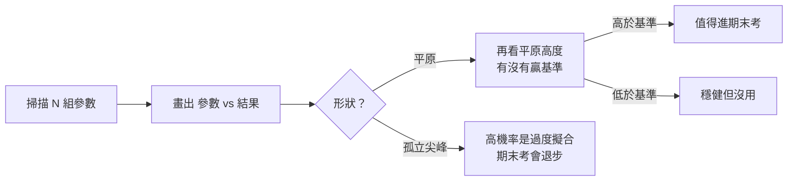

# [E-16-4] 參數掃描：要找「平原」，不要找「尖峰」

> **目標**：知道參數掃描（把一個策略的參數從小到大全部試一遍）時，為什麼「最好的那一組」常常是最不能信的；學會看參數對結果的形狀，分辨穩健的平原與過度擬合的尖峰。

> 本篇來自真實任務：交易策略探索（HQ 任務卡 `任務卡/20261102-trading-strategy-research.md`，報告 `trading/docs/reviews/2026-11-02-strategy-research.md` §1.5～1.6）。接續 [E-16-2](./E-16-2-backtest-biases.md) 的「過度擬合」。

## 先問一個問題：試了幾次？

[E-16-2](./E-16-2-backtest-biases.md) 說過，對著同一份歷史調參數，很容易調出「背答案」的結果。但不調參數又不行——均線該用 20 日還是 200 日，總得決定。

那次研究的做法是先**誠實地全部試一遍**，並把試了幾組寫出來：

| 策略家族 | 掃描內容 | 組數 |
|---|---|---|
| 0050 趨勢濾網 | 均線 9 種長度 × 防守資產 2 種 × 檢查頻率 2 種 | 36 |
| 槓桿＋趨勢（00631L） | 同上 | 36 |
| 動能輪動 | 資產池 2 種 × 回看期間 6 種 × 過濾 2 種 | 24 |
| Alpha 對照 | 風格參數 5 種 × autoTune 開關 2 種 | 10 |
| **合計** | | **106 組 × 2 種手續費情境 = 212 次回測** |

為什麼「試了幾組」這麼重要？想像你丟 106 次硬幣，最好的那次連續出了 7 個正面——這不代表那枚硬幣有魔力，只是試得夠多，總有一次運氣特別好。**試的組數越多，「最好的那組」裡面運氣的成分就越高。** 只報告最好那組、不說試了幾組，等於隱藏了證據。【共識，統計上叫多重比較問題】

## 平原 vs 尖峰

把「參數」放 X 軸、「結果」（這裡用 Sharpe）放 Y 軸，畫成一條線，會看到兩種形狀：

```
平原（穩健）                  尖峰（可疑）
Sharpe                        Sharpe
  │    ▄▄▆▆▆▆▄▄▄                │  █
  │  ▄█████████▆                │  █
  │ ▆███████████                │  █  ▄  ▄▄▄ ▄▄  ▄
  └──────────────── 均線        └──────────────── 均線
   參數差一點，結果差一點          只有剛好那個數字好
```

**Sharpe**（夏普比率）先說明一下：報酬除以波動，意思是「每承擔一單位起伏，換到多少報酬」。數字越高越好；這次研究是簡化版（沒扣無風險利率）。

為什麼形狀比最高點重要？

- **平原**：均線 80 日好、100 日也好、120 日也還行。代表策略抓到的是某種「大概在這個範圍都成立」的規律，未來行情稍微變一點，它還是能用。
- **尖峰**：只有 20 日特別好，40 日就掉下去。代表那個好成績很可能是「20 日剛好躲過歷史上某幾次大跌」——那是歷史的雜訊，未來不會照抄。

前端類比：一個 CSS 版面在 1280px 很漂亮、1279px 就破版。你不會說這個版面「做得很好」，你會說它是剛好對著某個寬度調出來的。好的版面是一整段寬度都不會壞——那就是平原。

## 真實數據：兩個家族並排看

下面是開發期（2014～2022）的 Sharpe，防守資產都是現金，最低手續費 20 元情境（來自 `research/output/dev/sweep.csv`）：

| 均線（日） | 20 | 40 | 60 | 80 | 100 | 120 | 150 | 200 | 250 |
|---|---|---|---|---|---|---|---|---|---|
| 0050 趨勢濾網・月檢查 | 0.26 | 0.43 | 0.63 | **0.79** | 0.87 | 0.63 | 0.60 | 0.66 | 0.77 |
| 槓桿＋趨勢・日檢查 | **1.04** | 0.71 | 0.79 | 0.85 | 0.74 | 0.73 | 0.68 | 0.63 | 0.66 |

粗體是最後被選進期末考的那組。同期 0050 含息持有的 Sharpe 約 0.70。

怎麼讀：

- **趨勢濾網・月檢查**：60～250 日之間都落在 0.60～0.87，算是一片平原。【事實】但要注意平原的**高度**——這 36 組裡**沒有一組年化報酬贏過 0050**（最高 10.1% 對 10.4%）。平原只代表穩健，不代表夠好。
- **槓桿＋趨勢・日檢查**：20 日 1.04 一枝獨秀，隔壁 40 日只有 0.71。而且 20 日是掃描範圍的**最邊緣**——更短的 10 日根本沒試，不知道再過去是不是懸崖。【事實】這是典型的尖峰。



這張圖在表達：參數掃描要看兩件事——形狀（穩不穩）與高度（贏不贏）——缺一不可。

## 結果：尖峰真的在期末考塌了

那組尖峰（槓桿＋趨勢、20 日線）在開發期相對 0050 的超額報酬是年化 12.3%、t 值 2.0（「看起來有意義」的門檻）；到了沒看過的期末考資料，掉到 2.4%、t 值 0.2——幾乎歸零。【事實，t 值的意思見 [E-16-6](./E-16-6-beta-alpha.md)】

這不是事後諸葛：研究在期末考**之前**就把「20 日線是尖峰、退步機率高」寫進了登記文件（見 [E-16-5](./E-16-5-preregistration.md)）。

## 怎麼把「偏好平原」寫成規則

光說「我會挑平原」不夠，因為看到結果之後，人很難不偏心。那次研究是在**跑掃描之前**就寫下機械化的挑選規則：

```
對每一組參數：
    鄰域平均 = 這組 與 左右相鄰各一組 的 Sharpe 平均
挑 鄰域平均 最高的那組
```

下面這段 TypeScript 在算「鄰域平均」：每組參數的分數不是看自己，而是看自己和左右鄰居的平均。孤立的尖峰會被兩旁的低谷拉下來，平原則不受影響。

```typescript
// 用鄰居平均當分數：孤立的高點會被兩旁拉低，一整片高的區域不受影響
function neighborhoodAverage(sharpeByParam: number[]): number[] {
  return sharpeByParam.map((_, index) => {
    const neighbors = sharpeByParam.slice(Math.max(0, index - 1), index + 2);
    return neighbors.reduce((sum, value) => sum + value, 0) / neighbors.length;
  });
}
```

拿上表的槓桿列試算：

- 20 日（端點，只有右邊一個鄰居）：(1.04 + 0.71) ÷ 2 = **0.875**
- 80 日：(0.79 + 0.85 + 0.74) ÷ 3 ≈ 0.79

結果還是選到 20 日。**規則的漏洞在端點**：最邊緣那組只有一個鄰居，懲罰比較弱。所以規則也要測試——這次是靠「把警訊寫進登記文件」補上。比較好的改法【推估】：掃描範圍要比你認為合理的範圍再寬一點，讓候選不要落在邊緣；或端點直接不能當候選。

## 小結

- 參數掃描一定要**報告試了幾組**；試越多次，「最好那組」裡的運氣成分越高。
- 看**形狀**：參數差一點、結果差一點的平原比較可信；孤立尖峰多半是背答案。
- 也看**高度**：平原整片低於基準，代表穩健但沒用。
- 「偏好平原」要在看結果之前寫成機械規則（例如鄰域平均），並注意規則本身的漏洞（端點只有一個鄰居）。

## 自我檢查

1. 某策略掃了 500 組參數，報告只寫「最佳參數年化 30%」。你會先追問哪兩件事？
2. 上表的趨勢濾網・月檢查，如果你看到結果後直接挑 Sharpe 最高的 100 日，跟用鄰域平均挑出 80 日，各有什麼風險？
3. 為什麼「最佳參數落在掃描範圍邊緣」本身就是一個警訊？

> 選出候選之後，怎麼確保期末考不被偷看 → [E-16-5：預先登記與樣本外期末考](./E-16-5-preregistration.md)
