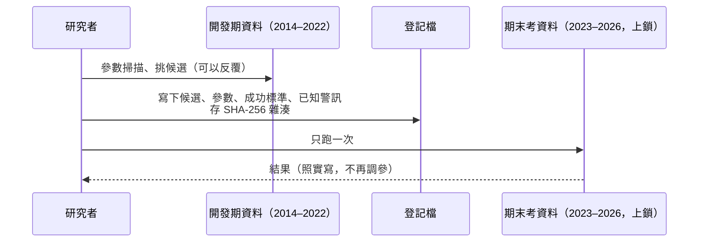

# [E-16-5] 預先登記與樣本外期末考：考卷要鎖起來，答案要先寫好

> **目標**：理解為什麼「把資料切成開發期和期末考」還不夠，還得把期末考**鎖起來**、並在考前把要考的策略和成功標準**登記存檔**；知道怎麼用程式強制這件事，而不是靠自律。

> 本篇來自真實任務：交易策略探索（HQ 任務卡 `任務卡/20261102-trading-strategy-research.md`，報告 §1.4、§2、§8 決策 2）。

## 切了資料，為什麼還會作弊

[E-16-2](./E-16-2-backtest-biases.md) 講過樣本外驗證：開發期調參，期末考驗證。但實務上有一個很自然的漏洞：

```
在開發期調好參數
跑期末考 → 結果不好
「啊，是不是均線再長一點比較好？」改參數
再跑期末考 → 好一點了
再改 → 再跑 → ……
最後「期末考成績很好」
```

每改一次再考一次，期末考就被偷看一次。考了十次的期末考，其實已經變成開發資料了。

前端類比：你寫 E2E 測試（End-to-End，端對端測試）時，測試失敗就去改**測試的預期值**讓它變綠——測試永遠會過，但它已經不能告訴你任何事了。

所以要做兩件事：

1. **鎖住期末考**：開發時連看都不能看。
2. **考前登記**：考什麼、怎麼算過關，考試前寫死；考完照實寫，不能改。

這個做法借自醫學研究的「預先登記（preregistration）」：臨床試驗要先公開登記主要指標，才不會試完才挑一個剛好顯著的指標來報告。【共識】



這張圖在表達：開發期可以反覆試，期末考只有一次，而且中間隔著一份「寫死的登記檔」。

## 登記檔裡寫什麼

那次研究在期末考前寫下的內容（報告 §2）：

| 項目 | 內容 |
|---|---|
| 候選 | 最多 3 個：C1 槓桿＋趨勢（20 日線）、C2 0050 趨勢濾網（80 日線、月檢查）、C3 台股動能輪動（12 個月） |
| 參數 | 每個都寫死 |
| 期末考區間 | 2023-01-01 ～ 2026-10-30 |
| 成本情境 | 最低手續費 20 元與 1 元、2.8 折、滑價 0.1% |
| **成功標準** | 年化報酬高於 0050 含息持有，**且** Sharpe 不低於它 |
| **已知警訊** | C1 是尖峰參數；C2、C3 開發期報酬就輸 0050；研究者事先知道 2023 年後大漲 |

兩個容易被省略、但最有價值的欄位：

- **成功標準要先寫**。不先寫的話，考完看到「年化輸了但回撤比較小」，很容易臨時改口說「我本來就是要少跌」。
- **已知警訊要先寫**。考前寫「C1 很可能會退步」，考後退步了，就不是事後找理由。最後一條甚至承認了研究者本身的偏誤：AI 的訓練資料裡就有 2023 年後的行情，這無法完全排除，只能寫出來讓讀者打折。

## 用程式強制，不靠自律

「我保證不偷看」在研究者是人、是 AI 的時候都不可靠。那次研究把規則寫進程式（`trading/research/`）：

```
load_panel("dev")       → 只回傳 2022-12-31 以前的資料，2023 以後直接截掉
資料抽查                 → 在鎖住區間只印「通過／不通過」，不印數字
final_exam.py 執行前：
    算登記檔的 SHA-256 雜湊
    如果 報告裡找不到這個雜湊 → 拒絕執行（「先登記再考試」）
    如果 已經考過、但雜湊跟第一次不同 → 拒絕執行（登記檔被改過）
    如果 已經考過、重算結果跟第一次不同 → 拒絕（資料或程式被改過）
```

**雜湊（hash）**先解釋：把一個檔案丟進 SHA-256 這種函式，會得到一串固定長度的指紋。檔案改了一個字，指紋就完全不一樣。所以只要把指紋寫進報告，之後任何人都能驗證「登記檔有沒有被偷改」。

下面這段 TypeScript（Node.js）做的是同一件事的核心：算登記檔的指紋，對不上就直接停止。

```typescript
import { createHash } from "node:crypto";
import { readFileSync } from "node:fs";

function assertRegistered(registrationPath: string, reportPath: string): void {
  const digest = createHash("sha256").update(readFileSync(registrationPath)).digest("hex");
  // 指紋寫在報告裡才算「登記」；登記檔之後被改過，指紋就對不上
  if (!readFileSync(reportPath, "utf8").includes(digest)) {
    throw new Error(`報告裡找不到登記檔的雜湊 ${digest}：先登記再考試`);
  }
}
```

這跟 `package-lock.json` 裡的 `integrity` 欄位是同一個概念：記下指紋，下次安裝時比對，被動過就拒絕。

## 鎖不住的情況要寫出來

那次研究有一個例外：資料抽查時，00631L 有兩天跟「2 倍 0050」對不上，為了判斷是不是資料錯，程式印出了**日期**（沒印價格）。考完才確認是 2025-04 跌停、2026-03 分割停牌，而 C1 那兩段都空手，不影響結果。

這種「碰到了鎖住區間」的地方，正確做法不是假裝沒發生，而是**寫進報告：碰了什麼、為什麼、有沒有影響**。誠實的紀錄比完美的流程重要。

## 考完之後：這份考卷不能再用了

決策 2 是這個概念最實際的後果：**2023-01～2026-10 已經考過了**。之後只要在這段資料上調任何策略，它就變成開發資料。

```
下一個策略的期末考
    必須是 2026-11 之後才產生的資料
    例如：虛擬盤從 2026-11 開始跑 12 個月
沒有新資料的期末考 → 退回
```

聽起來很慢，但這是唯一不會自己騙自己的方法。歷史資料只有一份，每考一次就少一份。

## 小結

- 切出期末考還不夠：反覆「考 → 改 → 再考」，期末考就變成開發資料。
- **預先登記**：考前寫死候選、參數、期末考區間、成功標準與已知警訊。
- **用程式強制**：開發時截斷資料、抽查只回報通過與否、期末考檢查登記檔雜湊。
- 鎖不住的地方寫出來；考過的資料不能再當期末考，下一輪要等新資料。

## 自我檢查

1. 期末考結果：C2 年化輸 0050，但最大回撤 21% 對 27.5%。如果登記時沒寫成功標準，你覺得會發生什麼事？
2. 為什麼「登記檔」要存雜湊，而不是只存檔案就好？
3. 你想試一個新策略，手上只有到 2026-10 的歷史資料。依決策 2，它的期末考該怎麼安排？

> 期末考結果怎麼判讀「是風險還是規律」 → [E-16-6：beta 與 alpha](./E-16-6-beta-alpha.md)；測試預期值不能隨便改的道理 → [課外讀物 E-9-1：為什麼要寫測試](../E-9-testing/E-9-1-why-test.md)
