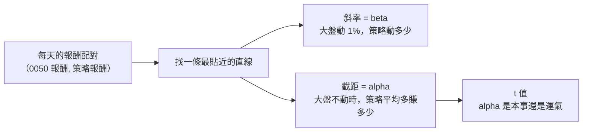

# [E-16-6] beta 與 alpha：報酬是從「風險」來的，還是從「規律」來的

> **目標**：會把一個策略的報酬拆成兩塊——跟著大盤放大或縮小的部分（beta），和扣掉這部分之後真正多出來的部分（alpha）；看懂為什麼 2 倍槓桿 ETF 00631L 報酬最高，卻不算「贏過 0050」。

> 本篇來自真實任務：交易策略探索（HQ 任務卡 `任務卡/20261102-trading-strategy-research.md`，報告 §0、§5、§8 決策 1）。

## 一個看起來像贏的結果

期末考（2023-01～2026-10），2 萬元的結果：

| 策略 | 年化 | 最大回撤 | Sharpe | 2 萬變成 |
|---|---|---|---|---|
| 0050 含息持有（基準） | 45.7% | 27.5% | 1.74 | 84,380 |
| **00631L 持有**（台灣 50 正 2） | **73.4%** | **55.1%** | 1.46 | **163,940** |

00631L 多賺了將近一倍。照 [E-16-1](./E-16-1-benchmark.md) 的標準「贏過 0050 含息持有」，它不就贏了？

那次研究的答案是：**沒有贏。它的報酬全部來自承擔兩倍風險，不是找到了什麼規律。**要說清楚這句話，需要兩個概念：beta 和 alpha。

## 前端類比：換了一台更快的電腦

你重構了一個頁面，載入時間從 2 秒降到 1 秒。但你同時把測試機從舊筆電換成新的桌機。

- 進步的一部分是**電腦變快**——任何程式在新機器上都會變快，不是你的功勞。
- 剩下的才是**程式真的寫得比較好**。

要評估重構，得先把「電腦變快」那一塊扣掉。

```
策略的報酬 = beta × 大盤的報酬  +  alpha  +  雜訊
             └─ 換了更快的電腦 ─┘   └ 程式真的比較好 ┘
```

- **beta**：策略跟著大盤動的程度。1 = 跟大盤一樣；2 = 大盤漲 1% 它漲 2%、跌 1% 它跌 2%；0.5 = 只跟一半。
- **alpha**：扣掉 beta 之後，平均每年多出（或少掉）的報酬。這才是「策略本身的本事」。

槓桿 ETF 就是那台更快的電腦：它把大盤的漲跌放大兩倍。在大多頭裡報酬當然好看——但那是把 beta 調到 2 的結果，任何人買了放著都拿得到，不需要任何「策略」。

這個拆法金融上叫 **CAPM 回歸**（Capital Asset Pricing Model，資本資產定價模型），是評估主動策略的標準做法。【共識】

## 怎麼算

做法是拿每天的報酬做回歸（regression，找一條最貼近資料點的直線）：X 軸是 0050 當天的報酬，Y 軸是策略當天的報酬。



這張圖在表達：beta 是直線的斜率、alpha 是截距，兩個都從同一批每日報酬算出來。

下面這段 TypeScript 對應研究程式（`research/final_exam.py` 的 `regression`）的算法：先用共變異數（策略和大盤「一起動」的程度）除以變異數（大盤自己晃動的程度）得到 beta，把 beta 那部分扣掉，剩下的平均就是每天的 alpha，再換算成年。

```typescript
const TRADING_DAYS_PER_YEAR = 252; // 對齊研究程式的換算天數

interface RegressionResult {
  beta: number;
  annualAlpha: number;
  alphaTStat: number;
}

function mean(values: number[]): number {
  return values.reduce((sum, value) => sum + value, 0) / values.length;
}

function regressOnBenchmark(strategyReturns: number[], benchmarkReturns: number[]): RegressionResult {
  const strategyMean = mean(strategyReturns);
  const benchmarkMean = mean(benchmarkReturns);
  const covariance = mean(strategyReturns.map((value, i) => (value - strategyMean) * (benchmarkReturns[i] - benchmarkMean)));
  const variance = mean(benchmarkReturns.map((value) => (value - benchmarkMean) ** 2));
  const beta = covariance / variance;

  const residuals = strategyReturns.map((value, i) => value - beta * benchmarkReturns[i]);
  const dailyAlpha = mean(residuals);
  const residualStd = Math.sqrt(mean(residuals.map((value) => (value - dailyAlpha) ** 2)));
  // t 值 = 平均 ÷ 標準誤；樣本天數越多，同樣的 alpha 越不像運氣
  const alphaTStat = dailyAlpha / (residualStd / Math.sqrt(residuals.length));

  return { beta, annualAlpha: dailyAlpha * TRADING_DAYS_PER_YEAR, alphaTStat };
}
```

**t 值**回答的是「這個 alpha 有沒有可能只是運氣」。粗略的看法：絕對值大約 2 以上才算有點意義，1 以下基本上跟擲硬幣分不出來。【共識，2 是慣用門檻，不是物理定律】

## 拆開來看

| 策略 | 開發期 beta / alpha（t） | 期末考 beta / alpha（t） | 判讀 |
|---|---|---|---|
| 00631L 持有 | 1.91 / +5.1%（1.7） | **1.87 / -10.8%（-2.0）** | 報酬全來自 2 倍 beta；扣掉後是負的 |
| C1 槓桿＋趨勢 | 0.82 / +12.3%（2.0） | 0.83 / +2.4%（0.2） | 開發期的 alpha 是挑出來的，樣本外消失 |
| C2 0050 趨勢濾網 | 0.53 / +3.5%（1.2） | 0.81 / +4.8%（1.0） | 有一點正 alpha，但兩段都不顯著 |
| C3 台股動能輪動 | 0.87 / -0.2%（-0.1） | 0.91 / +2.8%（0.7） | 基本上就是 0050 |

00631L 那一列是重點：

- beta 1.87：它確實是「0050 的兩倍」。
- alpha **-10.8%**：扣掉兩倍大盤之後，每年還**少**了約 11%。粗算一下也對得上：如果真的是 1.87 倍的 0050，大概會是 1.87 × 45.7% ≈ 85%，實際只有 73.4%。【推估，這只是直覺上的對照，回歸用的是每日報酬，不是年化相乘】

## 為什麼槓桿 ETF 的 alpha 會是負的

兩個原因【共識】：

**① 波動耗損**：槓桿 ETF 每天重設成 2 倍。來回震盪時，2 倍會虧得比 2 倍更多：

```
大盤：+10%，再 −10%
    1 倍：100 → 110 → 99      虧 1%
    2 倍：100 → 120 → 96      虧 4%（不是 2%）
```

**② 內扣費用**：管理費、期貨轉倉成本，每天從淨值裡扣，不會出現在你的帳單上。

所以槓桿 ETF 是「用更差的價格買到更多 beta」。如果你要的是更多風險，它能給你；但它不會給你 alpha。

## 回到成功標準：為什麼要加上 Sharpe

那次研究在登記時寫的成功標準是：**年化高於 0050，且 Sharpe 不低於 0050**。第二個條件就是為了擋住「靠槓桿」：

- 年化高、Sharpe 也高 → 每單位風險換到更多報酬 → 可能有規律。
- 年化高、Sharpe 較低 → 只是承擔更多風險 → 不算贏。

00631L 是第二種（Sharpe 1.46 對 1.74）。所以決策 1 給了三個選項，而不是「買 00631L」：(a) 買 0050 持有；(b) **承認是賭博**，買 00631L 並事先決定虧多少就停；(c) 用 C2 換取較小回撤。選 (b) 不是錯，錯的是把它當成「找到了更好的策略」。

> 還有一個看不到的風險：00631L 只有 2015 年後的資料，沒經歷過 2008 年那種腰斬。同樣的崩盤，2 倍槓桿可能跌掉 70～80% 以上。【推估】回測裡沒發生過，不代表不會發生。

## 小結

- **beta** = 跟著大盤動的程度；**alpha** = 扣掉 beta 後多出來的報酬；**t 值** = alpha 像不像運氣（約 2 以上才有點意義）。
- 報酬高不等於贏：00631L 年化 73%，但 beta 1.87、alpha -10.8%——報酬全是放大的大盤風險。
- 槓桿 ETF 的 alpha 偏負：波動耗損＋內扣費用。
- 成功標準加上「Sharpe 不低於基準」，就能擋住靠槓桿灌出來的報酬。

## 自我檢查

1. 一個策略 beta 0.5、alpha +3%（t=2.5）。另一個 beta 2、alpha 0。大盤年化 10% 時，兩者的預期年化大概各是多少？哪一個比較像「找到規律」？
2. 大盤連續三天 +5%、-5%、+5%，1 倍和每日重設的 2 倍各剩多少？用這個例子解釋波動耗損。
3. C1 在開發期 alpha 12.3%（t=2.0），期末考 2.4%（t=0.2）。結合 [E-16-4](./E-16-4-parameter-sweep.md)，你會怎麼解釋這個落差？

> 參數挑出來的 alpha 為什麼會消失 → [E-16-4：參數掃描](./E-16-4-parameter-sweep.md)；這些數字前提是資料正確 → [E-16-7：資料錯誤怎麼抓](./E-16-7-data-errors.md)
