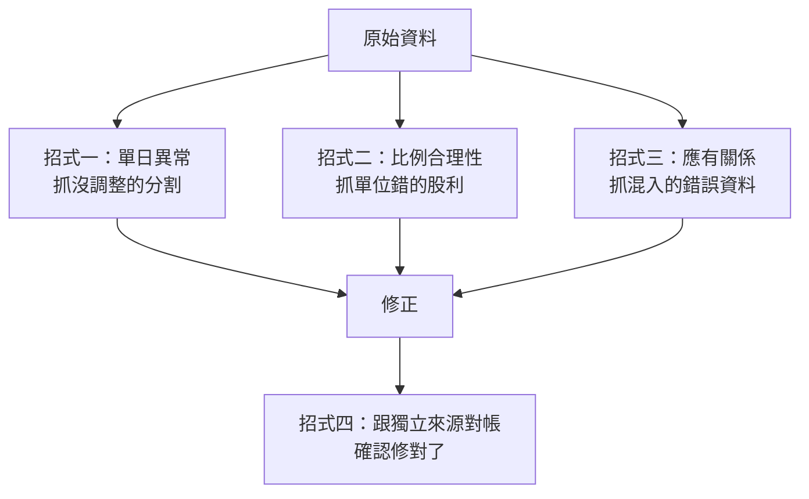

# [E-16-7] 資料錯誤怎麼抓：Yahoo 的資料不能直接信

> **目標**：知道免費行情資料常見的錯誤長什麼樣子，學會用「單日異常」「比例合理性」「兩檔互相對照」「跟另一個來源對帳」四招把它們抓出來；理解為什麼資料錯誤比程式 bug 更危險。

> 本篇來自真實任務：交易策略探索（HQ 任務卡 `任務卡/20261102-trading-strategy-research.md`，報告 §1.2 與附錄 A）。

## 為什麼這件事要獨立一篇

程式 bug 通常會讓結果「怪」——崩潰、負數、NaN（Not a Number，算不出來的數值）。資料錯誤不會。它讓回測**正常地跑完**，給你一個看起來合理、但完全錯的數字。

那次研究從 Yahoo Finance 抓 ETF 的還原權息價，抽查後發現**三個錯誤**、兩個資料缺口。其中一個錯誤污染了 0050 的**整條**還原價——如果直接用，從 2014 年起的每一個 0050 數字都是錯的，而且看不出來。

前端類比：API 回傳的 JSON 格式完全正確，TypeScript 型別也過了，但 `price` 欄位的單位有一段是「元」、有一段是「角」。型別檢查擋不住這種錯，只有**語意上的檢查**（這個數字合不合理）才擋得住。

## 招式一：找單日異常

**0050 這類 ETF 一天漲跌超過 10% 很罕見**；台股多數標的還有單日 10% 的漲跌幅限制（追蹤海外指數的 ETF 例外）。所以第一招最簡單：把每天的報酬算出來，列出超過門檻的日子，逐一看原因。

下面這段 TypeScript 在做這件事：算出每天相對前一天的變化，把超過門檻的日期挑出來給人看。它不自動修正——抓出來的每一筆都要人判斷是真的事件還是資料錯。

```typescript
const SUSPICIOUS_DAILY_MOVE = 0.1; // 超過台股常見的 10% 漲跌幅限制，幾乎一定是資料或公司事件

interface DailyBar {
  date: string;
  close: number;
}

function findSuspiciousMoves(bars: DailyBar[]): { date: string; dailyReturn: number }[] {
  return bars
    .slice(1)
    .map((bar, i) => ({ date: bar.date, dailyReturn: bar.close / bars[i].close - 1 }))
    .filter(({ dailyReturn }) => Math.abs(dailyReturn) > SUSPICIOUS_DAILY_MOVE);
}
```

**實際抓到的**：0050 在 2013-12-31 收 58.70、2014-01-02 收 14.64——單日 **-75%**。【事實】

-75% 剛好是 1/4。0050 在 2025-06 做了 1 拆 4，Yahoo 對 2014 年以後的價格有調整，但 2014 年以前的**沒有**。除以 4 之後，那天的報酬是 -0.26%，正常了。

> 反過來，也有「看起來異常但其實正常」的：0050 分割停牌期間（2025-06-11～17）價格固定、成交量 0。這是真的停牌，不用修。所以異常清單是「要查的清單」，不是「要刪的清單」。

## 招式二：檢查比例合不合理

有些錯誤不會造成大跳動，要用「這個比例正常嗎」來抓。

**實際抓到的**：0050 在 2014-10-24 配息 1.55 元，前一天收盤 16.26 元——殖利率 **9.5%**。同一檔其他年份的單次配息都在 1～3%。【事實】

原因跟招式一是同一個：股利金額沒做 1 拆 4 調整（應該是 1.55 ÷ 4 ≈ 0.39 元）。後果更嚴重——Yahoo 的「還原收盤價」是用股利往回推算的，這一筆錯的股利讓還原價在那天**假漲 10.5%**，而且之後的整條還原序列都帶著這個錯誤。

處理方式：把這筆股利 ÷ 4，並且**不用 Yahoo 的還原價**，改成自己用「價格＋股利」算總報酬。

```
對每一筆股利：
    殖利率 = 股利 ÷ 前一天收盤價
    如果 殖利率 遠高於 這檔平常的範圍：
        → 檢查是不是分割前後的單位沒對齊
```

## 招式三：用「應該有的關係」互相對照

有些資產之間有確定的關係，可以拿來互相檢查。00631L 是「台灣 50 正 2」，**每天的報酬應該大約是 0050 的 2 倍**。

```
對每一天：
    預期 = 2 × 0050 當天報酬
    如果 00631L 當天報酬 跟 預期 差很多（甚至方向相反）：
        → 列出來查
```

**實際抓到的**：2015-08-18～21 連續幾天，0050 跌 2.6% 時 00631L 漲 2.7%——**方向相反**；然後 2015-08-24 單日 -33.6%。【事實】疑似混進了反向 ETF 的資料。處理方式：這一段整個不用，只用 2015-08-25 之後。

這招的威力在於：單看 00631L，那幾天的數字都在漲跌幅之內，招式一抓不到；要跟 0050 放在一起才看得出來。

## 招式四：跟另一個來源對帳

修完之後，怎麼知道修對了？要找**另一個獨立的來源**對照。

| 對帳方式 | 結果 |
|---|---|
| 自算的 0050 總報酬 vs Yahoo 還原價（只比錯誤**之後**的 2015–2022 區間） | 112.72% vs 112.75%，差 0.03 個百分點 |
| 0050 vs 006208（追蹤同一個指數的另一檔 ETF），期末考逐年 | 差距都在 1.4 個百分點以內 |

【事實】

第二個對帳特別有用：期末考期間 0050 年化 45.7%、2026 年到 10 月就 +63%，高到讓人懷疑是資料錯。但 006208 是另一家公司發行、追蹤同一個指數的 ETF，它也是 +63.5%——兩個獨立來源同時錯成一樣的機率很低，所以這個暴漲是真的。



這張圖在表達：前三招負責「找錯」，第四招負責「確認修對」——只做前三招，你不知道自己的修正有沒有引入新錯誤。

## 資料缺口：不是錯，但會讓結論偏

除了錯誤，還有「資料不完整」：

- **0050、0056 在 Yahoo 上 2013 年以前沒有股利資料**（第一筆是 2013-10-24）。用了就會低估持有報酬、讓「常常空手」的策略看起來比較好。處理：開發期從 2014 起算，2009～2013 只拿來暖機算均線。
- **006208 早年成交量常為 0**（2016 年有 94 天）。價格雖然存在，但實際上買不到。處理：不放進資產池。

缺口的處理原則【推估，但很常見】：**寧可縮短資料，不要用壞資料把長度湊滿**。任務卡建議從 2008 年起，研究改成 2014 年起，並在報告裡寫明原因。

## 小結

- 資料錯誤不會讓程式崩潰，只會給你一個「看起來合理」的錯數字——比 bug 更危險。
- 四招：**單日異常**（分割沒調整）、**比例合理性**（股利單位錯）、**應有關係**（槓桿 ETF ≈ 2 倍）、**獨立來源對帳**（確認修對、也確認「好得離譜」的結果是真的）。
- 異常清單是「要查的」不是「要刪的」：停牌、真實崩盤也會出現在清單上。
- 資料不完整時，縮短期間並寫出原因，不要硬湊長度。

## 自我檢查

1. 某檔 ETF 某天報酬 -50%，前後幾天都正常。列出兩種可能的原因，以及你會怎麼分辨。
2. 為什麼一筆錯誤的股利會污染「整條」還原價，而不只是那一天？
3. 期末考的結果好得不像真的。除了「重跑一次」，還有什麼方法能確認不是資料錯？

> 資料對了，下一步才是判斷報酬從哪來 → [E-16-6：beta 與 alpha](./E-16-6-beta-alpha.md)；除權息與還原價的基本概念 → [E-16-2：回測的四種偏差](./E-16-2-backtest-biases.md)
