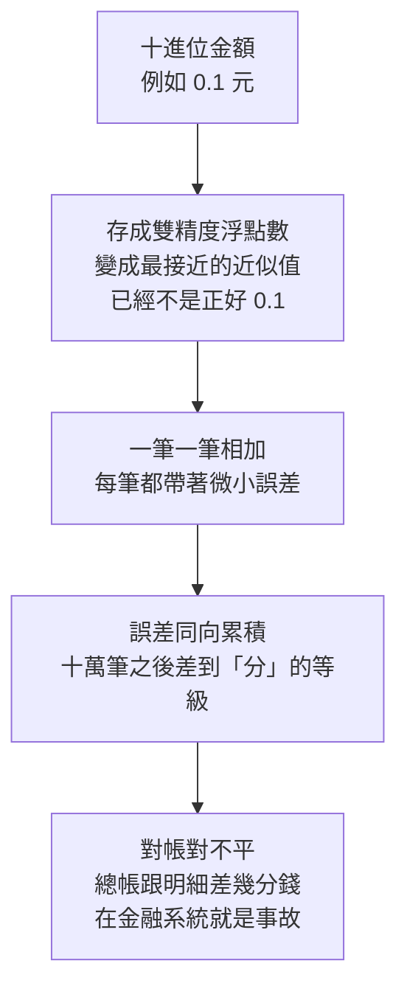

# [E-17-1] 浮點數為什麼不能拿來算錢

> **目標**：搞懂為什麼 `0.1 + 0.2` 不等於 `0.3`——不是程式語言有 bug，而是 IEEE 754 雙精度浮點數的本質就存不下 `0.1` 這種十進位小數；並理解在金融系統裡，這個「差一點點」累積起來就是事故。

## 一個問題：購物車加總，怎麼多了 0.00000000000000004？

你在做一個購物車。使用者加了三樣東西，單價分別是 10.1、20.2、0.1 元，你把它們加起來顯示小計。你很自然地寫：

```typescript
const subtotal = 10.1 + 20.2 + 0.1;
console.log(subtotal); // 你以為會是 30.4
```

結果印出來是 `30.400000000000002`。

你沒寫錯、語言也沒壞。這個「多出來的尾巴」是**電腦用二進位存小數**的必然結果。先看最有名的那個例子：

```typescript
console.log(0.1 + 0.2);          // 0.30000000000000004
console.log(0.1 + 0.2 === 0.3);  // false
```

在 JavaScript、Python、Java、C#、Go……幾乎所有主流語言裡，只要用的是浮點數，這個結果都一樣。這不是哪個語言的問題，而是它們共用的那套浮點數規格——**IEEE 754**（電機電子工程師學會訂的浮點數標準，Institute of Electrical and Electronics Engineers Standard 754）——先天就是這樣。

## 生活類比：用三分之一個披薩記帳

想像你只能用「三分之一個披薩」當記帳單位。有人跟你借了「半個披薩」，你要怎麼記？

半個 = 1.5 個三分之一。但你的單位是「整數個三分之一」，記不下那個 `.5`。你只能記成「1 個三分之一」或「2 個三分之一」，怎麼記都跟真正的「半個」差一截。你的記帳系統裡，**「半個」這個數字根本無法被精確表示**——不是你算錯，是你的單位天生表達不出它。

電腦存小數就是這個處境。電腦的世界只有 0 和 1，小數得拆成「二分之一、四分之一、八分之一……」這些**二的負次方**相加來逼近。有些十進位小數剛好湊得出來（例如 0.5 就是二分之一，剛剛好），但**像 0.1、0.2 這種，用再多個二的負次方相加也永遠湊不剛好**——就像上面的「半個披薩」永遠湊不出整數個三分之一。

```
十進位的 0.1，想用二進位表示：
  0.0001100110011001100110011...（1001 無限循環下去）

但電腦的儲存空間有限（雙精度給 52 個位元放尾數），
只能存到某一位就被迫「截斷 / 進位」。
→ 存進去的其實是「非常接近 0.1、但不完全是 0.1」的一個數。
```

所以 `0.1` 一存進浮點數，就已經不是真正的 0.1 了，而是一個極接近它的近似值。`0.1 + 0.2` 是「兩個近似值相加」，結果自然跟真正的 0.3 差了一點點。

## 誤差從哪裡來、又怎麼滾大

單看一次 `0.1 + 0.2`，誤差小到 `0.00000000000000004`，肉眼根本看不出來，四捨五入到小數點後兩位也看不出差別。真正的危險是**誤差會累積**。

這張圖說明「單筆看不出來、累加才現形」的過程：



這張圖表達：單筆浮點誤差小到看不見，但經過大量加總後，誤差會累積到「分」甚至更大的等級，最終造成帳對不平。

用程式碼把「累積」演出來——把 0.1 加十萬次，照理應該是 10000.0：

```typescript
// 把 0.1 累加十萬次，數學上答案應該剛好是 10000
let total = 0;
for (let i = 0; i < 100000; i++) {
  total += 0.1;
}
console.log(total); // 10000.000000018848 —— 不是 10000，尾巴跑出來了
```

十萬筆交易在一個稍有規模的系統裡是一天就會發生的量。這時候「總帳」跟「把每筆明細重新加一次」就會對不起來，差個幾分錢。在購物車裡顯示 `30.400000000000002` 只是醜；但在**金融系統裡，帳差一分錢就是事故**——會計帳對不平、稽核無法簽核、使用者看到奇怪的金額會不信任你的系統。

## 為什麼「四捨五入一下就好」不是真正的解法

很多人第一反應是：「那我顯示的時候四捨五入到兩位小數不就好了？」

```typescript
const subtotal = 10.1 + 20.2 + 0.1;
console.log(subtotal.toFixed(2)); // "30.40" —— 看起來正常了
```

顯示層這樣做沒錯，**但那只是把尾巴藏起來，底層存的還是帶誤差的浮點數**。你後續只要再拿這個值去做運算（再相加、乘稅率、打折），誤差又會從被藏起來的地方冒出來，而且是在「已經四捨五入過、你以為乾淨了」的數字上繼續滾。

更糟的是浮點數連「四捨五入」本身都可能不如你預期：

```typescript
// 你以為會進位到 1.01，實際上因為 1.005 存進去是 1.00499999...
console.log((1.005).toFixed(2)); // "1.00"，不是 "1.01"
```

`1.005` 存成浮點數後其實是 `1.00499999...`，所以 `toFixed` 看到的是個比 1.005 小一點的數，於是往下捨成 `1.00`。**連「要不要進位」這種最基本的判斷，浮點數都會給你一個違反直覺的答案。**

結論很硬：**錢不能用浮點數存、不能用浮點數算**。顯示時格式化是可以的，但「真相」必須存在一個精確的表示法裡。那要用什麼？下一篇就專門講解法。

## 常見錯誤（反模式）

> **常見錯誤一：用 `number`（浮點數）存金額**
>
> 在 TypeScript／JavaScript 裡，`number` 就是雙精度浮點數，沒有別的數字型別可選。所以只要你這樣宣告金額，就已經踩雷了：
>
> ```typescript
> interface CartItem {
>   name: string;
>   price: number; // 😱 用浮點數存金額，誤差從這裡開始
> }
> ```
>
> 問題是：這個 `price` 從被賦值的那一刻起就可能不精確，之後每一次加總、乘除都在放大誤差。等到對帳對不平時，你很難回頭找出是哪一筆、哪一步跑掉的。
>
> **正確做法**：金額改用「最小單位的整數」（例如以「分」為單位存 `number`，但只放整數）或十進位型別（decimal）來存——這正是下一篇 E-17-2 的主題。重點是**從資料型別這一層就不要讓浮點數碰到錢**。

> **常見錯誤二：用 `===` 直接比較兩個浮點數算出來的結果**
>
> ```typescript
> const paid = 0.1 + 0.2;
> if (paid === 0.3) {
>   markAsFullyPaid(); // 永遠進不來，因為 paid 是 0.30000000000000004
> }
> ```
>
> 問題是：兩個浮點運算的結果就算「數學上相等」，存進去的近似值也可能差一點點，`===` 會判為不相等。於是「明明付清了卻判定沒付清」這種鬼故事就發生了。
>
> **正確做法**：根本不要讓金額走到「比較兩個浮點結果」這一步——用整數分或十進位型別，整數的 `===` 是精確可靠的。真的不得已要比較浮點數（例如科學計算、繪圖座標，那些場合浮點數是對的選擇），才用「兩數相差小於一個極小容忍值（epsilon）」來判定，而不是 `===`。

> **常見錯誤三：以為「四捨五入就修好了」**
>
> ```typescript
> // 以為把每一步都 toFixed(2) 就安全了
> const afterTax = Number((price * 1.05).toFixed(2));
> const afterDiscount = Number((afterTax * 0.9).toFixed(2));
> // 每一步都在「已經不精確的浮點數」上再四捨五入，誤差照樣能累積、進位還可能跑錯
> ```
>
> 問題是：`toFixed` 回傳字串，你用 `Number()` 轉回去又變回浮點數；而且如前面示範的，浮點數連「該不該進位」都會判錯。這是把問題塗掉，不是修好。
>
> **正確做法**：用一種「天生就精確」的表示法（整數分或 decimal）全程貫徹，只在**最後要顯示給人看的那一步**才格式化成字串。什麼時候捨入、捨入到哪一位、用哪種捨入規則，都是要刻意設計的——這些細節 E-17-2 會講。

## 小結

- `0.1 + 0.2 !== 0.3` 不是語言 bug，而是 **IEEE 754 雙精度浮點數**的本質：電腦用二進位的「二的負次方」相加逼近小數，像 0.1、0.2 這種十進位小數永遠湊不剛好，存進去的是近似值。
- 單筆誤差小到看不見，但**會同向累積**——大量加總後差到「分」的等級，在金融系統裡就是對帳對不平的事故。
- **「顯示時四捨五入」不是解法**，只是把尾巴藏起來；底層還是浮點數，再運算又會冒出來，而且浮點數連「該不該進位」都可能判錯。
- 鐵則：**錢絕不能用浮點數（`number`）存、也不能用浮點數算**。格式化只發生在最後顯示那一步，真相要存在精確的表示法裡。

> 那「精確的表示法」到底長怎樣、怎麼選、捨入怎麼處理才不漏錢 → [E-17-2：怎麼正確表示金額——定點數與十進位型別](./E-17-2-fixed-point-decimal.md)
> 錢在「扣款→算結果→發錢」這種跨系統流程裡怎麼不扣兩次、不漏退款（用的也是整數金額）→ [E-15-2：錢的狀態機](../E-15-resilience/E-15-2-money-state-machine.md)
