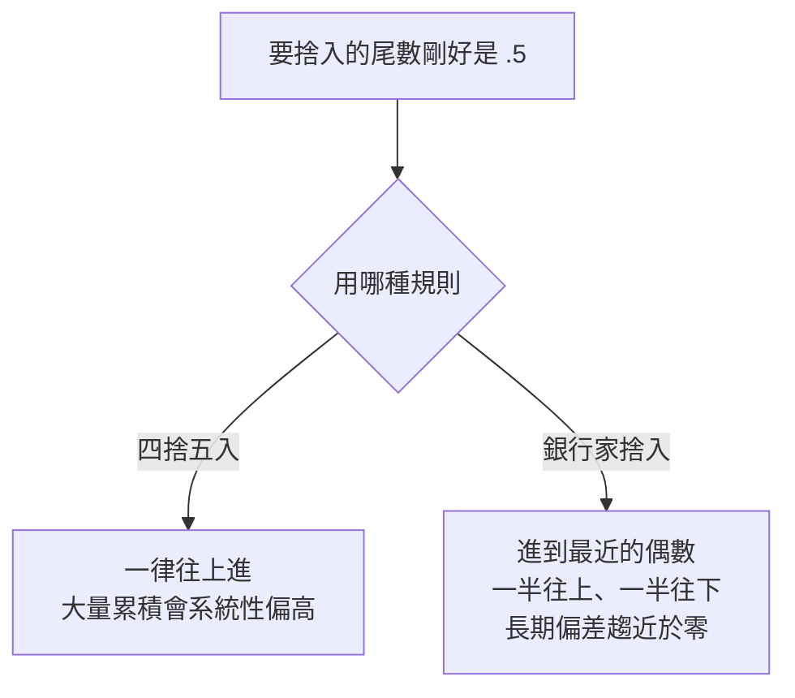

# [E-17-2] 怎麼正確表示金額：定點數與十進位型別

> **目標**：接續上一篇的「錢不能用浮點數」，給出正確解法——用「最小單位的整數」或十進位型別（decimal）精確表示金額；搞懂捨入的陷阱（四捨五入 vs 銀行家捨入）、乘除與稅率怎麼算才不漏錢、以及「該在哪一步捨入」。

> 前置：先看懂「為什麼浮點數不能算錢」→ [E-17-1：浮點數為什麼不能拿來算錢](./E-17-1-float-money.md)。這篇是它的下集：問題講完了，這裡講解法。

## 一個問題：三個人分一張 100 元的帳，怎麼分才不漏錢？

三個朋友吃飯，帳單 100 元，說好平分。`100 ÷ 3 = 33.333...`，一人該付 33.33 元。但 `33.33 × 3 = 99.99`——**少了一分錢**。這一分錢跑去哪了？誰要多付？

這不是浮點數的問題（就算用最精確的數學，`100 ÷ 3` 本來就除不盡）。這是**所有金額系統都逃不掉的課題**：錢只能到「分」為止，除不盡的尾數一定得有人承接。上一篇解決了「怎麼精確存一個金額」，這一篇要解決的是「精確存了之後，乘除、分帳、算稅這些運算怎麼做才不會憑空多出或少掉錢」。

先把地基打好：金額到底該用什麼型別存。

## 解法一：用「最小單位的整數」

最簡單、最可靠的做法：**不要存「元」，改存「分」，而且用整數存**。

生活類比：你不會說「我有半個十元硬幣」，你會說「我有 5 個一元硬幣」。把單位縮到最小（一元、一分），金額就永遠是整數，而**整數在電腦裡是精確的**——沒有上一篇那種二進位湊不剛好的問題。

```
顯示給人看：  12.34 元
系統內部存：  1234   （單位：分，一個精確的整數）
```

用 pseudo code 描述這個轉換：

```
存進系統時：   元 × 100 → 分（整數）   例如 12.34 → 1234
從系統取出顯示：分 ÷ 100 → 元           例如 1234 → "12.34"
所有加減運算：  直接對「分」的整數做，永遠精確
```

對應到 TypeScript。重點是用型別和命名把「這是分，不是元」釘死，避免有人不小心把「元」丟進來：

```typescript
// 用型別別名標記「這個數字的單位是分」，讓看程式的人一眼知道不是元。
// （TypeScript 的型別別名只是標註，不會真的擋住誤用，但大幅降低看錯的機率）
type Cents = number;

// 加總購物車：全程在「分」的整數上做加法，精確無誤差
function sumCartInCents(prices: Cents[]): Cents {
  return prices.reduce((total, price) => total + price, 0);
}

// 只在「要顯示給人看」的最後一步，才把分格式化成「元.角分」的字串
function formatCents(cents: Cents): string {
  const yuan = Math.floor(cents / 100);
  const remainder = (cents % 100).toString().padStart(2, "0");
  return `${yuan}.${remainder}`;
}

const cart: Cents[] = [1010, 2020, 10]; // 10.10 + 20.20 + 0.10 元
const total = sumCartInCents(cart);
console.log(total);             // 3040（分），精確
console.log(formatCents(total)); // "30.40"
```

對照上一篇用浮點數算出 `30.400000000000002`——這裡 `3040` 是個乾乾淨淨的整數。**加減法到這裡就解決了。** 麻煩的是乘除（稅率、折扣、分帳），因為它們會產生除不盡的尾數，這留到後面「捨入」一節。

> 一個現實限制：JavaScript 的 `number` 是浮點數，安全整數上限是 `2^53 - 1`（約 9 千兆）。以「分」計，這能表示到大約 90 兆元，一般業務綽綽有餘；但若要處理天文數字金額，整數分也會超出安全範圍——那就要用下面的 `BigInt` 或十進位型別。

## 解法二：十進位型別（decimal / BigDecimal）

「整數分」很好用，但有兩個場合會卡住：一是金額需要**比「分」更細的精度**（例如匯率、單價要到小數點後四、五位的計價）；二是數字大到超過安全整數範圍。這時候用**十進位型別**。

十進位型別（decimal）是一種「**直接用十進位記數、不轉成二進位**」的數字型別。因為它天生就是十進位，`0.1` 對它來說就是精確的 `0.1`，沒有上一篇那種近似問題。各語言的叫法不同：

| 語言／環境 | 十進位型別 |
|---|---|
| 資料庫（PostgreSQL 等） | `NUMERIC` / `DECIMAL`（存金額的標準選擇） |
| Java | `BigDecimal` |
| C# / .NET | `decimal`（語言內建） |
| Python | `decimal.Decimal` |
| JavaScript / TypeScript | 語言沒有內建，用函式庫（如 `decimal.js`）或 `BigInt` |

JavaScript 沒有內建十進位型別，所以 TypeScript 要嘛用「整數分」（前面那套），要嘛引入一個 decimal 函式庫。概念上，decimal 型別讓你能這樣寫，而且結果精確：

```typescript
// 概念示意：用十進位型別時，0.1 + 0.2 會精確等於 0.3
// （Decimal 來自十進位函式庫，不是 JS 內建的 number）
const a = new Decimal("0.1");
const b = new Decimal("0.2");
console.log(a.plus(b).toString()); // "0.3"，精確，沒有尾巴

// 注意：一定要用「字串」建構，不要寫 new Decimal(0.1)
// —— 因為 0.1 這個 number 字面值「在進到 Decimal 之前」就已經是帶誤差的浮點數了
```

最後那個註解是關鍵坑：**用字串 `"0.1"` 建 decimal，不要用 `number` 字面值 `0.1`**。否則那個 `0.1` 在變成 decimal 之前，已經先被 JavaScript 當成浮點數處理過、帶上誤差了，你等於把髒水倒進乾淨杯子。

**怎麼選**：金額只到「分」、數字不大 → 整數分，最簡單可靠；需要更高精度或超大數字 → 十進位型別。資料庫欄位一律用 `NUMERIC`，別用 `float`／`double`。

## 捨入的陷阱：四捨五入 vs 銀行家捨入

地基打好了，回到開場那個「100 ÷ 3」的問題：**只要有乘除，就會產生除不盡的尾數，一定得捨入**。而「怎麼捨」有兩種常見規則，差別會影響到錢。

**第一種：四捨五入（round half up）**——你最熟的那種，遇到 .5 就往上進。

**第二種：銀行家捨入（banker's rounding，又叫 round half to even，四捨六入五成雙）**——遇到剛好 .5 時，進到「最接近的偶數」。

```
要把這些數捨到整數：

數值     四捨五入    銀行家捨入
0.5  →   1          0   （進到偶數 0）
1.5  →   2          2   （進到偶數 2）
2.5  →   3          2   （進到偶數 2）
3.5  →   4          4   （進到偶數 4）
```

為什麼銀行家捨入存在？因為**四捨五入「遇 .5 永遠往上」，大量累積下來會系統性地偏高**——一堆 .5 全往上進，總和就會比真實值大。銀行家捨入讓 .5 一半往上、一半往下（看鄰居是不是偶數），長期下來偏差趨近於零。這在要跑大量加總的會計、金融結算裡很重要，很多財務系統與 IEEE 754 的預設捨入模式用的都是它。

這張圖說明兩種捨入「對 .5 的處理」差在哪：



這張圖表達：只有在「尾數剛好是 .5」時兩者才有差；非 .5 的情況兩者一致。選哪種沒有絕對對錯，但**整個系統必須統一用同一種**，而且最好跟你的會計／結算對手方（銀行、金流商）用的一致，否則對帳會出現「就差那幾個 .5」的詭異尾差。

用 TypeScript 示範兩種捨入的差別（以「把金額的分四捨到整數分」為例）：

```typescript
// 四捨五入：遇 .5 往上
function roundHalfUp(value: number): number {
  return Math.round(value); // 注意 JS 的 Math.round 對負數的 .5 行為要留意
}

// 銀行家捨入：遇 .5 進到最近的偶數
function roundHalfToEven(value: number): number {
  const floor = Math.floor(value);
  const diff = value - floor;
  if (diff < 0.5) return floor;
  if (diff > 0.5) return floor + 1;
  // 剛好 .5：看 floor 是不是偶數，進到偶數那邊
  return floor % 2 === 0 ? floor : floor + 1;
}

console.log(roundHalfUp(2.5));    // 3
console.log(roundHalfToEven(2.5)); // 2（進到偶數）
```

## 乘除與稅率：什麼時候才捨入

最後一塊拼圖，也是最常漏錢的地方：**算稅、打折這種乘法，要在哪一步捨入？**

鐵則：**乘除的中間過程保留完整精度，只在「這個金額要變成真的要收／要付的錢」時才捨入一次。** 中途每一步都捨入，誤差會一步步被放大。

用「含稅價」示範。情境：單價 333 分（3.33 元），買 3 件，稅率 5%。

```typescript
type Cents = number;

// ❌ 壞做法：每件先各自算稅、各自捨入，再加總 —— 捨入了三次，誤差放大
function taxBad(unitPriceCents: Cents, quantity: number, taxRate: number): Cents {
  let total = 0;
  for (let i = 0; i < quantity; i++) {
    total += Math.round(unitPriceCents * (1 + taxRate)); // 每件都捨一次
  }
  return total;
}

// ✅ 好做法：先把「未稅總額」算完（整數，精確），最後乘一次稅、只捨入一次
function taxGood(unitPriceCents: Cents, quantity: number, taxRate: number): Cents {
  const subtotal = unitPriceCents * quantity;        // 333 × 3 = 999，精確
  return Math.round(subtotal * (1 + taxRate));        // 999 × 1.05 = 1048.95 → 捨入成 1049
}

console.log(taxBad(333, 3, 0.05));  // 350 × 3 = 1050（每件 349.65→350，捨三次偏高）
console.log(taxGood(333, 3, 0.05)); // 1049（只捨一次，正確）
```

差了一分錢——`taxBad` 因為「每件各捨一次、三次都往上」而系統性偏高。**捨入的次數越少、越晚，誤差越小。**

至於開場那個「100 分三份」的分帳問題，正確做法是**先捨入、再把除不盡的尾數明確分配給某一方**，而不是假裝尾數不存在：

```typescript
// 把 total 平分成 n 份，餘數「一人多分一分」地發完，確保加總完全等於 total
function splitBill(totalCents: Cents, n: number): Cents[] {
  const base = Math.floor(totalCents / n);     // 每份至少這麼多
  const remainder = totalCents % n;            // 除不盡的餘數（單位：分）
  // 前 remainder 份各多拿一分，其餘拿 base —— 加起來剛好等於 totalCents
  return Array.from({ length: n }, (_, i) => (i < remainder ? base + 1 : base));
}

const shares = splitBill(10000, 3); // 100.00 元分三份
console.log(shares);                 // [3334, 3333, 3333]（分）
console.log(shares.reduce((a, b) => a + b, 0)); // 10000，一分不差
```

重點不是「每個人剛好一樣多」（本來就不可能），而是**餘數被明確分配掉、加總完全等於原始金額**，沒有任何一分錢憑空消失或冒出來。

## 常見錯誤（反模式）

> **常見錯誤一：資料庫金額欄位用 `float` / `double`**
>
> ```sql
> -- 危險：用浮點數型別存金額，誤差在資料庫層就種下了
> CREATE TABLE orders (
>   id      BIGINT PRIMARY KEY,
>   amount  DOUBLE PRECISION  -- 😱 和上一篇的 number 同一個病
> );
> ```
>
> 問題是：`DOUBLE PRECISION`（雙精度浮點數）在資料庫裡一樣存不下精確的十進位小數，你存進去 `0.1`，查出來可能是 `0.09999999...`。SUM 聚合大量資料時誤差照樣累積。
>
> **正確做法**：金額欄位用 `NUMERIC(精度, 位數)`（又名 `DECIMAL`），它是資料庫的十進位型別，精確無誤差：
>
> ```sql
> CREATE TABLE orders (
>   id      BIGINT PRIMARY KEY,
>   amount  NUMERIC(14, 2)  -- 共 14 位數、小數點後 2 位，精確
> );
> ```

> **常見錯誤二：用 `number` 字面值建構 decimal**
>
> ```typescript
> const price = new Decimal(0.1); // 😱 0.1 這個 number 在進 Decimal 前就已經是髒的浮點數
> ```
>
> 問題是：十進位型別本身是精確的，但你餵給它的 `0.1` 是個 JavaScript `number`——在它被包進 `Decimal` 之前，就已經是帶誤差的浮點數了。等於你買了精密天平，卻先把砝碼在泥巴裡滾一圈再放上去。
>
> **正確做法**：一律用**字串**建構，讓十進位型別自己去解析那串精確的十進位文字：`new Decimal("0.1")`。從外部（API、資料庫）拿到的金額也應該是字串形式，別讓它中途變成過 `number`。

> **常見錯誤三：乘除的每一步都捨入**
>
> ```typescript
> // 壞：算完稅捨一次、打完折又捨一次、分帳再捨一次 —— 捨越多次、誤差越大
> const afterTax = Math.round(price * 1.05);
> const afterDiscount = Math.round(afterTax * 0.9);
> ```
>
> 問題是：每一次捨入都丟掉一點尾數，而這些丟掉的量會往同方向累積。中途捨越多次，最後結果離「真正該收的錢」就越遠。
>
> **正確做法**：中間過程保留完整精度（用整數分或 decimal 一路算到底），**只在最終「要變成實際收付金額」的那一步捨入一次**，並明確選定捨入規則（四捨五入或銀行家捨入）全系統統一。

## 小結

- 正確表示金額有兩條路：**最小單位的整數**（存「分」而非「元」，整數精確無誤差，最簡單可靠）或**十進位型別**（decimal / `BigDecimal` / `NUMERIC`，天生十進位、適合更高精度或超大數字）。選定一種，全系統貫徹。
- 資料庫金額欄位用 `NUMERIC`／`DECIMAL`，**絕不用 `float`／`double`**；用 decimal 函式庫時一律**用字串建構**，別讓 `number` 字面值的浮點誤差偷渡進來。
- 有乘除就有除不盡的尾數，一定得**捨入**。四捨五入遇 .5 恆往上、大量累積會系統性偏高；**銀行家捨入**（四捨六入五成雙）讓 .5 一半往上一半往下、長期偏差趨近零。選哪種都行，但全系統要統一、最好跟結算對手方一致。
- 捨入的鐵則：**次數越少、時機越晚越好**——中間過程保留完整精度，只在「變成實際收付金額」那一步捨一次。分帳這種除不盡的，要把**餘數明確分配掉**，確保加總完全等於原始金額。

> 還沒看過「為什麼浮點數不能碰錢」的源頭 → [E-17-1：浮點數為什麼不能拿來算錢](./E-17-1-float-money.md)
> 這些精確的金額要透過 API 傳輸時，又有一個新陷阱（JSON 的 number 也是浮點數）→ [E-17-3：JSON 數字精度陷阱](./E-17-3-json-number-precision.md)
