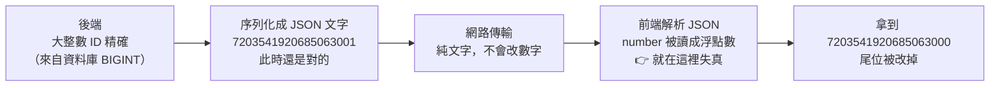

# [E-17-3] JSON 數字精度陷阱：大整數與金額別用 number 傳

> **目標**：搞懂為什麼 JSON 裡的 number 會「悄悄失真」——多數解析器把 JSON number 當成雙精度浮點數，所以超過 `2^53` 的大整數（雪花 ID、訂單號）和小數在序列化／反序列化時會被改掉；並記住一條準則：**ID 與金額在 API 傳輸時用字串傳，別用 JSON number**。

> 前置：先看懂浮點數為什麼存不下精確的數 → [E-17-1：浮點數為什麼不能拿來算錢](./E-17-1-float-money.md)。這篇是同一個病，發作在「資料跨系統傳輸」的環節。

## 一個問題：訂單號傳到前端，最後兩位變成 00 了

你的後端用一個 19 位數的大整數當訂單號，後端資料庫裡存的是 `7203541920685063001`。後端把它包進 JSON 回給前端：

```json
{ "orderId": 7203541920685063001, "amount": 12.10 }
```

前端用 `JSON.parse` 解開，拿到的 `orderId` 卻是 `7203541920685063000`——**最後一位被改掉了**。使用者點進這張「不存在的訂單」，後端查無此單，整條流程壞掉，而且沒有任何人報錯。

你後端沒寫錯、前端也沒寫錯、網路傳輸也沒掉封包。這個失真發生在一個你根本沒注意到的地方：**JSON 的 `number` 在解析時被當成了浮點數。**

## 為什麼會這樣：JSON 規格沒規定 number 的精度

JSON（JavaScript Object Notation，一種資料交換格式）的規格裡，`number` 就是「一串數字」，**規格本身沒有規定它該用多少精度去存**。於是絕大多數語言的 JSON 解析器，都把 JSON number 讀進各自語言的「預設數字型別」——而那個預設型別，在 JavaScript 裡就是雙精度浮點數（`number`），在很多其他語言裡也是 `double`。

這就接回 E-17-1 的老問題了：**雙精度浮點數能精確表示的整數，上限是 `2^53 - 1`（9007199254740991，約 9 千兆）。** 超過這個數，浮點數的尾數位元不夠用，就只能存「最接近的近似值」，於是尾端的位數被改掉。

```
2^53 - 1 = 9007199254740991   ← 這個數以內，整數精確
         ↓ 超過就開始失真
7203541920685063001           ← 19 位的訂單號，遠超 2^53
→ 存進浮點數後變成 7203541920685063000（尾數對不上，被改掉）
```

在 JavaScript 可以直接驗證這個上限：

```typescript
// Number.MAX_SAFE_INTEGER 就是 2^53 - 1：能被浮點數精確表示的最大整數
console.log(Number.MAX_SAFE_INTEGER); // 9007199254740991

// 超過之後，連「加 1」和「加 2」都可能分不出來
console.log(9007199254740992 === 9007199254740993); // true 😱 兩個不同的數被當成相等
```

哪些東西特別容易踩到這條線？**任何「夠大的整數 ID」**：

- **雪花 ID（Snowflake ID）**：一種分散式系統常用的 64 位元唯一識別碼產生法（把時間戳、機器編號、序號拼成一個大整數）。64 位元遠超 `2^53`，必中。
- **訂單號、交易流水號**：為了全域唯一常做成十幾位的大整數。
- **資料庫的 `BIGINT` 主鍵**：一旦數值長大，就可能越過 `2^53`。

而小數（例如金額）則是 E-17-1 講過的另一面：`12.10` 傳過去可能變成 `12.099999...`。

## 失真發生在哪一步

很多人以為「JSON 是純文字，傳輸不會改數字」——這句話對了一半。**失真不是發生在網路傳輸，而是發生在「解析（parse）那一步」**：把 JSON 文字變成語言裡的數字物件時，被塞進了浮點數型別。

這張圖標出失真的確切位置：



這張圖表達：JSON 文字在傳輸途中是完好的，失真發生在接收端「把 number 解析成浮點數」的那一刻。所以就算你用抓封包工具看到線上傳的文字是對的，前端拿到的值還是可能錯——因為錯在解析，不在傳輸。

這也解釋了一個常見的除錯鬼打牆：你在後端 log、在瀏覽器的 Network 分頁看 raw response，數字都是對的；偏偏程式裡 `JSON.parse` 之後就錯了。因為你看的是「文字」，程式用的是「解析後的 number」。

## 解法：ID 與金額一律用字串傳

解法簡單到有點反直覺：**把大整數 ID 和金額，在 JSON 裡用字串（string）傳，不要用 number。**

字串在序列化／反序列化時是**逐字元照搬**的，不經過任何數字型別，自然也不會被浮點數動手腳。`"7203541920685063001"` 傳過去就是一字不差的 `"7203541920685063001"`。

比較兩種 API 回應的設計：

```json
// ❌ 危險：大整數 ID 和金額都用 JSON number
{
  "orderId": 7203541920685063001,
  "amount": 12.10,
  "quantity": 3
}

// ✅ 安全：ID 和金額用字串，真正該是數字的（數量）才用 number
{
  "orderId": "7203541920685063001",
  "amount": "12.10",
  "quantity": 3
}
```

注意 `quantity`（數量）還是用 number——因為它是個小整數，不會超過 `2^53`，而且它本來就該參與數字運算。**準則不是「所有數字都用字串」，而是「會被精度咬到的那些（大整數 ID、金額）用字串」。**

在 TypeScript 的型別定義裡把這件事釘死，讓拿到資料的人一眼知道這是字串、不是 number：

```typescript
interface OrderResponse {
  orderId: string;   // 大整數 ID：用字串傳，避免超過 2^53 的失真
  amount: string;    // 金額：用字串傳，避免小數的浮點誤差（見 E-17-1）
  quantity: number;  // 小整數、要參與運算：用 number 沒問題
}

// 收到後要運算時，才在「可控的那一步」轉成你要的精確型別
function parseOrder(raw: OrderResponse) {
  return {
    orderId: raw.orderId,                  // ID 保持字串，本來就不該拿去算術
    amountInCents: Math.round(Number(raw.amount) * 100), // 轉成整數分（見 E-17-2）
    quantity: raw.quantity,
  };
}
```

關鍵是：`orderId` 既然是個識別碼，你根本不需要對它做加減乘除，**它一輩子都可以是字串**。金額則轉成 E-17-2 講的「整數分」再運算。

> 如果你無法改 API 格式（例如對接的是別人的服務，對方就是用 number 傳大整數），那就得換一個「不會把 number 讀成浮點數」的 JSON 解析器——有些函式庫能把超大整數解析成 `BigInt`（JavaScript 專門表示任意精度整數的型別）或字串，而不是 `number`。但這是補救，不是首選；能控制 API 格式時，一律用字串傳最乾淨。

## 常見錯誤（反模式）

> **常見錯誤一：以為「後端 log 是對的，就代表前端拿到的是對的」**
>
> ```typescript
> // 後端：log 出來的訂單號完全正確
> logger.info("建立訂單", { orderId: 7203541920685063001n }); // 用 BigInt，後端這裡是對的
>
> // 前端：JSON.parse 之後就錯了，但你盯著後端 log 怎麼看都正常
> const order = JSON.parse(responseText);
> console.log(order.orderId); // 7203541920685063000，尾位已被改掉
> ```
>
> 問題是：後端用的是精確型別（如 `BigInt`、資料庫 `BIGINT`），log 當然對；失真發生在前端「解析 JSON number 成浮點數」的瞬間，跟後端完全無關。盯著後端查會查到天荒地老。
>
> **正確做法**：認清失真點在「接收端的解析」，不在傳送端。從源頭就把 ID／金額設計成字串傳輸，問題根本不會發生。

> **常見錯誤二：只在前端 `toFixed` 補救金額，ID 卻放著不管**
>
> ```typescript
> const order = JSON.parse(responseText);
> const amount = order.amount.toFixed(2); // 以為把金額修好就沒事了
> // 但 order.orderId 這個大整數早就在 JSON.parse 時失真了，沒人管它
> ```
>
> 問題是：金額的小數失真比較容易被注意到（數字看起來怪），但**大整數 ID 的失真非常隱蔽**——`7203541920685063000` 看起來跟 `...001` 一樣「像個正常的訂單號」，不會觸發任何警覺，直到它拿去查資料庫查無此筆。
>
> **正確做法**：ID 和金額都要在 API 設計層就用字串傳，不是等拿到失真的 number 再事後補救（對大整數來說，失真後已經救不回來了——你不知道原本的尾位是什麼）。

> **常見錯誤三：把 ID 當數字，還拿去排序或做算術**
>
> ```typescript
> // 把訂單號當 number 來比大小排序 —— 大整數一失真，排序就亂
> orders.sort((a, b) => a.orderId - b.orderId); // 😱 orderId 是大整數，相減已不可靠
> ```
>
> 問題是：ID 的用途是「唯一識別」，不是「比大小」。把它當 number 不但會失真，相減（`a - b`）在超過 `2^53` 的區間還可能給出錯誤的大小關係，排序結果整個亂掉。
>
> **正確做法**：ID 全程當字串。需要排序時，若 ID 本身帶時間順序（如雪花 ID），用**字串比較**（等長的大整數字串，字典序就等於數值序）或另外帶一個明確的時間戳欄位來排。**別把識別碼拿去做算術。**

## 小結

- JSON 規格沒規定 `number` 的精度，多數解析器把它讀成**雙精度浮點數**。於是超過 `2^53 - 1`（約 9 千兆）的**大整數**（雪花 ID、訂單號、`BIGINT` 主鍵）和**小數**（金額）在解析時會**悄悄失真**。
- 失真發生在**接收端「解析 JSON number」那一步**，不在網路傳輸。所以後端 log、抓封包看到的文字都是對的，程式 `JSON.parse` 之後才錯——這是最容易查錯方向的地雷。
- 準則：**大整數 ID 和金額在 API 傳輸時一律用字串（string）傳**，字串逐字元照搬、不碰數字型別，不會失真。真正該運算的小整數（數量）才用 number。
- ID 既是識別碼就一輩子保持字串、別拿去做算術；金額收到後轉成「整數分」或十進位型別再算（見 E-17-2）。無法改 API 格式時，才退而用能解析成 `BigInt`／字串的 JSON 函式庫補救。

> 這個「大數字存不下」的本質，和金額的浮點誤差是同一個病 → [E-17-1：浮點數為什麼不能拿來算錢](./E-17-1-float-money.md)
> ID／金額在傳輸途中會不會被竄改、怎麼確認是對方發的沒被改過，是另一個層次的問題 → [E-3-3：HTTP 協定詳解](../E-3-network/E-3-3-http-protocol.md)
