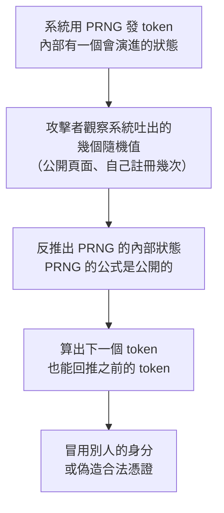

# [E-17-4] PRNG vs CSPRNG：兩種「隨機」差在哪

> **目標**：分清楚兩種隨機數產生器——偽隨機數產生器（PRNG，有種子、可重現、但可被預測）與密碼學安全的亂數（CSPRNG，不可預測、不可重現）；並記住選錯會出大事的那條界線：**可重播／模擬用 PRNG，權杖／金鑰／密碼重設碼／抽獎一律用 CSPRNG**。

## 一個問題：用「可重現的隨機」發 session token，會怎樣？

你要幫登入的使用者發一個 session token（連線憑證，一串隨機字串，後端靠它認得「這是誰」）。你隨手用了語言內建的 `Math.random()` 產生一串看起來很亂的字元：

```typescript
// 看起來很隨機，對吧？
const token = Math.random().toString(36).slice(2);
```

看起來很亂，但這串東西其實**可以被攻擊者預測**。只要他觀察你系統吐出的幾個 `Math.random()` 值，就能反推出產生器的內部狀態，接著**算出你「下一個」會發給別人的 token**——然後冒用那個人的身分登入。

問題不在於「這串字看起來夠不夠亂」，而在於你用錯了**種類**。`Math.random()` 是個 PRNG，它天生就不是拿來做這件事的。要理解這個錯在哪，得先分清楚兩種隨機。

## 生活類比：洗好的牌 vs 真正洗牌

**PRNG（偽隨機數產生器，Pseudo-Random Number Generator）** 像一副「照固定公式洗好、序列已經定了」的牌。只要給同樣的起手設定（這個起手設定叫**種子 seed**），它每次都發出**一模一樣的順序**。對不知道公式和種子的人來說，發出來的牌看起來很亂、分佈很均勻；但這個「亂」是**算出來的、可重現的**——知道種子就能完全複製整個序列，看了前面幾張甚至能推出後面。

**CSPRNG（密碼學安全的偽隨機數產生器，Cryptographically Secure Pseudo-Random Number Generator）** 像「每一張都當場真正洗出來、沒有人能預測下一張、也沒辦法倒帶重來」的牌。它的設計目標就是：**就算你看過它產出的一大堆值，也絕對推不出下一個、也還原不出內部狀態。**

把兩者的性質擺在一起對照：

| 性質 | PRNG | CSPRNG |
|---|---|---|
| 有種子、可指定 | 是（可重現的關鍵） | 否（由系統的真亂源餵入） |
| 相同種子 → 相同序列 | **是**（這是優點，用於重播） | 否 |
| 能不能被預測下一個 | **能**（看夠多就能反推） | **不能**（這是它的設計目標） |
| 速度 | 快 | 較慢（但對一般用途綽綽有餘） |
| 適合 | 模擬、測試、遊戲、需可重播的場合 | 權杖、金鑰、密碼、密碼重設碼、抽獎 |

一句話記住差別：**PRNG 的「亂」是為了「看起來均勻」，CSPRNG 的「亂」是為了「沒人猜得到」。** 兩者不是好壞之分，是**用途之分**——選錯邊才會出事。

## 「可預測」為什麼是嚴重問題

PRNG 可被預測，聽起來抽象，但後果很具體。這張圖畫出攻擊者怎麼利用它：



這張圖表達：PRNG 的演算法是公開的，一旦內部狀態被反推出來，過去和未來的輸出就全被攻破了——這正是 token、金鑰這類東西絕不能用 PRNG 的原因。

反過來說，**同樣這個「可重現」的特性，在另一些場合卻是救命的優點**：

- **模擬與測試**：你要重跑一次「出了 bug 的那次隨機序列」，就得讓隨機可重現——給同樣的種子，重播出一模一樣的過程來除錯。
- **遊戲的可重播**：要把一局遊戲錄下來、之後原封不動播回來，靠的就是「同種子 → 同序列」。
- **A/B 分流、抽樣**：想讓「同一個使用者每次都被分到同一組」，用種子化的 PRNG 餵使用者 ID 就能做到穩定且可重現的分流。

所以界線很清楚：**你「希望別人猜不到」還是「希望自己能重現」？** 答案決定你該用哪一種。

## 正式程式碼範例

Node.js 內建的 `crypto` 模組提供了 CSPRNG。下面對照「該用 CSPRNG」和「該用 PRNG」兩個情境。

**情境一：產生 session token——必須不可預測，用 CSPRNG。**

```typescript
import { randomBytes } from "node:crypto";

// randomBytes 是 CSPRNG：產出的位元組不可預測、不可重現，適合當機密憑證。
// 要 32 個位元組（256 位元）的隨機資料，轉成十六進位字串當 token。
function generateSessionToken(): string {
  return randomBytes(32).toString("hex");
}

const token = generateSessionToken();
console.log(token); // 例如 "9f2c...（64 個十六進位字元）"，攻擊者無法預測下一個
```

重點：**凡是「被猜到就完蛋」的東西，都走這條路。** 不只 session token——還包括 API 金鑰、密碼重設連結裡的那串碼、一次性驗證碼（OTP）、加密用的金鑰與初始向量、以及任何牽涉金錢或公平性的抽獎 / 抽選結果。

**情境二：產生「可重播」的模擬序列——需要可重現，用種子化 PRNG。**

這裡要帶種子，而 Node 內建的 `Math.random()` 不能指定種子，所以得自己寫一個小的種子化 PRNG（或用函式庫）。下面這個是教學用的簡單可種子化 PRNG，展示「同種子 → 同序列」：

```typescript
// 一個簡單的種子化 PRNG（mulberry32 演算法）。
// 它「可重現」正是重點：同一個種子，永遠產出同一串數列，方便重播與除錯。
// ⚠️ 它「可被預測」，所以絕對不可以拿去產生 token、金鑰這類機密。
function createSeededRandom(seed: number): () => number {
  let state = seed;
  return function next(): number {
    state |= 0;
    state = (state + 0x6d2b79f5) | 0;
    let result = Math.imul(state ^ (state >>> 15), 1 | state);
    result = (result + Math.imul(result ^ (result >>> 7), 61 | result)) ^ result;
    return ((result ^ (result >>> 14)) >>> 0) / 4294967296; // 回傳 0~1 的浮點數
  };
}

// 給同一個種子，兩次都得到一模一樣的序列 —— 這就是「可重播」
const runA = createSeededRandom(12345);
const runB = createSeededRandom(12345);
console.log(runA(), runA(), runA()); // 例如 0.223, 0.878, 0.405
console.log(runB(), runB(), runB()); // 完全一樣：0.223, 0.878, 0.405
```

把種子存起來，日後就能**原封不動重播**整段隨機過程——這對「出 bug 要重現」「錄一局重播」是不可或缺的能力。（這個「靠種子重現整個過程」的完整做法，是 E-17-6 確定性重播的主題。）

## 常見錯誤（反模式）

> **常見錯誤一：用 `Math.random()` 產生機密（token、密碼、金鑰）**
>
> ```typescript
> // 危險！Math.random() 是 PRNG，可被預測，拿來發密碼重設碼等於沒鎖
> function generateResetCode(): string {
>   return Math.random().toString(36).slice(2, 8); // 😱 攻擊者能推算出別人的重設碼
> }
> ```
>
> 問題是：`Math.random()` 是為「均勻分佈、跑得快」設計的 PRNG，**完全沒有抗預測性**。攻擊者觀察幾次輸出就能反推狀態，進而算出別人的密碼重設碼、冒用身分改密碼。這類漏洞在真實世界造成過大量帳號被盜。
>
> **正確做法**：所有機密一律用 CSPRNG——Node 用 `crypto.randomBytes` / `crypto.randomUUID`，瀏覽器用 `crypto.getRandomValues`。判準一句話：**「這東西被猜到會不會出事？」會，就用 CSPRNG。**

> **常見錯誤二：抽獎、發牌這種「要公平」的場合用普通 PRNG**
>
> ```typescript
> // 壞：線上抽獎用可預測的 PRNG 決定中獎者
> const winnerIndex = Math.floor(Math.random() * participants.length);
> ```
>
> 問題是：只要結果牽涉金錢或公平性，「可被預測」就等於「可被操弄」——有心人能預判或挑選對自己有利的結果，或事後質疑結果不公而你無法自證清白。
>
> **正確做法**：牽涉金錢、公平性的隨機結果用 CSPRNG 當亂源。（若同時還要求「結果可被第三方事後驗證不是喬出來的」，那是更進一步的可驗證隨機／承諾機制，超出本篇範圍，但起點仍是一個不可預測的亂源。）

> **常見錯誤三：模擬 / 測試需要重現，卻用了不可重現的來源**
>
> ```typescript
> // 壞：想重現「出 bug 的那次隨機狀況」，卻用了無法指定種子的來源
> function simulateOnce(): number {
>   return Math.random(); // 每次都不一樣，bug 再也重現不出來
> }
> ```
>
> 問題是：`Math.random()`（以及 CSPRNG）都**不能指定種子**，所以你永遠沒辦法「重跑同一串隨機」。測試掛了、模擬出現異常，你想重現當時的狀況卻做不到，只能乾瞪眼。
>
> **正確做法**：模擬、測試、任何需要重播的場合，用**可指定種子的 PRNG**，並把種子記錄下來。出事時用同一個種子重跑，就能原封不動重現整個過程。這正是和「安全」完全相反的需求——這裡「可重現」是優點。

## 小結

- **PRNG（偽隨機數產生器）**：有種子、**相同種子產生相同序列**、看夠多輸出就**能被預測**。它的「亂」是為了分佈均勻、跑得快。
- **CSPRNG（密碼學安全的偽隨機數產生器）**：由系統真亂源餵入、不可指定種子、**設計上就是讓你看再多輸出也猜不到下一個**。它的「亂」是為了沒人猜得到。
- 選錯會出大事，界線就一句話：**「被猜到會不會出事？」**
  - 會 → **CSPRNG**：session token、API 金鑰、密碼、密碼重設碼、OTP、加密金鑰、牽涉金錢／公平性的抽獎。（Node 用 `crypto.randomBytes`，瀏覽器用 `crypto.getRandomValues`。）
  - 不會、反而「要能重現」→ **種子化 PRNG**：模擬、測試、遊戲重播、穩定的 A/B 分流。
- 同一個「可重現」特性，在安全場合是致命弱點，在模擬／重播場合卻是不可或缺的優點——**不是好壞，是用途**。

> 這串「不可預測的亂數」正是金鑰與簽章安全的基礎 → [E-10-10：數位簽章入門](../E-10-security/E-10-10-digital-signatures.md)
> 把「種子」善用到底、讓整段隨機過程能原封不動重播出來 → [E-17-6：確定性重播](./E-17-6-deterministic-replay.md)
> 從隨機數取「某個範圍內的值」時還藏著一個偏差陷阱（取模偏差）→ [E-17-5：取模偏差與拒絕取樣](./E-17-5-modulo-bias-rejection-sampling.md)
