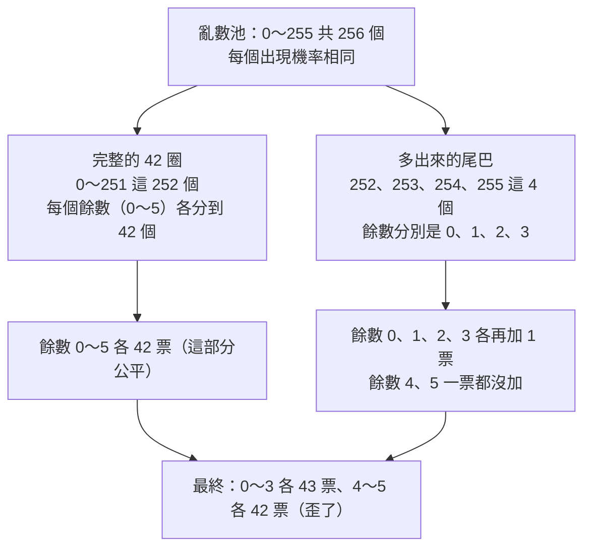

# [E-17-5] 取模偏差與拒絕取樣：為什麼 `rand() % n` 不是公平的骰子

> **目標**：理解「用取模把大範圍亂數壓進 0～n-1」為什麼會讓某些結果偏多（取模偏差 modulo bias / modulo 翻成「取餘數」），以及正確解法——拒絕取樣（rejection sampling，落在會造成偏差的尾巴區間就重抽）。

## 一個問題：我只是想擲一顆公平的骰子

你手上有一個亂數產生器，它會均勻地吐出一個整數——假設範圍是 `0 ～ 255`（剛好一個 byte，256 種可能，每一種機率相同）。

現在你想用它擲一顆六面骰，也就是從 `0 ～ 5` 裡等機率挑一個。幾乎每個人第一次都會這樣寫：

```
擲骰 = 亂數(0到255) % 6
```

取餘數（`%`）的意思是「除以 6 之後剩下多少」，結果一定落在 `0 ～ 5`，看起來完全正確。程式跑起來也沒報錯，骰子點數一直在變，感覺很隨機。

**但這顆骰子其實是歪的。** 有些點數會比其他點數更常出現。差距不大，肉眼擲幾次看不出來，但只要擲夠多次、或者這顆骰子背後牽涉到公平性（抽獎順序、洗牌、抽樣），這個偏差就是個真問題。

這一篇要講清楚：偏差從哪來、怎麼算出來、以及怎麼修。

## 生活類比：256 顆糖果分給 6 個小朋友

把「0～255 共 256 種亂數結果」想成 **256 顆一模一樣的糖果**，要公平分給 6 個小朋友（對應點數 0～5）。

你用的分法是「輪流發」：第 1 顆給 0 號、第 2 顆給 1 號……發到 5 號之後又回到 0 號，一直輪下去。這正是取餘數在做的事——第 `k` 顆糖果發給 `k % 6` 號小朋友。

問題來了：**256 不能被 6 整除**。256 ÷ 6 = 42 餘 4。輪了 42 整圈之後，還剩下 4 顆糖果，這 4 顆會發給 0、1、2、3 號——**5 號和 4 號（其實是 4、5 號）就少拿了一輪**。

算清楚：

- 0 號拿到：43 顆（42 整圈 + 多的 1 顆）
- 1 號拿到：43 顆
- 2 號拿到：43 顆
- 3 號拿到：43 顆
- 4 號拿到：42 顆
- 5 號拿到：42 顆

於是擲到 0～3 的機率是 `43/256 ≈ 16.8%`，擲到 4～5 的機率是 `42/256 ≈ 16.4%`。前四個點數**天生就比較容易出現**。這就是取模偏差。

> **一句話抓住它**：當亂數的總數（256）**不能被 n（6）整除**，那多出來的「尾巴」會偏心地加給前面幾個結果，骰子就歪了。

## 用圖看偏差從哪來

把 256 個亂數結果照「除以 6 的餘數」分組，會看到前 4 組各多一個成員：



這張圖表達：亂數池能被 n 整除的那部分（0～251）是公平的，問題全出在除不盡、多出來的那條「尾巴」（252～255）——它只偏心地灌給前面幾個餘數。

n 越大、或亂數範圍相對 n 越小，這個偏差會越明顯。如果亂數範圍只有 0～9（10 個）要取 0～5（6 個），尾巴佔的比例就大得嚇人，骰子會歪到肉眼可見。

## pseudo code：錯的做法 vs 對的做法

先把錯的做法和修正的核心想法並排。修正的關鍵只有一句：**把那條會造成偏差的尾巴「切掉」——抽到尾巴區間就重抽，不要它。**

```
// 歪的做法：直接取餘數，尾巴照單全收
擲骰 = 亂數(0到255) % 6        // 0～3 偏多

// 公平的做法：拒絕取樣
可接受的上限 = 能被 6 整除的最大門檻   // 下面會解釋怎麼算出 252
重複：
    r = 亂數(0到255)
    如果 r < 可接受的上限：
        回傳 r % 6              // 落在公平區，安全取餘數
    否則：
        繼續迴圈（重抽）         // 落在尾巴（252～255），丟掉重來
```

「可接受的上限」要設在哪？設在「亂數總數裡，能被 n 整除的最大數量」。256 裡能被 6 整除的最大值是 252（= 42 × 6）。只要抽到的數小於 252，它就落在「完整 42 圈」那段公平區；抽到 252～255 就是尾巴，丟掉重抽。這樣每個餘數都恰好對應 42 個亂數，完全均等。

這就是 **拒絕取樣（rejection sampling）**：不硬把尾巴塞進去，而是乾脆**拒絕**那些會破壞公平的樣本、重新抽一個。

## 會不會一直重抽、抽不完？

很多人看到「重抽」會擔心：萬一一直抽到尾巴，豈不是永遠出不來？

實務上幾乎不會。被拒絕的機率等於「尾巴佔整個池的比例」。以 256 取 6 為例，尾巴只有 4 個，被拒機率是 `4/256 ≈ 1.6%`——也就是約 98.4% 的情況一次就過，連抽兩次都被拒的機率只有 `0.016² ≈ 0.025%`。

更關鍵的是：**只要亂數範圍遠大於 n，尾巴佔比就很小。** 真實世界裡我們通常從 32 位元或 64 位元的亂數（幾十億、幾百億種可能）取一個小範圍的值，尾巴佔比小到可以忽略，平均重抽次數趨近於 0。拒絕取樣用「極少數情況多抽一次」換「完全沒有偏差」，這筆交易非常划算。

## 正式程式碼範例

把上面的概念寫成乾淨的 TypeScript。情境：**有一個會回傳 0 ～ (2³²−1) 均勻整數的亂數源，要從它公平地取出 0 ～ n-1。**

先定義亂數源的介面——它只負責「吐出一個範圍固定、均勻的整數」，公平地縮小範圍是我們自己的責任：

```typescript
// 一個均勻的 32 位元亂數源：每次回傳 0 ～ 4294967295，每個值機率相同。
// 它可能是 CSPRNG（密碼學安全亂數），也可能是帶種子的 PRNG，這裡不在乎——
// 我們只假設「它給的範圍是均勻的」，偏差是「縮小範圍」這一步引入的。
interface UniformRandomSource {
  nextUint32(): number;
}

const UINT32_COUNT = 2 ** 32; // 亂數源總共有這麼多種可能結果
```

接著是核心函式。重點在算出「可接受的上限」，以及把尾巴丟掉重抽：

```typescript
// 從均勻亂數源公平地取一個 0 ～ (bound-1) 的整數，沒有取模偏差。
function randomBelow(source: UniformRandomSource, bound: number): number {
  if (!Number.isInteger(bound) || bound <= 0) {
    throw new Error(`bound 必須是正整數，收到的是 ${bound}`);
  }

  // 尾巴有幾個？UINT32_COUNT 除以 bound 除不盡的餘數，就是會造成偏差的尾巴大小。
  const remainder = UINT32_COUNT % bound;

  // 可接受的上限：切掉尾巴後、能被 bound 整除的那段公平區大小。
  // 例：UINT32_COUNT 取 6，remainder 是 4，limit 就是 UINT32_COUNT - 4。
  const limit = UINT32_COUNT - remainder;

  // 抽到公平區就用它、抽到尾巴就重抽。尾巴佔比極小，平均幾乎不會重抽。
  while (true) {
    const value = source.nextUint32();
    if (value < limit) {
      return value % bound;
    }
    // 落在尾巴 [limit, UINT32_COUNT)，丟掉重來——這一步就是「拒絕取樣」。
  }
}
```

這段為什麼是對的：`limit` 以下的每一個亂數值，除以 `bound` 的餘數都恰好均勻分布（因為 `limit` 一定被 `bound` 整除），所以回傳的 `0 ～ bound-1` 每個機率完全相等。尾巴被拒絕，不會把偏差帶進來。

有了公平的「取一個」，洗牌（shuffle）就能正確做。下面是標準的 Fisher–Yates 洗牌（從後往前，每一步和「前面某個隨機位置」交換），它的公平**完全仰賴每一步的隨機索引都無偏**——所以這裡一定要用上面的 `randomBelow`，而不是 `% n`：

```typescript
// 原地洗牌一個陣列，結果每一種排列的機率都相等。
// 前提：randomBelow 必須無偏，否則洗出來的順序會偏心。
function shuffle<T>(items: T[], source: UniformRandomSource): void {
  // 從最後一個往前：第 i 個元素和 0 ～ i 之間的隨機位置交換
  for (let i = items.length - 1; i > 0; i--) {
    const j = randomBelow(source, i + 1); // 無偏，範圍 0 ～ i
    [items[i], items[j]] = [items[j], items[i]];
  }
}
```

注意 `randomBelow(source, i + 1)` 的範圍是 `0 ～ i`（含 i），這正是 Fisher–Yates 要求的；如果這裡偷懶寫成 `source.nextUint32() % (i + 1)`，取模偏差會讓某些排列系統性地比其他排列更常出現——洗牌結果就不公平了。

## 常見錯誤（反模式）

> **常見錯誤一：直接 `rand() % n` 當公平隨機用**
>
> ```typescript
> // 壞：只要亂數總數不能被 n 整除，前面幾個結果就偏多
> const dice = source.nextUint32() % 6;
> const winnerIndex = source.nextUint32() % players.length;
> ```
>
> 問題是：這在「n 不整除亂數範圍」時一定有偏差。抽獎的中獎者、洗牌後的順序、隨機分組——只要牽涉公平性或會被稽核，這個偏差就是漏洞。有心人甚至能利用「哪些結果偏多」佔便宜。
>
> **正確做法**：用拒絕取樣（前面的 `randomBelow`）。只有當 n 剛好整除亂數範圍（例如從 0～255 取 0～255、或取 0～1、0～3 這種 2 的次方），`% n` 才沒有偏差——但與其每次去判斷「這次整不整除」，不如一律走拒絕取樣，省心又不會寫錯。

> **常見錯誤二：用浮點數縮放，以為就沒事了**
>
> ```typescript
> // 壞：用 [0,1) 浮點數乘上 n 再取整，偏差只是換個地方藏起來
> const r = source.nextUint32() / UINT32_COUNT; // 0 ～ 近 1 的小數
> const dice = Math.floor(r * 6);
> ```
>
> 問題是：浮點數只是把「整數怎麼映射到 n 個格子」包裝了一層，底層同樣是「4294967296 個值分成 6 格」，除不盡的問題原封不動還在，某些格子還是會多拿。浮點數本身又有精度限制（見下方延伸閱讀），反而多了一個出錯來源。看起來乾淨，骰子一樣歪。
>
> **正確做法**：公平取整數就用整數的拒絕取樣，不要繞去浮點數。需要 `[0,1)` 的浮點隨機是另一回事（例如要一個隨機比例），但「從 n 個等機率選項挑一個」請留在整數世界解決。

> **常見錯誤三：把尾巴切錯邊，或上限算錯**
>
> ```typescript
> // 壞：門檻用「bound 的倍數」卻忘了它可能超出亂數範圍，或比較寫成 <=
> const limit = Math.floor(UINT32_COUNT / bound) * bound;
> const value = source.nextUint32();
> return value <= limit ? value % bound : retry(); // 😱 value === limit 其實該被拒絕
> ```
>
> 問題是：`limit`（能被 bound 整除的最大門檻）本身屬於「尾巴的第一個值」，必須用嚴格小於 `<` 判斷才會被拒絕。寫成 `<=` 會把一個尾巴值放進來，偏差雖小但依然存在——而且這種差一格（off-by-one）的錯最難用肉眼抓到。
>
> **正確做法**：想清楚公平區是**左閉右開**的 `[0, limit)`，判斷一律用 `value < limit`。能用現成、經過驗證的亂數函式庫（很多語言標準庫的「取範圍整數」已經內建拒絕取樣）就用它，不要自己手刻這段邊界。

## 小結

- **取模偏差（modulo bias）**：用 `rand() % n` 把亂數壓進 0～n-1 時，只要亂數的可能總數**不能被 n 整除**，除不盡多出來的「尾巴」會偏心地灌給前面幾個結果，讓它們出現機率偏高——骰子就歪了。
- 偏差大小等於「尾巴佔整個亂數池的比例」：亂數範圍遠大於 n 時偏差極小但不是零，n 大或亂數範圍小時偏差會明顯到影響公平性。
- **正解是拒絕取樣（rejection sampling）**：算出「能被 n 整除的最大門檻」當公平區上限，抽到門檻以下就安全取餘數，抽到尾巴就**丟掉重抽**。用「極少數情況多抽一次」換「完全無偏」。
- 洗牌、抽獎、隨機分組這些**仰賴公平性**的場景一定要用無偏的取整數；邊界用左閉右開 `[0, limit)`、判斷寫 `value < limit`，或直接用標準庫已內建拒絕取樣的「取範圍整數」函式。

> 想先搞懂「亂數源本身」有哪幾種、為什麼公平隨機要挑對亂數源 → [E-17-4：PRNG vs CSPRNG](./E-17-4-prng-vs-csprng.md)
> 為什麼用浮點數縮放會多一個出錯來源 → [E-17-1：用浮點數算錢的災難](./E-17-1-float-money.md)
> 修好偏差之後，怎麼用統計方法「證明」這顆骰子真的公平了 → [E-17-7：用統計驗證隨機](./E-17-7-statistical-validation.md)
