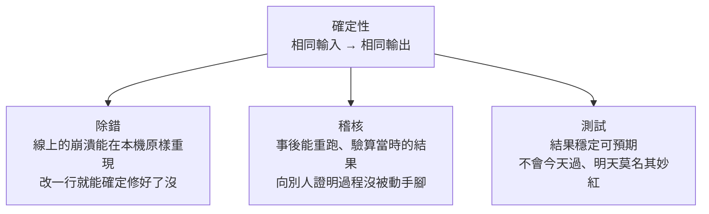

# [E-17-6] 確定性重播：同樣的種子，跑出同樣的結果

> **目標**：理解「確定性（determinism）＝相同輸入永遠產生相同輸出」為什麼對除錯、稽核、測試極其關鍵，以及要做到它，必須把哪些「非確定來源」隔離出去（真實時間、亂數種子、map 迭代順序、浮點差異、並發排程）。

## 一個問題：線上出事了，但我在本機重現不出來

想像你在維護一個模擬系統——它會跑一長串步驟，每一步根據前一步的狀態算出下一步，中間還穿插一些隨機決策（例如模擬排隊、模擬玩家行為、跑一個蒙地卡羅計算）。

某天，線上跑到第 48723 步的時候崩了，留下一份錯誤堆疊。你把同樣的輸入貼到本機，想重現這個崩潰來除錯——結果跑十次，有八次好好的，兩次崩在**不同的步數**。

這就慘了。你沒辦法穩定重現，等於沒辦法除錯：改了一行想驗證「修好了沒」，但你根本不確定原本那個 bug 這次會不會出現。更糟的是，如果事後有人要稽核「當時到底發生了什麼、為什麼算出這個結果」，你完全答不出來——因為**再跑一次，結果就不一樣了**。

問題的根源是：這個系統**不是確定性的**。它藏了一些「每次跑都可能不同」的來源。這一篇要講的，就是怎麼把這些來源揪出來、隔離掉，讓系統變成「**同樣的輸入，永遠跑出同樣的結果**」——這個性質叫確定性，而它帶來的能力叫**確定性重播（deterministic replay）**。

## 生活類比：一台能倒帶重看的錄影機

確定性重播最好的類比是**錄影機**。

你錄下一場表演，之後想看幾次就看幾次，每次播放，第 37 分鐘發生的事**永遠一模一樣**。你可以暫停、倒帶、逐格檢查，和別人指著同一個畫面討論「就是這裡出問題」。

一個確定性的系統就像這樣：只要你記下「這次是從哪個起點開始、用了哪顆種子」，之後任何時候、任何機器上，都能把整段過程原封不動**重播**一遍。出事了能原樣重現來除錯；要稽核時能攤開給人看、重新驗算；寫測試時結果穩定可預期。

反過來，一個非確定性的系統像**現場直播**：看過就過了，下一次是另一場，你永遠無法要求它「再演一次剛剛那個一模一樣的版本」。

> **核心信念**：確定性 = **相同輸入永遠產生相同輸出**。做到了，系統就從「現場直播」變成「可倒帶的錄影」——這正是除錯、稽核、測試三件事都需要的能力。

## 確定性能換到什麼？

把確定性帶來的三個好處講清楚，因為它們正是「值得花力氣做到確定性」的理由：



這張圖表達：確定性是一個共同的地基，除錯、稽核、測試三種需求都站在它上面。

- **除錯**：能穩定重現的 bug 才是能修的 bug。確定性讓「線上崩在第 48723 步」可以在本機原樣重演，逐步檢查。
- **稽核**：只要保存「起點 + 種子」，任何人都能事後重跑、得到完全相同的結果，驗證當時的計算沒有錯、也沒被竄改。這在需要公信力的計算（計費、抽樣、任何要向第三方交代的流程）裡是硬需求。
- **測試**：測試最怕「時好時壞」。確定性是消滅這種不穩定測試的根本手段——輸入固定，輸出就固定，紅燈一定代表真的壞了。

> 為什麼時好時壞的測試（flaky test）這麼有破壞力、它的根源就是非確定性 → [E-9-11：Flaky 測試——時好時壞的假訊號](../E-9-testing/E-9-11-flaky-tests.md)

## 敵人是「非確定來源」：五個最常見的漏洞

要做到確定性，不是加什麼神奇的東西，而是**把會「每次都不同」的來源一個個堵起來**。只要還有一個沒堵，整個系統就不是確定的——這就像錄影機只要有一軌是直播接進來的，整段就無法完美重播。

最常見的五個非確定來源：

| 非確定來源 | 為什麼每次不同 | 怎麼隔離 |
|---|---|---|
| **真實時間** | `現在幾點` 每次呼叫都不一樣 | 時間當成「輸入」傳進來，別在邏輯裡直接讀系統時鐘 |
| **亂數種子** | 不帶種子的亂數每次都不同 | 用帶種子的 PRNG，把種子記下來、當輸入 |
| **map / dict 迭代順序** | 某些語言的雜湊表迭代順序不保證固定 | 迭代前先明確排序，或用保證順序的結構 |
| **浮點運算** | 同樣的數學，不同機器 / 不同運算順序可能差最後一位 | 固定運算順序；跨機器一致性要求高時改用定點／整數 |
| **並發排程** | 多執行緒誰先誰後由作業系統決定 | 關鍵計算走單一、固定的執行順序 |

下面挑最重要的三個展開講。

### 真實時間：把「現在幾點」當輸入，不要當副作用

程式裡直接呼叫「取得現在時間」，是最隱蔽的非確定來源之一。同一段邏輯，早上跑和晚上跑,因為時間不同而走進不同分支、算出不同結果，就永遠無法重播。

解法是把時間當成一個**可以注入的輸入**，而不是在邏輯深處偷偷讀系統時鐘。重播時，餵進當初記錄的那個時間，邏輯就會走出一模一樣的路。

> 時間為什麼是這麼棘手的非確定來源（時鐘漂移、時區、單調時鐘），有一整章專講 → [E-13-18：時鐘與時間——分散式系統裡最會騙人的東西](../E-13-scaling/E-13-18-clocks-and-time.md)

### 亂數種子：隨機，但可以重現的隨機

「隨機」和「可重現」聽起來矛盾，但帶種子的 PRNG（pseudo-random number generator，偽亂數產生器）剛好兩者兼得：它從一顆**種子（seed）**出發，用固定的數學公式一個接一個推出後面的數——序列看起來很隨機，但**只要種子相同，整串序列就完全一樣**。

所以確定性重播的做法是：開跑時決定（或記錄）用哪顆種子，把種子存進那份「可重播的記錄」裡。事後重播時餵同一顆種子，所有隨機決策就會原樣重演。這也是為什麼「可重現」一定要用帶種子的 PRNG，而不能用作業系統那種「每次都不同、無法回放」的亂數。

> PRNG（可重現）和 CSPRNG（不可預測但不可回放）的差別、各自該用在哪 → [E-17-4：PRNG vs CSPRNG](./E-17-4-prng-vs-csprng.md)

### map 迭代順序：看不見的隨機

這個最容易中招。很多人以為「我又沒用亂數，怎麼會不確定？」——但如果你的邏輯**依賴遍歷一個雜湊表（hash map）的順序**，而那個語言不保證順序固定，那你每次跑可能以不同順序處理元素，累積出不同的結果。它不是亂數，卻一樣會破壞重播。

解法是：任何「順序會影響結果」的遍歷，遍歷前先用明確的鍵排序，或換用保證順序的資料結構。

## pseudo code：把非確定來源收進一個「執行環境」

處理這類問題的通用手法是：**不要讓業務邏輯自己去碰時間、亂數這些東西，而是把它們全部收進一個明確傳入的「執行環境」物件裡。** 這樣「這段邏輯依賴哪些非確定來源」就一目了然，重播時換掉這個環境就好。

```
定義 執行環境：
    現在時間()      // 不直接讀系統時鐘
    下一個亂數()    // 來自帶種子的 PRNG，不是系統亂數

正常執行：
    環境 = 真實環境（現在時間 = 系統時鐘, 亂數 = 用新種子建的 PRNG）
    記錄下用的種子和起始時間
    跑模擬(環境)

重播：
    環境 = 重播環境（現在時間 = 當初記錄的時間, 亂數 = 用同一顆種子建的 PRNG）
    跑模擬(環境)        // 因為所有非確定來源都被換成「當初那一份」，結果必然相同
```

關鍵在於：`跑模擬` 這段業務邏輯**完全不知道**自己是在正常執行還是重播——它只管跟 `環境` 要時間和亂數。非確定性被關進 `環境` 這一個地方，邏輯本身就是純粹、確定的。

## 正式程式碼範例

把上面的概念寫成 TypeScript。情境：**一個可重播的模擬器，每一步根據當前狀態和一個隨機決策推進，我們要能把整段跑過的過程原樣重現。**

先定義「執行環境」——它是所有非確定來源的唯一入口：

```typescript
// 執行環境：把「時間」和「亂數」這兩個非確定來源收成明確的介面。
// 業務邏輯只透過它取得這些值，於是「依賴了哪些非確定來源」一眼可見。
interface SimulationContext {
  now(): number; // 當前時間（毫秒），不直接讀系統時鐘
  nextRandom(): number; // 0 ～ 1 的隨機小數，來自帶種子的 PRNG
}
```

接著是帶種子的 PRNG。這裡用一個簡單、好懂的公式（mulberry32）當示範——**重點不是這個特定演算法，而是「同一顆種子 → 同一串序列」這個性質**：

```typescript
// 帶種子的 PRNG：給同一顆種子，nextRandom() 吐出的序列永遠一模一樣。
// 這是「可重現的隨機」的核心——不帶種子的系統亂數做不到重播。
function createSeededRandom(seed: number): () => number {
  let state = seed >>> 0; // 用種子初始化內部狀態（>>> 0 轉成 32 位元無號整數）
  return function nextRandom(): number {
    // 固定的數學公式：由當前 state 算出下一個 state，再映射到 0 ～ 1。
    // 公式細節不必背，記住「輸入狀態固定 → 輸出固定」即可。
    state = (state + 0x6d2b79f5) >>> 0;
    let result = state;
    result = Math.imul(result ^ (result >>> 15), result | 1);
    result ^= result + Math.imul(result ^ (result >>> 7), result | 61);
    return ((result ^ (result >>> 14)) >>> 0) / 4294967296;
  };
}
```

有了種子亂數，就能組出兩種環境：正常跑用的（真實時鐘 + 新種子），和重播用的（記錄的時間 + 同一顆種子）：

```typescript
// 一份「可重播記錄」：只要存下這兩樣，之後就能原樣重現整段過程。
interface ReplayRecord {
  seed: number;
  startedAt: number;
}

// 正常執行：用新種子、真實時鐘，同時把 seed 和起始時間記進 record。
function createLiveContext(): { context: SimulationContext; record: ReplayRecord } {
  const seed = Math.floor(Math.random() * 2 ** 32); // 只有「選種子」這一步用系統亂數
  const startedAt = Date.now();
  const nextRandom = createSeededRandom(seed);
  return {
    context: { now: () => startedAt, nextRandom },
    record: { seed, startedAt },
  };
}

// 重播：餵進當初記錄的 seed 和時間，環境就和當初完全一致。
function createReplayContext(record: ReplayRecord): SimulationContext {
  return { now: () => record.startedAt, nextRandom: createSeededRandom(record.seed) };
}
```

最後是模擬器本身。注意它**只跟 `context` 要時間和亂數**，自己完全不碰系統時鐘或系統亂數——這是它能被重播的唯一前提：

```typescript
interface SimulationStep {
  index: number;
  value: number;
}

// 跑 n 步模擬。因為所有非確定來源都來自 context，
// 同一個 context（同種子、同時間）跑兩次，steps 會逐筆完全相同。
function runSimulation(context: SimulationContext, steps: number): SimulationStep[] {
  const history: SimulationStep[] = [];
  let value = 0;
  for (let index = 0; index < steps; index++) {
    // 每一步的隨機決策都來自 context.nextRandom()，所以可被重播
    const delta = context.nextRandom() * 10 - 5;
    value += delta;
    history.push({ index, value });
  }
  return history;
}
```

這樣一來，「正常跑一次、把 `record` 存起來、事後用 `createReplayContext(record)` 再跑一次」會得到**逐筆完全相同**的 `history`——這就是確定性重播。線上崩在第幾步，本機就能原樣崩在第幾步；稽核時攤開 `record` 誰都能重算一次。

## 常見錯誤（反模式）

> **常見錯誤一：邏輯深處偷偷讀系統時鐘 / 系統亂數**
>
> ```typescript
> // 壞：業務邏輯直接讀「現在時間」和系統亂數，整段就無法重播
> function processOrder(order: Order): Receipt {
>   const processedAt = Date.now();          // 😱 每次跑都不同
>   const token = Math.random().toString(36); // 😱 無法重現
>   // ...
> }
> ```
>
> 問題是：這兩行讓 `processOrder` 永遠跑不出相同結果。就算其他地方都做對了，只要有**一個**非確定來源沒堵住，整段就從「錄影」退回「直播」，再也無法重播、重現、驗算。
>
> **正確做法**：把時間和亂數當成**注入的輸入**（前面的 `SimulationContext`），邏輯一律向它拿。要測試或重播時換一個「給固定時間、固定種子」的環境進去即可。判準很簡單：**一段邏輯如果你沒辦法讓它「跑兩次結果一樣」，它就藏了非確定來源，把那個來源挖出來變成輸入。**

> **常見錯誤二：以為「沒用亂數」就等於確定**
>
> ```typescript
> // 壞：沒用任何亂數，但依賴雜湊表的迭代順序——順序不保證，結果就不保證
> function summarize(scores: Map<string, number>): string {
>   let report = "";
>   for (const [name, score] of scores) { // 😱 迭代順序在某些語言 / 情況不固定
>     report += `${name}:${score};`;
>   }
>   return report;
> }
> ```
>
> 問題是：很多人只盯著「亂數」，卻忘了 map 迭代順序、並發執行順序、浮點運算順序這些**看不見的隨機**。這段沒有一個 `random`，卻可能每次吐出不同順序的字串，一樣破壞確定性，而且因為「看起來很無辜」特別難查。
>
> **正確做法**：任何「順序會影響結果」的遍歷，遍歷前先用明確的鍵排序（例如先把 key 排好再跑）；關鍵計算避免讓多執行緒的排程決定先後；跨機器要求位元級一致時，連浮點運算順序都要固定、或改用整數／定點數。

> **常見錯誤三：重播時只存了「結果」，沒存「種子和輸入」**
>
> ```typescript
> // 壞：出事時只把最終狀態 log 下來，卻沒記種子和起始輸入
> logger.error("模擬崩潰", { finalState }); // 😱 無法重跑，只能瞪著結果猜
> ```
>
> 問題是：確定性重播的價值在於「能再跑一次」，而再跑一次需要的是**起點**（種子、起始時間、輸入參數），不是終點。只存最終狀態，等於只拍了崩潰當下那張照片，卻丟掉了能讓你重演整段過程的錄影帶。
>
> **正確做法**：把「能唯一決定這次執行的那組輸入」整包記下來——種子、起始時間、輸入參數、版本號（邏輯改了，同種子也會跑出不同結果，所以版本也要記）。保存這份記錄，才是真正握住了重播能力。

## 小結

- **確定性（determinism）＝相同輸入永遠產生相同輸出。** 做到它，系統就從「看過就過的直播」變成「能倒帶重看的錄影」。
- 它一次換到三個關鍵能力：**除錯**（線上崩潰能在本機原樣重現）、**稽核**（事後能重跑、驗算、對第三方交代）、**測試**（結果穩定、紅燈一定代表真的壞了）。
- 做到確定性的方法是**把非確定來源一個個隔離掉**：真實時間（當輸入注入）、亂數種子（用帶種子 PRNG 並記下種子）、map/dict 迭代順序（先排序）、浮點運算（固定順序或改整數）、並發排程（關鍵計算走固定順序）。只要漏一個，整段就不確定。
- 實務手法：把所有非確定來源收進一個明確傳入的「執行環境」，業務邏輯只向它拿值、自己不碰系統時鐘或系統亂數；並且保存「種子 + 起始輸入 + 版本」這份**起點記錄**，而不是只存最終結果。

> 可重現的隨機靠的是帶種子的 PRNG，別用不可回放的系統亂數 → [E-17-4：PRNG vs CSPRNG](./E-17-4-prng-vs-csprng.md)
> 時間為什麼是最會騙人的非確定來源 → [E-13-18：時鐘與時間](../E-13-scaling/E-13-18-clocks-and-time.md)
> 非確定性正是測試時好時壞（flaky）的根源 → [E-9-11：Flaky 測試](../E-9-testing/E-9-11-flaky-tests.md)
