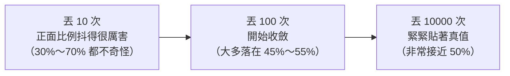
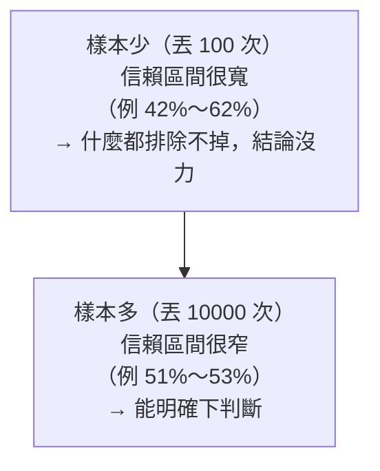

# [E-17-7] 用統計驗證隨機：怎麼「證明」一顆骰子是公平的

> **目標**：理解「看起來隨機」不等於「真的隨機」，學會用統計方法下判斷——卡方檢定（chi-squared test，觀察分布跟期望差多少）、信賴區間（confidence interval，結論站不站得住）、大數法則（樣本越多越接近真值，但永遠有波動）的直覺。

## 一個問題：這顆骰子公不公平？

你拿到一顆六面骰，想知道它公不公平。你擲了 60 次，記下每個點數出現幾次：

```
點數 1：8 次
點數 2：13 次
點數 3：9 次
點數 4：11 次
點數 5：7 次
點數 6：12 次
```

公平的骰子，60 次「理論上」每個點數該出現 10 次。但眼前的數字沒有一個剛好是 10——點數 2 出現 13 次（偏多）、點數 5 只有 7 次（偏少）。

問題來了：**這是骰子真的歪了，還是只是運氣？**

你心裡大概有個直覺：就算是完美公平的骰子，擲 60 次也不可能每個點數剛好 10 次，有點高低很正常。但「13 和 7 的差距」到底算正常波動，還是已經大到該懷疑這顆骰子？**光用眼睛看，給不出答案。** 你需要一個客觀的方法，把「差多少才算異常」算成一個能下判斷的數字。

這一篇要講的，就是三個互相搭配的統計工具：**大數法則**（告訴你樣本要夠多）、**卡方檢定**（算出「差這麼多算不算異常」）、**信賴區間**（告訴你結論有多站得住）。

## 大數法則：樣本越多，越逼近真相，但永遠在抖

先建立最重要的直覺。**大數法則（law of large numbers）**說的是：一件事重複越多次，實際觀察到的比例會越來越靠近它「真正的機率」。

生活類比：你丟一枚公平硬幣。

- 丟 **10 次**：出現 7 次正面（70%）很常見，一點都不奇怪。
- 丟 **100 次**：大概落在 45～55 次正面，離 50% 近一些了。
- 丟 **10000 次**：幾乎一定非常接近 5000 次（50%），要偏到 55% 反而變得極不可能。



這張圖表達：樣本數越大，觀察到的比例越緊地收斂到真實機率——但注意，它是「越來越接近」，**永遠不會剛好等於、也永遠有一點抖動**。

兩個關鍵推論，整篇都要用到：

1. **樣本太少，什麼都證明不了。** 擲 6 次骰子，就算 6 次全是點數 1，你也不能說它一定歪——這種事公平骰子偶爾也會發生。要下判斷，樣本必須夠多。
2. **就算樣本很多，也永遠有波動。** 所以不能期待「公平 = 每個點數次數完全相等」。真正的問題永遠是：**「觀察到的偏差，落在正常波動範圍內嗎？」** 這正是卡方檢定要回答的。

## 卡方檢定：把「差多少」算成一個數字

**卡方檢定（chi-squared test，chi-squared 是希臘字母 χ²，中文常譯「卡方」）** 是回答「觀察到的分布和期望的分布，差距算不算異常」的標準工具。

它的直覺其實很樸素，分三步：

1. **對每個類別，看「差了多少」**：觀察次數減掉期望次數。
2. **把差距平方、再除以期望次數**：平方是為了讓「偏多」和「偏少」都變成正貢獻、而且放大大偏差；除以期望是為了「相對看待」——期望 10 卻差 3，比期望 1000 卻差 3 嚴重得多。
3. **把每個類別的貢獻全部加起來**，得到一個總分，這個總分就叫卡方值（χ²）。

用生活話說：**卡方值就是「全部類別加起來，總共偏離期望有多嚴重」的一個總分。分數越大，越不像公平的結果。**

先看公式的樣子（只需要看懂結構，不用背）：

```
卡方值 = 把每個類別的 (觀察次數 − 期望次數)² ÷ 期望次數 全部加起來
```

用開頭那顆骰子算一遍（期望每格 10 次）：

| 點數 | 觀察 | 期望 | (觀察−期望)² ÷ 期望 |
|---|---|---|---|
| 1 | 8 | 10 | (−2)²/10 = 0.4 |
| 2 | 13 | 10 | (3)²/10 = 0.9 |
| 3 | 9 | 10 | (−1)²/10 = 0.1 |
| 4 | 11 | 10 | (1)²/10 = 0.1 |
| 5 | 7 | 10 | (−3)²/10 = 0.9 |
| 6 | 12 | 10 | (2)²/10 = 0.4 |

加起來：卡方值 = 0.4 + 0.9 + 0.1 + 0.1 + 0.9 + 0.4 = **2.8**。

### 這個 2.8 算大還是算小？

光有卡方值還不夠，你得知道「公平的骰子，這個分數通常會落在哪」。統計學算好了一個對照表：對六面骰（統計上叫 5 個**自由度（degrees of freedom）**，等於類別數 6 減 1），有個常用的門檻值大約是 **11.07**。

它的意思是：**如果骰子是公平的，卡方值超過 11.07 的機率只有 5%。** 換句話說，公平骰子算出來的分數有 95% 的機會會低於 11.07。

於是判斷規則是：

- 我們的卡方值 **2.8 遠小於 11.07** → 這點偏差完全在公平骰子的正常波動範圍內 → **沒有證據說它歪**。
- 如果算出來是 **20**（大於 11.07）→ 公平骰子很少會抖這麼大 → **有理由懷疑這顆骰子不公平**。

那個「5%」是你自己定的**顯著水準（significance level）**——你願意承擔多少「其實公平、卻被你誤判成歪」的風險。5% 是常見選擇，要求更嚴格可以用 1%（對應的門檻值更高）。

> **一句話抓住卡方檢定**：它把「觀察和期望差多少」濃縮成一個分數，再對照「公平情況下這個分數通常多大」，讓你能客觀說出「這個偏差算不算異常」，而不是用眼睛猜。

## pseudo code 與程式碼：算卡方值

先用 pseudo code 把流程寫清楚：

```
給定 每個類別的觀察次數 和 期望次數：
    卡方值 = 0
    對每個類別：
        差 = 觀察次數 − 期望次數
        卡方值 += (差 × 差) ÷ 期望次數
    回傳 卡方值

再把卡方值和「對應自由度的門檻值」比：
    如果 卡方值 > 門檻值 → 偏差異常，懷疑不公平
    否則              → 在正常波動內，沒有證據說不公平
```

寫成 TypeScript。第一段：算卡方值。函式很短，但每一步都對應上面的直覺：

```typescript
// 算卡方值：把每個類別「偏離期望的嚴重程度」加總成一個分數。
// observed 和 expected 要一一對應（同一個類別排在同一個索引）。
function chiSquared(observed: number[], expected: number[]): number {
  if (observed.length !== expected.length) {
    throw new Error(
      `觀察與期望的類別數不一致：observed 有 ${observed.length} 個、expected 有 ${expected.length} 個`,
    );
  }

  let total = 0;
  for (let i = 0; i < observed.length; i++) {
    if (expected[i] <= 0) {
      // 期望次數要當分母，不能是 0；通常也要求每格期望 ≥ 5，卡方近似才可靠
      throw new Error(`第 ${i} 個類別的期望次數必須大於 0，收到 ${expected[i]}`);
    }
    const difference = observed[i] - expected[i];
    total += (difference * difference) / expected[i];
  }
  return total;
}
```

第二段：把卡方值對照門檻，給出能讀的結論。這裡用一張查好的門檻表（對應不同自由度和 5% 顯著水準）——真實專案會用統計函式庫算出精確的 p 值，這裡用常用門檻值示範概念：

```typescript
// 5% 顯著水準下，各自由度的卡方門檻值（查統計表而來，非魔術數字）。
// 自由度 = 類別數 − 1；例如六面骰有 6 類，自由度 5。
const CHI_SQUARED_CRITICAL_5_PERCENT: Record<number, number> = {
  1: 3.841,
  2: 5.991,
  3: 7.815,
  4: 9.488,
  5: 11.07, // 六面骰用這個
  6: 12.592,
};

interface FairnessVerdict {
  chiSquaredValue: number;
  critical: number;
  // true 代表「偏差大到超過門檻，有證據懷疑不公平」
  looksBiased: boolean;
}

// 判斷一組觀察次數是否顯著偏離「均勻分布」的期望。
function testUniform(observed: number[]): FairnessVerdict {
  const categories = observed.length;
  const totalSamples = observed.reduce((sum, count) => sum + count, 0);

  // 均勻分布的期望：總樣本平均分到每一格
  const expectedPerCategory = totalSamples / categories;
  const expected = new Array(categories).fill(expectedPerCategory);

  const chiSquaredValue = chiSquared(observed, expected);

  const degreesOfFreedom = categories - 1;
  const critical = CHI_SQUARED_CRITICAL_5_PERCENT[degreesOfFreedom];
  if (critical === undefined) {
    throw new Error(`沒有自由度 ${degreesOfFreedom} 的門檻值，請改用統計函式庫計算 p 值`);
  }

  return { chiSquaredValue, critical, looksBiased: chiSquaredValue > critical };
}
```

用開頭那顆骰子跑一遍，`chiSquaredValue` 會是 2.8，`critical` 是 11.07，`looksBiased` 是 `false`——結論：沒有證據說它歪。

## 信賴區間：你的結論有多站得住？

卡方檢定給了「歪 / 沒歪」的判斷，但還有一個更根本的問題：**我到底該測幾次，結論才站得住？**

這就是**信賴區間（confidence interval）**的地盤。它回答的是：「根據我手上這些樣本，真實的機率大概落在哪個範圍。」

生活類比：你想知道一枚硬幣出現正面的真實機率。

- 丟 **100 次**、出現 52 次正面。你不能說「真實機率就是 52%」——樣本有限，真值可能在附近一段範圍。信賴區間會告訴你類似：「我有 95% 的把握，真實機率落在 **42%～62%** 之間。」這個範圍很寬，寬到連「45% 的歪硬幣」都排除不掉——**樣本太少，結論沒力。**
- 丟 **10000 次**、出現 5200 次正面（同樣 52%）。這次信賴區間會窄得多，大約「**51%～53%**」。範圍一窄，你就能有把握地說「這硬幣偏向正面」，因為連 50% 都被排除在外了。



這張圖表達：樣本數決定信賴區間的寬窄，而區間寬窄決定你的結論有沒有力——這和大數法則是同一件事的兩面。

抓住兩個直覺就夠了（不用背公式）：

1. **樣本越多，信賴區間越窄，結論越有力。** 粗略地說，要把區間縮小一半，樣本數大約要變成四倍——這就是為什麼驗證隨機動輒要跑上百萬次，而不是跑幾百次。
2. **「95% 信賴」不是指「真值有 95% 機率在這區間」**，而是指「用這套方法重複很多次，大約 95% 的次數，算出的區間會框住真值」。日常使用記住「區間越窄越可信、樣本越多區間越窄」這個操作性直覺即可。

所以「該測幾次」沒有魔術數字，取決於你想抓多小的偏差：想確認「沒有大於 1% 的偏差」，就需要多到讓信賴區間窄於 1% 的樣本量。想偵測越細微的不公平，就得跑越多次。

## 統計方法在「證據等級」裡的位置

要特別講清楚一件事，免得誤用這些工具：**統計檢定不會給你「絕對證明」，它給的是「證據強度」。**

卡方值沒超過門檻，不代表骰子「被證明公平」——只代表「在這個樣本數下，沒有找到它不公平的證據」。也許它有 0.1% 的細微偏差，只是你的樣本不夠多、抓不出來。同樣地，就算超過門檻，也有那 5% 的機會是「其實公平、只是這次剛好抖很大」。

所以統計驗證的正確心態是：**它把你對「這東西夠不夠隨機」的信心，從「我用眼睛看覺得還行」提升到「我跑了一百萬次、卡方檢定在 1% 水準下沒發現偏差」。** 後者是強得多的證據，但仍是證據、不是鐵證。樣本越多、顯著水準越嚴、搭配越多種不同的檢定，證據就越強。

> 「證明」其實分很多等級，從「跑一次沒壞」到「大樣本統計檢定」強度天差地遠，怎麼判斷一個結論的證據夠不夠 → [E-9-12：證據等級——你的「證明」到底有多強](../E-9-testing/E-9-12-evidence-levels.md)

## 常見錯誤（反模式）

> **常見錯誤一：樣本太少就下結論**
>
> ```typescript
> // 壞：擲 12 次就斷言公不公平
> const observed = [1, 3, 2, 2, 1, 3]; // 六面骰擲 12 次
> const verdict = testUniform(observed); // 😱 這點樣本，卡方檢定幾乎驗不出任何東西
> ```
>
> 問題是：樣本太少時，公平骰子本來就會抖得很厲害（大數法則還沒發揮作用），這時無論算出什麼都沒意義——信賴區間寬到什麼都排除不掉。卡方檢定還有個硬性前提：**每個類別的期望次數最好 ≥ 5**，擲 12 次六面骰每格期望才 2，連用這個檢定的資格都不夠。
>
> **正確做法**：先想清楚「我要抓多小的偏差」，再回推需要的樣本量——想偵測細微不公平就要跑到夠多（驗證亂數源常常是上百萬次）。至少確保每格期望次數遠大於 5。

> **常見錯誤二：把「沒驗出偏差」當成「證明了公平」**
>
> ```typescript
> if (!testUniform(observed).looksBiased) {
>   console.log("這個亂數源完全公平，可以放心用！"); // 😱 過度解讀
> }
> ```
>
> 問題是：卡方值沒超門檻，只代表「**在這個樣本數下沒找到不公平的證據**」，不等於「它一定公平」。它可能有你這次樣本抓不到的細微偏差，也可能在「分布均勻」以外的面向出問題（例如連續值之間有相關性，卡方檢定根本不管這個）。
>
> **正確做法**：講話要校準到證據的實際強度——說「在一百萬樣本、5% 水準下，未發現顯著偏離均勻」，而不是「證明公平」。對亂數源要用**多種**檢定（均勻性、獨立性、連續性……）交叉驗證，單一檢定過關不代表全面合格。

> **常見錯誤三：一直重測直到「這次過了」（p-hacking）**
>
> ```typescript
> // 壞：測不過就重跑、換個樣本、挑過關的那次回報
> let verdict = testUniform(sample());
> while (verdict.looksBiased) {
>   verdict = testUniform(sample()); // 😱 反覆重測、只採信對自己有利的結果
> }
> ```
>
> 問題是：顯著水準 5% 本來就允許「公平的東西每 20 次測試有 1 次會被誤判、或反過來」。如果你不斷重測、只挑「結論合你意」的那次回報，等於在刻意製造假訊號——這叫 p-hacking（湊 p 值），是統計上的自欺。
>
> **正確做法**：**事前**就決定好樣本量、顯著水準和要跑哪些檢定，然後跑一次、照結果誠實解讀，不因為「結論不喜歡」就反覆重抽、挑好看的。要更有把握就提高樣本量或收緊顯著水準，而不是多測幾次挑一個。

## 小結

- **「看起來隨機」不夠**：公平的骰子擲 60 次本來就不會每格剛好 10 次，光用眼睛分不出「正常波動」和「真的歪了」，必須用統計方法把「差多少才算異常」算成能下判斷的數字。
- **大數法則（law of large numbers）**：重複越多次，觀察到的比例越逼近真實機率——但永遠有波動、永遠不會剛好相等。推論：樣本太少什麼都證明不了；問題永遠是「偏差落在正常波動內嗎」。
- **卡方檢定（chi-squared test）**：把每個類別「偏離期望的嚴重程度」（差的平方除以期望）加總成一個分數，再對照「公平情況下這個分數通常多大」的門檻值，客觀判斷偏差算不算異常。
- **信賴區間（confidence interval）**：根據樣本估計真值大概落在哪個範圍；樣本越多區間越窄、結論越有力。「該測幾次」沒有魔術數字，取決於你想偵測多小的偏差——想抓越細微的不公平，就得跑越多次。
- 心態校準：統計檢定給的是**證據強度**不是絕對證明。別把「沒驗出偏差」說成「證明公平」，別樣本太少就下結論，更別反覆重測挑好看的結果（p-hacking）。

> 修好取模偏差之後，就是用這套統計方法去驗證「真的修好了」 → [E-17-5：取模偏差與拒絕取樣](./E-17-5-modulo-bias-rejection-sampling.md)
> 統計檢定屬於哪一種證據等級、它比「跑一次沒壞」強在哪 → [E-9-12：證據等級](../E-9-testing/E-9-12-evidence-levels.md)
> 想先搞懂被你拿來驗證的「亂數源」本身有哪幾種 → [E-17-4：PRNG vs CSPRNG](./E-17-4-prng-vs-csprng.md)
