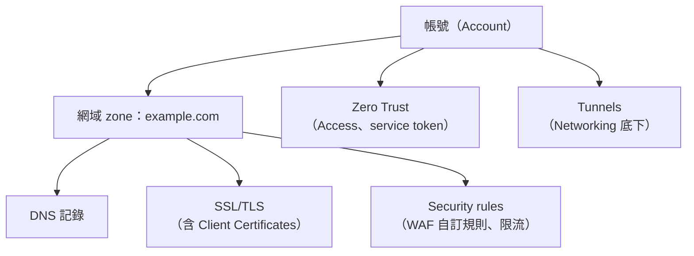
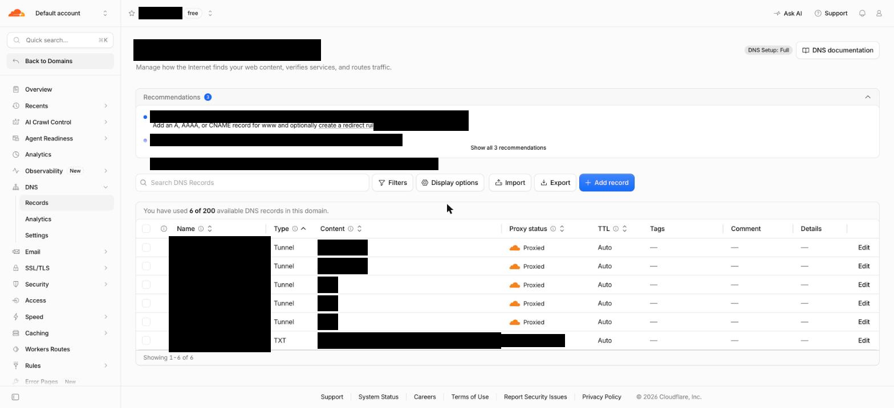
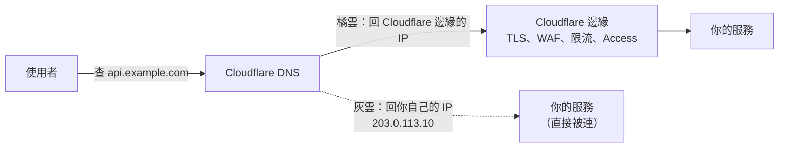

# [E-18-1] 帳號、網域與 DNS：先把網域交給 Cloudflare 管

> **目標**：知道 Cloudflare 後台的帳號／網域（zone）怎麼分層、DNS 記錄表怎麼讀，以及橘色雲朵（Proxied）和灰色雲朵（DNS only）差在哪——後面整個系列的 Tunnel、mTLS、WAF、Access，全部建立在「這筆記錄是橘雲」這個前提上。

## 先說這篇不重講什麼

這個系列（E-18）是**操作篇**：在 Cloudflare 後台實際點哪裡、畫面長什麼樣、哪裡容易踩坑。概念都在別的篇章講過，這裡只連過去：

- DNS 是什麼、記錄型別（A、CNAME、TXT）→ [E-3-5 DNS](../E-3-network/E-3-5-dns.md)
- 把網域的 NS（Name Server，名稱伺服器）改到另一家代管、橘雲／灰雲的原理 → [E-3-9 網域搬家](../E-3-network/E-3-9-dns-delegation-migration.md)
- CDN（內容傳遞網路）為什麼能擋流量、加速 → [E-11-5 CDN](../E-11-performance/E-11-5-cdn.md)

> 系列裡的網域一律用 `example.com`（例如 `api.example.com`、`app.example.com`），IP 一律用文件專用的 `203.0.113.x`。截圖裡的真實網域、ID、IP 都已塗黑。

## 生活類比：大樓的總機與門牌

```
沒有 Cloudflare：
    你的門牌（DNS 記錄）直接寫著你家地址（IP）
    訪客照著地址直接走到你家門口

交給 Cloudflare 代管、而且開橘雲：
    門牌改寫成「請洽大樓總機」（Cloudflare 的 IP）
    訪客先到總機，總機檢查、登記、擋掉可疑的人，再幫忙轉進來
    訪客從頭到尾不知道你住幾樓幾號

灰雲：
    Cloudflare 只負責「告訴你門牌」，不當總機
    訪客照樣直接走到你家門口
```

整個系列要用的功能——WAF（Web Application Firewall，網頁應用防火牆）、限流、mTLS（雙向 TLS）、Access——**全都是「總機」才做得到的事**。灰雲的記錄，流量根本不經過 Cloudflare，那些規則一條都不會生效。

## 後台的層級：帳號 → 網域 → 功能

進到 Cloudflare 後台，畫面左上角先是**帳號**（Account），帳號底下有一或多個**網域**（Cloudflare 稱為 zone）。設定分兩種層級：



這張圖表達：DNS、憑證、WAF 是**跟著網域走**的設定（要先點進某個網域才看得到）；Tunnel 和 Zero Trust 是**跟著帳號走**的，一條通道可以服務帳號裡好幾個網域。

> 找不到某個選單時，先看自己是在「帳號層」還是「網域層」。新版後台的側邊欄會隨層級切換，同一個功能在兩邊的入口不一樣。

## 把網域交給 Cloudflare

流程本身在 [E-3-9](../E-3-network/E-3-9-dns-delegation-migration.md) 講過，這裡只列後台會遇到的步驟：

```
1. 帳號首頁 → 加入網域（Add a domain），輸入 example.com
2. 選方案：個人用途選 Free 就夠這個系列用
3. Cloudflare 會先掃一次現有的 DNS 記錄，讓你確認匯入
4. 畫面給你兩個 Cloudflare 的 NS（名稱伺服器）位址
5. 到網域註冊商那邊，把 NS 改成這兩個
6. 等生效（幾分鐘到一兩天），網域狀態變成 Active
```

第 5 步是唯一要離開 Cloudflare 做的事。NS 一改，這個網域的 DNS 就「搬家」到 Cloudflare 了——之後新增、修改記錄都只在 Cloudflare 改，在註冊商那邊改不會有作用。

## 讀懂 DNS 記錄表

進到網域 → DNS → Records：



> 截圖遮蔽：網域名稱、每筆記錄的主機名、記錄內容（通道名稱與驗證字串）、上方建議區塊裡的網域字樣。

逐欄看：

| 欄位 | 意思 | 這張圖裡 |
|---|---|---|
| Name | 主機名（子網域） | 例如 `api.example.com`、`app.example.com` |
| Type | 記錄型別 | 前五筆顯示 **Tunnel**：這是新版介面把「指向通道的 CNAME」用通道名稱顯示，比一長串 ID 好讀 |
| Content | 指向哪裡 | Tunnel 型別顯示通道名稱，點下去會跳到那條通道 |
| Proxy status | 橘雲或灰雲 | 前五筆 **Proxied**（橘雲），TXT 是 **DNS only**（灰雲） |
| TTL | 快取多久 | 橘雲固定是 Auto，因為外界查到的是 Cloudflare 的 IP，不是你的 |

幾個觀察：

- **Tunnel 記錄一定是橘雲**。通道沒有對外的 IP 可以給人連，只能由 Cloudflare 的邊緣接住再轉進通道，所以它沒有灰雲這個選項。
- **TXT 記錄是灰雲**，而且只能是灰雲。TXT 是拿來給別人「查」的文字（例如網域所有權驗證），不是拿來「連」的，沒有東西可以代理。
- 右上角的 **DNS Setup: Full** 表示這個網域的 NS 整個交給 Cloudflare（另一種 Partial 是只把部分子網域交出去，需要付費方案）。
- 上方的 **Recommendations** 會提醒「`www` 沒有記錄」之類的事——那只是建議，不是錯誤。如果你根本不打算用根網域和 `www`，可以不理它。

## 橘雲與灰雲：一個開關決定流量走哪



這張圖表達：同一個 DNS，橘雲回答的是邊緣的位址，請求會先經過邊緣上的所有檢查；灰雲回答的是你自己的位址，請求直接打到你的機器，邊緣的規則完全沒機會作用。

所以後面每一篇設定完之後，第一件要確認的事都是：**那個主機名的記錄是不是橘雲**。

## 常見錯誤（反模式）

> **常見錯誤一：記錄是灰雲，卻以為 WAF 有在擋**
>
> 為了「先測通再說」把記錄切成灰雲，之後忘了切回來。WAF 規則、限流、mTLS 的設定畫面一切正常，但流量根本沒經過邊緣，規則一條都沒命中。更糟的是，灰雲等於把源站的 IP 公告出去了。
>
> **正確做法**：要對外服務的主機名一律橘雲；設定完用 `dig api.example.com` 確認回的不是你自己的 IP（橘雲會回 Cloudflare 的位址）。

> **常見錯誤二：在舊的 DNS 代管商那邊改記錄**
>
> NS 已經指到 Cloudflare，卻還在註冊商（或舊的代管商）後台新增記錄，然後納悶「怎麼查不到」。
>
> **正確做法**：NS 指到誰，就只在誰那邊改。不確定的話用 `dig NS example.com` 查一次目前的 NS。

> **常見錯誤三：把公開截圖當成不會外洩**
>
> DNS 記錄表、Tunnel 頁面一截圖，網域、子網域命名（常常透露內部專案名）、通道 ID 全部入鏡。這是 [E-6-6 反模式](../E-6-best-practices/E-6-6-anti-patterns.md)裡「機密不小心進了版本控制」的截圖版。
>
> **正確做法**：要公開的截圖，網域、各種 ID、IP、帳號 email 整塊塗黑，而且遮完要自己一張一張看過。

## 小結

- Cloudflare 後台分**帳號層**（Tunnel、Zero Trust）與**網域層**（DNS、SSL/TLS、Security rules），找不到選單先確認自己在哪一層。
- 網域交給 Cloudflare 的關鍵動作只有一個：**在註冊商把 NS 改成 Cloudflare 給的兩個位址**。
- **橘雲（Proxied）**＝流量經過邊緣，後面所有防護才有作用；**灰雲（DNS only）**＝只回答 DNS，流量直達你的機器。
- 新版 DNS 記錄表會把「指向通道的 CNAME」顯示成 **Tunnel** 型別，而且一定是橘雲。

> 下一篇：讓家裡的服務不開任何門就能被這些主機名連到 → [E-18-2 Tunnel 實作](./E-18-2-tunnel.md)
> DNS 記錄型別與查詢流程 → [E-3-5 DNS](../E-3-network/E-3-5-dns.md)
> NS 委派與橘雲／灰雲的原理 → [E-3-9 網域搬家](../E-3-network/E-3-9-dns-delegation-migration.md)
