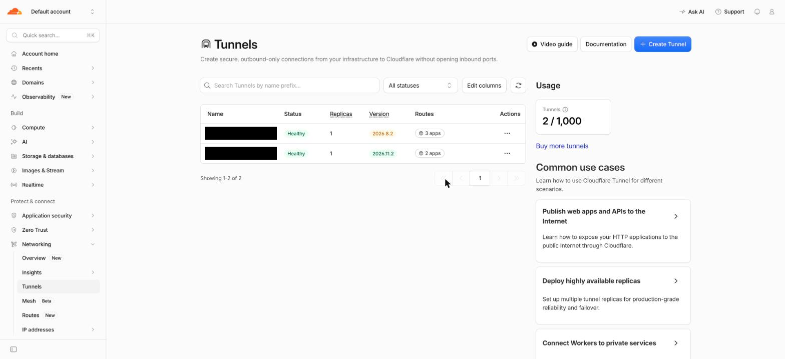
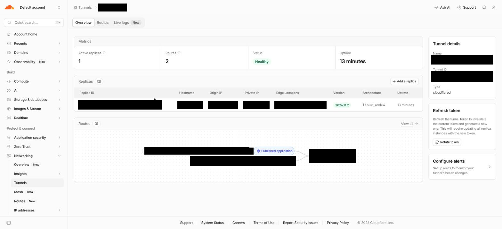
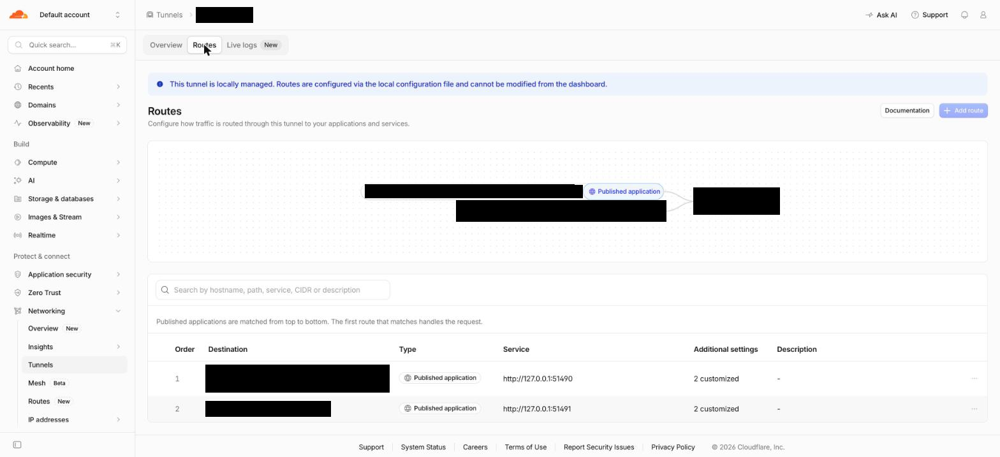
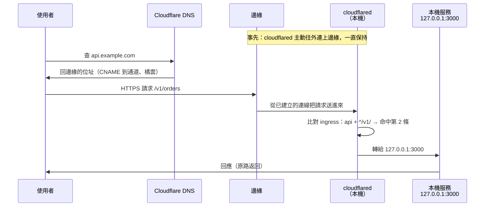

# [E-18-2] Tunnel 實作：cloudflared、ingress 規則與 `route dns`

> **目標**：實際在一台機器上建一條 Cloudflare Tunnel——登入、建立通道、寫 ingress 設定檔、用 `cloudflared tunnel route dns` 幫子網域加記錄、跑起來之後在後台確認狀態——並看懂後台的 Tunnel 頁面在告訴你什麼。

## 先說這篇不重講什麼

- 反向通道為什麼「不開門也能對外服務」、ingress 規則由上往下比對、最後一條要 404 → [E-3-12 反向通道](../E-3-network/E-3-12-reverse-tunnel.md)
- 為什麼家裡預設連不進來 → [E-3-8 NAT](../E-3-network/E-3-8-nat.md)

E-3-12 講「為什麼」，這篇講「怎麼做」。

## 生活類比：先辦一支專線，再設定總機的轉接表

```
1. 跟總機申請一支專線（建立通道），拿到專線的鑰匙（憑證檔）
2. 在家裡接上專線、一直不掛（cloudflared 主動往外連）
3. 寫一張轉接表（ingress）：
       找 app 的 → 轉客廳分機（本機 8080）
       找 api 而且說要 /v1/ 的 → 轉書房分機（本機 3000）
       其他 → 說「查無此人」（404）
4. 在大樓門牌上掛「app、api 請洽總機專線」（DNS 指向通道）
```

第 3 步的轉接表在**你家**（設定檔在本機），第 4 步的門牌在**總機**（DNS 在 Cloudflare）。兩邊都要有，請求才走得到。

## 兩種管理方式：本機設定檔 vs 後台設定

Cloudflare Tunnel 有兩種管理方式，差別在「ingress 規則存在哪裡」：

| | 本機管理（locally managed） | 後台管理（remotely managed） |
|---|---|---|
| ingress 寫在哪 | 本機的 `config.yml` | Cloudflare 後台的網頁表單 |
| 本機要放什麼 | 通道憑證檔（`<通道 ID>.json`）＋設定檔 | 只要一串 token |
| 改規則 | 改檔案、重啟 cloudflared | 在後台按儲存，馬上生效 |
| 適合 | 設定要進版本控制、要能重現 | 不想登入機器就能改規則 |

這篇示範**本機管理**——規則寫在檔案裡，可以 code review、可以回溯。後台畫面上會清楚標示這條通道是哪一種（下面的截圖會看到）。

## 步驟一：登入與建立通道

在要跑服務的那台機器上：

```bash
# 開瀏覽器讓你選要授權的網域，完成後在 ~/.cloudflared/ 放一張 cert.pem
cloudflared tunnel login

# 建立一條叫 home-gateway 的通道；會印出通道 ID，並產生 ~/.cloudflared/<通道 ID>.json
cloudflared tunnel create home-gateway
```

這裡出現兩個檔案，用途不同，**都要當密鑰保管**：

| 檔案 | 是什麼 | 外洩的後果 |
|---|---|---|
| `cert.pem` | 帳號層的登入憑證，能在這個帳號**建立、刪除通道、改 DNS** | 別人能動你整個帳號的通道與記錄 |
| `<通道 ID>.json` | 這**一條**通道的憑證 | 別人能冒充你的機器接上這條通道，接走流量 |

`cert.pem` 只在「管理」時需要（建通道、加 DNS），平常跑通道只需要那個 `.json`。正式機器上跑完設定可以把 `cert.pem` 移走。

## 步驟二：寫 ingress 設定檔

`~/.cloudflared/config.yml`（或 `/etc/cloudflared/config.yml`）：

```yaml
tunnel: <通道 ID>
credentials-file: /etc/cloudflared/<通道 ID>.json

ingress:
  # 給人用的網站
  - hostname: app.example.com
    service: http://127.0.0.1:8080

  # 給系統呼叫的 API，只開放 /v1/ 開頭的路徑；path 是正規表示式
  - hostname: api.example.com
    path: ^/v1/
    service: http://127.0.0.1:3000

  # 必填的最後一條：沒對上的一律 404，不要落進任何服務
  - service: http_status:404
```

幾個實務選擇：

- **service 寫 `127.0.0.1`，不寫 `localhost`**：有些系統的 `localhost` 會先解析成 IPv6 的 `::1`，而你的服務只聽 IPv4，就會出現「通道正常、卻一直 502」的怪問題。
- **本機服務只聽 `127.0.0.1`**：通道從本機連過去就夠了，服務不需要對區網開放。
- **路徑要收窄**：API 只對外開必要的前綴，其他路徑讓它掉到最後的 404。

改完先驗證：

```bash
cloudflared tunnel ingress validate
# 問「這個網址會命中哪一條」
cloudflared tunnel ingress rule https://api.example.com/v1/orders
cloudflared tunnel ingress rule https://api.example.com/admin   # 應該命中最後的 404
```

## 步驟三：用 `route dns` 幫子網域加記錄

```bash
cloudflared tunnel route dns home-gateway app.example.com
cloudflared tunnel route dns home-gateway api.example.com
```

這個指令做的事很單純：在 Cloudflare DNS 新增一筆 `app.example.com` → `<通道 ID>.cfargotunnel.com` 的 **CNAME**，而且是橘雲。就是 [E-18-1](./E-18-1-account-domain-dns.md) 截圖裡那些顯示成 **Tunnel** 型別的記錄。

> 注意 ingress 跟 DNS 是**兩件獨立的事**：只寫 ingress 沒加 DNS → 外面查不到這個名字；只加 DNS 沒寫 ingress → 請求進了通道，卻掉到最後一條 404。

## 步驟四：跑起來，並交給系統服務管理

```bash
# 前景試跑，看 log 有沒有連上
cloudflared tunnel run home-gateway

# 確認沒問題後，裝成系統服務（Linux 是 systemd），開機自動啟動
sudo cloudflared service install
```

## 在後台確認：通道列表

到帳號層 → Networking → Tunnels：



> 截圖遮蔽：兩條通道的名稱。

| 欄位 | 意思 |
|---|---|
| Status | **Healthy**＝至少有一個 cloudflared 連著；**Down**＝沒有任何一個連著；**Degraded**＝有連但部分連線有問題 |
| Replicas | 同時接著這條通道的 cloudflared 數量。跑兩台就是 2，互為備援 |
| Version | cloudflared 的版本。版本太舊後台會用顏色提醒（圖中第一條是較舊的版本，標成橘色） |
| Routes | 這條通道對外發布了幾個主機名／路徑 |

> 注意舊路徑：Tunnel 以前在 Zero Trust 底下，現在搬到 **Networking → Tunnels**。舊網址會顯示「Cloudflare Tunnels have moved」並給你一個前往的按鈕。

## 在後台確認：單一通道的總覽

點進其中一條：



> 截圖遮蔽：通道名稱、通道 ID、replica ID、主機名、來源 IP（對外 IP）、內網 IP、邊緣節點代碼、路由的主機名與路徑。

這頁最有用的是 **Replicas** 表：每個連上來的 cloudflared 是哪台機器（Hostname）、從哪個對外 IP 連出來（Origin IP）、連到哪幾個邊緣節點（Edge Locations）。**「通道說它是 Healthy，但我不確定是哪台機器在接」的時候，看這張表就知道。**

右邊的 **Refresh token** 區塊有一個 **Rotate token** 按鈕：它會讓目前的通道憑證失效、產生新的，所有 replica 都要換上新憑證才能再連上。這是憑證外洩時的處置手段，**不是日常要按的東西**——按下去，正在跑的服務就斷了。

## 在後台確認：路由

切到 **Routes** 分頁：



> 截圖遮蔽：通道名稱、每條路由的主機名與路徑。

- 頂端的藍色提示：**This tunnel is locally managed**——規則來自本機設定檔，後台不能改（Add route 按鈕是灰的）。想改就去改 `config.yml`。
- 表格的 **Order** 就是 ingress 的順序，跟設定檔一樣**由上往下、第一條符合的生效**。
- **Service** 欄顯示的是本機位址（`http://127.0.0.1:<埠號>`），這正是我們想要的：服務只聽本機，只有 cloudflared 連得到。
- 最後那條 `http_status:404` 不會出現在這裡，因為它不是一個「發布出去的應用」，而是沒對上時的預設行為。

整條路徑畫成圖：



這張圖表達：DNS 決定「請求能不能找到通道」，ingress 決定「進了通道之後送給誰」，兩者缺一不可。

## 常見錯誤（反模式）

> **常見錯誤一：ingress 最後一條指向真實服務**
>
> 為了省事寫成 `- service: http://127.0.0.1:8080` 當預設。之後任何指到這條通道的主機名、任何沒列到的路徑，都會掉進那個服務。
>
> **正確做法**：最後一條固定 `http_status:404`，要開放什麼就明確列出來。這是「預設拒絕」原則，也是 [E-6-6 反模式](../E-6-best-practices/E-6-6-anti-patterns.md)裡「預設全開」的反面。

> **常見錯誤二：把 `cert.pem` 跟通道憑證一起留在每台機器上**
>
> 通道憑證只能接這一條通道，但 `cert.pem` 能管整個帳號的通道與 DNS。留在每台跑服務的機器上，等於每台都握著帳號的管理權。
>
> **正確做法**：`cert.pem` 只放在做管理操作的那台（或用完移走）；跑服務的機器只放 `<通道 ID>.json`，權限設成只有跑 cloudflared 的帳號讀得到。

> **常見錯誤三：在後台按 Rotate token 來「試試看」**
>
> Rotate 會讓舊憑證立刻失效，所有 replica 斷線，直到換上新憑證。
>
> **正確做法**：只有懷疑外洩時才輪換，而且先準備好換憑證、重啟的步驟再按。

## 小結

- 建通道四步：`tunnel login` → `tunnel create` → 寫 `config.yml` 的 ingress → `tunnel route dns` 加記錄，最後 `tunnel run`（或裝成系統服務）。
- **ingress（本機）和 DNS（Cloudflare）是兩件事**，都要有，請求才會到。
- 本機服務聽 `127.0.0.1`、ingress 最後一條 404、路徑收窄。
- 後台：Networking → Tunnels 看狀態；通道總覽的 Replicas 表告訴你是哪台機器在接；Routes 分頁會標示 locally managed，表格順序就是 ingress 順序。
- `cert.pem` 與通道憑證都是密鑰；Rotate token 是外洩處置，不是日常操作。

> 下一篇：讓 API 只接受帶用戶端憑證的呼叫方 → [E-18-3 用戶端憑證與 mTLS](./E-18-3-client-certificate-mtls.md)
> 反向通道的原理與 ingress 規則 → [E-3-12 不開門也能對外服務：反向通道](../E-3-network/E-3-12-reverse-tunnel.md)
