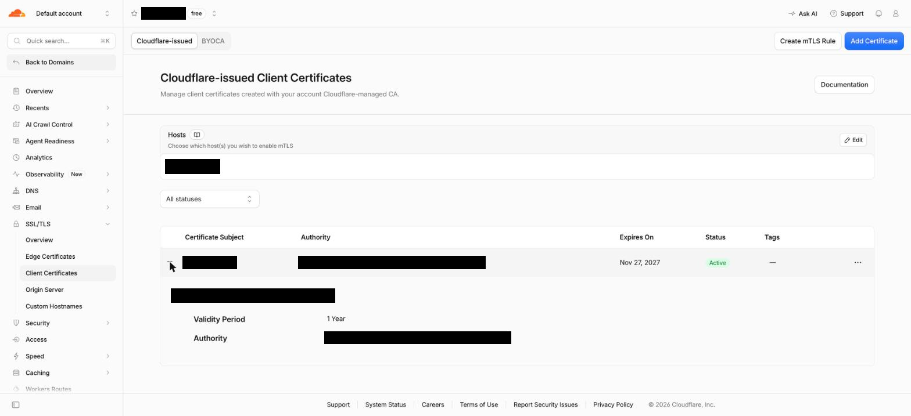
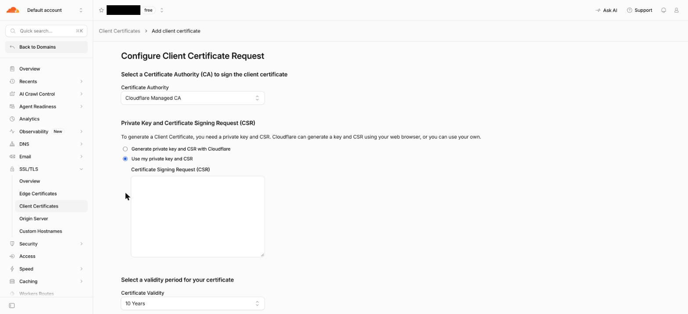
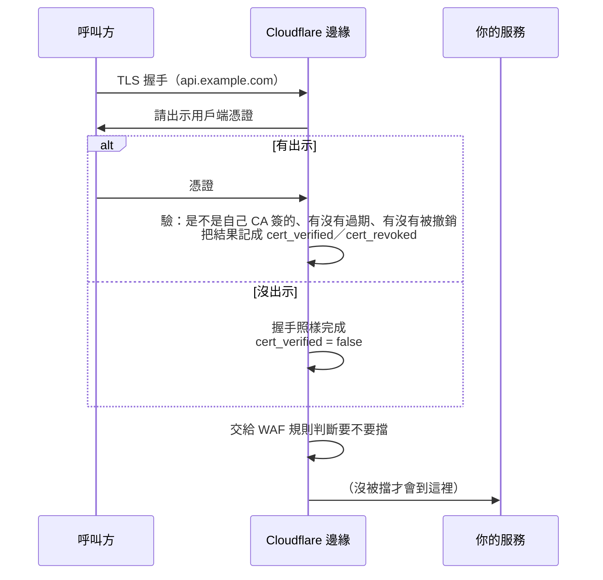

# [E-18-3] 用戶端憑證與 mTLS：用對方的 CSR 簽憑證、只對 API 開

> **目標**：在 Cloudflare 的 SSL/TLS → Client Certificates 用**對方給的 CSR** 簽出一張用戶端憑證（私鑰從頭到尾不離開對方）、把效期從預設 10 年改成 1 年、只對 API 子網域開啟 mTLS——並且搞清楚「開了 mTLS」到底做了什麼、還沒做什麼。

## 先說這篇不重講什麼

- 憑證裡有哪些欄位、CSR 是什麼、為什麼私鑰不該離開申請方 → [E-10-19 憑證拆解：X.509、憑證鏈與 CSR](../E-10-security/E-10-19-x509-certificate-csr.md)
- 雙向 TLS（mTLS）的觀念、內部 CA → [E-10-14 mTLS 與內部 CA](../E-10-security/E-10-14-mtls-internal-ca.md)
- 在邊緣驗 vs 在應用驗的取捨 → [E-10-20 邊緣防火牆（WAF）](../E-10-security/E-10-20-edge-waf.md)

## 生活類比：門禁卡由大樓管理處發，但晶片是住戶自己的

```
情境：合作方的伺服器要呼叫你的 API，你想確認「真的是它」

錯的做法：
    管理處做好一張門禁卡，連同密碼一起寄給住戶
    → 寄送過程中任何人看到，就能複製一張

對的做法（CSR 流程）：
    住戶自己做一顆晶片（私鑰），只把「晶片的公開資訊」填成申請單（CSR）寄給管理處
    管理處在申請單上蓋章（用 CA 簽名），寄回一張「已認證」的卡面（憑證）
    住戶把卡面跟自己的晶片合在一起用
    → 路上流通的只有申請單和卡面，都是公開資訊；晶片從沒離開住戶家
```

在 Cloudflare 的情境裡，「管理處」就是 Cloudflare 幫你代管的 CA（Certificate Authority，憑證簽發機構）。

## Client Certificates 頁面

到網域層 → SSL/TLS → Client Certificates：



> 截圖遮蔽：網域名稱、Hosts 裡的主機名、憑證主體（CN）、簽發者名稱（內含帳號 email）。

這頁有兩個區塊，**它們是獨立的兩件事**：

| 區塊 | 決定什麼 |
|---|---|
| **Hosts** | 哪些主機名在 TLS 握手時**會向用戶端要憑證** |
| 憑證列表 | 這個 CA 簽出過哪些憑證、各自的效期與狀態（Active／Revoked） |

點開憑證列的「＋」可以看到效期（Validity Period）與簽發者（Authority）。簽發者是 **Cloudflare Managed CA for ＜你的帳號＞**——每個帳號有自己的一個 CA，只有這個 CA 簽出的憑證會被當成「有效」。

## 步驟一：用對方的 CSR 簽憑證

點右上角 **Add Certificate**：



> 截圖遮蔽：網域名稱。

表單有三個選擇：

1. **Certificate Authority**：用 Cloudflare Managed CA。
2. **Private Key and CSR**：
   - `Generate private key and CSR with Cloudflare`（預設）：私鑰在**你的瀏覽器**裡產生，之後你得把私鑰交給對方——私鑰離開了申請方，這正是要避免的。
   - **`Use my private key and CSR`**：選這個，把**對方給你的 CSR** 貼進來。私鑰留在對方機器上，從頭到尾沒經過你。
3. **Certificate Validity**：預設 **10 Years**，下拉可改。**改成 1 年**。

對方產 CSR 的方式（給對方參考，在**對方的機器上**跑）：

```bash
# 產生私鑰與 CSR；私鑰 partner.key 留在本機，只把 partner.csr 寄出去
openssl req -new -newkey rsa:2048 -nodes \
  -keyout partner.key -out partner.csr \
  -subj "/CN=partner-api-client"
```

送出後，畫面會顯示簽好的**憑證**（PEM 格式）。把它寄回給對方——憑證是公開資訊，用一般管道寄沒問題。對方之後呼叫 API 時帶上「憑證＋自己的私鑰」：

```bash
curl --cert partner.crt --key partner.key https://api.example.com/v1/health
```

### 為什麼效期改成 1 年

| 效期 | 好處 | 代價 |
|---|---|---|
| 10 年（預設） | 幾乎不用換 | 外洩了，十年內都有效；到期時大家早忘了怎麼換 |
| 1 年 | 外洩的傷害有上限；每年換一次，流程不會失傳 | 要把到期日寫進行事曆或監控 |

這是 [E-10-19](../E-10-security/E-10-19-x509-certificate-csr.md) 講的「效期越短，外洩傷害越小，但前提是換發做得到」的實際選擇。

## 步驟二：只對 API 子網域開 mTLS

回到列表頁，**Hosts** 區塊按 **Edit**，加入 `api.example.com`。**給人用的網域（例如 `app.example.com`）不要加。**

原因是：Hosts 裡的主機名，在 TLS 握手時會向用戶端「要」憑證。

```
api.example.com（呼叫方是程式）：
    程式帶了憑證 → 出示
    → 正是我們要的

app.example.com（呼叫方是人，用瀏覽器）：
    瀏覽器被要求出示憑證
    → 有些瀏覽器會跳出「請選擇憑證」的視窗，使用者一頭霧水
    → 而且一般使用者本來就沒有你發的憑證
```

把 mTLS 範圍收在真正需要的主機名上，人用的網站不受影響。

## 關鍵觀念：開 mTLS 只是「要」憑證，不是「擋」

這是這篇最重要的一句：**Hosts 加進去之後，沒帶憑證的請求照樣進得來。**



這張圖表達：mTLS 這一步只負責「要憑證、驗憑證、把結果記下來」，**真正決定放行或封鎖的是下一步的 WAF 規則**。沒寫規則，等於門禁讀卡機裝好了，但門沒鎖。

所以 Client Certificates 頁面右上角才有一個 **Create mTLS Rule** 按鈕——它會帶你去建一條用 `cf.tls_client_auth.cert_verified` 判斷的 WAF 規則。下一篇會把這條規則寫完整。

## 撤銷

憑證外洩、或合作結束時，在憑證那列的「⋯」選 **Revoke**。撤銷後狀態變成 Revoked，邊緣驗證時 `cf.tls_client_auth.cert_revoked` 會是 `true`——**但同樣要 WAF 規則有檢查這個欄位，撤銷才有實際效果**（見下一篇）。

## 常見錯誤（反模式）

> **常見錯誤一：用「Generate private key with Cloudflare」再把私鑰寄給對方**
>
> 方便，但私鑰經過了你的瀏覽器、你的信箱或聊天工具，任何一段外洩都等於憑證外洩。
>
> **正確做法**：請對方自己產 CSR，你只簽。收到別人寄來的私鑰，就當它已經外洩。

> **常見錯誤二：Hosts 加了就以為擋住了**
>
> 加完 Hosts，用不帶憑證的 `curl` 一打，回應照樣是 200。
>
> **正確做法**：一定要配一條 WAF 規則（`not cf.tls_client_auth.cert_verified` → Block），並用「不帶憑證」實際打一次，確認被擋。這是 [E-6-6 反模式](../E-6-best-practices/E-6-6-anti-patterns.md)裡「沒驗證就上線」的典型。

> **常見錯誤三：效期留預設 10 年**
>
> 十年後沒人記得這張憑證給了誰、怎麼換；中間任何時候外洩，都會一直有效到那時。
>
> **正確做法**：效期改短（例如 1 年），到期日寫進行事曆或監控，換發流程寫成文件。

## 小結

- Client Certificates 頁面有兩件獨立的事：**Hosts（哪些主機名要憑證）** 與 **憑證列表（簽過哪些憑證）**。
- 簽憑證選 **Use my private key and CSR**，貼對方的 CSR——私鑰從不離開對方。
- 效期從預設 10 年**改成 1 年**。
- mTLS 只開在 **API 子網域**，給人用的網域不開，避免瀏覽器跳憑證選擇視窗。
- **開 mTLS 只是要憑證、驗憑證；要擋，還得靠 WAF 規則**。撤銷也一樣要規則有檢查才生效。

> 下一篇：把「沒憑證、憑證被撤銷、IP 不對」的請求真正擋下來 → [E-18-4 WAF 自訂規則與限流](./E-18-4-waf-rate-limiting.md)
> 憑證欄位、CSR、指紋 → [E-10-19 憑證拆解](../E-10-security/E-10-19-x509-certificate-csr.md)
> 在邊緣驗 mTLS 的風險與源站該做的事 → [E-10-20 邊緣防火牆（WAF）](../E-10-security/E-10-20-edge-waf.md)
