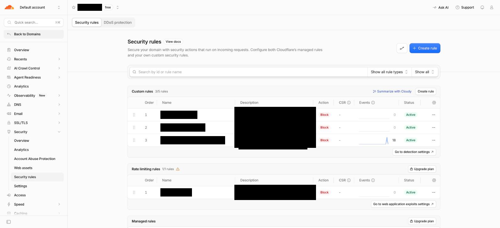
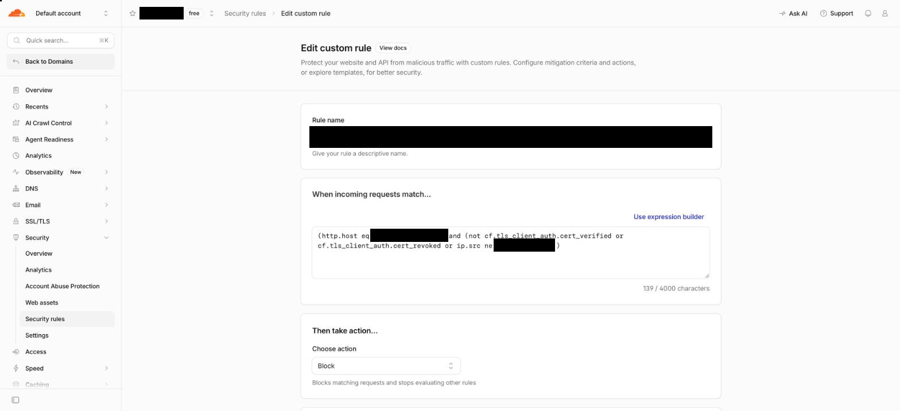
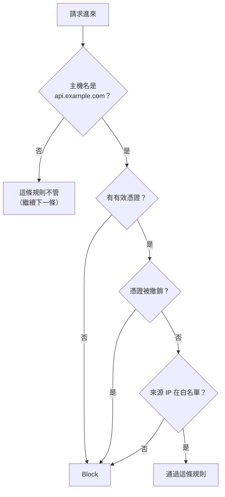
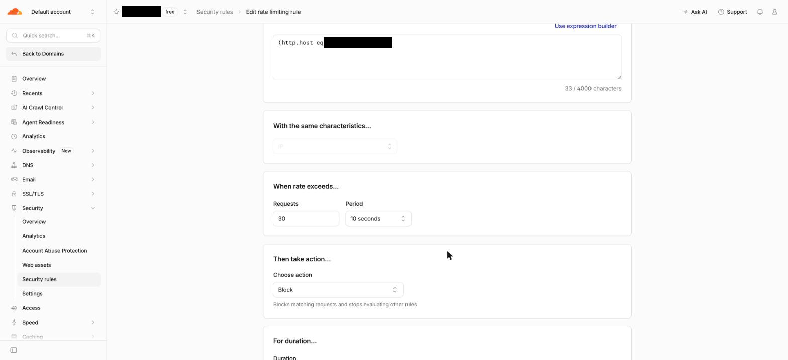

# [E-18-4] WAF 自訂規則與限流：把「要憑證」變成「沒憑證就擋」

> **目標**：在 Security → Security rules 寫一條自訂規則——「主機名是 API，而且（沒有有效憑證 或 憑證被撤銷 或 來源 IP 不在白名單）→ Block」——再加一條限流規則；看懂免費方案的限制，並知道規則改完要怎麼驗證它真的有擋。

## 先說這篇不重講什麼

- WAF 是什麼、規則＝條件＋動作、先中先贏、IP 不能當身分 → [E-10-20 邊緣防火牆（WAF）](../E-10-security/E-10-20-edge-waf.md)
- 限流演算法（固定視窗、滑動視窗、令牌桶）與分層 → [E-10-8 Rate Limiting](../E-10-security/E-10-8-rate-limiting.md)
- 上一篇設定的用戶端憑證 → [E-18-3 用戶端憑證與 mTLS](./E-18-3-client-certificate-mtls.md)

## 生活類比：讀卡機裝好了，現在要把門鎖接上

上一篇裝了讀卡機（mTLS）：每個進門的人都會被要求刷卡，讀卡機會記下「這張卡是真的、還是假的、還是已經掛失」。但門本身沒上鎖——刷不刷卡都進得來。

這篇做兩件事：

```
門鎖（自訂規則）：
    如果 要去的是 API 那扇門，而且
        沒刷卡、或刷的是假卡、或
        刷的是已掛失的卡、或
        人不是從合作方的辦公室過來的
    那麼 擋下

人潮管制（限流）：
    同一個人 10 秒內進出超過 N 次 → 先擋一陣子
```

## Security rules 頁面

到網域層 → Security → Security rules：



> 截圖遮蔽：網域名稱、每條規則的名稱與運算式摘要。

這頁把幾種規則放在一起：

| 區塊 | 用途 | 免費方案（以畫面顯示為準） |
|---|---|---|
| **Custom rules** | 自訂條件 → 封鎖／挑戰／略過／記錄 | 圖中顯示 3/5，表示可以有 5 條 |
| **Rate limiting rules** | 超過頻率就處置 | 圖中顯示 **1/1**——只能有一條，旁邊的警告圖示就是在說「額度用完了」 |
| Managed rules | Cloudflare 維護的規則集 | 多數需要付費方案 |

每條規則一列，**Order 就是執行順序**；Events 欄會畫出最近命中的次數——第 3 條規則旁邊有一根尖峰，代表最近真的擋了東西。這是確認規則「有在作用」最快的地方。

## 步驟一：自訂規則

按 **Create rule** → Custom rule。條件可以用表單（expression builder）一欄一欄選，也可以切到 **Edit expression** 直接寫運算式。條件一複雜（有 `and`、`or`、括號），直接寫運算式比較清楚：



> 截圖遮蔽：網域名稱、規則名稱、運算式裡的主機名與來源 IP。

寫成文字（白名單有多個 IP 時用 `in { }`）：

```
(http.host eq "api.example.com"
  and (
    not cf.tls_client_auth.cert_verified
    or cf.tls_client_auth.cert_revoked
    or not ip.src in {203.0.113.10 203.0.113.11}
  ))
```

動作選 **Block**。

逐項拆解：

| 片段 | 意思 | 為什麼要有 |
|---|---|---|
| `http.host eq "api.example.com"` | 只管 API 這個主機名 | 不加的話，給人用的網站也會被這條規則擋光 |
| `not cf.tls_client_auth.cert_verified` | 沒出示憑證，或憑證不是你的 CA 簽的 | 這就是「把要憑證變成擋」的那一句 |
| `cf.tls_client_auth.cert_revoked` | 憑證是你的 CA 簽的，但已經被撤銷 | **`cert_verified` 對已撤銷的憑證仍可能是 true**，不另外檢查，撤銷就沒有作用 |
| `not ip.src in {...}` | 來源 IP 不在合作方的出口 IP 清單 | 多一道門檻：憑證外洩，攻擊者還得從對的 IP 來 |

外層是 `and`、內層三個是 `or`：**只要內層任何一個條件成立就擋**。把它想成「三個條件都要通過才放行」：



這張圖表達：三道檢查任何一道不過就封鎖；只有主機名對、憑證有效、沒被撤銷、IP 也對，才會往下走。

> 規則清單裡另外兩條是「這些後台主機名不對外」的封鎖規則（主機名在清單裡就 Block）——同樣的寫法，換個條件而已。

## 步驟二：限流規則

按 **Create rule** → Rate limiting rule：



> 截圖遮蔽：網域名稱、運算式裡的主機名。

| 欄位 | 設定 | 說明 |
|---|---|---|
| When incoming requests match | `http.host eq "api.example.com"` | 只對 API 計數 |
| With the same characteristics | IP（灰色、不能改） | 免費方案只能「依來源 IP」分開計數 |
| Requests / Period | 30 次 / **10 seconds** | 免費方案的週期只有 10 秒可選 |
| Then take action | Block | 超過就擋 |
| For duration | （往下捲） | 擋多久；免費方案選項同樣很少 |

數字怎麼定：先估「正常呼叫方 10 秒內最多會打幾次」，再留一些餘裕。定太緊會擋到正常的重試；定太鬆就只擋得住真正的洪水——**邊緣限流本來就是擋洪水用的**，細的限額（例如每個帳號每分鐘幾次）要在應用程式裡做，見 [E-10-8](../E-10-security/E-10-8-rate-limiting.md)。

### 規則的先後：限流在自訂規則之後

Cloudflare 的處理順序裡，**自訂規則先跑、限流規則後跑**。所以沒憑證的請求在自訂規則就被擋了，不會占用限流的計數；能走到限流那一步的，都是「憑證有效、IP 也對」的請求。這正好是我們要的：限流保護的是「合法呼叫方失控」的情況（例如對方程式寫壞了，瘋狂重試）。

## 部署：存檔前會再確認一次

規則表單最下方是 **Save**（新規則是 **Deploy**）。按下去之後，新版介面可能再跳一個確認框，告訴你這條規則會影響哪些流量——這是最後一次反悔的機會，**看清楚主機名條件再確認**。規則存檔後幾乎是立刻在全球生效。

表單上還有一個 **Save with API call** 的區塊，展開後會顯示「同樣的設定用 API 怎麼送」——想把規則納入版本控制（例如用 Terraform 或腳本管理）時，可以從這裡抄格式。

## 步驟三：驗證規則真的有擋

規則寫完一定要從外面實際打一次，四種情況都要測：

```bash
# 1. 沒帶憑證 → 應該 403（被自訂規則擋）
curl -i https://api.example.com/v1/health

# 2. 帶有效憑證、從白名單 IP → 應該通過（拿到你的 API 回應）
curl -i --cert partner.crt --key partner.key https://api.example.com/v1/health

# 3. 帶有效憑證、從其他 IP（例如手機熱點）→ 應該 403
# 4. 短時間連打超過門檻 → 應該開始拿到 429
for i in $(seq 1 40); do
  curl -s -o /dev/null -w "%{http_code}\n" --cert partner.crt --key partner.key https://api.example.com/v1/health
done
```

每測一種，回 Security rules 列表看 Events 欄有沒有對應的命中；或到 Security → Analytics（Events）看每一筆被擋的請求是被**哪一條規則**擋的。

## 常見錯誤（反模式）

> **常見錯誤一：只檢查 `cert_verified`，沒檢查 `cert_revoked`**
>
> 合作結束後在後台撤銷了憑證，以為對方就進不來了。但規則只寫了 `not cf.tls_client_auth.cert_verified`，被撤銷的憑證仍然通過。
>
> **正確做法**：兩個欄位都要檢查；撤銷之後，用那張憑證實際打一次，確認拿到 403。

> **常見錯誤二：忘了限定主機名**
>
> 規則寫成 `not cf.tls_client_auth.cert_verified` → Block，沒加 `http.host`。結果給人用的網站也全部被擋——一般使用者沒有用戶端憑證。
>
> **正確做法**：每條規則都先用主機名把範圍收窄，再寫其他條件。

> **常見錯誤三：把 IP 白名單當成唯一的身分驗證**
>
> 只寫 `not ip.src in {...}` → Block，沒有憑證。合作方的出口 IP 可能是共用的（雲端業者、大型 NAT），同一個 IP 後面不只一個人。
>
> **正確做法**：IP 是「從哪來」，憑證才是「你是誰」，兩個一起用。原因見 [E-10-20](../E-10-security/E-10-20-edge-waf.md)。

> **常見錯誤四：規則寫完沒測就上線**
>
> 這是 [E-6-6 反模式](../E-6-best-practices/E-6-6-anti-patterns.md)裡「沒驗證就上線」在設定層面的版本。
>
> **正確做法**：上面四種情況都從外部實際打一次，並在 Events 確認是哪條規則命中。

## 小結

- Security rules 頁面把**自訂規則**和**限流規則**放在一起；免費方案自訂規則 5 條、限流 **1 條**、週期 **10 秒**、只能依 IP 計數（方案內容會變，以畫面為準）。
- 自訂規則：`主機名 and (沒憑證 or 憑證被撤銷 or IP 不在白名單)` → Block。**`cert_revoked` 一定要另外檢查**。
- 條件一複雜就切到運算式模式直接寫，比表單清楚。
- 自訂規則先跑、限流後跑；邊緣限流擋洪水，細的限額留給應用程式。
- 改完一定從外部實際打：沒憑證、有憑證、錯 IP、連打，四種都要看到預期的狀態碼。

> 下一篇：除了憑證，再加一層 Cloudflare Access 的 service token → [E-18-5 Zero Trust 開通與 service token](./E-18-5-zero-trust-service-token.md)
> WAF 規則與縱深防禦的觀念 → [E-10-20 邊緣防火牆（WAF）](../E-10-security/E-10-20-edge-waf.md)
> 限流演算法 → [E-10-8 Rate Limiting](../E-10-security/E-10-8-rate-limiting.md)
