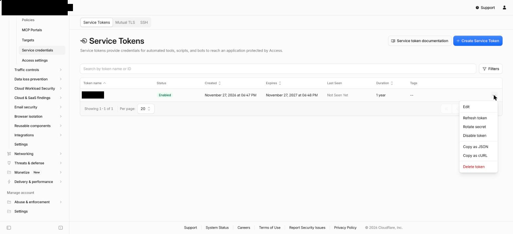
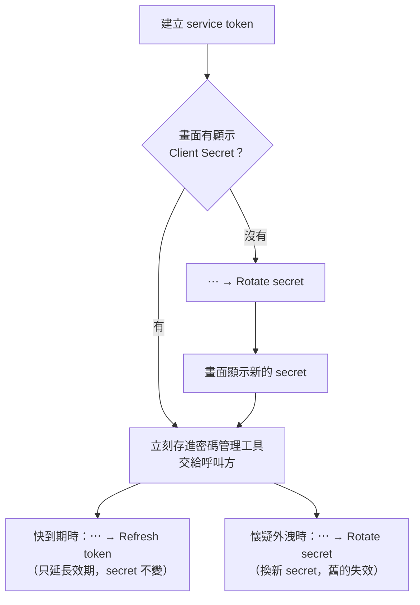

# [E-18-5] Zero Trust 開通與 service token：給程式用的通行證

> **目標**：第一次開通 Cloudflare Zero Trust（取 team name、選 Free 方案）、在 Service credentials 建立一組 service token，並知道新版介面「建立後不顯示 secret」時怎麼辦、**Rotate secret** 和 **Refresh token** 差在哪。

## 先說這篇不重講什麼

- 為什麼不能只靠網路位置（IP）來信任 → [E-10-20 邊緣防火牆（WAF）](../E-10-security/E-10-20-edge-waf.md) 的「IP 不能當身分」
- 金鑰外洩後怎麼換、輪換的通則 → [E-10-13 金鑰輪換與 KMS](../E-10-security/E-10-13-key-rotation-kms.md)
- 閘道驗過、後端仍要做細的檢查 → [E-10-17 API Gateway](../E-10-security/E-10-17-api-gateway.md)

## 生活類比：門禁卡之外，再發一張「訪客證」

前兩篇做的是**門禁卡**（用戶端憑證）＋**門鎖**（WAF 規則）。這篇和下一篇要再加一道：**櫃台**。

```
Zero Trust（零信任）的想法：
    不因為「你在大樓裡」「你從某個 IP 來」就信任你
    每一次進門，都要在櫃台出示通行證，櫃台查過才放行

給人用的通行證：用帳號登入（Google、GitHub、Email 驗證碼…）
給程式用的通行證：service token（服務權杖）
    ＝ 一組 Client ID（像訪客證上的編號）＋ Client Secret（像只有持有人知道的密碼）
    程式每次呼叫都帶這兩個值，櫃台（Cloudflare Access）比對過才放行
```

**Access** 是 Zero Trust 裡負責「櫃台」的那個功能。這篇先把櫃台開起來、發一張通行證；下一篇再告訴櫃台「哪扇門要查哪張證」。

## 步驟一：第一次開通 Zero Trust

在帳號首頁的側邊欄點 **Zero Trust**。第一次進來會有一段開通流程：

```
1. 取一個 team name
      → 會變成 <team-name>.cloudflareaccess.com，是 Access 登入頁的網址
      → 之後改得到，但會影響已經在用的登入連結，最好一開始就想好
      → 不要用公司或專案的內部代號，這個名字會出現在對外的網址上
2. 選方案：選 Free
      → 免費方案的人數上限對個人或小團隊足夠
3. 可能會出現付款資訊的頁面
      → 選的是免費方案時，金額是 $0
      → 有些情況仍會要求綁定付款方式才能完成開通；畫面上的金額確認是 $0 再繼續
4. 完成後進到 Zero Trust 的總覽頁
```

> 為什麼免費方案也可能要付款資訊：這是業者用來防止大量濫用開通的做法。重點是**看清楚畫面上的金額與方案名稱**，不要在沒注意的情況下選到付費方案。

## 步驟二：建立 service token

Zero Trust → Access controls → **Service credentials** → Service Tokens 分頁 → **Create Service Token**：

```
1. Token name：取一個看得出「給誰、做什麼用」的名字
      例：partner-api-client
2. Service Token Duration：效期
      預設可能很長（甚至不過期）；跟上一篇的憑證一樣，選 1 年
3. 建立
```

建立之後，這組 token 有兩個值：

| 值 | 用途 | 能不能再看到 |
|---|---|---|
| **Client ID** | 公開的識別碼 | 隨時可以在後台看到 |
| **Client Secret** | 秘密，像密碼 | **只在建立的當下顯示一次** |

呼叫方之後每次請求都要在標頭帶上這兩個值：

```bash
curl https://api.example.com/v1/health \
  -H "CF-Access-Client-Id: <Client ID>" \
  -H "CF-Access-Client-Secret: <Client Secret>"
```

## 新版介面的坑：建立後沒顯示 secret

舊版介面在建立後會跳出一個畫面，同時顯示 Client ID 和 Client Secret，提醒你「現在複製，之後就看不到了」。

**新版介面在某些情況下，建立完成會直接跳回列表或總覽頁，secret 從沒出現在畫面上。** 這時候 token 已經建立了，但你手上沒有 secret——等於一張沒有密碼的訪客證，什麼都做不了。

解法：在列表上那個 token 的「⋯」選 **Rotate secret**，產生一個新的 secret，這次畫面會顯示出來。



> 截圖遮蔽：帳號名稱（email）、token 名稱。

選單裡幾個容易搞混的項目：

| 選項 | 做什麼 | 對 secret 的影響 |
|---|---|---|
| **Rotate secret** | 產生一個新的 Client Secret，**畫面會顯示新值** | 舊 secret 失效（業者可能提供短暫的新舊並存期，以畫面說明為準）；Client ID 不變 |
| **Refresh token** | **只延長效期**，從今天起再算一次 | **secret 不變**，也不會顯示 secret |
| Disable token | 暫停這個 token，不刪除 | 用這個 token 的請求全部被拒 |
| Copy as JSON／cURL | 複製一段範例 | 只含 Client ID，不含 secret |
| Delete token | 刪除 | 用這個 token 的請求全部被拒，而且不能復原 |

**最常見的誤會是：以為 Refresh token 會給你新的 secret。** 不會——Refresh 只是「續約」，要拿到 secret 只能 Rotate。



這張圖表達：拿 secret 只有兩個時機——建立的當下，或 Rotate 的當下；Refresh 是續約，不會產生或顯示 secret。

## secret 怎麼交給呼叫方

secret 跟密碼一樣：

- 存在**密碼管理工具**或密鑰管理服務，不貼在聊天室、不寫進信件內文。
- 呼叫方的程式從環境變數或密鑰管理服務讀取，**不寫死在程式碼、不進版本控制**。
- 給不同的呼叫方各發一組 token，不要共用——這樣要停掉其中一方時，只要 Disable 那一組。

## 常見錯誤（反模式）

> **常見錯誤一：以為 Refresh token 會換 secret**
>
> 擔心 secret 外洩，按了 Refresh token，以為已經換掉了。實際上 secret 完全沒變，外洩的那組還能用。
>
> **正確做法**：懷疑外洩就 **Rotate secret**，並確認呼叫方換上新值後，舊值打過去會被拒。

> **常見錯誤二：好幾個呼叫方共用一組 token**
>
> 一組 token 給所有合作方用，其中一方合作結束或外洩，只能整組換掉，所有人一起中斷。
>
> **正確做法**：一個呼叫方一組 token，名字寫清楚是誰的。這也是 [E-6-6 反模式](../E-6-best-practices/E-6-6-anti-patterns.md)裡「一把鑰匙開所有門」的版本。

> **常見錯誤三：token 設成永不過期**
>
> 方便，但沒人記得它存在；外洩了也不會自己失效。
>
> **正確做法**：效期設 1 年，到期前用 Refresh 續約——續約這個動作本身，就是一次「這組 token 還有人在用嗎」的檢查。

## 小結

- **Zero Trust** 的核心是「每次都要出示通行證」；**Access** 是查通行證的櫃台。
- 開通時取 **team name**（會出現在對外網址上）、選 **Free**；若出現付款頁，確認金額是 $0。
- **service token**＝Client ID（公開）＋Client Secret（只顯示一次）；呼叫時用 `CF-Access-Client-Id`／`CF-Access-Client-Secret` 兩個標頭帶上。
- 新版介面建立後可能不顯示 secret → 用 **⋯ → Rotate secret** 取得新的。
- **Rotate secret 換 secret；Refresh token 只延長效期**，兩者不要搞混。

> 下一篇：告訴櫃台「API 這扇門，要查這張通行證」→ [E-18-6 Access 應用：用 service token 保護 API](./E-18-6-access-application.md)
> 金鑰輪換的通則 → [E-10-13 金鑰輪換與 KMS](../E-10-security/E-10-13-key-rotation-kms.md)
