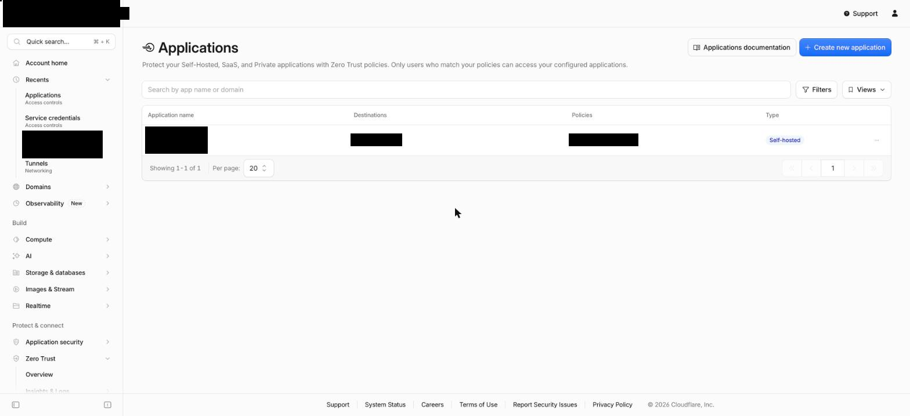
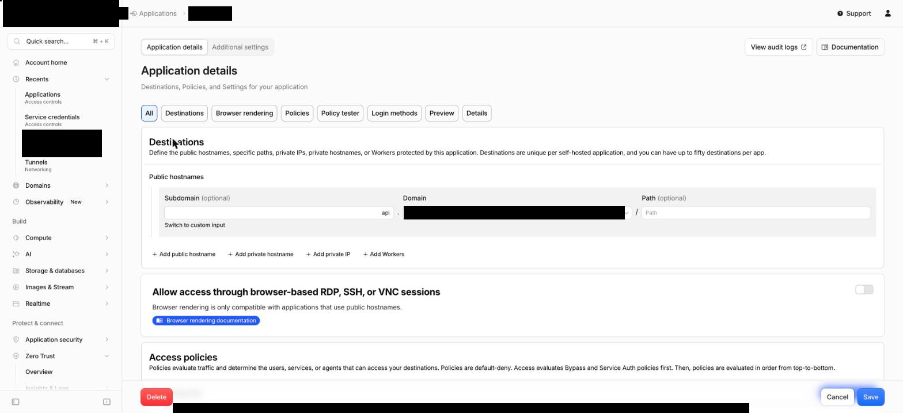
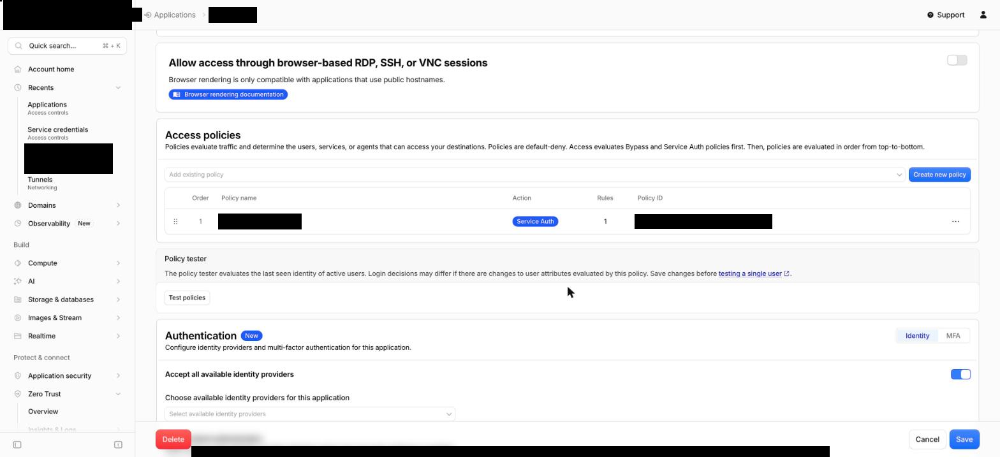
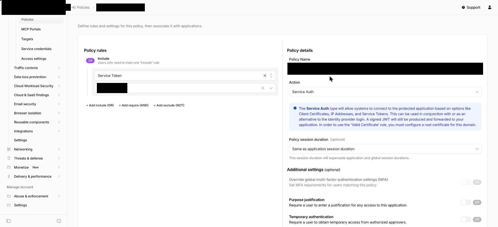
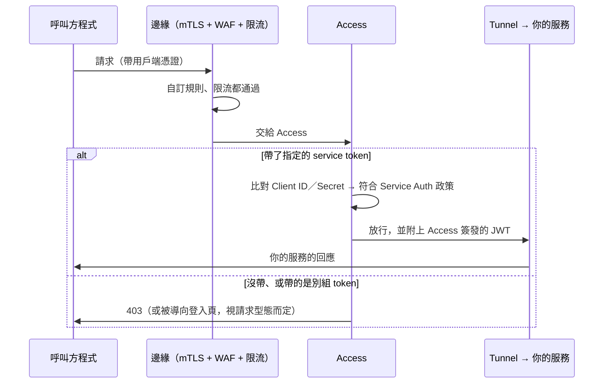

# [E-18-6] Access 應用：用 service token 保護整個 API 子網域

> **目標**：在 Access controls → Applications 建一個 Self-hosted 應用，目的地是整個 API 子網域（路徑留空＝預設全擋），掛上一條動作為 **Service Auth**、條件為 **Service Token**（指定那一組，而不是 Any Access Service Token）的政策；並理解這一層擋下請求時，呼叫方會看到什麼。

## 先說這篇不重講什麼

- 上一篇建立的 service token → [E-18-5 Zero Trust 開通與 service token](./E-18-5-zero-trust-service-token.md)
- 閘道（gateway）驗過、後端仍要做授權 → [E-10-17 API Gateway](../E-10-security/E-10-17-api-gateway.md)

## 生活類比：告訴櫃台「這扇門要查哪張證」

上一篇發了一張訪客證（service token），但櫃台還不知道它是用來進哪扇門的。這篇要建立一張「門與證的對照表」：

```
應用（Application）＝ 一扇門
    門牌：api.example.com（整個子網域，不分路徑）

政策（Policy）＝ 這扇門的進門規則
    動作：Service Auth（給程式用的通行證檢查，不跳登入頁）
    條件：Include → Service Token → 只認「partner-api-client」這一張

沒有任何政策放行的人 → 一律擋下（預設拒絕）
```

## 步驟一：建立 Self-hosted 應用

Zero Trust → Access controls → Applications → **Create new application** → 選 **Self-hosted**。

建好之後在列表會長這樣：



> 截圖遮蔽：帳號名稱（email）、側邊欄最近瀏覽中的網域、應用名稱、目的地主機名、政策名稱。

### 目的地：整個子網域，路徑留空

應用的設定頁（Application details）第一塊就是 **Destinations**：



> 截圖遮蔽：帳號名稱、應用名稱、Domain 欄位的網域、側邊欄最近瀏覽中的網域、底部工具列後方的模糊內容。

| 欄位 | 填什麼 | 為什麼 |
|---|---|---|
| Subdomain | `api` | 要保護的子網域 |
| Domain | `example.com` | 從下拉選單選，只會列出這個帳號裡的網域 |
| Path | **留空** | 留空＝整個子網域的**所有路徑**都受保護 |

**路徑留空是刻意的。** 如果填 `/v1/`，那 `/v1/` 以外的路徑（例如 `/admin`、`/debug`）就**不在 Access 保護範圍內**，會直接穿過去。保護範圍應該是「整扇門」，然後在後面的層（Tunnel 的 ingress、應用程式本身）再決定哪些路徑真的存在。這就是「預設全擋」：

```
路徑留空：
    api.example.com/v1/orders  → Access 檢查
    api.example.com/admin      → Access 檢查
    api.example.com/任何東西    → Access 檢查

路徑填 /v1/：
    api.example.com/v1/orders  → Access 檢查
    api.example.com/admin      → 沒人檢查，直接過 ← 漏洞
```

## 步驟二：政策——Service Auth ＋ Service Token

往下捲到 **Access policies**：



> 截圖遮蔽：帳號名稱、應用名稱、側邊欄最近瀏覽中的網域、政策名稱、Policy ID、底部工具列後方的模糊內容。

區塊上方的說明文字值得讀一次：**Policies are default-deny**（政策預設拒絕）、**Access evaluates Bypass and Service Auth policies first**（先評估 Bypass 和 Service Auth 類型的政策）。也就是說：

- 沒有任何政策放行的請求，一律被擋。
- Service Auth 類型的政策會**優先**被檢查，所以程式呼叫不會被導去登入頁。

點進政策（或在 Access controls → Policies 裡編輯同一條可重複使用的政策）：



> 截圖遮蔽：帳號名稱、政策名稱（頂部麵包屑與 Policy Name 欄位）、Include 條件裡選中的 token 名稱。

兩個關鍵選擇：

### Action 選 Service Auth，不是 Allow

| Action | 給誰用 | 沒帶通行證時 |
|---|---|---|
| Allow | 人（瀏覽器） | 導到登入頁，讓人用帳號登入 |
| **Service Auth** | 程式 | 不跳登入頁，只認 service token、用戶端憑證這類「非人」的通行證 |
| Bypass | 任何人 | **不檢查**，直接放行（只該用在公開的健康檢查之類） |
| Block | 任何人 | 擋下 |

API 的呼叫方是程式，程式不會填登入表單。選 Allow 的話，沒帶對 token 的請求會被導去一個 HTML 登入頁，呼叫方的程式拿到一堆看不懂的 HTML——除錯時非常困惑。選 **Service Auth** 才對。

### 條件選 Service Token，不是 Any Access Service Token

Include 的選擇器裡有兩個名字很像的選項：

| 選擇器 | 意思 |
|---|---|
| **Service Token** | 只認你**指定的那幾組** token |
| Any Access Service Token | 這個帳號底下**任何一組**有效的 service token 都放行 |

選 Any 的話，今天給 A 合作方的 token、明天給 B 監控服務的 token，全都能進這個 API。**一定要選 Service Token，然後指定那一組。**

## 整體效果



這張圖表達：Access 是在 WAF 之後、Tunnel 之前的一層；它通過時會在請求上附一個由 Access 簽名的 JWT（JSON Web Token，一種帶簽章的身分聲明）送進源站，源站若要更嚴謹，可以再驗這個 JWT 確認「這個請求真的經過 Access」。

驗證方式跟上一篇一樣，從外部實際打：

```bash
# 不帶 service token（但帶了用戶端憑證）→ 應該被 Access 擋
curl -i --cert partner.crt --key partner.key https://api.example.com/v1/health

# 帶指定的 service token → 應該通過
curl -i --cert partner.crt --key partner.key https://api.example.com/v1/health \
  -H "CF-Access-Client-Id: $CLIENT_ID" \
  -H "CF-Access-Client-Secret: $CLIENT_SECRET"
```

## 常見錯誤（反模式）

> **常見錯誤一：Action 選 Allow**
>
> 程式沒帶 token 時被導去登入頁，拿到 302 或一大段 HTML，呼叫方以為是你的 API 壞了。
>
> **正確做法**：給程式的應用，政策 Action 用 **Service Auth**。

> **常見錯誤二：條件選 Any Access Service Token**
>
> 圖方便選了 Any，帳號裡每一組 service token 都能進這個 API，「一組 token 只給一個呼叫方」的隔離就失效了。
>
> **正確做法**：選 **Service Token** 並指定那一組；要多給一個呼叫方，就在同一個條件裡多加一組。

> **常見錯誤三：Path 填了特定路徑**
>
> 只保護 `/v1/`，其他路徑沒有 Access 檢查。哪天應用程式多了一個 `/admin`，就直接對外了。
>
> **正確做法**：Path 留空保護整個子網域，路徑的取捨交給 ingress 與應用程式。這是「預設拒絕」原則；反過來「預設全開、想到再擋」是 [E-6-6 反模式](../E-6-best-practices/E-6-6-anti-patterns.md)裡常見的設計錯誤。

> **常見錯誤四：有了 Access，應用程式就不做認證**
>
> Access 確認的是「這是一個持有有效 token 的程式」，不知道你應用裡的帳號、權限、哪筆資料屬於誰。
>
> **正確做法**：應用程式仍然要做自己的認證與授權（例如請求簽章、API 金鑰對應到哪個合作方），見 [E-10-17](../E-10-security/E-10-17-api-gateway.md)。

## 小結

- **應用（Application）＝一扇門**：Self-hosted、目的地填子網域、**Path 留空＝整個子網域預設全擋**。
- **政策（Policy）＝進門規則**：Action 選 **Service Auth**（程式用、不跳登入頁）；Include 選 **Service Token** 並指定那一組，**不要選 Any Access Service Token**。
- Access 預設拒絕，並且優先評估 Bypass 與 Service Auth 政策。
- 通過 Access 的請求會帶著 Access 簽發的 JWT 進源站；應用程式仍要做自己的認證與授權。

> 下一篇：把整個系列串起來，從狀態碼判斷請求卡在哪一層 → [E-18-7 一個請求的完整路徑與排錯](./E-18-7-request-path-troubleshooting.md)
> 閘道與後端的分工 → [E-10-17 API Gateway](../E-10-security/E-10-17-api-gateway.md)
