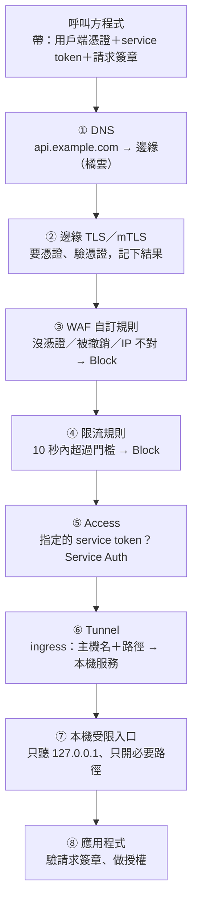
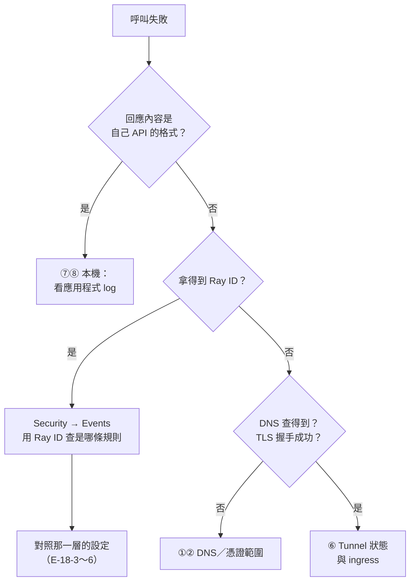

# [E-18-7] 一個請求的完整路徑與排錯：從狀態碼判斷卡在哪一層

> **目標**：把 E-18 整個系列串起來——一個 API 請求從 DNS 查詢開始，依序經過邊緣 mTLS、WAF、限流、Access、Tunnel、本機的受限入口，最後才到應用程式自己的簽章驗證；並學會從 403／401／429／404／5xx 和回應的長相，判斷請求是在哪一層被擋下的。

## 先說這篇不重講什麼

- 縱深防禦的觀念、每層各擋什麼 → [E-10-20 邊緣防火牆（WAF）](../E-10-security/E-10-20-edge-waf.md) 的「縱深防禦」一節
- HTTP 狀態碼的意思 → [E-3-3 HTTP 協定](../E-3-network/E-3-3-http-protocol.md)
- 系列前面每一層的設定：[E-18-1 DNS](./E-18-1-account-domain-dns.md)、[E-18-2 Tunnel](./E-18-2-tunnel.md)、[E-18-3 mTLS](./E-18-3-client-certificate-mtls.md)、[E-18-4 WAF 與限流](./E-18-4-waf-rate-limiting.md)、[E-18-5 service token](./E-18-5-zero-trust-service-token.md)、[E-18-6 Access 應用](./E-18-6-access-application.md)

## 生活類比：包裹被退回時，看退件章是誰蓋的

```
一個包裹要送進大樓深處的某間辦公室，路上會經過：
    門牌查詢 → 大門讀卡機 → 警衛 → 人潮管制 → 櫃台 → 專用電梯 → 樓層門禁 → 辦公室本人

包裹被退回來時，不要只看「被退了」：
    退件單上蓋的章是誰的？
        「查無此址」→ 門牌那一關
        警衛的章 → 警衛（WAF）
        「人太多請稍後」→ 人潮管制（限流）
        櫃台的章 → 櫃台（Access）
        電梯的章 → 專用電梯（Tunnel）
        辦公室自己的回函 → 辦公室本人（你的應用）
```

排錯的關鍵就是**認出退件章是誰蓋的**。狀態碼是一部分線索，回應的「長相」（是 Cloudflare 的網頁，還是你自己 API 的 JSON）是另一部分。

## 一個請求經過的每一層



這張圖表達：一個請求要連過八關才拿得到資料；前五關在 Cloudflare 的邊緣，後三關在你自己的機器上。**每一層只擋自己看得懂的東西**——WAF 不懂你的帳號系統，應用程式看不到用戶端憑證——所以不能拿掉任何一層，期待別層替它擋。

各層對應的設定與「它在擋什麼」：

| 層 | 在哪設定 | 擋什麼 |
|---|---|---|
| ① DNS | DNS 記錄（橘雲） | 不經過邊緣的直連（灰雲就沒有後面 ②～⑤） |
| ② mTLS | SSL/TLS → Client Certificates → Hosts | 本身不擋，只是要憑證、驗憑證 |
| ③ WAF | Security rules → Custom rules | 沒有效憑證、憑證被撤銷、來源 IP 不在白名單 |
| ④ 限流 | Security rules → Rate limiting | 同一來源短時間大量請求 |
| ⑤ Access | Zero Trust → Applications＋Policies | 沒帶指定的 service token |
| ⑥ Tunnel | 本機 `config.yml` 的 ingress | 沒列在 ingress 的主機名或路徑（→ 404） |
| ⑦ 本機受限入口 | 本機服務或本機反向代理的設定 | 不該對外的路徑、不該從外面來的連線 |
| ⑧ 應用程式 | 你的程式碼 | 簽章錯誤、過期的請求、沒有權限的操作 |

> 第 ⑦ 層的意思：通道把請求送到 `127.0.0.1` 上的某個服務，這個服務（或它前面的反向代理）只接受必要的路徑，其他一律拒絕。即使 ingress 寫錯放進來太多，這裡還有一道。

## 從狀態碼與回應判斷卡在哪

先用 `curl -i`（顯示回應標頭）或 `curl -v`（連 TLS 握手都顯示）打一次，看三樣東西：**狀態碼**、**回應標頭**、**回應內容的長相**。

```bash
curl -sv https://api.example.com/v1/health \
  --cert partner.crt --key partner.key \
  -H "CF-Access-Client-Id: $CLIENT_ID" \
  -H "CF-Access-Client-Secret: $CLIENT_SECRET"
```

| 你看到的 | 最可能卡在 | 下一步 |
|---|---|---|
| `Could not resolve host` | ① DNS | 記錄存在嗎？拼字對嗎？`dig api.example.com` |
| TLS 握手失敗（`SSL routines` 之類的錯誤） | ② 邊緣 TLS | 主機名在邊緣憑證的涵蓋範圍內嗎？（多層子網域如 `a.b.example.com` 不在免費憑證的範圍內） |
| **403**，回應是 Cloudflare 的封鎖網頁（`Sorry, you have been blocked`，附一個 Ray ID＝每個請求的編號，見下方） | ③ WAF 自訂規則 | 拿 Ray ID 去 Security → Events 查，看是**哪一條規則**命中 |
| **429** | ④ 限流 | 呼叫方是不是在重試迴圈裡？門檻是不是太緊？ |
| **403**，回應是 Access 的拒絕頁；或 **302** 導向 `<team-name>.cloudflareaccess.com` | ⑤ Access | token 有帶嗎？是不是「指定的那一組」？secret 是不是 Rotate 前的舊值？政策 Action 是不是誤設成 Allow（才會導向登入頁）？ |
| **530**，或 Cloudflare 錯誤頁寫著通道相關的錯誤代碼（例如 1033） | ⑥ Tunnel 沒連上 | 後台 Tunnels 的狀態是不是 Down？`systemctl status cloudflared` |
| **502** | ⑥→⑦ 通道有連上，但送不到本機服務 | 本機服務有在跑嗎？埠號對嗎？`localhost` 被解析成 `::1` 而服務只聽 IPv4？ |
| **404**，回應很短、不是你 API 的格式 | ⑥ ingress 最後一條 | 這個路徑有在 ingress 裡嗎？`cloudflared tunnel ingress rule <網址>` |
| **403／404**，回應是你本機反向代理的格式 | ⑦ 本機受限入口 | 這個路徑在允許清單裡嗎？ |
| **401**，回應是**你 API 自己的 JSON 錯誤格式** | ⑧ 應用程式 | 簽章算錯、時間戳過期、金鑰不對——到這一步，前七關都已經過了 |

判斷「是 Cloudflare 擋的還是我擋的」最快的方法：

```
看回應內容：
    是 Cloudflare 的網頁（有 Cloudflare 字樣、有 Ray ID）→ 邊緣某一層擋的（②～⑥）
    是你自己 API 的 JSON 錯誤格式 → 已經到了你的機器（⑦～⑧）

看回應標頭：
    幾乎所有經過邊緣的回應都會有 server: cloudflare 和 cf-ray
    → 所以不能只靠「有 cf-ray」判斷是邊緣擋的，要搭配內容一起看
```

**Ray ID** 是 Cloudflare 給每個請求的編號（回應標頭的 `cf-ray`）。在後台 Security → Events 用 Ray ID 搜尋，可以看到這個請求被哪一條規則、在哪個階段處理掉。這是排錯時最有用的一條線索——請呼叫方回報問題時，**一定要附上 Ray ID 和時間**。

## 排錯順序：由外往內



這張圖表達：先用回應的長相切成「邊緣」和「本機」兩半，邊緣那半用 Ray ID 查，本機那半看自己的 log；連 Ray ID 都沒有，就是更外層的 DNS 或 TLS 問題。

## 常見錯誤（反模式）

> **常見錯誤一：一看到 403 就去改應用程式**
>
> 403 在這條路徑上至少有四個可能的來源（WAF、Access、本機入口、應用程式）。沒先認出是誰擋的就改程式，改了半天問題還在。
>
> **正確做法**：先看回應內容與 Ray ID，確認是哪一層，再去改那一層的設定。

> **常見錯誤二：為了排錯把某一層整個關掉，然後忘了開回來**
>
> 「先把 WAF 規則停用看看會不會通」——通了，問題也找到了，但規則一直停用著。
>
> **正確做法**：能用 Events 查就不要關規則；真的要關，先在行事曆或任務卡記下「何時要開回來」，改完立刻開回來並重測。這是 [E-6-6 反模式](../E-6-best-practices/E-6-6-anti-patterns.md)裡「暫時的變成永久的」。

> **常見錯誤三：以為邊緣都擋好了，應用程式就不用驗**
>
> 前五層都在 Cloudflare，任何一層設定失誤（灰雲、規則漏了主機名、Access 選了 Any），請求就會直接到你的機器。
>
> **正確做法**：應用程式永遠自己做認證與授權（例如請求簽章），把邊緣當成「多擋掉一大批」，而不是「唯一的防線」。

## 小結

- 一個 API 請求依序經過：**DNS → 邊緣 mTLS → WAF → 限流 → Access → Tunnel → 本機受限入口 → 應用程式的簽章驗證**，前五層在邊緣、後三層在你的機器。
- 每一層只擋自己看得懂的，不能拿掉任何一層。
- 排錯先看**回應的長相**：Cloudflare 的網頁＝邊緣擋的，你 API 的 JSON＝已經到你的機器。
- 常見對應：**403＋封鎖頁 → WAF**、**429 → 限流**、**403／302 到登入網域 → Access**、**530 → 通道沒連上**、**502 → 本機服務連不到**、**404 → ingress 沒列**、**401＋自己的格式 → 應用程式**。
- 拿 **Ray ID** 到 Security → Events 查是哪條規則，比猜快得多。

> 縱深防禦的觀念 → [E-10-20 邊緣防火牆（WAF）](../E-10-security/E-10-20-edge-waf.md)
> 不開門也能對外服務的原理 → [E-3-12 反向通道](../E-3-network/E-3-12-reverse-tunnel.md)
> 用戶端憑證的原理 → [E-10-19 憑證拆解：X.509、憑證鏈與 CSR](../E-10-security/E-10-19-x509-certificate-csr.md)
