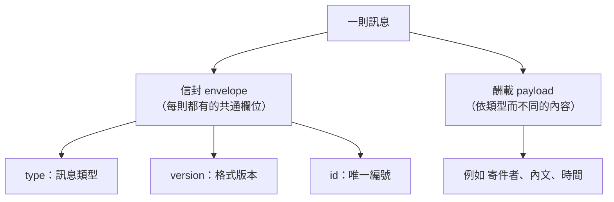
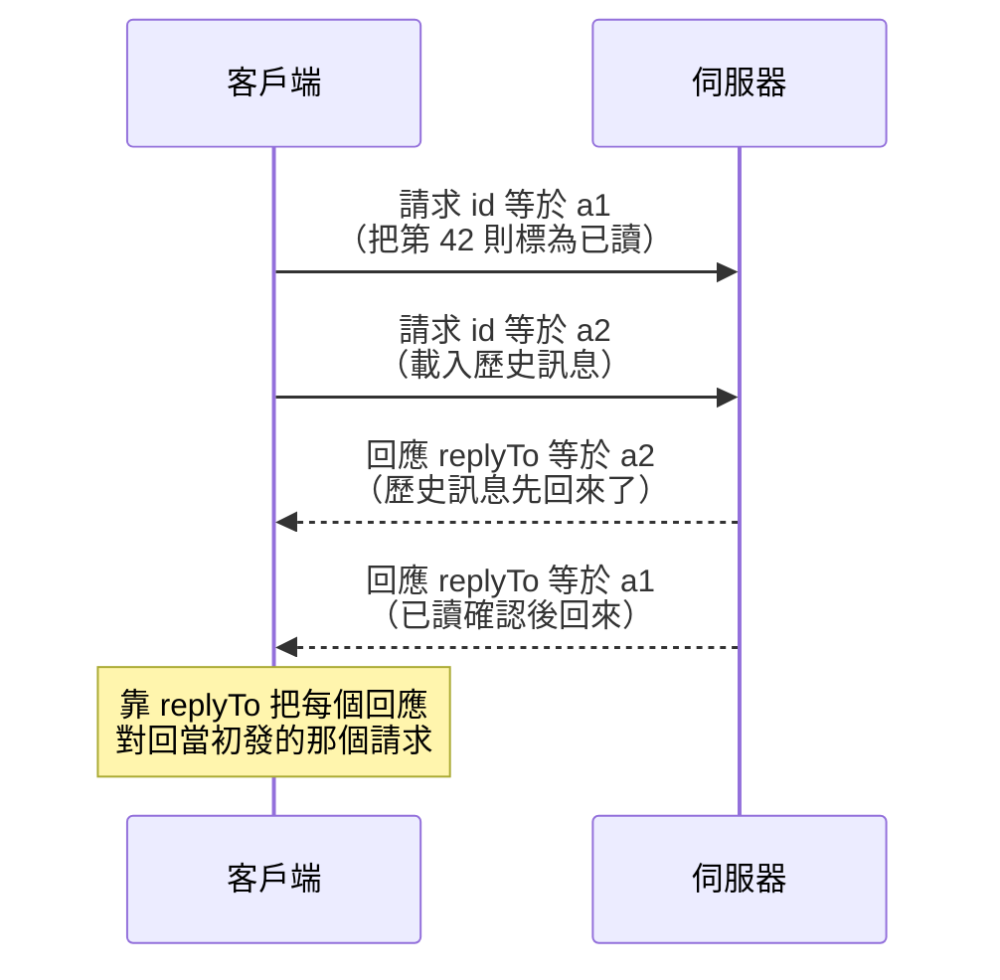
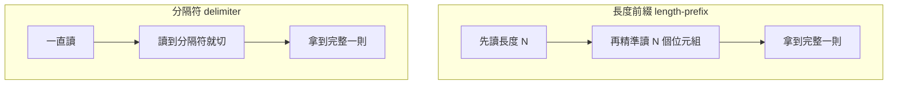

# [E-3-10] 自訂應用層協定設計：先想「壞掉」與「演進」

> **目標**：當你要在 TCP 或 WebSocket 上自己定一套訊息協定時，理解該先想清楚哪些事——訊息信封（envelope）、版本欄位、訊息 ID／序號、訊息邊界（framing），以及往前／往後相容。核心心法：**自訂協定時，第一版就要為「日後會改」和「對方會送壞東西」留好退路。**

## 一個問題：兩台服務之間，要怎麼「說同一種話」？

想像你在做一個**即時通知系統**：使用者的瀏覽器連上通知伺服器，伺服器有新通知就主動推過來，瀏覽器偶爾也要回報「這則我已讀」。

你決定用 WebSocket（E-3-6）當通道。通道通了，但馬上遇到真正的問題：**這條通道上，一則「訊息」到底長什麼樣子？**

最隨興的做法是直接丟字串：

```
伺服器送："你有一則新訊息"
瀏覽器送："read"
```

一開始能動。但兩週後你就會被自己坑死：

- 通知有很多種（新訊息、好友邀請、系統公告），字串要怎麼分辨是哪一種？
- 瀏覽器回「read」，是讀了**哪一則**？沒帶 ID，伺服器根本對不起來。
- 你想在通知裡多塞一個「縮圖網址」欄位，但舊版 App 看到多出來的東西就當掉了。
- 兩則通知黏在一起變成 `"你有一則新訊息""系統維護公告"`，收端切不開。

這些坑，HTTP 其實早就幫你踩過、也設計好解法了——HTTP 本身就是**一套設計得很完整的應用層協定**（E-3-3）：它有方法（method）、狀態碼、Headers、明確的訊息邊界。你現在要在 WebSocket 上自己定協定，等於是**重新扮演當年設計 HTTP 的人**。這一章就是教你，動手前該想哪些事。

## 生活類比：寄一個「正式的包裹」，而不是喊一句話

隨興丟字串，像是在走廊上對同事**喊一句話**——當下聽得懂，但沒有紀錄、沒有格式、喊錯了也沒人知道。

自訂協定該做的，是把每則訊息包成一個**正式的包裹**：

- 外面貼一張**面單**，寫清楚「這是什麼類型的包裹」「用哪一版的填單規則」「單號多少」。
- 裡面才是真正的**內容物**。
- 面單和內容物中間有清楚的**封箱線**，收件的人知道一個包裹到哪裡結束、下一個從哪裡開始。

這張面單，在協定設計裡叫**訊息信封（envelope，信封／外層包裝）**。先把信封設計好，裡面的內容物日後怎麼改都有地方放。

## 概念一：訊息信封（envelope）——把「外層資訊」和「內容」分開

信封的精神是：**每一則訊息都長成「固定的外層 ＋ 可變的內容」兩層**。外層是每則訊息都有的共通欄位，內容（payload，酬載／實際資料）才是這則訊息獨有的東西。

用 pseudo code 先描述一則「新訊息通知」長什麼樣子：

```
一則訊息 = {
    外層資訊（信封）：
        type    ：這是什麼類型的訊息（例如 新訊息通知）
        version ：這則訊息用哪一版的格式規則
        id      ：這則訊息的唯一編號
    內容（payload）：
        （依 type 而不同，新訊息通知就放 寄件者、內文…）
}
```

畫成結構圖：



這張圖表達：**每則訊息都切成「信封」與「酬載」兩層，信封放共通的中繼資訊，酬載放該類型專屬的資料。**

為什麼要分兩層？因為**收端可以先只看信封就做很多事**——用 `type` 決定丟給哪個處理函式、用 `id` 去重、用 `version` 判斷要用哪套規則解讀——完全不用先把 payload 拆開。這種「**先讀信封再決定怎麼處理內容**」的分層，是所有成熟協定（包含 HTTP）的共通骨架。

## 概念二：版本欄位——為什麼「第一版」就要放

新手最常省掉的就是 `version`，理由是「現在只有一版，放它幹嘛？」。這正是日後最痛的坑。

協定一旦上線，**新舊版本的程式會同時存在**：使用者的 App 不會一夜之間全部更新，你的伺服器和各種客戶端會長期處於「新舊混著跑」的狀態。這時收到一則訊息，你怎麼知道該用舊規則還是新規則去解讀它？答案就是信封裡那個 `version`。

關鍵在於：**版本欄位沒辦法事後補。** 想像你第一版沒放 version，欄位就直接是：

```
{ "type": "新訊息", "text": "午安" }
```

等到第二版你想加 version，新訊息會長成 `{ "version": 2, "type": "新訊息", "text": "午安" }`。問題來了——**第一版的收端程式，面對「有沒有 version 欄位」這件事根本沒有任何判斷邏輯**，因為當初它活在「世界上只有一種格式」的假設裡。於是你被迫用一堆醜陋的猜測（「沒有 version 欄位的就當作第一版」）去兜，而且每多一種客戶端就多一條特例。

所以規則很簡單：

> **第一版就放 version，哪怕它永遠是 1。** 它是你唯一「免費」的演進退路——第一版放，成本是一個整數；第一版不放，成本是日後所有相容性邏輯的地基都歪掉。

## 概念三：訊息 ID 與序號——去重、排序、把回應對回請求

信封裡的 `id` 看起來不起眼，其實一次解決三個問題。先分清楚兩個常被混用的東西：

- **訊息 ID（message id）**：每則訊息**獨一無二**的身分證，通常用 UUID（Universally Unique Identifier，通用唯一識別碼）這類「幾乎不可能撞號」的值。重點是「**唯一**」。
- **序號（sequence number）**：一個**單調遞增**的計數器（1、2、3…）。重點是「**有順序、連續**」，所以收端能看出「我漏接了第 5 號」。

它們合起來撐住三件事：

**① 去重（deduplication）**：網路不可靠，同一則訊息可能因為重連、重送而收到兩次。收端記住「處理過哪些 id」，重複的就丟掉。這和 HTTP 世界用冪等鍵避免重複扣款是同一個道理。

> 為什麼重送會發生、怎麼靠唯一鍵擋掉重複副作用 → [課外讀物 E-13-15：冪等性與重試](../E-13-scaling/E-13-15-idempotency.md)

**② 排序（ordering）**：如果訊息順序有意義（例如聊天訊息），靠**序號**就能在收端重新排好，即使它們到達的順序被打亂。

**③ 把回應對回請求（correlation）**：這是雙向通道最關鍵的一個。HTTP 是「一問一答」，回應天生黏在那個請求上（E-3-3）；但 WebSocket 是雙向亂序的，伺服器的回應回來時，**你怎麼知道它在回哪一個請求？** 答案：請求帶一個 `id`，回應帶一個 `replyTo`（回覆對象）指回那個 `id`。



這張圖表達：**雙向通道上回應可能亂序到達，客戶端靠回應裡的 replyTo 欄位，把它對應回當初送出的那個請求。**

沒有這個機制，你在雙向通道上就只能「假裝一次只發一個請求、等它回來再發下一個」，等於把雙向通道硬用成單向的一問一答，白白浪費了它。

## 概念四：訊息邊界 framing——一則訊息到哪裡結束？

如果你用的是 WebSocket，有個好消息：**WebSocket 本身就幫你分好訊息邊界了**——它傳的是一則一則完整的「訊息（message）」，不是一團連續的位元組，所以收端 `onmessage` 每次拿到的就是完整一則。

但如果你是直接在 **TCP** 上自訂協定，就沒這麼好命。TCP 是**位元組串流（byte stream）**——它只保證「位元組會照順序、不漏地送到」，但**完全不管一則訊息到哪裡結束**。你送了兩則訊息，收端可能一次收到一團黏在一起的、也可能分三次零碎收到。你必須自己定義「邊界在哪」，這件事叫 **framing（分幀／劃定訊息邊界）**。

兩種主流做法：

**做法 A：長度前綴（length-prefix）**——每則訊息前面先放「這則有多長」。

```
[ 4 個位元組寫長度 = 18 ][ 18 個位元組的訊息內容 ][ 4 個位元組寫長度 = 25 ][ 25 個位元組… ]
```

收端的讀法：先讀 4 個位元組知道長度 N，再剛好讀 N 個位元組，就拿到完整一則，接著讀下一個長度。

**做法 B：分隔符（delimiter）**——每則訊息之間用一個特殊字元隔開（例如換行 `\n`）。

```
{"type":"新訊息","text":"午安"}\n{"type":"已讀","id":"a1"}\n
```

收端的讀法：一直讀到遇見 `\n` 就切成一則。



這張圖表達：**長度前綴靠「先宣告長度再精準讀」劃定邊界，分隔符靠「讀到特定字元就切開」劃定邊界。**

兩者取捨：

| | 長度前綴 | 分隔符 |
|---|---|---|
| 內容可任意（含二進位） | ✅ 不怕內容裡有特殊字元 | ❌ 內容裡若出現分隔符就會切錯 |
| 可讀性／好除錯 | ❌ 長度是二進位，肉眼難讀 | ✅ 純文字，一眼看得懂 |
| 需不需要跳脫（escape） | 不需要 | 內容含分隔符時要跳脫，變麻煩 |

實務上：傳**任意內容（尤其二進位）用長度前綴**較穩；傳**純文字、重視好除錯**用分隔符（很多協定用換行當分隔符就是這原因）。**用分隔符時務必處理「內容裡剛好出現分隔符」**——這是分隔符最大的雷。

## 概念五：往前相容與往後相容——協定一定會改，別讓改動變災難

協定上線後最確定的一件事就是：**它會改。** 你會想加欄位、加訊息類型。設計時要讓「改動」不會打爆還沒更新的那一端。兩個方向：

- **往後相容（backward compatibility）**：**新版的收端，看得懂舊版送來的訊息。** （新程式 ← 舊資料）
- **往前相容（forward compatibility）**：**舊版的收端，碰到新版送來的訊息也不會爆，看不懂的部分就跳過。** （舊程式 ← 新資料）

往後相容比較直覺，真正要刻意設計的是**往前相容**——你得讓舊程式在面對「多出來、它不認識的東西」時，選擇**無視**而不是**當掉**。這帶出兩條黃金規則：

> **規則一：只增不改、不刪。** 加新欄位可以（舊端會忽略它），但**絕不改既有欄位的名字或意義**，也**不刪既有欄位**（舊端還在等它）。要淘汰一個欄位，是「讓它變成沒人填、但格式上還留著」，而不是直接拿掉。

> **規則二：收端要「寬進嚴出」。** 解析時對「多出來的未知欄位」要容忍（直接忽略），不要因為「怎麼多一個我沒看過的欄位」就拒收整則訊息。這正是往前相容能成立的前提。

## 正式程式碼範例

把上面五個概念收斂成一段乾淨的 TypeScript。情境：即時通知系統的訊息格式與收端處理。

先定義**信封**。注意泛型 `Payload`——信封的外層固定，酬載的型別可變：

```typescript
// 信封：每一則訊息共通的外層結構。
// Payload 用泛型，讓「外層固定、內容可變」這件事直接反映在型別上。
interface Envelope<Payload> {
  version: number;   // 第一版就放，哪怕永遠是 1——這是唯一免費的演進退路
  type: string;      // 訊息類型，收端據此決定丟給哪個處理函式
  id: string;        // 這則訊息的唯一編號，用來去重與被回應對應
  replyTo?: string;  // 可選：若這是「回應」，指回當初請求的 id
  payload: Payload;  // 真正的內容，型別依 type 而不同
}

// 新訊息通知的酬載長這樣
interface NewMessagePayload {
  sender: string;
  text: string;
  sentAt: string; // ISO 8601 時間字串
}
```

為什麼 `replyTo` 是**可選**（`?`）而其他欄位不是？因為「伺服器主動推的通知」本來就沒有對應的請求，它**理應沒有** `replyTo`——這是**預期內的「沒有」**，所以用可選欄位表達。反過來，`version`／`type`／`id` 是每則訊息都**一定要有**的，少了就是送端的 bug，不該用可選去掩蓋。

接著是收端處理。重點在「**先驗信封、再按 type 分流、同時做去重與往前相容**」：

```typescript
// 記住處理過的 id，用來擋掉重送造成的重複
const processedIds = new Set<string>();

function handleIncoming(raw: Envelope<unknown>): void {
  // ① 往前相容：版本比我懂的還新，不要硬解，記錄下來、安全跳過
  const MAX_SUPPORTED_VERSION = 1;
  if (raw.version > MAX_SUPPORTED_VERSION) {
    logger.warn("收到未知版本的訊息，已略過", { version: raw.version, id: raw.id });
    return;
  }

  // ② 去重：這個 id 處理過就直接丟掉（重送、重連都可能造成重複）
  if (processedIds.has(raw.id)) {
    logger.info("重複訊息，略過", { id: raw.id });
    return;
  }
  processedIds.add(raw.id);

  // ③ 按 type 分流。未知的 type 代表「對方版本比較新」——
  //    往前相容的精神：跳過、不要讓整條連線因為一則看不懂的訊息而崩掉。
  switch (raw.type) {
    case "新訊息":
      renderNewMessage(raw.payload as NewMessagePayload);
      break;
    case "已讀回執":
      markAsRead(raw.payload as { messageId: string });
      break;
    default:
      logger.warn("收到未知類型的訊息，已略過（可能來自較新版本）", { type: raw.type });
  }
}
```

這段程式碼把五個概念全用上了：**信封分層**（`Envelope<unknown>` 先當成未知酬載收下）、**版本把關**（①，往前相容）、**去重**（②，靠 id）、**按 type 分流**（③），以及「**未知就安全略過、不吃掉錯誤**」——每個略過都有 `logger` 記下來，不是默默吞掉。

> 這裡 `switch` 的 `default` 選擇「記 log 後略過」而不是 `throw`，是刻意的往前相容設計；但這不等於可以吞掉錯誤。「預期外的壞資料」（例如該有的欄位缺了）仍應該讓它報出來。兩者的界線——「沒有」是不是預期內——要逐欄判斷。

## 常見錯誤（反模式）

> **常見錯誤一：第一版不放 version，想說「以後再加」**
>
> ```typescript
> // 壞：第一版直接把欄位攤平，沒有信封、沒有版本
> socket.send(JSON.stringify({ sender: "系統", text: "維護通知" }));
> ```
>
> 問題是：等你第二版想演進時，舊端程式從來沒寫過「判斷版本」的邏輯，你只能靠「有沒有某個欄位」去猜版本，每多一種客戶端就多一條特例，相容性地基整個歪掉。
>
> **正確做法**：第一版就包信封、就放 `version`（哪怕永遠是 1）。這是唯一能「免費」預留的演進退路，錯過就補不回來了。

> **常見錯誤二：在 TCP 上假設「一次 send 就是一則訊息」**
>
> ```typescript
> // 壞：以為對端每次 onData 收到的，剛好就是你 send 的那一則
> tcpSocket.on("data", (chunk) => {
>   const message = JSON.parse(chunk.toString()); // 💥 遲早炸：chunk 可能是半則、或兩則黏一起
>   handleIncoming(message);
> });
> ```
>
> 問題是：TCP 是**位元組串流**，它不保證訊息邊界。你 `send` 兩則，對端可能一次收到黏在一起的、也可能分好幾次收到半則。這種 bug 在本機測試常常不出現（量小、剛好沒黏），一上線高併發就炸，極難查。
>
> **正確做法**：自己做 framing——用長度前綴或分隔符，收端維護一個緩衝區，**湊滿一則完整訊息才解析**。（用 WebSocket 的話它已經幫你分好邊界，這個雷不存在——這也是自訂協定時優先考慮 WebSocket 的理由之一。）

> **常見錯誤三：收到不認識的欄位或類型就拒收整則**
>
> ```typescript
> // 壞：嚴格到不近人情，多一個沒看過的欄位就整則丟掉
> if (Object.keys(payload).length !== EXPECTED_FIELD_COUNT) {
>   throw new Error("欄位數量不對，拒絕處理");
> }
> ```
>
> 問題是：這讓協定**完全無法演進**。只要新版多送一個欄位，所有舊端就全部拒收——你等於把「往前相容」親手鎖死，任何改動都變成破壞性更新，必須所有客戶端同步升級才能動。
>
> **正確做法**：解析要「**寬進**」——多出來的未知欄位就忽略、未知的 type 就記 log 後略過。只在「**該有的欄位缺了**」時才報錯。這樣新版加東西時，舊端不受影響，協定才演進得下去。

## 小結

- 在 TCP 或 WebSocket 上自訂協定，等於重新扮演當年設計 HTTP 的人。動手前的核心心法：**第一版就為「日後會改」和「對方會送壞東西」留好退路。**
- **訊息信封（envelope）**：每則訊息切成「固定外層 ＋ 可變酬載」。外層放 `type`／`version`／`id`，讓收端先讀信封就能分流、去重、判版本。
- **版本欄位第一版就要放**，哪怕永遠是 1——它沒辦法事後補，是唯一「免費」的演進退路。
- **訊息 ID／序號**一次解決三件事：去重（唯一 id）、排序（遞增序號）、把回應對回請求（`replyTo`）——最後這個是雙向通道能不退化成一問一答的關鍵。
- **framing（訊息邊界）**：WebSocket 幫你分好了；直接用 TCP 就得自己做——**長度前綴**（內容任意、適合二進位）或**分隔符**（純文字、好除錯，但要處理內容含分隔符）。
- **相容性**靠兩條規則：**只增不改不刪**、收端**寬進嚴出**（未知欄位／類型就忽略，別拒收整則）。

> 這條協定是雙向、持續開著的連線 → [課外讀物 E-3-6：WebSocket](./E-3-6-websocket.md)
> HTTP 本身就是一套設計完整的應用層協定，很多坑它都示範了標準解法 → [課外讀物 E-3-3：HTTP 協定詳解](./E-3-3-http-protocol.md)
> 長連線實務上怎麼靠心跳活著、斷了怎麼靠序號補回漏接的訊息 → [課外讀物 E-3-11：WebSocket 心跳與斷線重連](./E-3-11-websocket-heartbeat-reconnect.md)
