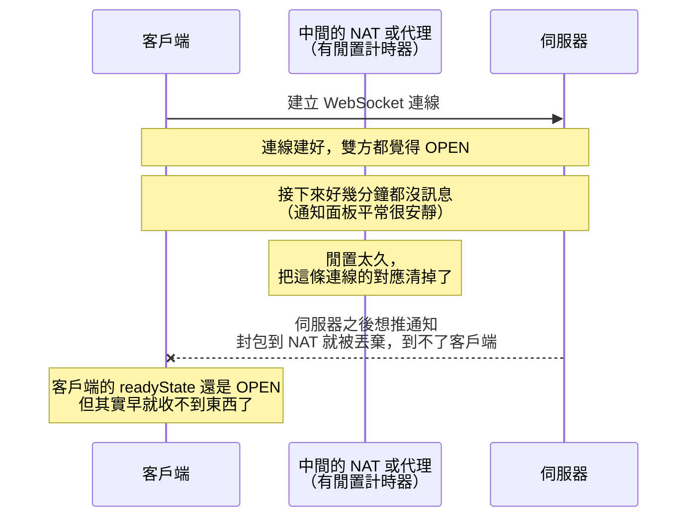
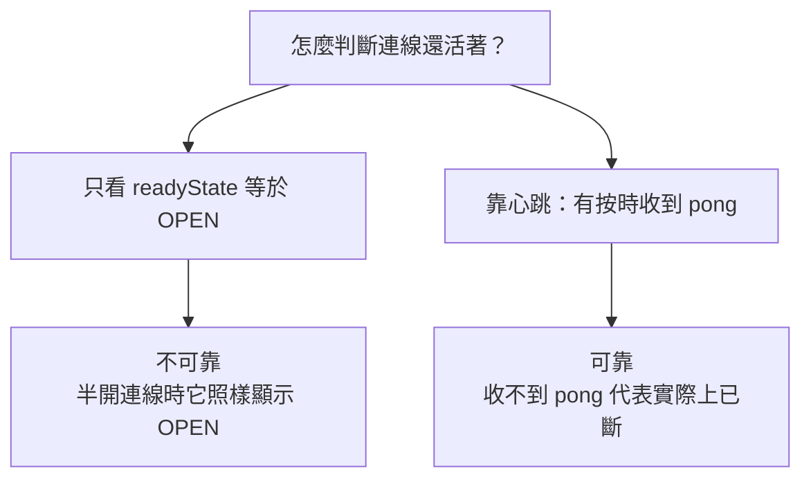
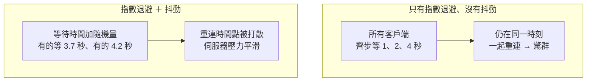
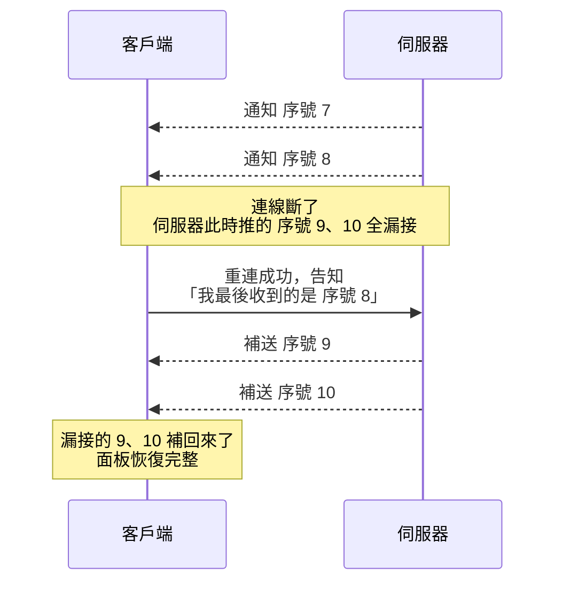

# [E-3-11] WebSocket 心跳與斷線重連：讓長連線在真實網路裡活下去

> **目標**：理解一條 WebSocket 長連線在真實網路裡會遇到的三個殘酷現實——**連線會被偷偷砍掉、一端會以為還連著其實早斷了、重連風暴會壓垮伺服器**——以及對應的實務手段：心跳（ping／pong）、半開連線偵測、指數退避＋抖動的重連、重連後補回漏接的訊息，還有一個常被忽略的安全檢查：`Origin` 標頭。

## 一個問題：連線「看起來」還在，其實早就死了

你照著 E-3-6 建好了一條 WebSocket，做一個**即時通知面板**：使用者開著頁面，伺服器一有新通知就推過來。本機測試一切完美。

上線後，使用者開始回報：「通知面板開著，但有時候好幾分鐘都收不到通知，重新整理一下又好了。」

你去看程式——`socket.readyState` 顯示 `OPEN`（開啟中），`onclose`（關閉事件）從來沒被觸發過。從你的程式角度看，**這條連線明明是好的**。但使用者就是收不到東西。

這就是長連線最陰險的地方：**TCP 連線可以在你毫不知情的情況下，變成一條「名存實亡」的死連線。** 你的程式以為它還開著，其實中間早就斷了，只是沒人通知你。這一章要解決的，就是這類「長連線在真實網路裡會遇到的鬼」。

## 為什麼連線會被「偷偷」砍掉？NAT 與代理的計時器

要理解這個鬼，得回到 NAT（E-3-8）。還記得你家路由器維護一張 **NAT 表**，記著「內部裝置 ↔ 對外連線」的對應關係吧？

這張表有個現實限制：**表的容量有限，所以每一筆對應都有「保存期限」。** 如果某條連線**一段時間都沒有任何封包來往**，路由器會認為「這條大概沒在用了」，就把那筆對應**從表裡清掉**騰出空間。

問題來了——WebSocket 的特性就是「**平常很安靜**」：建立連線後，可能好幾分鐘沒有任何通知要推。對 NAT 和中間的各種代理（proxy，公司防火牆、雲端的負載平衡器都算）來說，這條「安靜很久」的連線看起來就像沒人用了，於是：



這張圖表達：**中間的 NAT 或代理因為連線「閒置太久」而悄悄清掉它，之後的封包就送不到，但兩端的程式都還以為連線是好的。**

關鍵在於：**NAT／代理清掉連線時，通常不會通知兩端**（它只是默默丟棄後續封包）。所以你的 `onclose` 不會觸發、`readyState` 還是 `OPEN`——這就是開頭那個詭異現象的真相。

解法的核心概念很簡單：**別讓連線閒著。** 定時送一點東西，讓 NAT／代理覺得「這條還活著」，不要清掉它。這個「定時送一點東西」就是**心跳**。

## 心跳（ping／pong）：定時證明「我還在」

**心跳（heartbeat）**就是雙方約定：**每隔固定一段時間，就互相送一個很小的訊息，證明彼此都還活著、連線還通。** 這對小訊息慣例上叫 **ping（探測）** 和 **pong（回應）**——一端送 ping，另一端收到就回 pong。

心跳同時達成兩件事：

1. **保活（keep-alive）**：規律的封包來往，讓 NAT／代理的閒置計時器一直被重置，不會把連線當成「沒人用」清掉。
2. **探活（liveness detection）**：如果我送了 ping，等了一段時間**卻沒收到 pong**，就代表這條連線其實已經死了——即使 `readyState` 還顯示 `OPEN`。這就是偵測出開頭那種「名存實亡」連線的方法。

用 pseudo code 描述客戶端的心跳邏輯：

```
每隔 30 秒：
    送出一個 ping
    開一個「等 pong」的計時器（例如 5 秒）

當 收到 pong：
    取消「等 pong」的計時器（對方還活著，很好）

當 「等 pong」計時器到期卻還沒收到 pong：
    判定這條連線已死 → 主動關掉它 → 進入重連流程
```

這裡有個反直覺但極重要的點：**偵測到連線死掉時，要「主動關掉」這條看起來還 OPEN 的連線。** 因為它名存實亡，你不主動了結它、重新建一條，就會一直卡在「以為連著、其實收不到」的狀態。

> 補充一個名詞：上面這種「一端以為連線還在、另一端其實早就不在了」的狀態，正式叫**半開連線（half-open connection，半開連線）**。心跳的 pong 等不到，就是半開連線最可靠的偵測手段。

## 偵測半開連線：為什麼不能只信 `readyState`

把半開連線單獨拉出來講，因為它是新手最容易栽的坑。

直覺上，你會想用 `socket.readyState === OPEN` 來判斷「連線還能用嗎」。但如前面所說——**NAT／代理砍連線不會通知你**，所以 `readyState` 可能長時間停在 `OPEN`，而連線早就是一具空殼。



這張圖表達：**`readyState` 只反映「本地程式認為的狀態」，無法偵測半開連線；真正可靠的存活判斷來自「有沒有按時收到對方的 pong」。**

一句話記住：**`readyState` 告訴你「我這邊的 socket 物件是什麼狀態」，心跳才告訴你「這條路真的通不通」。** 兩者不是同一件事。

## 斷線重連：指數退避 ＋ 抖動（別變成重連風暴）

偵測到連線死了，當然要重連。但重連的**節奏**如果設計錯，會釀成大災難。

先看最天真的寫法會怎樣：**斷了就立刻重連，失敗了就立刻再試。** 平常沒事。但想像伺服器**重啟**的那一刻——同時有一萬個客戶端的連線一起斷掉：

- 一萬個客戶端在同一瞬間、全部立刻重連 →
- 剛要起來的伺服器瞬間被一萬個連線請求打爆 → 又掛 →
- 一萬個客戶端又在同一瞬間一起重連 → 永遠起不來。

這叫**驚群效應（thundering herd）**或重連風暴。治它要靠兩個東西合用：

**① 指數退避（exponential backoff，指數退避）**：重試的等待時間**一次比一次長，倍增上去**：第 1 次等 1 秒、第 2 次等 2 秒、第 3 次等 4 秒、第 4 次等 8 秒……（通常設一個上限，例如最多 30 秒）。這樣失敗越多次、敲門越輕，給伺服器喘息空間，而不是用固定頻率猛敲。

**② 抖動（jitter，抖動／隨機擾動）**：光有指數退避還不夠——如果所有客戶端都「等 1 秒、等 2 秒、等 4 秒」，它們還是會**在同一個時間點一起重連**，只是把「每秒一次」變成「每 4 秒一次」的齊步走，驚群依舊。抖動就是在等待時間上**加一個隨機量**，把大家的重連時間點打散開來。



這張圖表達：**指數退避讓重試越來越慢，但唯有再加上抖動把重連時間點隨機打散，才能避免所有客戶端齊步重連造成的驚群。**

用 pseudo code：

```
重連嘗試次數 = 0

嘗試重連：
    基礎等待 = min(上限, 初始值 × 2 的 (嘗試次數) 次方)   // 指數退避，有上限
    實際等待 = 基礎等待 × (0.5 到 1.0 之間的隨機數)         // 加抖動，打散時間點
    等待 實際等待 秒
    試著重新建立連線
    如果成功 → 重連嘗試次數歸零
    如果失敗 → 嘗試次數 加一 → 再跑一次
```

> 這和一般 API 呼叫失敗後的重試是同一套心法（指數退避、抖動），差別只在這裡重試的對象是「重新建立整條長連線」。退避與抖動的更完整說明，可參考韌性模式系列對重試的討論 → [課外讀物 E-15-1：Fallback Pattern](../E-15-resilience/E-15-1-fallback.md)

## 重連之後：怎麼補回斷線期間漏接的訊息？

重連成功了，但還有一個洞：**從連線斷掉到重連成功之間，伺服器推的通知，客戶端全漏接了。** 使用者會發現「中間少了幾則通知」。

解法要靠 E-3-10 講的**序號**。精神是：**客戶端記住「我最後成功收到的序號」，重連後告訴伺服器，請它把後面的補送過來。**



這張圖表達：**客戶端重連後回報「最後收到的序號」，伺服器據此把斷線期間漏掉的訊息補送回來，不是從頭重來、也不是直接跳過。**

這一步能成立的前提，正是 E-3-10 設計的那套信封裡有**序號**，而且伺服器端**暫存了近期訊息**（通常留一個時間窗或固定筆數的緩衝）。這也回頭說明了「為什麼協定第一版就該把序號設計進去」——斷線重連這個實務需求，就是序號的主要買主之一。

> 訊息信封、序號怎麼設計，為什麼第一版就要放 → [課外讀物 E-3-10：自訂應用層協定設計](./E-3-10-protocol-design.md)

## 一個常被忽略的安全檢查：`Origin` 標頭

最後講一個**和前面主題不同、但做 WebSocket 一定要知道**的安全點——因為它的疏漏不會讓功能壞掉，所以最容易被忘記。

瀏覽器有一套**同源政策（same-origin policy）**，限制網頁只能跟「同源」的伺服器互動，這是擋跨站攻擊的重要防線。但有個殘酷的事實：**WebSocket 連線不受同源政策的保護。** 任何網站的 JavaScript，都可以向**你的** WebSocket 伺服器發起連線。

這會造成什麼問題？如果你的 WebSocket 只靠 Cookie 認證（連線時瀏覽器會自動帶上使用者的 Cookie），那麼使用者在登入你的服務的情況下，只要去逛了一個惡意網站，那個網站的 JavaScript 就能**用使用者的身分**連上你的 WebSocket，替使用者做操作。這其實就是 CSRF（跨站請求偽造）在 WebSocket 上的版本。

> CSRF 是什麼、它怎麼利用「瀏覽器自動帶 Cookie」這件事 → [課外讀物 E-10-3：CSRF 跨站請求偽造](../E-10-security/E-10-3-csrf.md)

防線之一是檢查 **`Origin` 標頭**——瀏覽器在發起 WebSocket 握手時，會自動帶上一個 `Origin` 標頭，標明「這個連線請求是從哪個網站的頁面發起的」。而且這個標頭**是瀏覽器強制加上、網頁的 JavaScript 無法偽造的**，所以伺服器可以信任它：

```typescript
// WebSocket 握手階段，在伺服器端檢查 Origin。
// 只放行來自自己信任網域的連線請求。
const ALLOWED_ORIGINS = new Set([
  "https://app.example.com",
  "https://admin.example.com",
]);

function isOriginAllowed(origin: string | undefined): boolean {
  // origin 可能根本沒帶（例如非瀏覽器的客戶端）。
  // 「沒帶 Origin」是預期外的情況，寧可明確拒絕，也不要放行一個來路不明的連線。
  if (origin === undefined) {
    return false;
  }
  return ALLOWED_ORIGINS.has(origin);
}
```

為什麼 `origin === undefined` 要**直接拒絕**，而不是當作「沒問題」放行？因為瀏覽器一定會帶 `Origin`，沒帶的要嘛是非瀏覽器客戶端、要嘛是有人在繞過瀏覽器——這兩種都不該默默放行。這呼應了「別用寬鬆的預設把該報的錯藏起來」的原則。

要特別強調：**`Origin` 檢查只是一道防線，不能取代真正的身分認證。** 它擋的是「惡意網站用使用者身分偷連」，但它本身可被非瀏覽器工具偽造（因為「瀏覽器不能偽造」只對瀏覽器成立）。真正的認證還是得靠 Token 等機制。

## 常見錯誤（反模式）

> **常見錯誤一：用 `readyState === OPEN` 判斷連線能不能用**
>
> ```typescript
> // 壞：以為 OPEN 就代表這條路通
> if (socket.readyState === WebSocket.OPEN) {
>   socket.send(message); // 半開連線時這則會石沉大海，而你毫無所覺
> }
> ```
>
> 問題是：NAT／代理砍連線不通知兩端，`readyState` 會長時間停在 `OPEN`，但訊息其實送不出去。你的程式自以為一切正常，使用者卻什麼都收不到。
>
> **正確做法**：加心跳。靠「有沒有按時收到 pong」判斷連線是否真的活著；等不到 pong 就主動關掉這條死連線、進入重連。`readyState` 只能參考，不能當作存活依據。

> **常見錯誤二：斷了就立刻重連、固定頻率猛敲**
>
> ```typescript
> // 壞：斷線就馬上重連，失敗就馬上再來
> socket.onclose = () => {
>   connect(); // 伺服器一重啟，上萬客戶端同時這樣做 → 把它再次打爆
> };
> ```
>
> 問題是：伺服器重啟的瞬間，所有客戶端的連線一起斷、又一起立刻重連，形成驚群效應，剛要起來的伺服器被瞬間打爆、永遠起不來。
>
> **正確做法**：指數退避（等待時間倍增、設上限）**再加上**抖動（等待時間加隨機量，打散重連時間點）。缺了抖動，大家還是齊步重連，退避就白做了。

> **常見錯誤三：忘記在伺服器端檢查 `Origin`**
>
> 問題是：WebSocket 不受同源政策保護，不檢查 `Origin` 就等於任何網站都能向你的 WebSocket 發起連線。若你又只靠 Cookie 認證，就會開出一個 CSRF 漏洞——使用者逛到惡意網站，對方就能用他的身分連上你的服務。這個洞不影響功能、測試也測不出來，所以最容易被漏掉。
>
> **正確做法**：握手階段檢查 `Origin`，只放行信任的網域；沒帶 `Origin` 的直接拒絕。但記住它只是一道防線，真正的身分認證（Token）不能省。

## 小結

- 長連線在真實網路裡有三個殘酷現實：**連線會被 NAT／代理因閒置而偷偷砍掉**、**一端會卡在「以為還連著其實早斷」的半開連線**、**重連節奏錯了會釀成驚群**。
- **心跳（ping／pong）**一次解決前兩個：規律封包**保活**（NAT 不把它當閒置清掉）＋ 等不到 pong 就**探活**（偵測半開連線）。
- **別只信 `readyState`**——它只反映本地 socket 狀態，偵測不了半開連線；真正可靠的存活判斷來自「有沒有按時收到 pong」。
- **重連要用指數退避 ＋ 抖動**：退避讓敲門越來越輕，抖動把時間點打散，兩者缺一就會驚群。
- **重連後靠序號補漏接**：客戶端回報「最後收到的序號」，伺服器補送斷線期間的訊息——這正是協定第一版就該放序號的理由。
- **別忘了 `Origin` 檢查**：WebSocket 不受同源政策保護，不檢查就是 CSRF 漏洞；但它只是一道防線，取代不了真正的身分認證。

> 這條雙向連線是怎麼從 HTTP 握手升級來的 → [課外讀物 E-3-6：WebSocket](./E-3-6-websocket.md)
> 為什麼閒置連線會被中間設備砍掉（NAT 表的保存期限）→ [課外讀物 E-3-8：NAT](./E-3-8-nat.md)
> 心跳要帶的訊息、補漏接要用的序號，怎麼在協定裡設計好 → [課外讀物 E-3-10：自訂應用層協定設計](./E-3-10-protocol-design.md)
> WebSocket 為什麼會有 CSRF 風險、CSRF 的完整原理 → [課外讀物 E-10-3：CSRF 跨站請求偽造](../E-10-security/E-10-3-csrf.md)
