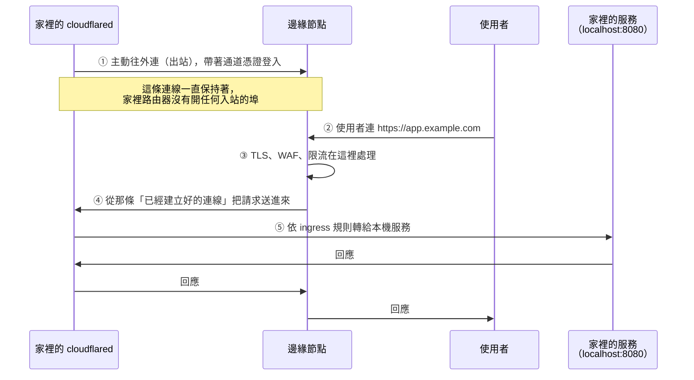

# [E-3-12] 不開門也能對外服務：反向通道（以 Cloudflare Tunnel 為例）

> **目標**：理解為什麼「路由器開埠轉發」有風險、反向通道怎麼做到「家裡不開任何門也能對外服務」、ingress 規則怎麼寫，以及這樣做之後還剩下哪些事要自己顧。

## 先說這篇不重講什麼

- 為什麼外面預設連不進你家、什麼是 port forwarding → [E-3-8 NAT](./E-3-8-nat.md)
- 代理開關（橘雲／灰雲）與「不暴露家裡 IP」→ [E-3-9 網域搬家](./E-3-9-dns-delegation-migration.md) 的附註
- 邊緣的 WAF 規則、mTLS、限流 → [E-10-20 邊緣防火牆](../E-10-security/E-10-20-edge-waf.md)
- 一個實際用通道上線的架構與踩坑 → [實戰筆記 04](../../playground/liyi-server/實戰筆記/04-兩台機器的部署分工與三個綠燈陷阱.md)

E-3-8 結尾說「開 port forwarding 要小心」，這篇就是接著回答：那不開的話，要怎麼讓外面連進來？

## 生活類比：不裝門鈴，改成你主動打給總機

```
傳統做法（開埠轉發）：
    在你家牆上開一扇對外的門，門牌號碼貼在網路上
    任何人都可以走到門口敲門——包括整天沿街試門把的小偷（掃描器）
    門後面的東西有任何一個破洞，小偷就進來了

反向通道：
    你家完全不開門
    你主動打一通電話給「總機」（邊緣業者），而且一直不掛斷
    有人要找你時，他打給總機；總機從你那通「已經接通的電話」把話轉進來
    外面的人從頭到尾不知道你家在哪、也沒有門可以敲
```

關鍵在「**電話是你打出去的**」。對你家的路由器來說，這跟你開瀏覽器上網一模一樣——是內部主動往外的連線，NAT 本來就放行（[E-3-8](./E-3-8-nat.md) 講過：連線只要是內部先發起的，回程就有路）。

## 傳統做法的風險：開埠轉發

用 port forwarding 對外服務，等於：

| 風險 | 說明 |
|---|---|
| **家裡的 IP 公開了** | DNS 要指向你的公網 IP，任何人一查就知道；被針對時，連 DDoS（分散式阻斷服務攻擊，用大量流量把你灌爆）都直接打在你家線路上 |
| **全網際網路的掃描器都會來** | 公網上的每個 IP 每天都會被自動化程式掃過無數次，開著的埠很快就被找到、被試各種已知漏洞 |
| **服務本身就是最前線** | 你的服務（或路由器本身的管理介面）只要有一個沒更新的漏洞，攻擊者就直接進到家裡的網路 |
| **路由器的 UPnP** | 很多裝置會透過 UPnP（自動開埠協定）自己在路由器上開門，你可能根本不知道開了哪些 |
| **TLS 憑證和防護都要自己顧** | 憑證更新、限流、WAF 全部在自己機器上處理 |

這不代表開埠轉發一定錯，但它把「整個網際網路」直接接到你家的某台機器上。

## 反向通道怎麼運作

**反向通道（reverse tunnel）** 的「反向」，指的是**連線方向跟請求方向相反**：請求是從外面進來的，但承載它的那條連線是從裡面往外建立的。

以 Cloudflare Tunnel 為例，家裡跑一個叫 `cloudflared` 的小程式（稱為 **connector**，連接器）：



這張圖表達：家裡只有「往外」的一條長連線，使用者的請求是搭著這條連線被送進來的，所以家裡的路由器完全不需要開門。

幾個細節：

- **DNS 指向的是通道，不是 IP**。`app.example.com` 會被設成指到這條通道的記錄，外面查不到你家的 IP（E-3-9 提到的「這筆一定是橘雲」就是這個原因）。
- **cloudflared 會同時建立好幾條連線**到不同的邊緣節點，任一條斷了還有其他條；家裡要是跑兩個 cloudflared 連同一條通道，它們就互為備援。
- **出站也要被允許**：cloudflared 往外連的是邊緣的特定埠（官方文件寫的是 7844，走 QUIC 或 HTTP/2；QUIC 是跑在 UDP 上的新一代傳輸協定，HTTP/3 就是建在它上面）。家裡的網路對出站有限制時，要放行這個。
- **TLS 在邊緣終止**：使用者的 HTTPS 是跟邊緣建立的，邊緣解開後再經通道送進來。這代表**邊緣業者看得到明文請求**——這是你為了這套便利所做的信任選擇，要知道自己做了這個選擇。

### 最小版本的同一個概念：`ssh -R`

反向通道不是某家業者的專利。如果你有一台公網上的機器（例如租一台 VPS，Virtual Private Server，雲端業者賣的小型虛擬主機），用 SSH 就能做出最陽春的版本：

```bash
# 在家裡執行：連到公網上的那台機器，並請它把自己的 8080 埠「反向」轉回家裡的 3000
ssh -N -R 8080:localhost:3000 user@vps.example.com
```

這行指令之後，連到 `vps.example.com:8080` 的請求，會沿著家裡主動建立的那條 SSH 連線，送到家裡的 `localhost:3000`。家裡沒開任何門——但**那台公網機器開了門**，它的安全、TLS、限流都要你自己顧。邊緣業者的通道服務，等於把「那台公網機器」換成了一整個有 WAF 和 DDoS 防護的全球網路。

## ingress 規則：哪個名字送到哪個服務

一個 cloudflared 可以服務好幾個主機名。決定「這個請求要送到家裡哪個服務」的是 **ingress 規則**（ingress 是「入口」的意思）。用設定檔管理時長這樣：

```yaml
tunnel: <通道 ID>
credentials-file: /etc/cloudflared/<通道 ID>.json

ingress:
  # 由上往下比對，第一條符合的就用它
  - hostname: app.example.com
    service: http://localhost:8080

  # 同一個主機名，依路徑分流；path 是正規表示式
  - hostname: api.example.com
    path: ^/v1/
    service: http://localhost:3000

  # 最後一條必須是「什麼都不寫」的預設規則
  - service: http_status:404
```

規則的想法跟 [E-10-20](../E-10-security/E-10-20-edge-waf.md) 的 WAF 規則一樣——**由上往下、先中先贏**：

```
收到請求：
    主機名是 app.example.com？ → 送到本機 8080
    主機名是 api.example.com 而且路徑以 /v1/ 開頭？ → 送到本機 3000
    都不是？ → 回 404，不送到任何服務
```

**最後那條預設規則是必填的**，而且它的值很重要：

- 設成 `http_status:404` → 沒被明確列出的名字和路徑，一律被拒絕。這是安全的預設。
- 設成某個本機服務 → 任何指到這條通道的主機名、任何路徑，都會掉進那個服務。哪天你多綁了一個名字、或某個路徑沒想到，就會意外對外公開。

修改後可以先讓 cloudflared 自己檢查：`cloudflared tunnel ingress validate` 檢查設定檔格式，`cloudflared tunnel ingress rule https://api.example.com/v1/users` 告訴你這個網址會命中哪一條規則。

> 通道也可以改成在業者的網頁介面上管理（設定存在雲端、家裡只用一串 token 啟動）。概念完全一樣：一串「主機名＋路徑 → 本機服務」的規則，最後一條是預設。

## 跟其他做法比較

| | 開埠轉發 | VPN（如 WireGuard、Tailscale） | 開發用通道（如 ngrok） | 自架反向代理＋通道（公網 VPS） | 邊緣業者的通道 |
|---|---|---|---|---|---|
| 給誰用 | 任何人 | **只有你自己和加入的裝置** | 臨時給別人看 | 任何人 | 任何人 |
| 家裡要開門嗎 | 要 | 通常不用（會打洞或走中繼） | 不用 | 不用（VPS 要開） | 不用 |
| 家裡 IP 曝光 | 是 | 否 | 否 | 否 | 否 |
| TLS／WAF／DDoS | 全部自己顧 | 不適用（不對大眾開） | 業者處理一部分 | VPS 上自己顧 | 業者處理 |
| 誰看得到明文 | 只有你 | 只有你 | 業者 | 只有你 | 業者 |
| 適合 | 不建議長期使用 | 自己連回家管理機器 | 臨時展示、測 webhook | 想完全掌控、願意維運一台公網機器 | 長期對外的網站或 API |

最常見的混淆是 **VPN 和通道**：它們解決的是不同問題。

```
VPN：讓「你自己」的裝置像是在家裡網路一樣 → 管理用，不對大眾開放
通道：讓「任何人」能連到家裡某個指定的服務 → 對外服務用

常見的組合：
    對外網站 → 走通道
    SSH、管理介面、資料庫 → 只走 VPN，完全不放進通道
```

## 這樣做之後，還需要什麼

通道解決的是「家裡不用開門、IP 不曝光」。它**沒有**解決的事：

### 1. 應用程式仍然要認證與授權

通道只是一條管子。管子另一端的服務如果本來就沒有登入機制，現在它就是**一個沒有登入、任何人都能連的網站**——只是不用開埠而已。

- 公開的服務：照常做好自己的認證、授權、輸入驗證
- 只想給特定人用的服務：在邊緣加一層存取控制（例如要求登入身分提供者、或要求 mTLS 用戶端憑證，見 [E-10-20](../E-10-security/E-10-20-edge-waf.md) 與 [E-10-19](../E-10-security/E-10-19-x509-certificate-csr.md)），**並且**應用程式自己也要授權

### 2. 通道程式本身的權限

cloudflared 是一個「外面的請求能經過它進到家裡」的程式，它本身就是一道入口：

```
要問自己的：
    它跑在哪個使用者底下？ → 用專屬的低權限帳號，不要 root
    它連得到哪些東西？ → ingress 只列需要的服務；
                       不要寫成能轉到整個內網的萬用規則
    它跑在哪台機器上？ → 這台機器被入侵 = 攻擊者拿到一條通往外面的穩定通道，
                       也拿到 ingress 裡列的所有內部服務
```

### 3. 通道憑證就是鑰匙

啟動通道用的憑證檔（`credentials-file`）或 token，等於「以這條通道的身分登入邊緣」的鑰匙。**別人拿到它，就能在他自己的機器上跑一個 connector 掛上你的通道**——你的網域流量會被分一部分到他那裡去。

- 憑證檔和 token 當密鑰處理：不進版本控制、不貼進聊天、不寫進公開的腳本
- 外洩了就到業者介面上輪換或刪掉重建通道（輪換的想法見 [E-10-13](../E-10-security/E-10-13-key-rotation-kms.md)）

### 4. 源站仍要拒絕其他來路

如果同一個服務**同時**還開著埠轉發或別的公開入口，通道和邊緣上的所有規則都能被繞過。用了通道，就把原本的埠轉發和 UPnP 關掉；服務最好只聽 `localhost` 或內網位址。

## 常見錯誤（反模式）

> **常見錯誤一：預設規則指向一個服務**
>
> 為了省事，把 ingress 寫成只有一條 `service: http://localhost:8080`。後來在 DNS 上多綁了一個名字給別的用途，結果那個名字也直接打進 8080；有人隨便猜路徑也全部進得去。
>
> **正確做法**：每個主機名（必要時加路徑）明確列一條，最後一條固定 `http_status:404`。

> **常見錯誤二：「用了通道，所以安全了」**
>
> 把一個原本只在家裡用、沒有登入的管理介面掛上通道，心想「反正沒開埠」。
>
> 問題是：沒開埠擋的是「直接連你家 IP」的人，但通道把這個服務**公開到網際網路上了**，任何知道網址的人都連得到。
>
> **正確做法**：不對大眾開放的服務走 VPN，或在邊緣加存取控制；應用程式自己仍然要有認證。這是 [E-6-6 反模式](../E-6-best-practices/E-6-6-anti-patterns.md)裡「把一層防護當成全部」的典型。

> **常見錯誤三：通道和埠轉發並存**
>
> 上了通道，但舊的埠轉發規則忘了關，源站 IP 也早就在舊的 DNS 記錄裡被看過。
>
> **正確做法**：上通道後關掉路由器上的埠轉發和 UPnP，確認服務只聽本機或內網位址；用一台外部網路的機器實際連一次你家 IP 的那個埠，確認連不上。

> **常見錯誤四：通道 token 寫在公開的地方**
>
> 為了方便部署，把啟動 token 寫進 `docker-compose.yml` 一起 commit 到公開 repo。
>
> **正確做法**：token 和憑證檔放在環境變數或密鑰管理工具，不進版本控制；外洩就立刻輪換。

## 小結

- **開埠轉發**把整個網際網路接到你家某台機器上：IP 公開、掃描器會來、服務本身變成最前線。
- **反向通道**讓家裡的程式**主動往外**建立一條長連線，邊緣把使用者的請求從這條連線送進來——家裡不開任何入站的門，DNS 指向通道而不是 IP。
- **ingress 規則**是「主機名＋路徑 → 本機服務」的清單，由上往下比對，**最後一條預設回 404**。
- **VPN 給自己用，通道給大眾用**；開發用通道適合臨時展示，自架反向代理要自己維運公網機器。
- 用了通道之後仍要：**應用程式自己認證授權**、**通道程式低權限且只連必要服務**、**通道憑證當密鑰保管**、**關掉其他公開入口**。

> 外面為什麼預設連不進來、埠轉發是什麼 → [E-3-8 NAT](./E-3-8-nat.md)
> 通道前面那一層的 WAF、mTLS、限流 → [E-10-20 邊緣防火牆（WAF）](../E-10-security/E-10-20-edge-waf.md)
> 在邊緣用用戶端憑證限制誰能進來 → [E-10-19 憑證拆解：X.509、憑證鏈與 CSR](../E-10-security/E-10-19-x509-certificate-csr.md)
> 一個實際用通道上線的案例 → [實戰筆記 04](../../playground/liyi-server/實戰筆記/04-兩台機器的部署分工與三個綠燈陷阱.md)
> 在 Cloudflare 後台實際建一條通道（指令、設定檔、後台畫面）→ [E-18-2 Tunnel 實作](../E-18-cloudflare/E-18-2-tunnel.md)
