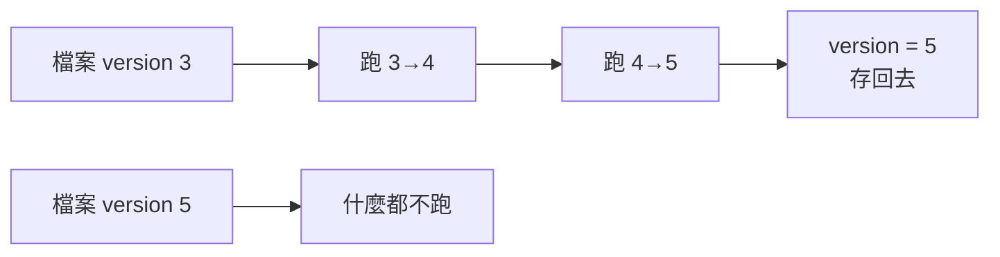

# [E-4-6] 存檔格式的版本化轉換——以及一個「標了新版本卻沒轉換」的坑

> **目標**：理解為什麼存檔（或資料庫 schema）改格式時要用「版本號＋依序轉換」，以及開發中一個很容易踩、踩了還不會報錯的坑：檔案被標成新版本，但轉換根本沒跑。

## 先說問題：格式會一直改

假設你做一個網頁編輯器，使用者的專案存在瀏覽器（自動存檔）或匯出成檔案。功能一直在加，存檔格式也一直在變：

- 某個欄位改名（`easeOut` → `quadOut`）
- 某個欄位拿掉（沒人在用了）
- 某個欄位從「可以沒有」變成「一定要有」

舊的存檔還在使用者手上。讀進來的時候，結構對不上，畫面就會壞。所以每次改格式，都要寫一段「把舊格式換成新格式」的程式，叫 **轉換（migration）**。

## 第一版做法：看形狀猜

我一開始的做法是：每次讀檔，把所有轉換全部跑一次，每一段自己判斷「這個檔案是不是舊的」：

```
讀檔時：
    如果 有舊欄位 skip：拿掉
    如果 緩動名稱是 easeOut：改成 quadOut
    如果 某事件沒有 durationMode：補上
    ……（累積到 29 段）
```

這樣「能動」，但越來越糟：

- **每次讀檔都全跑**：連已經是新格式的檔案也要重跑 29 段。
- **順序有隱性依賴**：第 12 段要在第 5 段之後才對，這件事只寫在註解裡。
- **「猜」會猜錯**：有一段靠「名稱排序後比對」判斷是不是舊結構，資料剛好長得像就誤判。
- **結果會飄**：有些轉換用「現在的範本」去補資料，範本一改，同一個舊檔轉出來就不一樣。

## 改成：版本號＋依序轉換

資料庫的世界早就有標準答案（Rails migrations、Flyway、EF Core migrations 都是這個思路）：

```
專案檔裡記 version（例：3）
程式裡有：
    目前版本 CURRENT = 5
    轉換步驟 = [ 2→3, 3→4, 4→5 ]

讀檔時：
    從檔案的 version 開始，一步一步跑到 CURRENT
    跑完把 version 設成 CURRENT
    存回去之後，下次讀就不再跑
```



這張圖在表達：舊檔只跑「它缺的那幾步」，新檔一步都不跑。

規則只有兩條：

1. **改格式＝加一步、版本 +1**。
2. **不要改舊的步驟**：舊檔必須照「當時的規則」轉換。改了舊步驟，等於改寫歷史。

另外有些事不是「轉換」，而是「每次讀檔都要成立」（例如：某些固定元件一定要存在，程式新增了一種，舊檔讀進來要自動補上）。這類放在另一個每次都跑的「正規化」函式，不要混進版本轉換。

## 坑：標了新版本，轉換卻沒跑

改成版本化之後，某次我要把格式從 v3 升到 v4，改了三個地方：

1. 型別檔：`CURRENT = 4`
2. 新增 `v4` 轉換步驟
3. 步驟清單加上 `{ to: 4, run: v4 }`

改完、測試全過，到瀏覽器一看——存檔顯示 `version: 4`，但緩動名稱還是舊的 `easeOut`。**v4 的轉換根本沒跑。**

我一開始以為是 v4 步驟寫錯，但單元測試明明驗過它會把 `easeOut` 換掉。後來才想通：問題不在程式最後的樣子，而在**改程式的過程中**。

開發伺服器有熱更新（HMR，Hot Module Replacement：存檔就自動重新載入頁面）。我改完第 1 步、還沒改第 3 步的時候，頁面就自動重新載入了。那一瞬間的程式是：

```
CURRENT = 4
轉換步驟 = [ 2→3 ]        ← v4 還沒加上去

讀進 version 3 的存檔：
    要跑的步驟：to > 3 的 → 沒有
    version 設成 CURRENT → 4
    自動存檔 → 存成 version 4
```

存檔就這樣被標成 v4。之後程式改完了、v4 步驟也加上了，但檔案已經是 version 4——**「to > 4」的步驟一個都沒有，v4 轉換再也不會對它跑**。沒有任何錯誤訊息，只是資料悄悄停在半套狀態。

> **常見錯誤** — 轉換程式這樣寫：
> ```typescript
> for (const step of STEPS) if (step.to > from) step.run(project);
> project.version = CURRENT;
> ```
> 問題是：它無條件相信 `STEPS` 一定排到了 `CURRENT`。只要兩者對不上（改程式改到一半、或忘了加步驟），舊檔就會被直接標成新版本，資料卻沒轉。
> 正確做法：先檢查，對不上就**直接報錯**，不要標版本：
> ```typescript
> if (STEPS.at(-1)!.to !== CURRENT) {
>     throw new Error(`轉換只排到 v${STEPS.at(-1)!.to}，目前版本是 v${CURRENT}：少了轉換步驟`);
> }
> ```

這一行把「靜悄悄地壞掉」變成「當場炸掉」。改程式改到一半時頁面會報錯，存檔不會被動到；正式上線時如果有人忘了加步驟，也會第一次讀檔就發現。

已經被標錯的那份存檔，修法是把它的 version 改回 3，重新讀一次，讓 v4 正常跑過。

## 小結

- 存檔格式會一直改：改了就要有轉換，否則舊檔讀進來會壞。
- 「每次全跑、看形狀猜」能動但不可靠；改成**版本號＋依序轉換**：舊檔只跑缺的步驟，跑完標新版本。
- 規則：改格式＝加一步、版本 +1；不改舊步驟；「每次都要成立的事」另外放正規化。
- 坑：熱更新、忘記加步驟都可能讓「版本號」和「步驟清單」對不上，舊檔被標成新版本、轉換永遠不會跑，而且不會報錯。
- 防呆：**步驟沒排到目前版本就報錯**，不要把版本標上去。

> 「不要吃掉錯誤、該炸就讓它炸」的原則 → [課外讀物 E-6-8 後端 Clean Code](../E-6-best-practices/E-6-8-backend-clean-code.md)；資料要「全有或全無」的概念 → [E-4-3 交易：ACID](./E-4-3-transaction-acid.md)
> 「靜悄悄地失敗」是常見反模式之一 → [課外讀物 E-6-6 常見反模式大全](../E-6-best-practices/E-6-6-anti-patterns.md)
