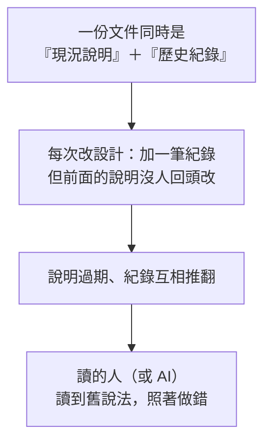

# [E-6-11] 設計文件分成「現況」與「決定紀錄」——別讓文件越長越不能信

> **目標**：理解為什麼一份「邊做邊加」的設計文件，最後會變得又長又不準；學會把它拆成「現在是什麼」和「當初為什麼」兩種文件，特別是在跟 AI 協作的專案裡。

## 一個越長越不能信的文件

很多專案都有一份設計文件（常叫 `DESIGN.md`），一開始很合理：寫下架構、資料格式、畫面怎麼排。

接著開始做功能。每次改了設計，就在文件最後的「決定紀錄」表格加一列：哪天、決定了什麼、為什麼。這也是好習慣——沒人會記得三週前為什麼這樣做。

問題出在幾週之後。我自己的一個例子：

- 文件長到 418 行、約 138 KB，其中 179 筆決定紀錄占了大半。
- 前半段寫的「架構」還是第一版的樣子，那一版的介面後來整個換掉了。
- 同一件事被決定好幾次：「壓黑」先是一個節點透明度、後來變成「要不要／多黑／多快」、再後來多了「幾秒後開始」。三筆紀錄都在表格裡，**只有最後一筆是對的**。

想知道「現在壓黑怎麼運作」，得從頭讀到尾，再自己判斷哪一筆是最新的。



這張圖在表達：問題不是寫太多，而是「兩種性質不同的內容混在一起」——歷史只會增加，現況卻需要被改寫。

## 跟 AI 協作時更嚴重

如果是讓 AI（例如 Claude）幫忙開發，這個問題會被放大兩倍：

1. **上下文（context）有成本**：AI 每次要查設計就得把整份讀進來。138 KB 大約是四、五萬個 token，佔掉的空間就不能拿來放程式碼。
2. **AI 不會自己判斷哪筆過期**：人看到矛盾會起疑，AI 很可能照著讀到的第一個說法做。

所以文件不只要「有寫」，還要「讀到的就是對的」。

## 拆成兩種文件

```
DESIGN.md（現況）
    只寫「現在是什麼」
    設計改了 → 直接改這裡（不是追加）
    目標：短，讀完就能開工

docs/decisions/2026-10.md（決定紀錄）
    只追加、不改寫：日期｜決定｜原因
    依月份分檔，越來越多也沒關係
    要查「為什麼」才用搜尋找（例：grep 壓黑），不整份讀
```

拆完之後，那份 418 行的文件變成 116 行（約 10 KB），只有原本的十分之一。歷史一筆都沒丟，只是換了地方放。

這其實就是業界常說的 **ADR（Architecture Decision Record，架構決策紀錄）**：把每個重大決定獨立記下來，而現況文件保持精簡。不同團隊格式差很多（一個決定一個檔、或像這裡一個月一張表），**重點是「現況」和「歷史」分開，用哪種格式是團隊慣例**。

## 實際拆的時候注意什麼

**① 歷史要原文搬，不要改寫**

決定紀錄是證據。搬的時候順便「整理一下措辭」，等於把歷史改掉了。我搬完還數了一次筆數（179 → 179），確認沒漏。

**② 現況要照「程式」重寫，不是照舊文件刪減**

舊文件本身就有過期內容，從它刪減只會把錯誤保留下來。應該看程式現在怎麼運作，重新寫一份。寫完再抽查比較沒把握的段落，跟程式對一遍。

**③ 舊的規劃文件標成「歷史文件」**

專案裡常有「v2 構想」「某某計畫」這類當時的規劃。它們不用刪（記錄了當初的思路），但開頭要註明「現況以 DESIGN.md 為準」，免得被當成現行規格。

**④ 給 AI 的指示文件也要跟著改**

如果專案有給 AI 的說明檔（例如 `CLAUDE.md`，每次對話都會自動載入），要寫清楚：「查設計看 DESIGN.md；查原因才搜 decisions，不要整份讀」。另外，這份每次都會載入的檔案本身也要精簡，它比設計文件更常被讀。

## 小結

- 邊做邊加的設計文件會把「現況」和「歷史」混在一起：歷史只增不減，現況沒人回頭改，最後讀到的常是過期說法。
- 拆成兩種：**現況文件**（改設計就直接改它，保持短）＋**決定紀錄**（只追加，用搜尋查）。
- 跟 AI 協作時特別重要：省上下文，也避免 AI 照著過期的說法做。
- 拆的時候：歷史原文搬、現況照程式重寫、舊規劃標成歷史、給 AI 的指示一起更新。

> 文件跟程式碼一樣會「腐化」→ [課外讀物 E-6-10 破窗理論](./E-6-10-broken-windows.md)；注解寫「為什麼」也是同一個精神 → [E-6-5 注解的正確使用](./E-6-5-comments.md)
