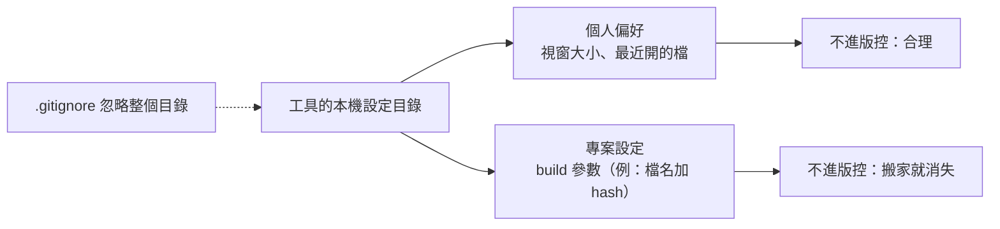

# [E-8-12] 被 .gitignore 藏起來的設定：「git 追蹤的都搬了」不等於「設定都搬了」

> **目標**：理解為什麼有些關鍵設定會住在被 `.gitignore` 忽略的檔案裡、搬專案時會無聲消失；學會怎麼列出被忽略的檔、怎麼比對兩邊的 build 找出差異，以及把關鍵參數放回版控的做法。

## 一個情境：搬進新 repo 之後，CDN 怎麼都快取不了

你把一個前端專案從舊 repo 搬進新的 monorepo。搬法很乾淨：`git clone`、把追蹤的檔案複製過去、跑 build，畫面一模一樣。

幾週後要開 CDN 快取，才發現新 build 的檔名**都沒帶 hash**（`settings.json`，不是 `settings.f28af.json`），所以根本不能長期快取。舊 repo 的線上版本明明有 hash。

查下去：
- 打包工具的「檔名加 hash」選項，在舊 repo 裡是設在一個本機設定目錄（例如 `profiles/`）。
- 那個目錄在 `.gitignore` 裡（它還存了每個人的編輯器偏好，所以整個被忽略）。
- 舊 repo 的 CI 是**直接在 build 指令上帶參數**，所以 CI 產物一直有 hash，沒人發現本機設定根本沒進版控。

搬遷時「git 追蹤的都搬了」，這個設定不在 git 裡，就沒搬。沒有報錯，畫面也一樣，只是少了一個你沒看見的行為。

## 為什麼會這樣：被忽略的檔案混了兩種東西

`.gitignore` 本來是用來排除「不該共享」的東西（→ [E-8-6 .gitignore](./E-8-6-gitignore.md)）：build 產物、快取、個人偏好、密鑰。

問題出在**工具把「個人偏好」和「專案設定」寫進同一個檔或同一個目錄**。為了排除前者，整個目錄被忽略，後者也跟著消失在版控之外。



這張圖在說：忽略一整個目錄時，裡面「該共享的」也一起被丟掉了。

讓它更難發現的是：**CI 和本機走的是不同的路**。CI 在指令上帶參數，本機靠那個被忽略的檔。兩條路結果一樣，所以沒人懷疑；搬家時只帶走了「看得到的那一條」。

## 怎麼找出來

**1. 列出舊 repo 裡被忽略、但真的存在的檔**

```bash
git status --ignored --short                     # !! 開頭的就是被忽略的
git ls-files --others --ignored --exclude-standard # 完整清單
```

搬家前在舊 repo 跑一次，逐一問：「這個檔如果不見了，build 或執行會不會不一樣？」build 產物、`node_modules` 可以跳過；設定目錄要打開來看。

**2. 比對兩邊的 build 指令與產物**

```
// pseudo code
在舊環境與新環境各 build 一次
比較：
    實際執行的 build 指令與參數（CI 設定檔、腳本）
    產物的檔名清單（有沒有 hash？）
    產物裡的設定檔內容（debug 開關、版本字）
```

「畫面一樣」不夠，要比產物本身。檔名清單用 `find build -type f | sort` 兩邊 `diff` 一下，差異一眼就看得出來。

## 怎麼修：把關鍵參數放回版控

- **寫進 build 指令或腳本**：例如 `build.sh` 裡直接帶 `--hash-filenames=true`，旁邊註解為什麼（「原本設在被忽略的 profiles，搬家時漏掉」）。這樣 CI 和本機走同一條路。
- 或者把「專案設定」和「個人偏好」拆成兩個檔，前者進版控、後者忽略。
- 加一個檢查，讓它不會再悄悄消失：例如 build 後檢查「除了 `index.html` 以外的檔都帶 hash」，不符合就讓 build 失敗。

> **常見錯誤** — 搬專案只看「功能正常」就收工：
> 畫面、流程都對，但少了快取 hash、少了某個安全標頭、debug 開關沒關——這些都不會讓功能壞掉，所以功能測試抓不到。
> 正確做法：搬家前列被忽略的檔、搬家後比對產物，把「這次搬家應該保持不變的行為」寫成檢查。
> 通用的反模式整理 → [E-6-6 反模式](../E-6-best-practices/E-6-6-anti-patterns.md)

## 小結

- `.gitignore` 忽略整個目錄時，裡面該共享的專案設定也會一起消失在版控外。
- CI 走指令參數、本機走被忽略的檔，兩條路結果一樣，所以很難發現。
- 搬家前用 `git status --ignored` 列出被忽略的檔逐一檢查；搬家後比對產物（檔名、設定內容），不要只看畫面。
- 關鍵參數寫回版控裡的 build 指令，並加檢查讓它不會再悄悄消失。

> 這次漏掉的正好是快取需要的 hash 檔名 → [E-11-9 幫已上線的前端打開快取](../E-11-performance/E-11-9-hashed-frontend-cache-rules.md)
> .gitignore 該放什麼 → [E-8-6 .gitignore](./E-8-6-gitignore.md)
