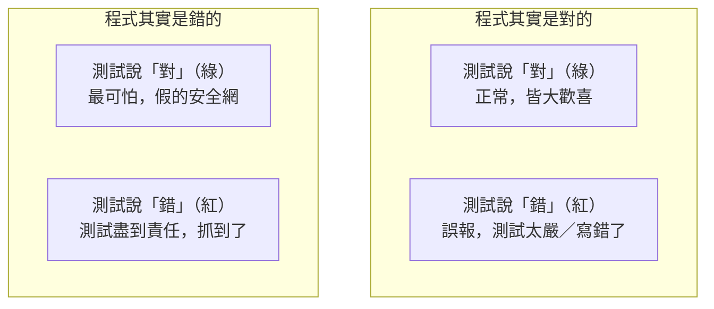
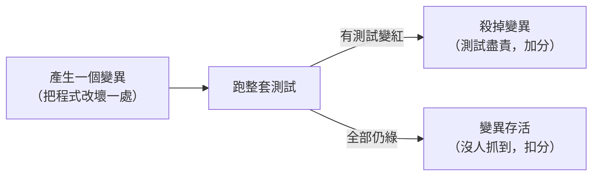

# [E-9-10] 陽性對照：怎麼確認「測試真的會抓到錯」

> **目標**：理解「綠燈不等於測試有效」——測試自己也要被驗證；學會用「陽性對照（positive control）」故意注入一個 bug，看測試會不會因此變紅，紅了才證明它真的守得住；並認識這背後的「變異測試（mutation testing）」直覺。

## 一個問題：這條綠燈，到底證明了什麼？

你剛接手一段「計算訂單金額」的程式。打開測試檔，跑一下——**全綠**。心裡鬆一口氣：「有測試，而且都過了，應該沒問題。」

但停一下想：**綠燈到底證明了什麼？** 它證明的其實只有一句話——「在這些測試眼中，程式是對的」。問題是，如果這些測試**根本沒在測你以為它在測的東西**呢？那麼不管程式對不對，它都會給你綠燈。

這不是假設。看這個真實會發生的情況：

```
// 被測的函式：算含稅總額
function calculateTotal(price, taxRate) {
  return price * (1 + taxRate);
}

// 測試
test("100 元、稅率 0.05，總額應該是 105", () => {
  const total = calculateTotal(100, 0.05);
  // 😱 忘了寫 expect！這個 test 永遠會「通過」
});
```

這個測試**永遠是綠的**——因為它根本沒有斷言（assertion，宣告「結果應該是什麼」的那一行）。就算有人把 `calculateTotal` 改成 `return 0`，它照樣綠燈。你以為有一張安全網，其實那是一張**破了個大洞、但看起來完好的網**。

綠燈讓人安心，但安心不等於安全。這一篇要回答的問題是：**你怎麼知道一條測試「真的會在程式壞掉時變紅」？**

## 生活類比：煙霧偵測器要怎麼確認它沒壞？

家裡裝了煙霧偵測器。它平常安安靜靜不響——這代表「沒有火」，還是代表「它早就壞了、根本不會響」？你分不出來。一個「永遠不響」的壞偵測器，和一個「沒事所以不響」的好偵測器，平常看起來**一模一樣**。

所以偵測器上都有一顆「**測試鈕（test button）**」。你按下去，故意給它一個訊號，看它會不會叫。**會叫，才證明它是活的、真的在守著。** 不會叫，代表它壞了，你現在就知道該換電池。

測試也一樣。一條「平常是綠燈」的測試，可能是「程式沒錯所以綠」，也可能是「它根本不會變紅」。要分辨，你得像按測試鈕一樣——**故意弄壞程式，看它會不會響（變紅）**。這就是「陽性對照」。

> **陽性對照（positive control）**：科學實驗裡的用語，指「一個『已知應該會出現陽性結果』的對照組」。如果連這個「保證該有反應」的對照組都沒反應，代表你的**檢測方法本身壞了**，這次實驗的所有結果都不能信。套到測試上：故意注入一個「保證是錯的」程式，測試卻沒變紅，代表這條測試這個「檢測方法」本身是壞的。

## 用 pseudo code 描述「驗證一條測試」

平常我們只做上半段，陽性對照是補上**下半段**：

```
確認「測試在程式正確時會綠」：
    程式維持正確
    跑測試
    預期 → 綠燈（不然就是測試太嚴，誤報）

確認「測試在程式錯誤時會紅」：   ← 陽性對照，常被忽略的這一半
    故意改壞程式（注入一個 bug）
    跑測試
    預期 → 紅燈
    如果還是綠燈 → 這條測試是假的，它根本沒守住這個行為
    （確認完，把 bug 改回來）
```

一條測試要能真正保護你，這**兩半都要成立**：正確時會綠（不誤報），錯誤時會紅（不漏報）。我們天天在看第一半，卻幾乎不驗第二半——而漏掉的 bug，全躲在第二半裡。

## 一條測試的四種可能

把「程式對不對」和「測試說對不對」交叉起來，有四格：



這張圖表達：測試有兩種失職方式。左下的「誤報」很吵、會被馬上發現；真正致命的是**右上那格——程式錯了、測試卻給綠燈**，它安靜、沒人察覺，而陽性對照就是專門用來照出這一格的手電筒。

陽性對照問的正是：「**當程式掉進『程式其實是錯的』那一排時，我這條測試會停在右下（變紅、抓到），還是滑到右上（照樣綠燈、放過）？**」

## 正式程式碼範例

情境沿用開頭的「含稅金額計算」，用 Vitest（與本系列一致的測試框架）。先把被測函式和一條**像樣的**測試寫好——這條有確實斷言，不是開頭那條破網：

```typescript
// 被測函式：給定未稅價與稅率，回傳含稅總額
export function calculateTotal(price: number, taxRate: number): number {
  return price * (1 + taxRate);
}
```

```typescript
import { describe, it, expect } from "vitest";
import { calculateTotal } from "./calculateTotal";

// 這條測試遵循 AAA 結構（E-9-4）：準備輸入、執行、斷言結果
describe("calculateTotal", () => {
  it("未稅 100 元、稅率 0.05，含稅應為 105", () => {
    const price = 100;          // Arrange 準備
    const taxRate = 0.05;

    const total = calculateTotal(price, taxRate); // Act 執行

    expect(total).toBe(105);    // Assert 斷言
  });
});
```

綠燈。但到這裡，我們只知道「程式正確時它會綠」。接著做**陽性對照**——這一步**不寫在測試檔裡，而是你手動（或用工具）做的一個驗證動作**：暫時把程式改壞，看測試會不會抓到。

把乘法故意改成加法，這是一個「保證錯」的注入：

```typescript
// ⚠️ 故意改壞：把「price × (1 + taxRate)」寫成「price + taxRate」
// 這是陽性對照的「注入 bug」，驗證完一定要改回來
export function calculateTotal(price: number, taxRate: number): number {
  return price + taxRate; // 100 + 0.05 = 100.05，而非 105
}
```

再跑一次測試。**預期它變紅**——`expect(total).toBe(105)` 會收到 `100.05`，失敗。

- **它變紅了** → 太好了，這條測試是真的。它確實盯著「含稅計算」這個行為，程式一錯就會喊。把 bug 改回去，安心。
- **它居然還是綠的** → 警報。代表這條測試根本沒在測這段邏輯（也許斷言寫錯、也許測資料剛好兩種算法都成立）。這時你要修的是**測試**，不是程式。

這就是陽性對照的全部精神：**用一個「你確定是錯的」程式去考你的測試，考過了，你才敢信它平常的綠燈。**

## 這就是變異測試的直覺

你剛剛手動做的「改壞一行、看測試有沒有紅」，正是**變異測試（mutation testing）** 的核心概念——只是工具把它自動化、而且大規模地做。

變異測試工具會自動對你的程式做很多種「小變異（mutation）」，每一種都是一個「保證錯」的版本，例如：

| 原本的程式 | 變異後 | 在考驗的是 |
|---|---|---|
| `a + b` | `a - b` | 有沒有測試盯著這個加法 |
| `a > b` | `a >= b` | 有沒有測試踩到這個邊界 |
| `return true` | `return false` | 有沒有測試在乎這個回傳 |
| 刪掉某一行 | （整行消失） | 那行到底有沒有被任何測試覆蓋 |

每做一個變異，工具就跑一次你的整套測試：



這張圖表達變異測試的判定規則：每個「被改壞的版本」如果害某條測試變紅，就算被「殺掉（killed）」，代表這處有測試守著；如果改壞了測試卻**全綠**，這個變異就「存活（survived）」，等於指出「這段程式沒有有效的測試」。

最後它給你一個**變異分數（mutation score）**＝被殺掉的變異 ÷ 總變異數。這個分數比「程式碼覆蓋率（code coverage）」誠實得多：覆蓋率只說「這行**有被執行到**」，變異分數說的是「這行**被改壞時真的有測試會喊**」——行有沒有被跑到，和行壞了有沒有人管，是兩回事。

> 你不一定要天天跑變異測試工具（它會把每個變異都跑一輪測試，較耗時）。但「**手動對關鍵邏輯做一次陽性對照**」幾乎零成本，而且是所有驗證裡 CP 值最高的一招——尤其在你把一段重要邏輯「照理說測試都綠」地交出去之前。

## 常見錯誤（反模式）

> **常見錯誤一：把「測試通過」直接當成「測試有效」**
>
> 最普遍的誤解：看到全綠就宣布「有測試、都過了，安全」。但綠燈有兩種來源——「程式對」或「測試根本沒在測」——而它們長得一模一樣。開頭那條**忘了寫 `expect`** 的測試就是鐵證：它永遠綠，卻什麼都沒保護。
>
> **正確做法**：對「重要、怕錯」的邏輯，至少手動做一次陽性對照——故意改壞，確認它會紅。一條「你親眼看過它變紅」的測試，才是你能信的測試。沒看過它紅過，它的綠燈只是「還沒被戳破的假設」。

> **常見錯誤二：先寫程式、再補測試，而且測試一寫出來就是綠的**
>
> 事後補測試時，很容易「湊」出一條剛好會過的測試——因為你是對著「已經能跑的程式」寫，潛意識會把斷言寫成「反正現在的輸出是多少、我就斷言多少」。這種測試從出生到現在**從沒紅過**，你根本不知道它會不會紅。
>
> ```typescript
> // 壞味道：直接把「現在跑出來的值」貼成期望值，自己也沒算過對不對
> const total = calculateTotal(100, 0.05);
> expect(total).toBe(total); // 😱 永遠成立，等於沒測
> ```
>
> **正確做法**：這正是 TDD「先紅後綠」（E-9-5）珍貴的地方——TDD 要求你**先寫測試、先看著它因為「程式還沒寫」而變紅**，再寫程式讓它轉綠。「看過它紅」這件事，TDD 幫你天生內建了。事後補測試時，就靠陽性對照手動補回這一步。而且期望值要**自己獨立算出來**（手算 100×1.05＝105），不要抄程式的輸出。

> **常見錯誤三：注入的 bug 太溫和，沒有真的考到那條測試**
>
> 做陽性對照時，如果你注入的「錯」剛好對測試用的那組資料不痛不癢，測試不會紅，你卻誤以為「測試壞了」而白忙，或更糟——以為「這個 bug 不嚴重」。例如測資料用 `taxRate = 0`，那麼 `price * (1 + 0)` 和 `price + 0` 兩種寫法算出來都一樣，加法 bug 根本考不出來。
>
> **正確做法**：注入的變異要是「對這組測試資料**保證會算出不同結果**」的那種；同時這也反過來提醒你——**測試資料本身要挑得有鑑別力**，別用那些「對了錯了都一樣」的輸入（像 0、1、空字串這種容易讓不同邏輯殊途同歸的值當唯一樣本）。

## 小結

- **綠燈 ≠ 測試有效**。綠燈只代表「在這些測試眼中程式是對的」；如果測試根本沒在測，它對任何程式都會綠。測試自己也需要被驗證。
- **陽性對照（positive control）**：故意注入一個「保證錯」的 bug，看測試會不會因此變紅。**紅了，才證明這條測試真的守得住這個行為**；還是綠，代表要修的是測試。驗證完記得把 bug 改回來。
- 這正是**變異測試（mutation testing）** 的直覺：工具自動產生大量「改壞一處」的變異，被測試殺掉的越多越好；**變異分數比程式碼覆蓋率誠實**——覆蓋率只說「行被執行」，變異分數說「行壞了有人喊」。
- 三個雷：別把「通過」當「有效」；別湊一條「從沒紅過」的事後測試（TDD 的先紅後綠天生避開這點）；注入的 bug 要對測試資料真的有鑑別力。

> 測試的標準結構（AAA）→ [E-9-4](./E-9-4-aaa-principle.md)；先紅後綠的 TDD → [E-9-5](./E-9-5-tdd.md)
> 弱證據別當強結論、「測過的範圍」與「宣稱的範圍」→ [E-9-12：證據等級](./E-9-12-evidence-levels.md)
> 當別人回報「我驗過了，沒問題」時該追問什麼 → [E-9-13：怎麼審查一份驗收報告](./E-9-13-reviewing-verification.md)
