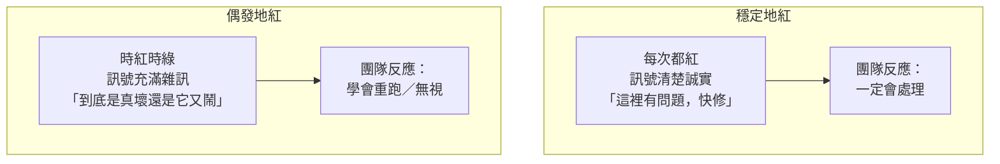
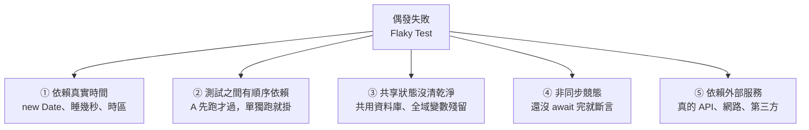
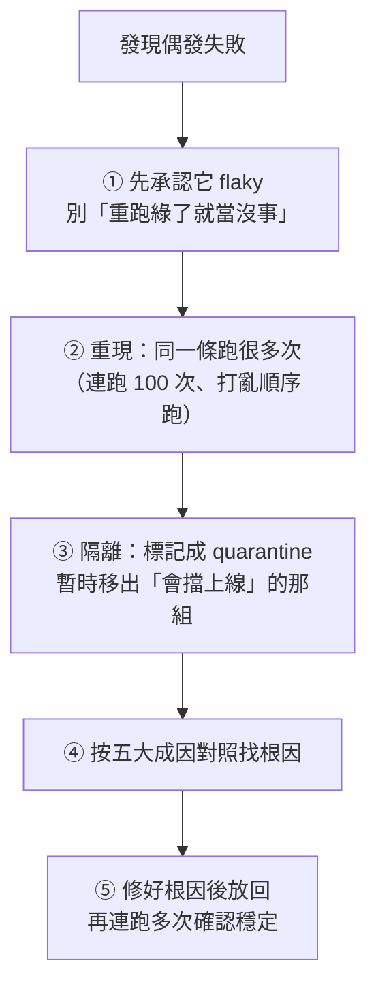

# [E-9-11] 偶發失敗（Flaky Test）：時紅時綠的測試，比一直紅更危險

> **目標**：理解什麼是 flaky test（偶發失敗的測試）、為什麼它比「一直紅」更傷——因為它會侵蝕人對整套測試的信任；認識五個最常見的成因，以及怎麼定位與隔離它。

## 一個問題：同一段程式碼，跑兩次結果不一樣

你改好一段功能，跑測試——紅了一條。你皺眉看了看，什麼都沒改，**再跑一次——綠了**。

你愣了一下，聳聳肩：「喔，大概是剛剛卡一下吧。」繼續做事。

這一刻，一個很糟的習慣悄悄開始了。那條測試是 **flaky test（偶發失敗的測試，也譯作「不穩定測試」）**——**同樣的程式碼、同樣的輸入，跑多次結果卻時紅時綠**。它沒有真的抓到你的 bug，它只是自己不穩。

問題還不在這條測試本身，而在你剛剛學會的那個動作：**「紅了？再跑一次看看。」** 這個動作一旦變成反射，你整套測試的價值就開始崩塌。

## 生活類比：那個「狼來了」的警報器

想像辦公室的火災警報器壞了，三不五時沒事亂叫。第一次響，大家衝下樓；第三次響，有人開始猶豫；到第十次，所有人坐著不動——「又來了，別理它」。

然後某天，它響的是**真的火災**。沒有人動。

flaky test 就是這個亂叫的警報器。它最大的傷害不是「它自己不準」，而是它**訓練整個團隊學會無視紅燈**。一套「偶爾會無辜變紅」的測試，跑久了大家的反應會從「紅燈？馬上查」退化成「紅燈？重跑／忽略」。等到哪天紅燈是**真的 bug**，它淹沒在「狼來了」的雜訊裡，沒人當一回事就上線了。

這就是為什麼這一篇要特別強調：

> **flaky test 比「一直紅」更危險。** 一直紅的測試很誠實——它大聲說「這裡壞了」，你一定會去修。flaky test 是**溫水煮青蛙**：它不吵，卻一點一點把「紅燈 ＝ 要停下來」這條團隊鐵律給溶解掉。

## 為什麼「一直紅」反而比較安全？

把兩種壞測試擺在一起比，就看得很清楚：



這張圖表達：穩定的紅燈雖然惱人，但訊號是誠實的、一定會被修；偶發的紅燈真正的破壞力在**最後那一格**——它讓團隊養成「無視紅燈」的習慣，從而讓**整套測試**失去意義，而不只是壞了一條。

一條測試「可靠」的前提，是它**可重複（Repeatable）**——同樣輸入永遠同樣結果（這正是 E-9-4「FIRST」特質裡的 R）。flaky test 違反的就是這一條，所以它動搖的是測試最底層的信任基礎。

## 五個最常見的成因

flaky 幾乎都來自「測試偷偷依賴了某個**它控制不了、每次不一樣**的東西」。五大慣犯：



這張圖表達 flaky test 的五個典型來源——它們的共通點都是「測試的結果取決於某個不受測試掌控、每次執行可能不同的因素」。逐一看：

**① 依賴真實時間（real time）**：測試裡直接用「現在幾點」。例如驗證「優惠券在午夜過期」的測試，剛好在 23:59:59 跑和在 00:00:01 跑，結果就不同；或程式用 `new Date()` 取當下、測試又寫死某個日期去比。時間是最經典的 flaky 來源——它無聲無息地每一毫秒都在變。

**② 測試之間有順序依賴（order dependency）**：測試 B 其實偷偷靠「測試 A 先跑、留下了某筆資料」才會過。單獨跑 B、或測試框架打亂順序（很多框架會刻意隨機化執行順序）時，B 就掛了。這違反 FIRST 的 I（Isolated，每個測試要獨立，E-9-4）。

**③ 共享狀態沒清乾淨（shared state）**：好幾條測試共用同一個資料庫、同一個全域變數、同一個暫存檔。前一條測試塞進去的資料沒清，污染了後一條——誰先誰後、上次有沒有清乾淨，決定了這次紅不紅。

**④ 非同步競態（race condition）**：程式是非同步的（async），測試卻沒好好等它做完就去斷言。機器快的時候剛好做完了、綠；機器忙的時候還沒做完、紅。這是 CI（持續整合）機器上「本機都過、一上 CI 就偶爾紅」最常見的元兇。

**⑤ 依賴外部服務（external service）**：測試真的去打第三方 API、連真網路。對方慢一下、抖一下、限流一下，你的測試就無辜陪葬——這也正是我們要用「測試替身」把外部換成假的理由（E-9-6）。

## 正式程式碼範例：一個時好時壞的整合測試

看一條**整合測試（integration test，E-9-2）**——它驗證「建立一張 24 小時後到期的工作階段（session）」。這條測試同時踩到上面的 ①（真實時間）和 ④（非同步競態）兩個雷。

先看被測的函式：它用「現在時間」算出到期時間：

```typescript
// 被測函式：建立一個 session，到期時間是「此刻 + 存活秒數」
export async function createSession(userId: string, ttlSeconds: number): Promise<Session> {
  const now = new Date();                                   // ⚠️ 直接讀真實時間
  const expiresAt = new Date(now.getTime() + ttlSeconds * 1000);
  return await sessionRepository.insert({ userId, expiresAt });
}
```

下面是**寫得會 flaky 的測試**——注意它怎麼踩雷：

```typescript
import { it, expect } from "vitest";
import { createSession } from "./createSession";

it("建立的 session 應在 24 小時後到期", () => {
  // ⚠️ 雷 ④：createSession 是 async，這裡沒有 await，
  //    斷言時 insert 可能還沒完成，session 可能還是 undefined
  const session = createSession("user-1", 24 * 60 * 60) as unknown as Session;

  // ⚠️ 雷 ①：期望值也用「測試這一刻的真實時間」去算，
  //    和函式內部那個 new Date() 差了幾毫秒，兩邊對不起來
  const expected = new Date(Date.now() + 24 * 60 * 60 * 1000);

  expect(session.expiresAt.getTime()).toBe(expected.getTime());
});
```

這條測試會「大部分時候過、偶爾紅」：函式裡的 `new Date()` 和測試裡的 `Date.now()` 執行的瞬間差了幾毫秒，剛好兩次落在同一毫秒就綠、跨過毫秒邊界就紅；再加上沒 `await`，機器忙時 `session` 根本還沒拿到。**時好時壞**，典型 flaky。

修法有兩步。第一步，**把時間變成可控的依賴，不要讀真實時間**——把「現在幾點」當參數傳進去（這叫依賴注入，讓測試能餵一個固定的時間）：

```typescript
// 改法：讓呼叫者提供「現在時間」，預設才用真實時間。
// 這樣測試可以餵一個固定時間，結果就完全可預測。
export async function createSession(
  userId: string,
  ttlSeconds: number,
  now: Date = new Date(), // 測試時傳固定值，正式執行用預設的真實時間
): Promise<Session> {
  const expiresAt = new Date(now.getTime() + ttlSeconds * 1000);
  return await sessionRepository.insert({ userId, expiresAt });
}
```

第二步，**測試裡餵固定時間、而且好好 `await`**：

```typescript
import { it, expect } from "vitest";
import { createSession } from "./createSession";

it("建立的 session 應在 24 小時後到期", async () => {
  // 餵一個「寫死的現在時間」，不依賴測試跑在幾點
  const fixedNow = new Date("2026-01-01T00:00:00.000Z");
  const oneDay = 24 * 60 * 60;

  // 有 await，確定 insert 完成後才斷言（修掉雷 ④）
  const session = await createSession("user-1", oneDay, fixedNow);

  // 期望值由「固定的 now」算出，兩邊用同一個基準（修掉雷 ①）
  const expected = new Date("2026-01-02T00:00:00.000Z");
  expect(session.expiresAt.getTime()).toBe(expected.getTime());
});
```

現在它**每次跑都一樣**——時間被釘死、非同步被等完。可重複，不再 flaky。

> 「時間不可信、該把 clock 當成可注入的依賴」這件事值得單獨一讀 → [E-13-18：時鐘與時間](../E-13-scaling/E-13-18-clocks-and-time.md)。而「把外部服務換成假的替身」避開雷 ⑤ → [E-9-6：測試替身](./E-9-6-test-doubles.md)。

## 怎麼定位與隔離一條 flaky test

flaky 難抓，因為它「不一定會發作」。一套可行的流程：



這張圖表達處理 flaky test 的標準流程——重點在第 ①、③ 兩步：先**承認**它是問題（而不是重跑帶過），並把它**隔離（quarantine，隔離檢疫）** 出主要測試組，讓它不再擋住正常開發、也不再製造「狼來了」的雜訊，但同時留一張待辦、不讓它被遺忘。

幾個實務招式：

- **重現**：把可疑的測試**連跑很多次**（例如 `--repeat` 或迴圈跑 100 遍），flaky 的會在其中幾次露餡。再**打亂執行順序**跑，能逼出雷 ②（順序依賴）。
- **隔離（quarantine）**：把確認 flaky 的測試先標記出來（例如 Vitest 的 `it.skip`，或移進一個「已知不穩、不擋上線」的清單），**但一定要同時開一張待辦票**。隔離是為了止血，不是為了遺忘——沒有待辦的隔離，等於悄悄刪掉一條測試。
- **找根因**：拿五大成因一條條對。flaky 幾乎都逃不出那五類，對照著問「這條測試有沒有偷偷依賴時間／順序／共享狀態／非同步時機／外部服務？」
- **驗證修好**：修完別只跑一次就宣布好了——**再連跑多次**確認它真的穩了。這一步很關鍵：flaky 的驗收，跑一次綠什麼都不能證明。

## 常見錯誤（反模式）

> **常見錯誤一：「重跑綠了就當沒事」——把重跑當成修復**
>
> 最傷的反模式，就是開頭那個動作：紅了 → 再跑一次 → 綠了 → 繼續。甚至有人在 CI 設定「自動重試三次，有一次綠就算過」。這**沒有修掉任何東西**，只是把 flaky 藏起來，還順便把它製造的雜訊常態化。
>
> **正確做法**：把每一次「重跑才綠」都當成一張 bug 票——因為它就是。測試偶發失敗，代表「要嘛程式有隱藏的非同步／狀態 bug，要嘛測試寫壞了」，兩者都該查。重跑可以當**止血**（讓今天的上線不被卡），但必須伴隨「開票、排進去修」，不能當**治療**。

> **常見錯誤二：用「睡一下」來對付非同步競態**
>
> 遇到雷 ④（async 還沒做完就斷言），很多人隨手加一行 `sleep`：
>
> ```typescript
> // 壞：賭「500 毫秒應該夠它做完了吧」
> triggerAsyncJob();
> await new Promise((resolve) => setTimeout(resolve, 500)); // 😱 魔術數字，純靠運氣
> expect(await getResult()).toBe("done");
> ```
>
> 問題是：這個 500 毫秒是**猜的**。機器更慢的時候（例如 CI 很忙）500 毫秒不夠 → 還是 flaky；機器很快的時候它又白白拖慢每一次測試。你沒解決競態，只是把賭注金額換了個數字。
>
> **正確做法**：**等「事件」，不要等「時間」**。用框架提供的「等到某條件成立」機制（例如輪詢直到結果出現、或對完成事件 `await`），讓測試「做完就往下、沒做完就等」，而不是賭一個固定秒數。E-9-6 的測試替身也能讓非同步流程變成「可以確定地等它完成」。

> **常見錯誤三：測試之間共用狀態卻不在每條之間清乾淨**
>
> 雷 ②、③ 的根源，常是「圖方便，所有測試共用同一個資料庫 / 同一個全域物件，而且不重設」。於是測試會不會過，取決於「前面那條留了什麼」「這次誰先跑」——這是順序依賴與狀態污染的溫床。
>
> **正確做法**：讓每條測試**自給自足**（呼應 FIRST 的 Isolated，E-9-4）。用框架的 `beforeEach` / `afterEach` 在每條測試前後**建立乾淨環境、跑完清掉**；共用的全域狀態要重設歸零。判準是一句話：**任何一條測試單獨拿出來跑、或打亂順序跑，都要能過。**

## 小結

- **flaky test（偶發失敗）**：同樣的程式碼與輸入，跑多次卻時紅時綠。它違反測試「可重複（Repeatable）」的基本要求（E-9-4）。
- **它比「一直紅」更危險**：一直紅很誠實、一定會被修；flaky 是「狼來了」，它會**訓練整個團隊學會無視紅燈**，最後連真的 bug 紅燈也被忽略——壞掉的是對整套測試的信任，不只一條測試。
- 五大成因：① 依賴真實時間、② 測試間順序依賴、③ 共享狀態沒清、④ 非同步競態、⑤ 依賴外部服務。共通點都是「偷偷依賴了某個控制不了、每次不同的東西」。
- 定位流程：承認它 flaky → 連跑多次／打亂順序重現 → 隔離（quarantine）但開待辦 → 按五大成因找根因 → 修好後再連跑多次確認穩。
- 三個雷：別把「重跑綠了」當修復；別用 `sleep` 對付競態（要等事件不等時間）；別讓測試共用狀態卻不清乾淨。

> 時間為什麼不可信、該把 clock 當可注入依賴 → [E-13-18：時鐘與時間](../E-13-scaling/E-13-18-clocks-and-time.md)
> 把外部依賴換成假的替身，避開「真服務害測試不穩」→ [E-9-6：測試替身](./E-9-6-test-doubles.md)
> 「可重複」等好測試特質 → [E-9-4：AAA 與 FIRST](./E-9-4-aaa-principle.md)
