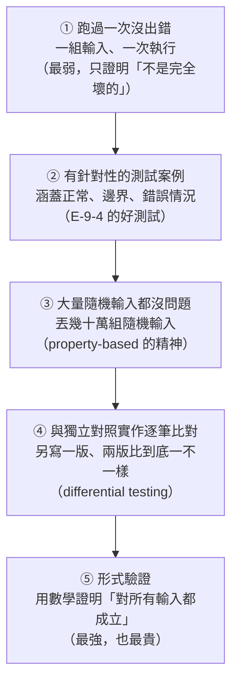

# [E-9-12] 證據等級：弱證據別當強結論

> **目標**：理解「驗證」有強弱不同的等級——從「跑過一次沒出錯」到「形式驗證」，證明力天差地遠；學會讓**結論的強度配上證據的強度**，並且永遠分清「我測過的範圍」和「我宣稱的範圍」。

## 一個問題：「我驗過了」，到底驗到什麼程度？

你做了一個「計算引擎」——給它一組輸入，它吐出一個數字。你想確認它算得對，於是：**餵了一組輸入進去，看了一眼輸出，對了**。你在回報裡寫下：「已驗證，計算正確。」

這句話有問題嗎？有。它把一個**很弱的證據**（跑過一次、一組輸入、對了），包裝成一個**很強的結論**（計算正確）。「計算正確」聽起來像是「對所有輸入都正確」，但你實際證明的只有「對**那一組**輸入、在**那一次**執行，剛好對」。

這兩者之間的差距，大到可以藏下無數 bug。這一篇要講的，就是怎麼不讓這個差距騙到自己（和別人）。

## 生活類比：你憑什麼說「這座橋能過」？

有人要你確認一座新橋能不能通車。你可以有很多種「確認」法，強度完全不同：

- 「我**走過去了**，沒塌。」——一個人、一次、走路。
- 「我開了**一台車**過去，沒事。」——多一點重量，還是一次、一台。
- 「我讓**一千台各種噸位的車**，連開一週，全程量測結構應力。」——大量、多樣、長期、有量測。
- 「我請結構技師**用力學公式算過**整座橋的受力極限，證明在設計載重內保證不垮。」——不靠「試試看」，靠**數學推導**。

這四句都叫「我確認過橋能過」，但你敢把全城的車放上去的信心，天差地遠。沒有人會因為「有個人走過去沒塌」就開放通車——因為大家直覺知道：**不同強度的結論，需要不同強度的證據。**

奇怪的是，寫程式時這個直覺常常消失。「我跑過一次沒報錯」就敢在報告寫「功能正確」——這等於「我走過去沒塌，所以橋能通車」。

## 證據強度的階梯

把驗證方法由弱到強排出來，像一道階梯：



這張圖表達：越往上的證據越弱、越往下越強，而「強」的代價也越高。重點不是「永遠要用最強的」，而是**讓你嘴上說的結論，配得上你手上這一階的證據**。逐階看它們各自證明了什麼、又沒證明什麼：

| 等級 | 方法 | 它證明了什麼 | 它**沒**證明什麼 |
|---|---|---|---|
| ① | 跑過一次沒出錯 | 在這**一組**輸入、這**一次**執行不會崩、結果對 | 其他任何輸入、邊界、並發情況 |
| ② | 針對性測試案例 | 你**想到的**那些情況（正常、邊界、錯誤）是對的 | 你**沒想到**的情況 |
| ③ | 大量隨機輸入 | 在很廣的輸入空間裡沒撞到反例 | 沒被隨機撞到的罕見組合；「輸出對不對」的標準是否可靠 |
| ④ | 對照實作逐筆比對 | 你的實作和「另一個獨立實作」在測到的範圍內**一致** | 兩版**同時錯**的情況；沒比對到的輸入 |
| ⑤ | 形式驗證 | 對**所有**輸入，在數學上成立 | 規格本身寫錯、或模型與真實環境不符的部分 |

兩個關鍵觀念從這張表跳出來：

**第一，每一階都有「沒證明什麼」。** 連最強的形式驗證也有——它證明「程式符合規格」，但如果**規格本身寫錯**，它無能為力。沒有任何證據是「什麼都證明了」。誠實的驗證者，講得出自己這一階的盲區。

**第二，等級③、④ 特別容易被高估。** 「我跑了幾十萬組隨機輸入都一樣」聽起來很猛，但它藏了一個前提——**你拿什麼來判斷「輸出對不對」？** 如果你是拿程式自己的輸出跟它自己比，那跑一億次也只證明「它很穩定地一致」，不證明「它對」。這個陷阱下一段細講。

## 重點陷阱：「一致」不等於「正確」

等級 ④「對照實作逐筆比對」是很強的證據——但它強的前提是**那個對照實作是『獨立』的**。差之毫釐的誤用，會讓它退化成一文不值。

用 pseudo code 對比兩種「比對」：

```
真正的對照比對（強）：
    主實作 = 你要驗的那個計算引擎
    對照實作 = 「用完全不同的方法、獨立寫的另一版」
    for 大量輸入:
        如果 主實作(輸入) ≠ 對照實作(輸入):
            抓到不一致 → 其中一版有 bug
    // 兩版獨立 → 它們要「同時錯到剛好一樣」很難，所以一致 ≈ 很可能都對

假的對照比對（弱，常見自欺）：
    先跑一次主實作，把輸出存成「期望值檔案」
    for 大量輸入:
        如果 主實作(輸入) ≠ 期望值檔案(輸入):
            報錯
    // 期望值就是主實作自己吐的 → 這只證明「主實作每次結果一樣」
    // 完全不證明「它對」。主實作一開始就算錯，期望值也跟著錯
```

這兩段長得很像，證明力卻天差地遠。差別只在一句話：**你的「標準答案」是從哪裡來的？**

- 來自**獨立的另一個來源**（另一版實作、手算、公認的參考值）→ 真的在驗「對不對」。
- 來自**被測物自己**（存它的輸出當期望值、拿它跟它自己比）→ 只在驗「穩不穩定」，這是**拿答案對答案**，一種很常見的自欺。

```mermaid
graph TB
    subgraph 拿答案對答案（假強證據）
        X["被測的計算引擎"] --> X1["它自己的輸出<br/>存成「期望值」"]
        X1 --> X2["再拿引擎跟期望值比<br/>→ 只證明「一致」"]
    end
    subgraph 有獨立參照（真強證據）
        Y["被測的計算引擎"] --> Z["比對"]
        W["獨立的另一版／手算／公認參考值"] --> Z
        Z --> Z2["兩個獨立來源一致<br/>→ 才接近「正確」"]
    end
```

這張圖表達：強證據的關鍵不在「比對了幾十萬次」，而在「拿來比的那個標準答案，是不是**獨立於被測物**」。沒有獨立參照，次數再多也只是在證明「它很穩定」，不是「它對」。

## 正式程式碼範例：同一個引擎，三種強度的驗證

情境：一個 `priceEngine.quote(order)`，吃一張訂單、算出報價。我們用三段 Vitest 測試，看它們各自是第幾階、各自宣稱到哪。

**第一階（弱）——跑一次、看一眼**：

```typescript
import { it, expect } from "vitest";
import { quote } from "./priceEngine";

it("跑得起來、算得出一個合理的數字", () => {
  const result = quote({ items: [{ price: 100, qty: 2 }], taxRate: 0.05 });
  // 這只證明「不是完全壞的」，期望值還是我們自己心算的一組
  expect(result).toBe(210);
});
```

這條**有價值**（至少證明引擎不是完全壞的），但它只能支撐「這一組輸入對」這種**窄**結論。拿它去寫「報價引擎正確」是過度宣稱。

**第三階（較強）——大量隨機輸入，但只驗「不變量」**：

當輸入空間太大、你**沒有**獨立的標準答案可比時，退而求其次：不去斷言「每一筆的確切數字」，而是斷言「**不管輸入是什麼，都該成立的性質（不變量，invariant）**」。這是 property-based testing（基於性質的測試）的精神：

```typescript
import { it, expect } from "vitest";
import { quote } from "./priceEngine";

// 產生一組隨機但合法的訂單
function randomOrder() {
  const itemCount = 1 + Math.floor(Math.random() * 10);
  const items = Array.from({ length: itemCount }, () => ({
    price: Math.round(Math.random() * 10000) / 100, // 0～100 元
    qty: 1 + Math.floor(Math.random() * 5),
  }));
  return { items, taxRate: 0.05 };
}

it("不論輸入如何，報價都該滿足這些『不變量』", () => {
  for (let round = 0; round < 100_000; round++) {
    const order = randomOrder();
    const result = quote(order);

    // 不變量一：報價不可能是負數
    expect(result).toBeGreaterThanOrEqual(0);
    // 不變量二：含稅報價一定 ≥ 未稅小計（稅率非負）
    const subtotal = order.items.reduce((sum, i) => sum + i.price * i.qty, 0);
    expect(result).toBeGreaterThanOrEqual(subtotal);
  }
});
```

注意它**誠實的地方**：它沒有假裝知道「每一筆的正確報價」（那需要獨立答案），只斷言「該成立的性質」。它能抓到「算出負數」「含稅比未稅還低」這類 bug，但**抓不到**「稅率算成 0.04」這種「數字錯了、但不變量仍成立」的 bug。所以它支撐的結論是：「在這些性質上、十萬組隨機輸入沒出問題」——不是「報價一定對」。

**第四階（強）——與獨立對照實作逐筆比對**：

如果另有一版「用不同方法、獨立寫成」的參考實作 `referenceQuote`（例如一版圖快、一版圖直白好懂），就能真的驗「對不對」：

```typescript
import { it, expect } from "vitest";
import { quote } from "./priceEngine";
import { referenceQuote } from "./priceEngine.reference"; // 獨立的另一版

it("主實作與獨立參考實作，逐筆結果一致", () => {
  for (let round = 0; round < 100_000; round++) {
    const order = randomOrder();
    // 關鍵：referenceQuote 是獨立寫的，不是存 quote 的輸出當答案
    expect(quote(order)).toBe(referenceQuote(order));
  }
});
```

這條支撐的結論最強：「在十萬組隨機輸入上，與一個獨立實作完全一致」。但它仍有盲區（表格裡列過）——**兩版同時犯同一個錯**（例如兩人都誤解了同一條稅務規則），它照樣一起綠燈。所以就算到了第四階，結論也該寫成「與獨立實作一致、且不變量成立」，而不是「數學上保證正確」。

## 核心紀律：分清「測過的範圍」與「宣稱的範圍」

把三段範例串起來，真正的原則只有一句：

> **你的結論，不能比你的證據走得更遠。**

每次要寫下「它是對的 / 已驗證 / 沒問題」之前，先把兩件事攤開：

| 你**測過**的範圍 | 你**宣稱**的範圍 |
|---|---|
| 一組輸入、跑了一次 | 不能寫「功能正確」，只能寫「這組輸入下正確」 |
| 想到的正常／邊界／錯誤案例 | 不能寫「全對」，只能寫「涵蓋到的這些情況對」 |
| 十萬組隨機輸入、只驗不變量 | 不能寫「數字都對」，只能寫「這些性質沒被違反」 |
| 與獨立實作逐筆比對一致 | 不能寫「保證正確」，只能寫「與該實作一致、未發現分歧」 |

當這兩欄差距很大，而你只寫了右欄那種強句子時，你就是在開頭那個陷阱裡——**用弱證據撐強結論**。修正方法不是「去做更強的驗證」（那要看值不值得），而是**先把結論改到配得上證據的強度**，並明講盲區。

## 常見錯誤（反模式）

> **常見錯誤一：把「跑過一次沒報錯」寫成「功能正確」**
>
> 這是最高頻的一種膨脹。「沒報錯」只排除了「完全壞掉」，離「正確」還很遠——一個把稅率算錯 1% 的引擎，跑一次也不會報錯。
>
> **正確做法**：把結論收斂到證據的大小。與其寫「報價引擎已驗證正確」，寫「以 3 組代表性訂單手動驗過，結果符合預期；邊界（0 元、超大數量）與並發尚未驗」。後者句子醜一點，但它誠實，而且**直接告訴讀的人下一步該補哪裡**。

> **常見錯誤二：拿被測物自己的輸出當「標準答案」**
>
> 「我存了上一版的輸出當快照（snapshot），跑十萬次都一致，所以它對。」——不。這只證明它**穩定**。如果被測物第一天就算錯，快照把錯的答案一起凍起來，之後每次比對都「一致地錯」，還給你滿滿的綠燈安全感。
>
> **正確做法**：強證據的「標準答案」必須**獨立於被測物**——獨立寫的另一版、手算、公認的參考數據、或規格明文給的例子。快照測試（snapshot testing）有它的用途（防止輸出**無意間改變**），但它驗的是「有沒有變」，不是「對不對」，別把它當正確性證據。

> **常見錯誤三：以為「次數多」就自動變成「強證據」**
>
> 「我跑了一百萬次欸！」次數多確實能提高「撞到反例」的機率（等級 ③ 的價值就在這），但它**補不了兩個洞**：(a) 判斷對錯的標準若不可靠（拿答案對答案），跑再多次也只是穩定地錯；(b) 隨機沒覆蓋到的罕見組合（特定邊界、特定並發時序），再多隨機也可能永遠撞不到。
>
> **正確做法**：強度看的是**證據的「種類」，不是「數量」**。一條「與獨立實作比對」或「踩中真正邊界」的測試，勝過一百萬次「拿自己對自己」的隨機跑。先問「我的標準答案夠獨立嗎？我有沒有專門打中邊界？」再談次數。

## 小結

- **不同強度的結論，需要不同強度的證據**。寫程式時容易丟掉這個生活裡本來有的直覺，把「跑過一次沒錯」當「功能正確」。
- 證據強度階梯（由弱到強）：① 跑一次沒錯 → ② 針對性測試案例 → ③ 大量隨機輸入驗不變量 → ④ 與**獨立**對照實作逐筆比對 → ⑤ 形式驗證。**每一階都有盲區**，連形式驗證也擋不住「規格本身寫錯」。
- 最關鍵的陷阱：**「一致」不等於「正確」**。強證據的前提是「標準答案獨立於被測物」；拿被測物自己的輸出當答案（快照自比），次數再多也只證明「穩定」，不證明「對」。
- 核心紀律：**結論不能比證據走得更遠**。下筆寫「已驗證」前，先分清「測過的範圍」與「宣稱的範圍」，把結論收斂到配得上證據的強度，並講出盲區。

> 想確認「測試真的會抓到錯」（陽性對照）→ [E-9-10：陽性對照](./E-9-10-positive-control.md)
> 各種測試的分類與用途 → [E-9-2：測試的種類](./E-9-2-test-types.md)
> 當你要審查別人「我驗過了」的回報時 → [E-9-13：怎麼審查一份驗收報告](./E-9-13-reviewing-verification.md)
