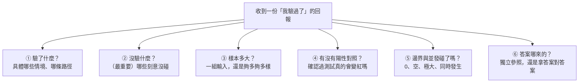
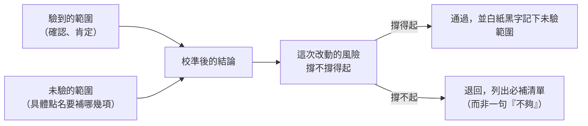

# [E-9-13] 怎麼審查一份驗收報告：別被漂亮的綠燈收買

> **目標**：學會把「驗收」本身當成要審查的對象——當有人回報「我驗過了，沒問題」時，你該追問哪幾件事（驗了什麼、**沒**驗什麼、樣本多大、有沒有陽性對照、邊界與並發、是不是拿答案對答案），以及怎麼不被一面綠燈牽著走。

## 一個問題：「我驗過了，沒問題」——你要照單全收嗎？

你是 reviewer（審查者）。有人交來一段改動，附一句：「**功能已驗證，測試全綠，沒問題。**」還附了一張 CI（持續整合）的截圖，滿滿的綠勾。

你該怎麼回？如果你看一眼綠勾就按「通過」，那你審查的其實不是「這段程式對不對」，而是「**他有沒有說自己驗過**」——這兩件事差很遠。

這一篇的核心主張是：

> **「驗收」本身，也是一個要被審查的對象。** 別把它當成「已經替你把關好的結論」直接吞下，要把它當成「一份**宣稱**」，用審查程式碼的同一種懷疑精神去審查它。

這不是不信任人，而是因為——前面幾篇講過——綠燈可能是假的（測試根本沒測，E-9-10）、綠燈可能不穩（flaky，E-9-11）、而「驗過了」這句話背後的證據可能很弱（E-9-12）。一個負責任的 reviewer，審的是**證據的強度，不是宣稱的語氣**。

## 生活類比：收到「已檢驗合格」的食品，你驗的是什麼？

一批食品送到，附一張「**已檢驗合格**」的證書。一個隨便的驗收員看到紅章就簽收。一個稱職的驗收員會翻到背面問：

- 檢驗了**哪些項目**？（農藥？重金屬？還是只量了重量？）
- **沒**檢驗哪些？（有沒有驗到這批最該擔心的那一項？）
- 抽了**幾個樣本**？（一萬箱裡抽一箱，還是抽了具代表性的量？）
- 檢驗方法**可靠嗎**？（儀器有沒有先用「已知含毒的對照樣本」校準過，確認它真驗得出來？）
- 證書是**獨立第三方**開的，還是**賣家自己**開給自己的？

同一張「合格」證書，背面這些答案決定了它值不值錢。稱職的驗收員**不否定證書，但也不被證書代替思考**——他把證書當成「一份需要被追問的宣稱」。

審查一份驗收報告，就是在翻這張證書的背面。

## 審查驗收報告的六個追問

把「食品證書的背面」翻譯成軟體驗收，有六個該問的問題。它們不是要刁難對方，而是幫**雙方**看清「這份綠燈到底撐得起多強的結論」（E-9-12 的精神）：



這張圖表達：一份驗收報告要被信任，得經得起這六個追問；其中第 ② 問（沒驗什麼）和第 ⑥ 問（答案哪來的）最常被漏掉，也最能照出報告的虛實。逐一說它們在問什麼、聽到什麼答案要警覺：

**① 驗了什麼（scope，驗收範圍）**：要的是**具體**，不是形容詞。「功能正常」是形容詞；「驗了『正常下單』『庫存不足時擋下』兩條路徑」才是範圍。答得越含糊，越可能是「跑了一下覺得 OK」。

**② 沒驗什麼（這題最重要）**：一份誠實的報告，一定講得出自己的邊界。**一個說「全都驗了、沒有死角」的人，通常是還沒想清楚死角在哪。** 這題也最能分辨對方是「真的驗過並知道自己驗到哪」，還是「憑感覺說沒問題」。答不出「沒驗什麼」，這份報告的可信度要先打折。

**③ 樣本多大（sample size）**：「驗過了」是一組輸入跑一次，還是涵蓋多種情況、夠多次？這直接對應 E-9-12 的證據強度——一組輸入只能撐「這組對」的窄結論。

**④ 有沒有陽性對照（E-9-10）**：測試全綠，但**確認過這些測試真的會在程式壞掉時變紅嗎**？如果對方從沒看過這些測試紅過，那「全綠」可能只是「測試根本沒在測」。這題常常問倒人——因為多數人只驗了「對的時候會綠」，沒驗「錯的時候會紅」。

**⑤ 邊界與並發碰了嗎（edge cases & concurrency）**：bug 最愛躲的地方——**0、空集合、極大值、負數、同時發生（並發）**。「正常情況都對」幾乎是必然的，真正的風險在這些角落。尤其「並發」（兩個請求同時進來）在「手動點一點」的驗收裡幾乎永遠不會被碰到。

**⑥ 答案哪來的（獨立參照 vs. 拿答案對答案）**：報告說「輸出都正確」——那個「正確」的標準答案，是**獨立**來源（手算、規格明文、另一版實作），還是**程式自己吐的、再拿它跟自己比**？後者（E-9-12 講過的自欺）只證明「穩定」，不證明「對」。

## 用 pseudo code 走一遍審查

審查不是「挑錯」，是「把報告的結論強度，校準到證據撐得起的位置」：

```
收到：「功能已驗證，測試全綠，沒問題。」

逐一追問六題：
    驗了什麼？          → 若答「就…功能啊」：範圍不清，要求列出具體情境
    沒驗什麼？          → 若答「應該都驗了」：警訊，一起找出沒碰到的角落
    樣本多大？          → 若只有一組輸入：結論最多只能是「這組對」
    有陽性對照嗎？      → 若沒有：請對方注入一個 bug，確認測試會紅
    邊界與並發？        → 若沒碰：點名 0／空／極大／同時發生，要求補
    答案哪來的？        → 若是拿自己對自己：這不算正確性證據，要求獨立參照

然後校準結論：
    把「沒問題」改寫成「在【驗到的範圍】內沒問題，【這些角落】尚未驗」
    決定：驗到的範圍，夠不夠這次改動的風險？
        夠 → 通過，但把「未驗範圍」明白記下來
        不夠 → 退回，指明要補哪幾項（而不是一句「驗得不夠」）
```

注意最後一步的心法：審查的產出**不是「通過／不通過」的二選一**，而是「**把結論校準到證據的強度，再決定這個強度夠不夠這次的風險**」。改一個文案和改一段金額計算，需要的證據強度天差地遠。

## 正式程式碼範例：同一份「全綠」，背後兩種世界

為了讓「追問」有具體對象，看兩份都宣稱「報價計算已驗證」的測試。它們都會全綠，但撐起的結論強度完全不同。

**報告 A 附上的測試**——這是最常見的「看起來有驗」：

```typescript
import { it, expect } from "vitest";
import { quote } from "./priceEngine";

it("報價功能正常", () => {
  const result = quote({ items: [{ price: 100, qty: 1 }], taxRate: 0.05 });
  expect(result).toBe(105);
});
```

用六題審它：**驗了什麼**＝一條正常路徑；**沒驗什麼**＝幾乎全部（多件商品、數量為 0、空訂單、極大金額、並發）；**樣本多大**＝一組；**陽性對照**＝不明（這條會不會紅過沒人知道）；**邊界/並發**＝完全沒碰；**答案哪來**＝手算的 105，這點還行。結論該校準成：「**單件、正常稅率下的報價正確**」——不是「報價功能已驗證」。

**報告 B 附上的測試**——同樣全綠，但經得起追問：

```typescript
import { it, expect } from "vitest";
import { quote } from "./priceEngine";
import { referenceQuote } from "./priceEngine.reference"; // 獨立的另一版實作

it("空訂單報價為 0", () => {
  expect(quote({ items: [], taxRate: 0.05 })).toBe(0); // 邊界：空集合
});

it("數量為 0 的品項不計入", () => {
  expect(quote({ items: [{ price: 100, qty: 0 }], taxRate: 0.05 })).toBe(0); // 邊界：0
});

it("極大金額不溢位、仍正確", () => {
  const result = quote({ items: [{ price: 1_000_000_000, qty: 9999 }], taxRate: 0.05 });
  expect(result).toBeGreaterThan(0); // 邊界：極大值
});

it("與獨立參考實作逐筆一致（多組隨機輸入）", () => {
  for (let round = 0; round < 10_000; round++) {
    const order = randomOrder();
    // 答案來自獨立實作，不是拿 quote 自己的輸出當期望值
    expect(quote(order)).toBe(referenceQuote(order));
  }
});
```

同樣全綠，但這份答得出六題：**沒驗什麼**＝並發（它誠實地沒宣稱）；**樣本**＝一萬組隨機 + 具名邊界；**答案**＝獨立的 `referenceQuote`。它撐得起的結論強得多：「單執行緒下、邊界與一萬組隨機輸入都與獨立實作一致；**並發尚未驗**」。

**關鍵體會**：兩份 CI 截圖都是一片綠。**光看「綠不綠」，你永遠分不出 A 和 B。** 分得出來的唯一方法，是翻到背面問那六題——這就是「別被漂亮的綠燈收買」的實際操作。

## 把審查結果寫成有用的回饋

審完要給回饋。差的回饋是一句「驗得不夠」（對方不知道要補什麼）；好的回饋是**具體、可執行、分清強弱**：



這張圖表達：一份好的審查回饋，要同時講清楚「驗到的」和「沒驗到的」，把結論校準後對著「這次改動的風險」衡量，最後給出**可執行**的決定——通過也要把未驗範圍記下來，退回則要列出具體必補項，而不是只丟一句主觀評語。

## 常見錯誤（反模式）

> **常見錯誤一：看到綠燈／CI 全過就等於「審查完畢」**
>
> 「測試都綠了，還審什麼？」——綠燈只回答了「在這些測試眼中是對的」，沒回答「這些測試夠不夠、它們真的會紅嗎、驗到哪裡」。把綠燈當終點，等於把判斷權完全交給「一組你沒檢查過其強度的測試」。
>
> **正確做法**：綠燈是審查的**起點**，不是終點。綠燈讓你可以開始問那六題——尤其「這些測試有沒有做過陽性對照（E-9-10）？覆蓋到哪些情境、漏了哪些？」一面你沒追問過的綠燈，資訊量其實很低。

> **常見錯誤二：被「我跑了一萬次」這種數字唬住，不問數字背後的方法**
>
> 報告寫「跑了一萬組隨機輸入都通過」，聽起來很扎實，很多 reviewer 就放行了。但數字大不代表證據強——如果那一萬次是**拿程式自己的輸出當標準答案**（E-9-12 的「拿答案對答案」），它只證明「很穩定」，不證明「對」；如果隨機輸入根本沒覆蓋到關鍵邊界，再多次也白搭。
>
> **正確做法**：聽到大數字，先問第 ⑥ 題——「**那個『正確』的標準答案是哪來的？**」獨立來源（手算、規格、另一版實作）才算；拿自己對自己不算。再問覆蓋——「這些隨機輸入有涵蓋 0、空、極大、並發嗎？」數字要配上「方法」才有份量。

> **常見錯誤三：只盯著「做了什麼」，不追問「沒做什麼」**
>
> reviewer 很容易順著報告列的「我驗了 A、B、C」一項項點頭，卻忘了問那句最重要的——「**那 D、E、F 呢？**」。報告天生只會寫「做過的」，**沒做的那部分不會自己跳出來**，而 bug 偏偏最愛躲在沒做的那部分。
>
> **正確做法**：把第 ② 題（沒驗什麼）當成**每次必問**。主動拿邊界清單去對照——「並發有嗎？空輸入有嗎？極大值有嗎？失敗/逾時的分支有嗎？」一份連「我沒驗 X、Y」都講得清清楚楚的報告，比一份「全都驗了、沒問題」的報告可信得多——因為前者證明對方**真的想過邊界在哪**。

## 小結

- **把「驗收」本身當成要審查的對象**。「我驗過了，沒問題」是一份**宣稱**，不是已經替你把關好的結論；用審程式碼的懷疑精神去審它。
- 收到驗收報告，追問六題：① 驗了什麼、② **沒**驗什麼（最重要）、③ 樣本多大、④ 有沒有陽性對照（E-9-10）、⑤ 邊界與並發（0／空／極大／同時發生）碰了沒、⑥ 答案是獨立參照還是拿答案對答案（E-9-12）。
- **光看綠不綠，分不出好驗收和爛驗收**——兩份 CI 都是一片綠，差別全在背面那六題。審查的動作，就是翻到背面去問。
- 審查的產出不是「過/不過」二選一，而是**把結論校準到證據撐得起的強度，再衡量這次改動的風險夠不夠**；回饋要具體可執行——通過也白紙黑字記下未驗範圍，退回則列出必補清單。
- 三個雷：別把綠燈當審查完畢；別被大數字唬住而不問方法；別只點頭「做了什麼」而漏問「沒做什麼」。

> 確認測試「真的會抓到錯」的陽性對照 → [E-9-10：陽性對照](./E-9-10-positive-control.md)
> 弱證據別當強結論、測過的範圍 vs. 宣稱的範圍 → [E-9-12：證據等級](./E-9-12-evidence-levels.md)
> 小心那些時紅時綠、會侵蝕信任的綠燈 → [E-9-11：偶發失敗（Flaky Test）](./E-9-11-flaky-tests.md)
